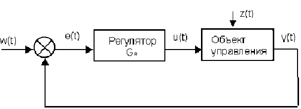
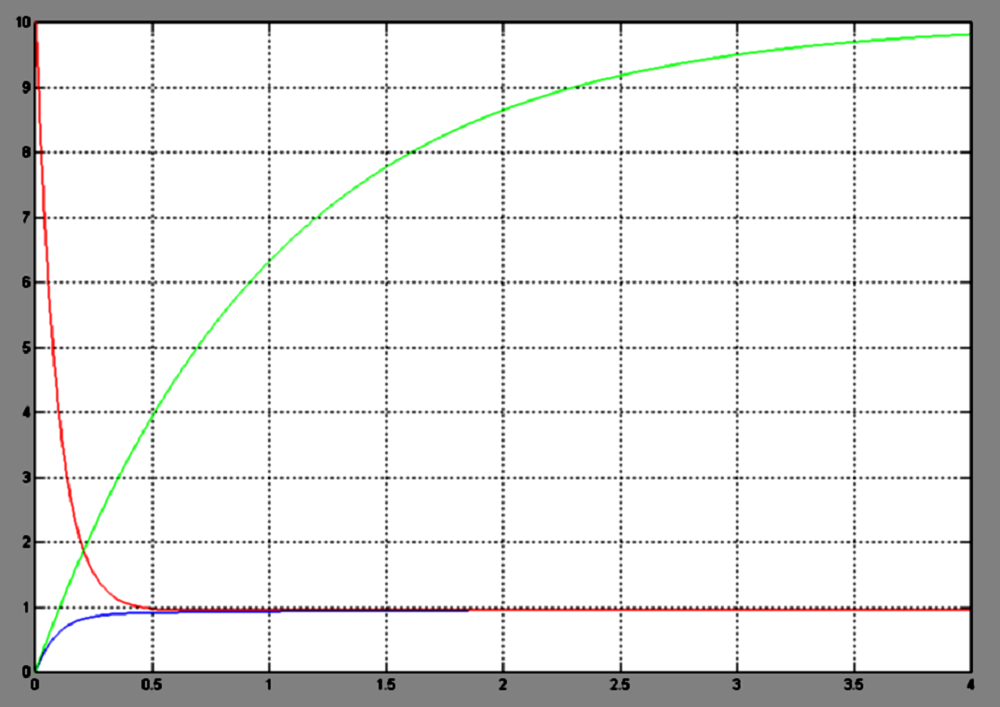

# Общее задание #
Реализовать систему автоматического управления на основе ПИД-регулятора для объектов, разработанных в лабораторной работе №1, обеспечив документирование кода, гибкие режимы симуляции и визуализацию.

1. Написать отчет по выполненной лабораторной работе №3 в .md формате (*readme.md*) и разместить его в следующем каталоге: **trunk\as0xxyy\task_03\doc**.
2. Исходный код написанной программы разместить в каталоге: **trunk\as0xxyy\task_03\src**.
3. Отразить выполнение работы в общем файле `readme.md` в соответствующей строке.
4. Документировать исходный код программы с помощью комментариев в стиле **Doxygen**. Полученную документацию разместить в каталоге: **trunk\as0xxyy\task_03\doc\html**. Настроить `GitHub Pages` для автоматической публикации документации из этого каталога.
5. Разработанная программа должна быть покрыта модульными тестами с использованием **Google Test**. Тесты разместить в каталоге: **trunk\as0xxyy\task_03\test**.
6. Выходные данные симуляции должны быть представлены в строгом табличном виде (в консоли или экспортированы в `.csv` / `.txt` файл).
7. В программе должна быть предусмотрена **графическая визуализация** полученных результатов переходных процессов (инструменты для визуализации выбрать самостоятельно: gnuplot, Python/Matplotlib, MATLAB, Excel или встроенные C++ графические библиотеки). Графики обязательно должны быть добавлены в отчет.
8. **[Локальная автоматизация]:** Расширить или создать командный файл Windows (**`run_all.bat`**), который выполняет полную сборку проекта, запускает тесты с отображением шагов в консоли, а также автоматически генерирует Doxygen-документацию локально.
9. В качестве объекта управления (Plant) использовать математические модели, доставшиеся студенту по **варианту из ЛР №1** (линейная модель, нелинейная модель, дифференциальное уравнение). В программе должна быть реализована возможность переключения объекта управления.
10. **[Режимы работы симуляции]:** В программе необходимо реализовать два режима проведения симуляции на выбор пользователя:
    * **Режим А:** Моделирование в течение фиксированного количества временных шагов $n$.
    * **Режим Б:** Моделирование до тех пор, пока абсолютная ошибка регулирования $|e_{\tau}|$ не уменьшится до заданных пользователем пределов $\epsilon$ (достижение установившегося режима).
11. **[Инженерный анализ]:** В отчете (*readme.md*) необходимо привести графики переходных процессов для разных заданных значений температуры, а также **пошагово описать процесс настройки коэффициентов регулятора** ($K_p, K_i, K_d$) выбранным методом (например, метод Зиглера-Никольса или метод последовательного подбора).

---

## Task 3. PID Controllers & Automated Documentation

The goal of this task is to implement a discrete PID (Proportional-Integral-Derivative) controller to regulate the temperature of the controlled objects simulated in Task 1, accompanied by multi-mode simulation control, visual plots, Doxygen code documentation, and automated local workflows.

---

<details>
  <summary> <b>Теоретическое описание и формулы ПИД-регулятора (PID Controller Theory)</b></summary>

<br>

### Структурная схема и законы регулирования САУ

Структурная схема системы автоматического управления (САУ) с обратной связью показана на рис. 1.



Здесь:
* $w(t)$ — алгоритм функционирования системы (задающее воздействие);
* $u(t)$ — управляющее воздействие;
* $z(t)$ — внешние возмущающие воздействия, влияние которых нужно свести к минимуму;
* $y(t)$ — выходная (регулируемая) переменная;
* $e(t) = w(t) - y(t)$ — ошибка регулирования (отклонение выходной переменной от желаемого значения).

Выходной переменной может быть температура в печи, скорость вращения вала двигателя, уровень жидкости в баке, рассовмещение знаков привязки фотошаблонов и т. п. Целью управления является изменение выходной переменной по заданному закону $w(t)$. Для этого нужно свести к минимуму ошибку управления $e(t)$.

Эта задача решается автоматическим регулятором $G_R$, который описывается некоторым законом регулирования:

$$u(t) = G_R[e(t)]$$

Для правильного выбора закона регулирования нужно знать математическую модель объекта управления:

$$y(t) = G_O[u(t)]$$

Математическая модель обычно представляет собой систему обыкновенных нелинейных дифференциальных уравнений или дифференциальных уравнений в частных производных. Нахождение вида и коэффициентов этих уравнений представляет собой задачу идентификации объекта управления. 

Для традиционно используемых объектов управления математические модели часто известны, и тогда задача идентификации конкретного объекта сводится к отысканию значений коэффициентов уравнений. Во многих случаях эти коэффициенты можно подобрать опытным путем в процессе настройки системы.

Выбор закона регулирования $u(t) = G_R[e(t)]$ является основным звеном в процессе проектирования системы автоматического регулирования. Синтез оптимального регулятора, дающего максимальные показатели качества регулирования, представляет собой достаточно сложную задачу. Кроме того, реализация оптимального регулятора может оказаться экономически неоправданной. Однако во многих случаях для автоматизации производственных процессов могут быть использованы простейшие и наиболее распространенные типы линейных регуляторов — П-, ПИ- и ПИД-регуляторы.

#### ПИД-регулятор
Идеализированное уравнение ПИД-регулятора имеет вид:

$$u(t) = K \left[ e(t) + \frac{1}{T} \int_{0}^{t} e(\tau) d\tau + T_D \frac{de(t)}{dt} \right]$$

где:
* $K$ — коэффициент передачи;
* $T$ — постоянная интегрирования;
* $T_D$ — постоянная дифференцирования.

Эти три параметра подбирают в процессе настройки регулятора таким образом, чтобы максимально приблизить алгоритм функционирования системы к желаемому виду.

#### П-регулятор и ПИ-регулятор
В зависимости от типа объекта управления может быть достаточным применение более простого П-регулятора:

$$u(t) = K e(t)$$

или ПИ-регулятора:

$$u(t) = K \left[ e(t) + \frac{1}{T} \int_{0}^{t} e(\tau) d\tau \right]$$

которые являются частными случаями ПИД-регулятора при соответствующем выборе постоянных интегрирования и дифференцирования ($T \to \infty$ или $T_D = 0$).

---

### Графики переходных процессов

Графики переходных процессов регулируемой величины представлены на рис. 2–4. 
* **Зеленый цвет** — реакция самого объекта регулирования на скачок (без регулятора);
* **Синий цвет** — выходная переменная в процессе регулирования ($y(t)$);
* **Красный цвет** — изменение управляющего воздействия во времени ($u(t)$).


*Рисунок 2 — Переходный процесс П-регулятора при $K = 10$*


*Рисунок 3 — Переходный процесс ПИ-регулятора при $K = 10, T = 0.1$*


*Рисунок 4 — Переходный процесс ПИД-регулятора при $K = 10, T = 0.1, T_D = 50$*

### Дискретная реализация ПИД-регулятора

Описанная выше система автоматического регулирования является непрерывной, то есть использует непрерывное время. При построении регулятора на базе микропроцессорного устройства или компьютера входные и выходные переменные регулятора необходимо квантовать по времени с некоторым шагом $T_0$ и преобразовывать в цифровую форму с помощью аналого-цифровых (АЦП) и цифро-аналоговых (ЦАП) преобразователей.

При этом уравнение ПИД-регулятора должно быть преобразовано в разностное с помощью замены производных конечными разностями, а интеграла — конечной суммой. В зависимости от выбранного метода перехода от непрерывных операторов к их дискретным аналогам возникает несколько различных уравнений, описывающих дискретные ПИД-регуляторы. 

При использовании **метода прямоугольников** для замены интеграла суммой получим дискретное уравнение ПИД-регулятора:

$$u(k) = K \left[ e(k) + \frac{T_0}{T} \sum_{i=1}^{k} e(i-1) + \frac{T_D}{T_0} \big(e(k) - e(k-1)\big) \right]$$

где:
* $k = 0, 1, \dots, \frac{t}{T_0}$ — порядковый номер отсчета дискретного времени.

Недостатком такого представления уравнения регулятора является необходимость хранить в памяти значения отклонений $e(k)$ для всех моментов времени от самого начала процесса регулирования.

#### Рекуррентный (инкрементный) алгоритм

Этот недостаток можно устранить, если для вычисления текущего значения управляющей переменной $u(k)$ использовать ее предыдущее значение $u(k-1)$ и поправочный член (инкремент). Для получения такого рекуррентного алгоритма запишем уравнение для предыдущего шага:

$$u(k-1) = K \left[ e(k-1) + \frac{T_0}{T} \sum_{i=1}^{k-1} e(i-1) + \frac{T_D}{T_0} \big(e(k-1) - e(k-2)\big) \right]$$

Вычитая уравнение для $u(k-1)$ из уравнения для $u(k)$, мы полностью избавляемся от знака суммы. В результате получаем инкрементную форму ПИД-регулятора:

$$u(k) - u(k-1) = q_0 e(k) + q_1 e(k-1) + q_2 e(k-2)$$

Где параметры дискретного регулятора $q_0, q_1, q_2$ рассчитываются через непрерывные коэффициенты следующим образом:

$$q_0 = K \left( 1 + \frac{T_D}{T_0} \right)$$

$$q_1 = -K \left( 1 + 2\frac{T_D}{T_0} - \frac{T_0}{T} \right)$$

$$q_2 = K \frac{T_D}{T_0}$$

Таким образом, для вычисления текущего значения управляющего воздействия $u(k)$ на объект управления достаточно хранить в памяти только величины $u(k-1)$, $e(k)$, $e(k-1)$ и $e(k-2)$. 

Итак, пошаговый алгоритм работы инкрементного ПИД-регулятора может быть представлен в следующем виде:

1. Вычисление приращения управляющего воздействия:
$$\Delta u(k) = q_0 e(k) + q_1 e(k-1) + q_2 e(k-2)$$

2. Расчет полного управляющего сигнала:
$$u(k) = u(k-1) + \Delta u(k)$$

Где постоянные коэффициенты дискретного регулятора рассчитываются один раз перед запуском цикла управления:

$$q_0 = K \left( 1 + \frac{T_D}{T_0} \right)$$

$$q_1 = -K \left( 1 + 2\frac{T_D}{T_0} - \frac{T_0}{T} \right)$$

$$q_2 = K \frac{T_D}{T_0}$$

#### Анализ погрешности дискретизации

При переходе от непрерывных операторов к дискретным возникает погрешность, величина которой пропорциональна остаточному члену ряда Тейлора функции $e(t)$. Поэтому полученные дискретные уравнения можно считать строго эквивалентными непрерывным только при условии, что ошибка $e(t)$ изменяется достаточно слабо в пределах одного такта квантования $T_0$.

Однако с помощью аппарата $z$-преобразования можно показать, что основные динамические свойства ПИД-регулятора полностью сохраняются и при относительно больших шагах квантования. Для этого параметры дискретного регулятора $q_0, q_1, q_2$ выбирают не на основании формул связи с непрерывным аналогом, а настраивают независимо от них — методами параметрической оптимизации, выбрав необходимый критерий качества исходя из конкретной цели регулирования. Такт квантования $T_0$ при этом выбирается аналогично.

</details>

---

<details>
  <summary> <b>Математическое описание и формулы ПИД-регулятора (PID Controller Theory)</b></summary>

<br>

Непрерывный закон управления ПИД-регулятора имеет вид:
$$\Large u(t) = K_p e(t) + K_i \int_{0}^{t} e(\tau) d\tau + K_d \frac{de(t)}{dt}$$

Где $e(t) = g(t) - y(t)$ — ошибка регулирования (разность между заданным значением температуры $g(t)$ и текущим значением объекта $y(t)$).

Для реализации в программе используется **дискретная форма (алгоритм скорости или позиционный алгоритм)** с шагом квантования $\Delta t$:
$$\Large u_{\tau} = u_{\tau-1} + \Delta u_{\tau}$$
$$\Large \Delta u_{\tau} = K_p (e_{\tau} - e_{\tau-1}) + K_i e_{\tau} \Delta t + \frac{K_d}{\Delta t} (e_{\tau} - 2e_{\tau-1} + e_{\tau-2})$$

Студенты должны предусмотреть ограничение на интегральную сумму (Anti-windup) или ограничение управляющего сигнала $u_{\tau}$ под физические лимиты исполнительного устройства (актуатора).

</details>

---

<details>
  <summary> <b>Пример структуры скрипта run_all.bat</b></summary>

<br>

Скрипт должен отображать логирование каждого этапа сборки, тестирования и документирования:

```batch
@echo off
echo =======================================
echo  [STEP 1/3] Compiling and Testing...
echo =======================================
if not exist build mkdir build
cd build
cmake .. -G "MinGW Makefiles"
cmake --build .
if %ERRORLEVEL% NEQ 0 (
    echo [ERROR] Build failed!
    exit /b %ERRORLEVEL%
)
ctest --output-on-failure
cd ..

echo =======================================
echo  [STEP 2/3] Generating Doxygen Docs...
echo =======================================
doxygen Doxyfile
if %ERRORLEVEL% NEQ 0 (
    echo [ERROR] Doxygen generation failed!
    exit /b %ERRORLEVEL%
)

echo =======================================
echo  [STEP 3/3] Execution Finished Successfully!
echo =======================================
pause
```

</details>
