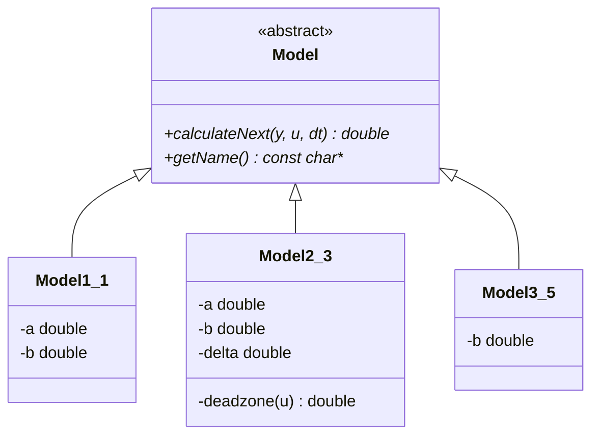

<p align="center">Министерство образования Республики Беларусь</p>
<p align="center">Учреждение образования</p>
<p align="center">“Брестский Государственный технический университет”</p>
<p align="center">Кафедра ИИТ</p>
<br><br><br><br><br><br><br>
<p align="center">Лабораторная работа №1</p>
<p align="center">По дисциплине “Теория и методы автоматического управления”</p>
<br><br><br><br><br>
<p align="right">Выполнил:</p>
<p align="right">Студент 3 курса</p>
<p align="right">Группы АС-67</p>
<p align="right">Ковалевич М. М.</p>
<p align="right">Проверил:</p>
<p align="right">Дворанинович Д. А.</p>
<br><br><br><br><br>
<p align="center">Брест 2026</p>


## Вариант 1

- Линейная модель: **Model 1.1**
- Нелинейная модель: **Model 2.3**
- Дифференциальное уравнение: **Model 3.5**

## Реализованные модели

### Model 1.1

`y(t+1) = a*y(t) + b*u(t)`

### Model 2.3

`y(t+1) = a*y(t) + b*deadzone(u(t))`

где `deadzone(u)` — зона нечувствительности:

- `u - δ`, если `u > δ`;
- `0`, если `-δ <= u <= δ`;
- `u + δ`, если `u < -δ`.

### Model 3.5

`dy/dt = b*sin(u)`

Для Model 3.5 используется метод Эйлера:

`y(t+1) = y(t) + dt*b*sin(u(t))`

## Входные воздействия

1. Ступенчатое: `u(t) = A`
2. Импульсное: `u(0) = A`, `u(t > 0) = 0`
3. Гармоническое: `u(t) = A*sin(t)`

## ООП

Создан абстрактный базовый класс `Model` с чисто виртуальным методом `calculateNext(y, u, dt)`, который по текущему значению `y(t)`, входу `u(t)` и шагу `dt` вычисляет `y(t+1)`.

От него наследуются:

- `Model1_1`
- `Model2_3`
- `Model3_5`

## Результат

Программа:

- позволяет выбрать модель;
- принимает коэффициенты;
- позволяет выбрать входное воздействие;
- позволяет задать количество шагов `n`;
- выводит результаты в табличном виде;
- сохраняет результаты в `results.csv`;
- позволяет построить график через Python/Matplotlib.

## Пример работы программы:

### Сборка

На Windows build.bat:

```bat
@echo off
setlocal
cd /d "%~dp0"

if not exist CMakeLists.txt (
    echo ERROR: CMakeLists.txt not found
    pause
    exit /b 1
)

echo ===== STARTING BUILD PROCESS =====
echo [STAGE 1/3] Configuration
cmake -S . -B build -G "MinGW Makefiles" ^
      -DCMAKE_BUILD_TYPE=Release ^
      -DCMAKE_C_COMPILER=gcc ^
      -DCMAKE_CXX_COMPILER=g++ ^
      -DCMAKE_MAKE_PROGRAM=mingw32-make
if errorlevel 1 goto error

echo [STAGE 2/3] Compilation
cmake --build build
if errorlevel 1 goto error

echo [STAGE 3/3] Launch
if exist build\src\tmau_task_01.exe (
    cd build\src
) else (
    cd build
)
tmau_task_01.exe
echo ===== DONE =====
pause
goto end

:error
echo ERROR: Build failed
pause
exit /b 1

:end
endlocal
```

### Демонстрация исполняемого файла tmau_task_01.exe:


При запуске исполняемого файла мы получаем результат файл .csv, после чего автоматически запускается plot.py для визуализации ответа.

Пример для Model 1.1 (`a = 0.8`, `b = 0.5`, `A = 1`, `n = 30`, `y0 = 0`):

## Демонстрация ступенчатого воздействия

## Демонстрация импульсного воздействия

## Демонстрация гармонического воздействия


## UML

