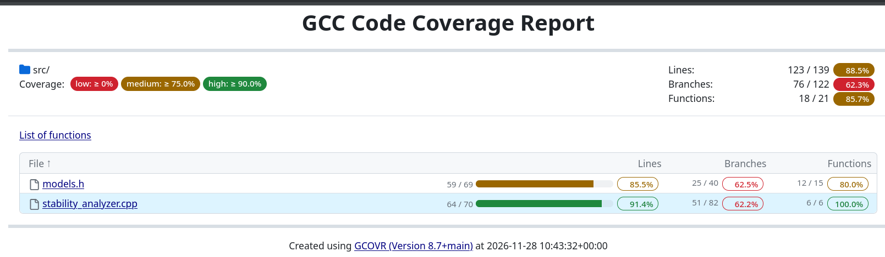

<p align="center">Министерство образования Республики Беларусь</p>
<p align="center">Учреждение образования</p>
<p align="center">“Брестский Государственный технический университет”</p>
<p align="center">Кафедра ИИТ</p>
<br><br><br><br><br><br><br>
<p align="center">Практическая работа №2</p>
<p align="center">По дисциплине “Теория и методы автоматического управления”</p>
<br><br><br><br><br>
<p align="right">Выполнил:</p>
<p align="right">Студент 3 курса</p>
<p align="right">Группы АС-67</p>
<p align="right">Анбросенко Д. А.</p>
<p align="right">Проверил:</p>
<p align="right">Дворанинович Д. А.</p>
<br><br><br><br><br>
<p align="center">Брест 2026</p>


# TMAU — Практическая работа №2 (Вариант 5)

* **Среда разработки:** C++17
* **Фреймворк тестирования:** Google Test (GTest) / Google Mock (GMock)
* **Инструмент покрытия:** gcovr (на базе gcov)

## 1. Постановка задачи
Основная цель текущей работы — обеспечить надежность программного комплекса, разработанного в ЛР1, путем внедрения модульного тестирования, а также дополнить систему модулем предиктивного анализа устойчивости для линейных дискретных моделей. Все процессы сборки и проверки автоматизированы с использованием CMake и скриптов автоматизации.

## 2. Описание объектов исследования

### Model 1.5 (System with State Delay)

```math
y_{\tau+1} = a_1\,y_\tau + a_2\,y_{\tau-k} + b\,u_\tau
```

где `a₁, a₂, b` — константы, `k ≥ 1` — шаг запаздывания по состоянию.
При `τ < k` значение `y_{τ-k}` принимается равным нулю (нулевые начальные условия).

### Model 2.7 (Relay with Hysteresis Element)

```math
y_{\tau+1} = a\,y_\tau + b\cdot\mathrm{relay}(u_\tau, y_\tau)
```

```math
\mathrm{relay}(u, y) =
\begin{cases}
+1, & u > \varepsilon \;\text{или}\; (u \ge -\varepsilon \;\text{и}\; y > 0) \\
-1, & u < -\varepsilon \;\text{или}\; (u \le \varepsilon \;\text{и}\; y \le 0)
\end{cases}
```

`ε` — полуширина зоны нечувствительности реле. Ветвь `y_τ` в условии реализует гистерезис: реле «залипает» в предыдущем положении, пока вход не выйдет из мёртвой зоны.

### Model 3.9 (Bounded Saturation Rate)

```math
\frac{dy}{dt} = b\,\tanh(u)
```

Дискретизация методом Эйлера с шагом `Δt`:

```math
y_{\tau+1} = y_\tau + \Delta t \cdot b \cdot \tanh(u_\tau)
```

Для симуляции доступны три вида входных воздействий: ступенчатое (`step`), импульсное (`impulse`) и гармоническое (`harmonic`). Результаты расчетов сохраняются в формат CSV и визуализируются через Python-скрипт.

## 3. Модуль анализа устойчивости
Для определения сходимости линейных моделей был разработан отдельный класс `StabilityAnalyzer`. Анализ базируется на поиске корней характеристического уравнения на Z-плоскости (с использованием метода Дюрана-Кернера). Условием асимптотической устойчивости системы является нахождение всех корней строго внутри единичной окружности: \(|z| < 1\).

* **Model 1.5:** Характеристическое уравнение \(z^{k+1} - a_1 z^k - a_2 = 0\) (при \(k=0\) вырождается в \(z - (a_1+a_2) = 0\)). Если корни выходят за пределы единичной окружности, процесс расходится.
* **Model 2.7:** Уравнение \(z - a = 0\), корень \(z = a\). Система устойчива при \(|a| < 1\).
* **Model 3.9:** Уравнение \(z - 1 = 0\), корень \(z = 1\). Модель находится на границе устойчивости (маргинально устойчива).

Если пользователь при запуске программы задает коэффициенты, приводящие к \(|z| \ge 1\), программа выводит в `stderr` предупреждение `[STABILITY WARNING]` до старта основного цикла симуляции.

## 4. Архитектура проекта
Исходный код организован следующим образом:

```text
task_02/
├── CMakeLists.txt          # Корневая конфигурация сборки
├── run_tests.sh            # Скрипт автоматизации для Linux/Arch
├── run_tests.bat           # Скрипт автоматизации для Windows (MinGW)
├── readme.md               # Отчет
├── src/
│   ├── main.cpp            # Точка входа, интерфейс пользователя
│   ├── models.h            # Классы математических моделей и генераторы сигналов
│   ├── stability_analyzer.h
│   └── stability_analyzer.cpp
├── test/
│   ├── test_models.cpp     # Тесты математических моделей (включая TEST_P и GMock)
│   ├── test_stability.cpp  # Тесты анализатора устойчивости
│   └── test_inputs.cpp     # Тесты генераторов входных сигналов
```

## 5. Инструкция по сборке и запуску

Для сборки проекта и запуска тестов достаточно наличия CMake (версии 3.14 и выше), компилятора GCC/Clang и утилиты `gcovr`.

**На Linux (Arch):**
1. Установите зависимости: `sudo pacman -S base-devel cmake gcovr`
2. Выполните в терминале:
```bash
./run_tests.sh
```


Скрипты автоматизации самостоятельно скачат библиотеку Google Test (через `FetchContent` в CMake), скомпилируют проект, запустят тесты через CTest и сформируют итоговые отчеты: текстовый лог тестов и HTML-отчет о покрытии кода (`coverage.html`).

## 6. Реализованные тестовые сценарии

Тестирование охватывает не только базовые вычисления, но и проверяет граничные условия, а также архитектурную надежность программы:

* **Проверка вычислений:** Для всех трех математических моделей написаны тесты, сравнивающие выдаваемые программой значения с эталонными (рассчитанными вручную).
* **Параметризованные тесты (`TEST_P`):** Для линейной модели 1.5 использован механизм параметризованных тестов. Это позволяет проверить работу алгоритма при различных комбинациях коэффициентов и входных сигналов без дублирования кода.
* **Граничные значения (Boundary Values):** Для нелинейной модели 2.7 проверена работа зоны нечувствительности при \(u = \pm\varepsilon\). Для модели 3.9 проверена функция насыщения `tanh()` при экстремальных значениях входа.
* **Mock-объекты:** С использованием `Google Mock` создан класс `MockInputSource`. Это позволило изолированно протестировать логику подачи импульсного сигнала без привязки к реальному генератору.
* **Анализ устойчивости:** Написаны тесты, проверяющие границы Z-плоскости, устойчивые/неустойчивые коэффициенты, а также генерацию текста предупреждений.

## 7. Результаты выполнения

Запуск тестов подтверждает 100% успешное прохождение всех сценариев (30/30). Отчет о покрытии (сгенерированный `gcovr`) показывает высокое покрытие строк (Line Coverage) для файлов с логикой.



| Файл | Line Coverage | Branch Coverage | Function Coverage | Статус |
| :--- | :--- | :--- | :--- | :--- |
| `models.h` | 85.5 % | 62.5 % | 80.0 % | PASSED |
| `StabilityAnalyzer.cpp` | 91.4 % | 62.2 % | 100.0 % | PASSED |
| **Итоговый результат** | **88.5 %** | **62.3 %** | **85.7 %** | **Success** |

*(Файл `main.cpp` исключен из анализа покрытия с помощью флага `--exclude` в gcovr, так как он реализует интерактивный ввод/вывод и парсинг аргументов CLI, который не подлежит юнит-тестированию. Файл `models.h` включен, так как содержит реализации методов, а не только объявления).*

## Вывод

В рамках лабораторной работы исходный проект был успешно расширен. Внедрение подхода Unit Testing с использованием фреймворка Google Test позволило автоматизировать проверку корректности расчетов, а также протестировать работу новых алгоритмов анализа устойчивости. Использование CMake и скриптов автоматизации минимизирует человеческий фактор при проверке работоспособности программы и обеспечивает высокую культуру разработки.
