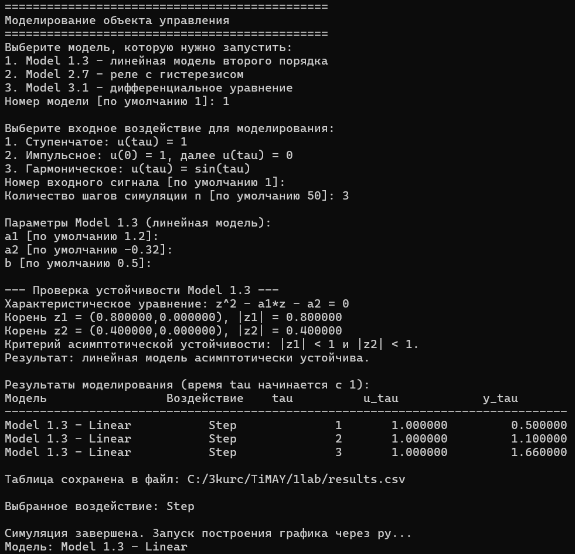
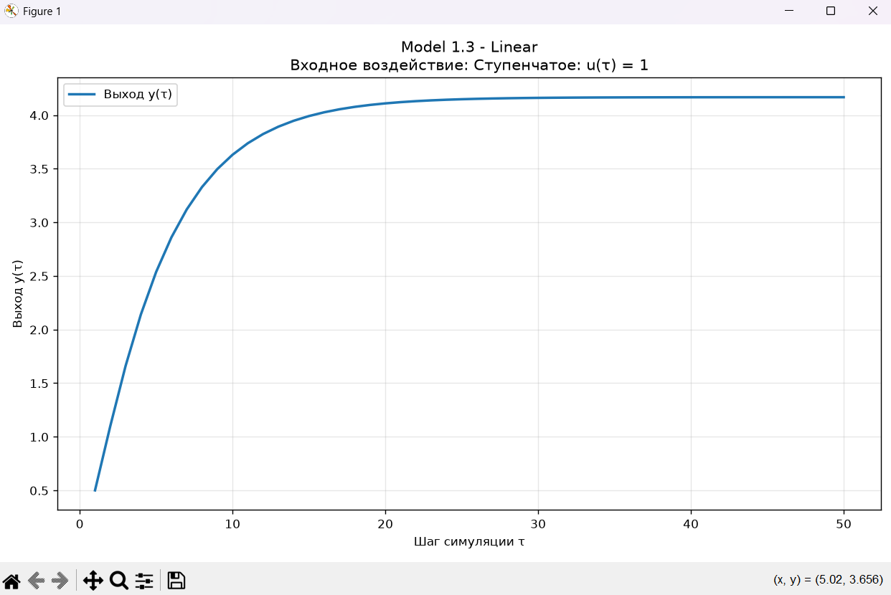
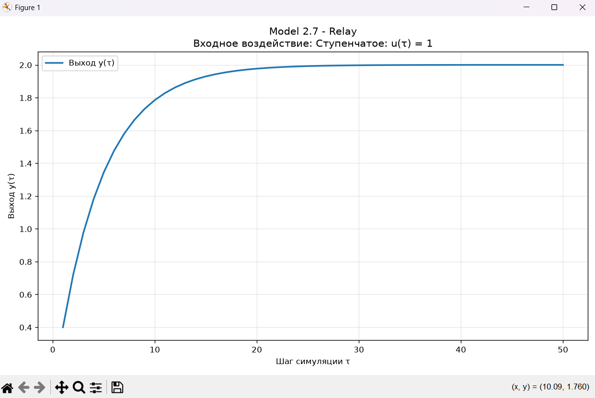
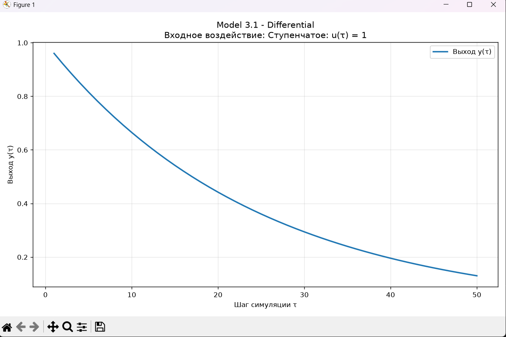
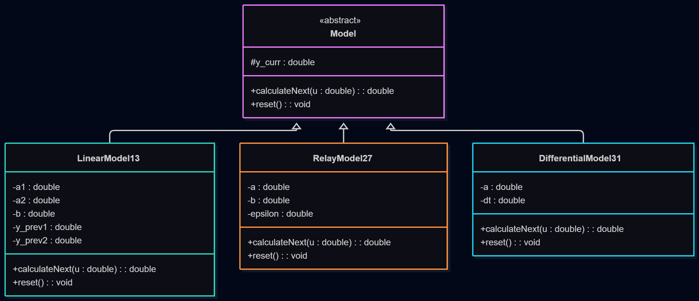

Министерство образования Республики Беларусь

Учреждение образования

“Брестский Государственный технический университет”

Кафедра ИИТ

       

Лабораторная работа №1

По дисциплине: "Теория и методы автоматического управления"

 

     

Выполнил:

Студент 3-го курса

Группы АС-67

Голуб В. М.

Проверил

Дворанович Д.А.

     

Брест 2026

   

## Вариант задания 13

* **Линейная модель: "Model 1.3 (Linear Autoregressive Model)"**
  * $y_{\tau+1} = a_1 y_{\tau} + a_2 y_{\tau-1} + b u_{\tau}$

* **Нелинейная модель: "Model 2.7 (Relay with Hysteresis)"**
  * $y_{\tau+1} = a y_{\tau} + b \cdot \mathrm{relay}(u_{\tau})$
  * Функция реле:

$$
\mathrm{relay}(u) = 
\begin{cases} 
+1, & u > \varepsilon \\ 
-1, & u < -\varepsilon \\ 
\operatorname{sign}(y_{\tau}), & |u| \le \varepsilon 
\end{cases}
$$

* **Дифференциальное уравнение: Model 3.1 "(Exponential Decay)"**
  * $\frac{dy}{dt} = -ay$
  * Для этой модели используется метод Эйлера: $y_{\tau+1} = y_{\tau} + dt \cdot (-a y_{\tau})$

Была создана программа, реализующая интерфейс класс "*Model*" с помощью классов-наследников:
* *LinearModel13*
* *RelayModel27*
* *DifferentialModel31*

## Функционал программы:
- Выбор типа генерируемого сигнала
- Выбор типа модели
- Ввод коэффициентов для каждой модели
- Выбор количества шагов симуляции
- Проверка устойчивости линейной модели по корням характеристического уравнения $z^2 - a_1 z - a_2 = 0$
- Вывод результатов в табличном виде
- Сохранение данных в файл с расширением .csv
- Вывод графика функции

## Пример работы программы
Вывод работы программы в консоли:

График линейной модели со ступенчатым сигналом:

График нелинейной модели с гармоническим сигналом:

График дифференциальной модели с импульсным сигналом:

## UML

