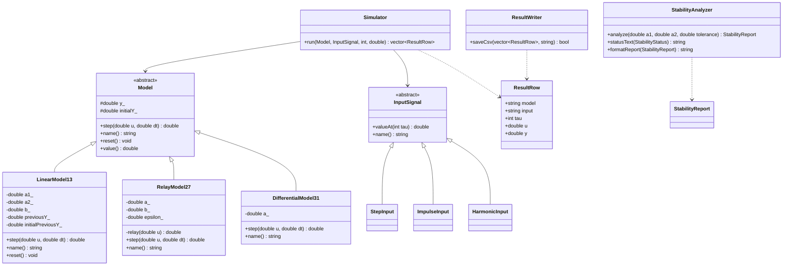

<p align="center">Министерство образования Республики Беларусь</p>
<p align="center">Учреждение образования</p>
<p align="center">«Брестский государственный технический университет»</p>
<p align="center">Кафедра ИИТ</p>

<br><br><br><br><br><br>

<p align="center">Лабораторная работа № 2</p>
<p align="center">По дисциплине «Теория и методы автоматического управления»</p>
<p align="center">Тема: «Модульное тестирование и анализ устойчивости»</p>

<br><br><br><br>

<p align="right">Выполнил:</p>
<p align="right">Студент 3-го курса</p>
<p align="right">Группы АС-67</p>
<p align="right">Голуб В. М.</p>
<p align="right">Проверил:</p>
<p align="right">Дворанинович Д. А.</p>

<br><br><br><br>

<p align="center">Брест 2026</p>

---

# 1. Цель работы

Цель лабораторной работы — расширить математический и функциональный базис программы, разработанной в лабораторной работе № 1, реализовать модуль анализа устойчивости линейной дискретной системы и проверить основные функции программы с помощью модульных тестов. Для тестирования используются фреймворки **Google Test** и **Google Mock**. Дополнительно необходимо автоматизировать сборку проекта, запуск тестов и формирование отчёта о покрытии кода.

# 2. Вариант задания

Вариант **13**. Согласно таблице вариантов используются следующие математические модели:

| Блок | Модель | Уравнение |
| :--- | :--- | :--- |
| Линейная модель | **Model 1.3** | $y_{\tau+1}=a_1y_\tau+a_2y_{\tau-1}+bu_\tau$ |
| Нелинейная модель | **Model 2.7** | $y_{\tau+1}=ay_\tau+b\cdot relay(u_\tau,y_\tau)$ |
| Дифференциальное уравнение | **Model 3.1** | $\dfrac{dy}{dt}=-ay$ |

Для модели 3.1 используется метод Эйлера с шагом интегрирования $\Delta t$:

$$
y_{\tau+1}=y_\tau+\Delta t(-ay_\tau)=(1-a\Delta t)y_\tau.
$$

В программе предусмотрены три типа входных воздействий:

- ступенчатое: $u_\tau=1$;
- импульсное: $u_0=1$, $u_{\tau>0}=0$;
- гармоническое: $u_\tau=\sin(\tau)$.

В уравнении Model 3.1 входное воздействие $u_\tau$ отсутствует, поэтому выход этой модели не зависит от выбранного типа входного сигнала. Входные сигналы используются для проверки моделей, в уравнения которых они входят.

Релейная функция модели 2.7 имеет гистерезис. При входном сигнале выше положительного порога реле принимает значение $+1$, при входном сигнале ниже отрицательного порога — $-1$. Внутри зоны гистерезиса значение реле определяется текущим состоянием выходной переменной:

$$
relay(u_\tau,y_\tau)=
\begin{cases}
+1, & u_\tau>\varepsilon,\\
-1, & u_\tau<-\varepsilon,\\
+1, & -\varepsilon\leq u_\tau\leq\varepsilon,\quad y_\tau>0,\\
-1, & -\varepsilon\leq u_\tau\leq\varepsilon,\quad y_\tau\leq 0.
\end{cases}
$$

# 3. Расширение математического и функционального базиса

По сравнению с лабораторной работой № 1 программа была дополнена следующими возможностями.

1. **Общий базовый класс `Model`.** Для математических моделей создан абстрактный базовый класс с виртуальным методом расчёта следующего шага `step(double u, double dt)`. Конкретные уравнения реализованы в классах-наследниках. Также предусмотрены методы `name()`, `reset()` и `value()`.
2. **Линейная модель `LinearModel13`.** Реализовано уравнение второго порядка. Для вычисления следующего значения хранятся текущее значение $y_\tau$ и предыдущее значение $y_{\tau-1}$. После выполнения шага история состояний обновляется.
3. **Нелинейная модель `RelayModel27`.** Реализован релейный элемент с гистерезисом, учитывающий входной сигнал и текущее состояние модели.
4. **Дифференциальная модель `DifferentialModel31`.** Реализовано уравнение чистого линейного затухания с использованием метода Эйлера.
5. **Входные воздействия `InputSignal`.** Создан абстрактный класс источника входного сигнала. Реализованы ступенчатое, импульсное и гармоническое воздействия: `StepInput`, `ImpulseInput` и `HarmonicInput`.
6. **Симулятор `Simulator`.** Компонент выполняет расчёт выбранной модели на заданном количестве шагов. Метод `Simulator::run()` возвращает последовательность результатов, содержащую название модели, название входного сигнала, номер шага, значение входа и значение выхода.
7. **Модуль `StabilityAnalyzer`.** Добавлен анализ устойчивости линейной модели 1.3 по корням характеристического уравнения.
8. **Класс `ResultWriter`.** Реализовано сохранение результатов моделирования в CSV-файл для последующего анализа.
9. **Модульное тестирование.** Для проверки вычислений, граничных условий и взаимодействия компонентов добавлены тесты Google Test, параметризованные тесты `TEST_P` и mock-тест Google Mock.

# 4. Анализ устойчивости систем

## 4.1. Аналитическое определение устойчивости Model 1.3

Линейная модель 1.3 описывается уравнением:

$$
y_{\tau+1}=a_1y_\tau+a_2y_{\tau-1}+bu_\tau.
$$

Для анализа устойчивости рассматривается свободное движение системы, поэтому входное воздействие принимается равным нулю:

$$
u_\tau=0.
$$

Тогда однородное уравнение принимает вид:

$$
y_{\tau+1}=a_1y_\tau+a_2y_{\tau-1}.
$$

Предположим, что решение имеет вид $y_\tau=z^\tau$. Подставляя его в уравнение, получаем:

$$
z^{\tau+1}=a_1z^\tau+a_2z^{\tau-1}.
$$

После деления на $z^{\tau-1}$ получаем характеристическое уравнение:

$$
\boxed{z^2-a_1z-a_2=0}.
$$

Корни уравнения находятся по формуле:

$$
z_{1,2}=\frac{a_1\pm\sqrt{a_1^2+4a_2}}{2}.
$$

Дискретная линейная система асимптотически устойчива, если оба корня характеристического уравнения находятся строго внутри единичной окружности Z-плоскости:

$$
|z_1|<1,\qquad |z_2|<1.
$$

Если хотя бы один корень находится на единичной окружности, система находится на границе асимптотической устойчивости. Если хотя бы один корень находится за пределами единичной окружности, система является неустойчивой.

### Проверка на стандартных коэффициентах

Для стандартных параметров модели:

$$
a_1=1{,}2,\qquad a_2=-0{,}32.
$$

Характеристическое уравнение:

$$
z^2-1{,}2z+0{,}32=0.
$$

Дискриминант:

$$
D=1{,}2^2-4\cdot 0{,}32=0{,}16.
$$

Корни:

$$
z_1=0{,}8,\qquad z_2=0{,}4.
$$

Так как оба корня по модулю меньше единицы, система асимптотически устойчива.

| $a_1$ | $a_2$ | Корни | Результат |
| :---: | :---: | :--- | :--- |
| 1,2 | -0,32 | 0,8; 0,4 | Устойчива |
| 0 | -1 | $i; -i$ | Граница устойчивости |
| 1,5 | -0,2 | приблизительно 1,352; 0,148 | Неустойчива |

## 4.2. Программная реализация анализа устойчивости

Для проверки устойчивости создан класс `StabilityAnalyzer`. Он получает коэффициенты $a_1$ и $a_2$, вычисляет корни характеристического уравнения и определяет состояние системы по их модулям.

Результат анализа относится к одному из трёх состояний:

- `AsymptoticallyStable` — асимптотически устойчивая система;
- `MarginallyStable` — система находится на границе устойчивости;
- `Unstable` — неустойчивая система.

При проверке учитывается числовой допуск `tolerance`, необходимый для обработки погрешностей вычислений с плавающей точкой. В реализации корни квадратного уравнения вычисляются с использованием комплексных чисел, поэтому также обрабатывается случай отрицательного дискриминанта.

## 4.3. Предупреждение перед моделированием

Перед началом моделирования линейной модели выполняется проверка заданных пользователем коэффициентов. Для этого вызывается метод `StabilityAnalyzer::analyze(a1, a2)`. Полученный отчёт выводится в консоль до выполнения шагов симуляции.

Если система находится на границе устойчивости или является неустойчивой, метод `formatReport()` формирует предупреждение. Для нелинейной модели 2.7 и дифференциальной модели 3.1 данный анализатор не применяется, поскольку разработанный критерий предназначен для линейной дискретной модели второго порядка.

# 5. Архитектура программы

Программа построена с использованием принципов объектно-ориентированного программирования. Абстрактный базовый класс `Model` задаёт общий интерфейс математических моделей. Классы `LinearModel13`, `RelayModel27` и `DifferentialModel31` реализуют соответствующие уравнения.

Для входных воздействий используется отдельный абстрактный класс `InputSignal` и его реализации `StepInput`, `ImpulseInput` и `HarmonicInput`. Класс `Simulator` выполняет пошаговое моделирование, `StabilityAnalyzer` проверяет устойчивость линейной модели, а `ResultWriter` сохраняет результаты в CSV-файл.

Основные связи между классами представлены на диаграмме:



# 6. Модульное тестирование

Для проверки правильности работы программы использованы Google Test и Google Mock. По результатам запуска `run_tests.bat` выполнено **25 тестовых случаев**, включая отдельные экземпляры параметризованных тестов.

## 6.1. Состав тестов

| Тестовый набор | Проверяемые функции и сценарии | Количество случаев |
| :--- | :--- | :---: |
| `LinearModelTests` | Параметризованный расчёт следующего значения, проверка последовательностей и сброс состояния | 7 |
| `RelayModelTests` | Положительное и отрицательное переключение реле, граничные значения гистерезиса | 4 |
| `DifferentialModelTests` | Шаг Эйлера, нулевое состояние, сравнение с аналитическим решением, проверка шага интегрирования | 4 |
| `StabilityAnalyzerTests` | Устойчивые и неустойчивые коэффициенты, граница единичной окружности, предупреждение, проверка допуска | 5 |
| `SimulatorTests` | Подмена сигнала через Google Mock, проверка количества шагов, параметризованная проверка входных воздействий | 5 |
| **Итого** | | **25** |

## 6.2. Параметризованные тесты TEST_P

Для проверки расчёта шагов симуляции применяются параметризованные тесты `TEST_P`. Они позволяют выполнять одну тестовую процедуру с различными наборами параметров без дублирования тестового кода.

В `LinearModelTests.cpp` реализованы два параметризованных набора:

1. `LinearModelStepTest` — проверяет правильность расчёта следующего значения при различных коэффициентах $a_1$, $a_2$, $b$, начальных состояниях и входных значениях. Используются четыре набора параметров.
2. `LinearModelSequenceTest` — проверяет ожидаемую последовательность выходных значений на нескольких шагах симуляции. Используются два набора параметров.

В `SimulatorTests.cpp` параметризованный тест `SimulatorSignalTest` проверяет первый шаг симуляции при ступенчатом, импульсном и гармоническом воздействиях. Используются три набора параметров.

## 6.3. Использование Mock-объектов Google Mock

Для проверки взаимодействия симулятора с входным сигналом создан mock-класс `MockInputSignal`, который наследуется от `InputSignal` и подменяет методы `valueAt()` и `name()`.

Фрагмент реализации:

```cpp
class MockInputSignal : public InputSignal {
public:
    MOCK_METHOD(double, valueAt, (int tau), (const, override));
    MOCK_METHOD(std::string, name, (), (const, override));
};
```

В тесте `SimulatorMockTests.UsesTheValuesProvidedByMockInputSignal` с помощью `EXPECT_CALL` задаются ожидаемые значения входного сигнала на последовательных шагах. Проверяется, что симулятор использует именно значения, возвращаемые mock-объектом, при расчёте выходной переменной.

## 6.4. Проверка граничных значений и инвариантов

В ходе тестирования проверяются следующие случаи:

- переключение реле при положительном и отрицательном входном сигнале;
- работа релейного элемента на границах зоны гистерезиса $u=\varepsilon$ и $u=-\varepsilon$;
- сохранение нулевого состояния дифференциальной модели при нулевом начальном значении;
- корректность одного шага метода Эйлера;
- сравнение численного результата с аналитическим решением;
- восстановление начальных состояний модели методом `reset()`;
- устойчивость при расположении корней внутри единичной окружности;
- неустойчивость при выходе корня за единичную окружность;
- граничный случай, когда модуль корня равен единице;
- формирование предупреждения для неустойчивой системы;
- обработка некорректного значения допуска анализатора;
- обработка недопустимого количества шагов симуляции.

# 7. Сборка и запуск программы

Для сборки проекта и запуска модульных тестов используется CMake. Google Test и Google Mock подключаются в процессе конфигурирования проекта с помощью `FetchContent`. При первой настройке проекта требуется подключение к Интернету для загрузки исходных файлов библиотек.

Локальная автоматизация выполняется командным файлом Windows `run_tests.bat`. Он автоматически выполняет следующие действия:

1. проверяет наличие CMake;
2. создаёт каталог `build_tests`;
3. конфигурирует проект с помощью CMake;
4. загружает Google Test и Google Mock при необходимости;
5. собирает библиотеку моделирования, основную программу и модульные тесты;
6. запускает тесты через CTest;
7. при наличии OpenCppCoverage формирует HTML-отчёт покрытия.

Запуск тестирования осуществляется командой:

```bat
run_tests.bat
```

Для ручной сборки и запуска тестов можно использовать следующие команды:

```powershell
cmake -S . -B build_tests -DBUILD_TESTING=ON
cmake --build build_tests --config Debug --parallel
ctest --test-dir build_tests -C Debug --output-on-failure
```

Отчёт покрытия OpenCppCoverage сохраняется в каталоге `coverage/html`. Для просмотра подробных результатов необходимо открыть файл `coverage/html/index.html`.

# 8. Тестовое покрытие и результаты

Для анализа покрытия исходного кода тестами использовался инструмент **OpenCppCoverage**. По результатам запуска `run_tests.bat` проект успешно собран, а все модульные тесты завершились успешно.

- **Способ запуска:** локальный скрипт `run_tests.bat`.
- **Фреймворк тестирования:** Google Test.
- **Mock-тестирование:** Google Mock.
- **Инструмент анализа покрытия:** OpenCppCoverage.
- **Всего тестовых случаев:** 25.
- **Успешно пройдено:** 25 / 25 (100 %).
- **Неуспешно:** 0.
- **Общее количество анализируемых строк:** 135.
- **Покрыто строк:** 118.
- **Не покрыто строк:** 17.
- **Покрытие строк кода:** 87 %.

Расчёт покрытия строк:

$$
Coverage=\frac{118}{135}\cdot100\%=87{,}4\%\approx87\%.
$$

### Результаты анализа исходных файлов

| Модуль / класс | Количество строк |
| :--- | :---: |
| `DifferentialModel31.cpp` | 12 |
| `RelayModel27.cpp` | 14 |
| `LinearModel13.cpp` | 19 |
| `StabilityAnalyzer.cpp` | 41 |
| `Simulator.cpp` | 15 |
| `InputSignal.cpp` | 25 |
| `InputSignal.h` | 1 |
| `Model.cpp` | 7 |
| `Model.h` | 1 |
| **Итого** | **135** |

| Показатель | Результат |
| :--- | :---: |
| Всего тестовых случаев | 25 |
| Успешно пройдено | 25 |
| Неуспешно | 0 |
| Успешность тестирования | 100 % |
| Всего строк исходного кода | 135 |
| Покрыто строк | 118 |
| Не покрыто строк | 17 |
| Покрытие строк | **87 %** |

Подробный HTML-отчёт OpenCppCoverage расположен в каталоге `coverage/html`. Процент покрытия функций в имеющихся результатах отдельно не указан, поэтому он не приводится.

# 9. Вывод

В ходе выполнения лабораторной работы № 2 была расширена программа, разработанная в лабораторной работе № 1 для 13-го варианта. Реализованы линейная модель второго порядка Model 1.3, нелинейная модель с релейным элементом Model 2.7 и дифференциальная модель Model 3.1.

Для линейной модели разработан модуль анализа устойчивости на основе корней характеристического уравнения. Реализована проверка положения корней относительно единичной окружности и вывод предупреждения при обнаружении граничного или неустойчивого состояния.

Для проверки правильности работы программы написано 25 модульных тестовых случаев с использованием Google Test и Google Mock. Применены параметризованные тесты `TEST_P`, проверены математические вычисления моделей, граничные значения релейного элемента, работа метода Эйлера, входные воздействия и модуль анализа устойчивости.

По результатам запуска все 25 тестов успешно пройдены. С помощью OpenCppCoverage установлено, что покрытие исходного кода составляет 87 %, что соответствует 118 покрытым строкам из 135 анализируемых.

Для автоматизации сборки, тестирования и формирования отчёта создан командный файл `run_tests.bat`, использующий CMake. Таким образом, поставленные цели лабораторной работы достигнуты.
