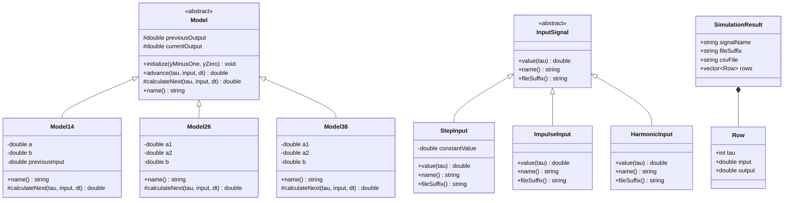
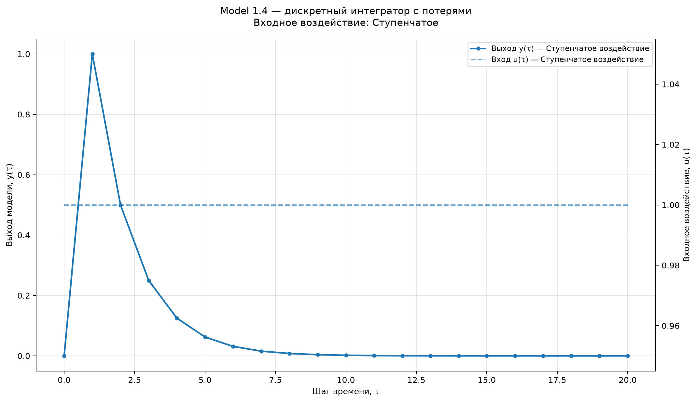
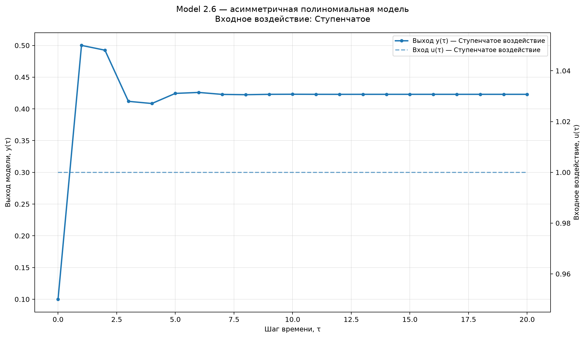
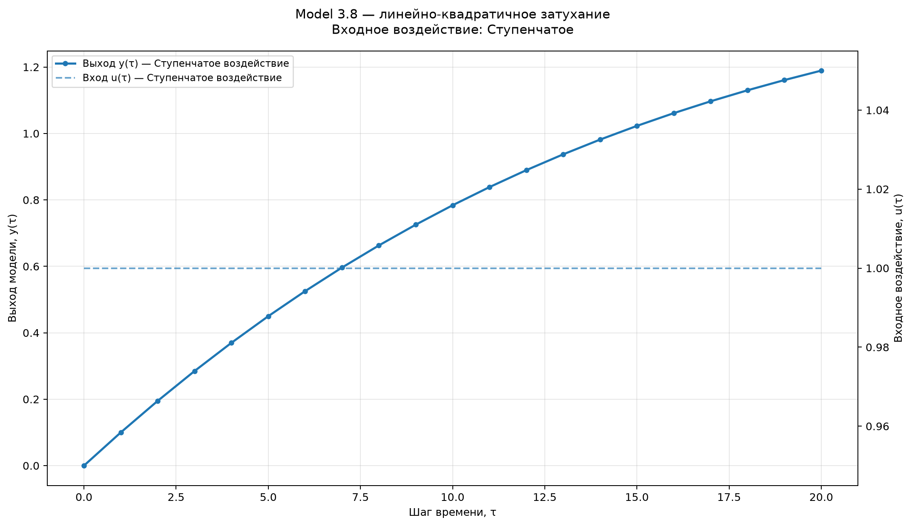

Министерство образования Республики Беларусь

Учреждение образования

«Брестский государственный технический университет»

Кафедра ИИТ

       

<b>Лабораторная работа № 1</b>

По дисциплине «Теория и моделирование автоматического управления»

Тема: «Моделирование объектов управления»

     

Выполнил:

Студент 3 курса

Группы АС-67

Гришкевич А.Н.

Проверил:

Дворанинович Д.А.

     

<b>Брест 2026</b>

---

# Вариант 4

Согласно таблице вариантов для выполнения лабораторной работы выбраны следующие модели:

- Линейная модель: **Model 1.4**.
- Нелинейная модель: **Model 2.6**.
- Дифференциальное уравнение: **Model 3.8**.

Программа реализована на C++ с применением объектно-ориентированного подхода. Пользователь выбирает модель, входное воздействие и количество шагов моделирования. Результаты выводятся в консольную таблицу, сохраняются в CSV-файл и визуализируются при помощи Python и Matplotlib.

## 1. Реализованные математические модели

### 1.1. Model 1.4 — дискретный интегратор с потерями

Математическое описание:

$$
y_{\tau+1}=a y_{\tau}+b(u_{\tau}-u_{\tau-1})
$$

где $a$ и $b$ — постоянные коэффициенты модели, $u_{\tau}$ — входное воздействие на текущем шаге, $u_{\tau-1}$ — входное воздействие на предыдущем шаге.

В программе модель реализована классом `Model14`. Для начального шага значение предыдущего входного воздействия принимается равным нулю.

Пример параметров для тестирования: $a=0.5$, $b=1.0$, $y(0)=0.0$.

### 1.2. Model 2.6 — асимметричная полиномиальная модель

Математическое описание:

$$
y_{\tau+1}=a_1 y_{\tau}^{3}-a_2 y_{\tau-1}+b u_{\tau}^{2}
$$

где $a_1$, $a_2$ и $b$ — постоянные коэффициенты модели, $y_{\tau}$ — текущее значение выхода, $y_{\tau-1}$ — предыдущее значение выхода, $u_{\tau}$ — входное воздействие.

В программе модель реализована классом `Model26`. Для отсутствующего значения предыдущего выхода на начальном шаге используется заданное начальное значение $y(-1)$.

Пример параметров для тестирования: $a_1=0.1$, $a_2=0.2$, $b=0.5$, $y(-1)=0.0$, $y(0)=0.1$.

### 1.3. Model 3.8 — линейно-квадратичное затухание

Математическое описание:

$$
\frac{dy}{dt}=-a_1 y-a_2 y^2+b u
$$

Для численного решения дифференциального уравнения используется явный метод Эйлера с шагом интегрирования $\Delta t$:

$$
y_{\tau+1}=y_{\tau}+\Delta t\left(-a_1 y_{\tau}-a_2 y_{\tau}^{2}+b u_{\tau}\right)
$$

где $a_1$, $a_2$ и $b$ — коэффициенты модели, $\Delta t$ — шаг интегрирования, $u_{\tau}$ — входное воздействие.

В программе модель реализована классом `Model38`.

Пример параметров для тестирования: $a_1=0.5$, $a_2=0.1$, $b=1.0$, $\Delta t=0.1$, $y(0)=0.0$.

Значения, приведённые выше, являются значениями по умолчанию, используемыми при тестовом запуске программы. Коэффициенты и начальные условия могут быть изменены пользователем.

## 2. Входные воздействия

Для проверки моделей реализованы три вида входного сигнала:

1. **Ступенчатое воздействие:**

$$
u_{\tau}=C
$$

где $C$ — постоянное значение, задаваемое пользователем.

2. **Импульсное воздействие:**

$$
u_0=1, \qquad u_{\tau}=0 \text{ при } \tau>0
$$

3. **Гармоническое воздействие:**

$$
u_{\tau}=\sin(\tau)
$$

Сигналы реализованы классами `StepInput`, `ImpulseInput` и `HarmonicInput`, наследующими абстрактный класс `InputSignal`.

## 3. Объектно-ориентированная архитектура

В основе программы лежит абстрактный класс `Model`. Он задаёт общий интерфейс для математических моделей и содержит следующие методы:

- `name()` — возвращает название модели;
- `initialize(...)` — задаёт начальные значения выхода;
- `advance(...)` — рассчитывает и возвращает следующее значение выхода;
- `calculateNext(...)` — виртуальный метод, в котором вычисляется следующий шаг конкретной модели.

Класс `Model` имеет чистые виртуальные методы `name()` и `calculateNext()`, поэтому непосредственно создать объект базового класса нельзя. Конкретные уравнения реализованы в классах-наследниках `Model14`, `Model26` и `Model38`.

Для входных сигналов используется абстрактный класс `InputSignal` с виртуальными методами `value(tau)`, `name()` и `fileSuffix()`. Это позволяет использовать разные типы входного воздействия через общий интерфейс. Классы `StepInput`, `ImpulseInput` и `HarmonicInput` реализуют соответствующие сигналы.

Дополнительные структуры программы:

- `Row` — хранит номер шага, значение входного сигнала и значение выхода модели;
- `SimulationResult` — хранит название входного сигнала, суффикс CSV-файла и рассчитанные строки результатов.

Функция `simulate(...)` выполняет моделирование, `printTable(...)` выводит результаты в консоль, `saveCsv(...)` сохраняет их в CSV-файл, а `runPlotScript(...)` запускает Python-скрипт для построения графика.

### UML-диаграмма классов

Диаграмма классов представлена в формате Mermaid:

### Model 1.4 — дискретный интегратор с потерями

### Model 2.6 — асимметричная полиномиальная модель

### Model 3.8 — линейно-квадратичное затухание

