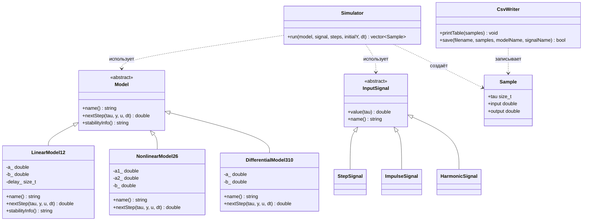
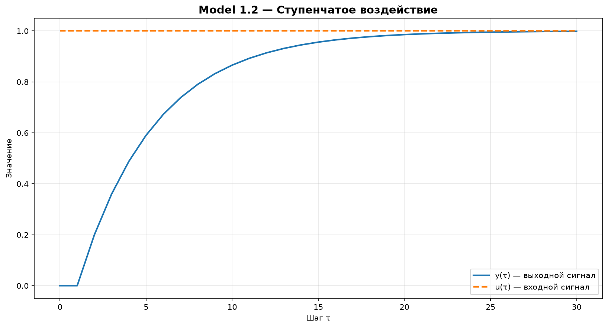
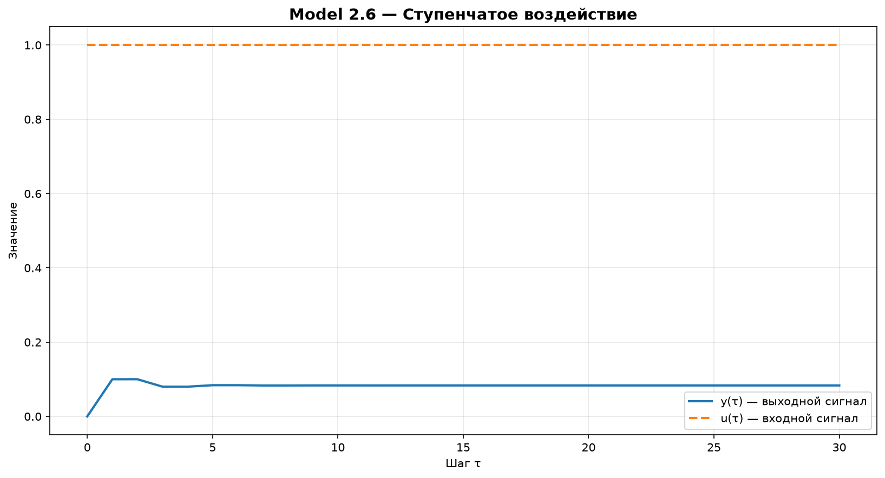
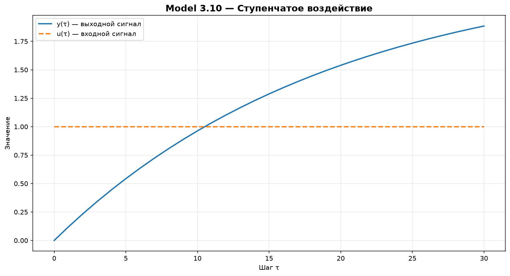

**Министерство образования Республики Беларусь**  
**Учреждение образования**  
**«Брестский государственный технический университет»**  
**Кафедра ИИТ**

   

# Лабораторная работа № 1

**По дисциплине:** «Теория и моделирование автоматического управления»  
**Тема:** «Моделирование объектов управления»

  

Выполнил:  
Студент 3 курса  
Группа: АС-67
Давидюк В.В.
Проверил:
Дворанович Д.А.

  

**Брест 2026**

---

# Вариант 12

Согласно таблице вариантов для выполнения лабораторной работы выбраны следующие модели:

- Линейная модель: **Model 1.2**.
- Нелинейная модель: **Model 2.6**.
- Дифференциальное уравнение: **Model 3.10**.

Программа реализована на C++ с применением объектно-ориентированного подхода. Пользователь выбирает модель, входное воздействие и количество шагов моделирования. Результаты выводятся в консольную таблицу, сохраняются в CSV-файл и визуализируются при помощи Python и Matplotlib.

## 1. Реализованные математические модели

### 1.1. Model 1.2 — линейная модель с запаздыванием управления

Математическое описание:

\[
y_{\tau+1}=a y_{\tau}+b u_{\tau-k}, \qquad k\geq 1.
\]

где \(a\) и \(b\) — коэффициенты модели, \(k\) — задержка входного воздействия, \(u_{\tau-k}\) — входной сигнал с учётом задержки.

В программе модель реализована классом `LinearModel12`. Если индекс задержанного сигнала выходит за начало последовательности, значение входа считается равным нулю.

Пример параметров для тестирования: \(a=0.8\), \(b=0.2\), \(k=1\).

### 1.2. Model 2.6 — нелинейная полиномиальная модель

Математическое описание:

\[
y_{\tau+1}=a_1 y_{\tau}^{3}-a_2 y_{\tau-1}+b u_{\tau}^{2}.
\]

где \(a_1\), \(a_2\) и \(b\) — параметры модели. Уравнение содержит кубическую зависимость от текущего состояния, зависимость от предыдущего состояния и квадратичное входное воздействие.

В программе модель реализована классом `NonlinearModel26`. Для начального значения предыдущего состояния, которое отсутствует при \(\tau=0\), используется ноль.

Пример параметров для тестирования: \(a_1=0.1\), \(a_2=0.2\), \(b=0.1\).

### 1.3. Model 3.10 — дифференциальное уравнение с постоянным смещением

Математическое описание:

\[
\frac{dy}{dt}=-a y+b+u.
\]

Для численного решения используется метод Эйлера:

\[
y_{\tau+1}=y_{\tau}+\Delta t\left(-a y_{\tau}+b+u_{\tau}\right),
\]

где \(\Delta t\) — шаг интегрирования.

В программе модель реализована классом `DifferentialModel310`.

Пример параметров для тестирования: \(a=0.5\), \(b=0.2\), \(\Delta t=0.1\).

Значения, приведённые выше, являются примерами для тестового запуска. В программе коэффициенты вводятся пользователем.

## 2. Входные воздействия

Для проверки моделей реализованы три вида входного сигнала:

1. **Ступенчатое воздействие:**
   \[
   u_{\tau}=1.
   \]
2. **Импульсное воздействие:**
   \[
   u_0=1, \qquad u_{\tau}=0 \text{ при } \tau>0.
   \]
3. **Гармоническое воздействие:**
   \[
   u_{\tau}=\sin(\tau).
   \]

Сигналы реализованы классами `StepSignal`, `ImpulseSignal` и `HarmonicSignal`, наследующими абстрактный класс `InputSignal`.

## 3. Объектно-ориентированная архитектура

В основе программы лежит абстрактный класс `Model`. Он задаёт общий интерфейс для всех математических моделей:

- `name()` — возвращает название модели;
- `nextStep(...)` — вычисляет следующее значение выхода;
- `stabilityInfo()` — возвращает информацию об устойчивости, если она предусмотрена моделью.

Класс `Model` имеет чистые виртуальные методы `name()` и `nextStep()`, поэтому непосредственно создать объект базового класса нельзя. Конкретные уравнения реализованы в классах-наследниках `LinearModel12`, `NonlinearModel26` и `DifferentialModel310`.

Для входных сигналов используется абстрактный класс `InputSignal` с виртуальными методами `value(tau)` и `name()`. Это позволяет симулятору работать с разными сигналами через общий интерфейс.

Дополнительные классы программы:

- `Simulator` — выполняет расчёт последовательности значений модели;
- `Sample` — хранит номер шага, значение входного сигнала и значение выхода;
- `CsvWriter` — выводит таблицу в консоль и сохраняет её в CSV-файл.

### UML-диаграмма классов

Диаграмма классов представлена ниже в формате Mermaid. На GitHub она отображается как UML-диаграмма:

## 4. Результаты моделирования

В начале работы пользователь выбирает одну из трёх моделей и одно из трёх входных воздействий. Далее вводятся количество шагов \(n\), начальное значение \(y(0)\) и коэффициенты выбранного уравнения. Для Model 1.2 дополнительно указывается задержка \(k\), для Model 3.10 — шаг интегрирования \(\Delta t\).

Результаты содержат следующие поля:

| Поле | Описание |
|---|---|
| `tau` | Номер дискретного шага |
| `u_tau` | Значение входного воздействия |
| `y_tau` | Значение выходного сигнала модели |
| `model` | Название выбранной модели |
| `signal` | Название выбранного входного воздействия |

### Model 1.2 — линейная модель с задержкой управления

### Model 2.6 — нелинейная полиномиальная модель

### Model 3.10 — дифференциальное уравнение

