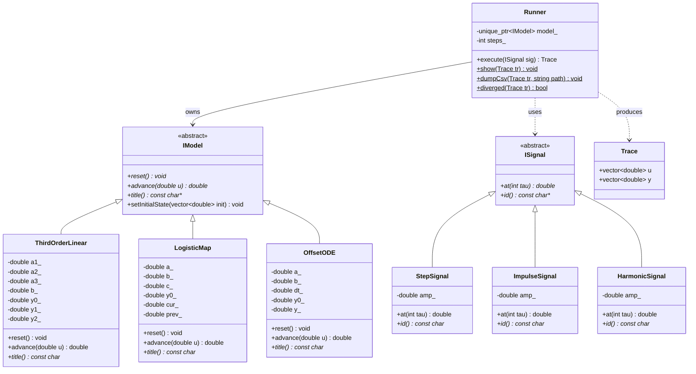
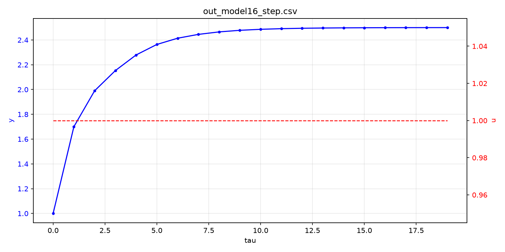
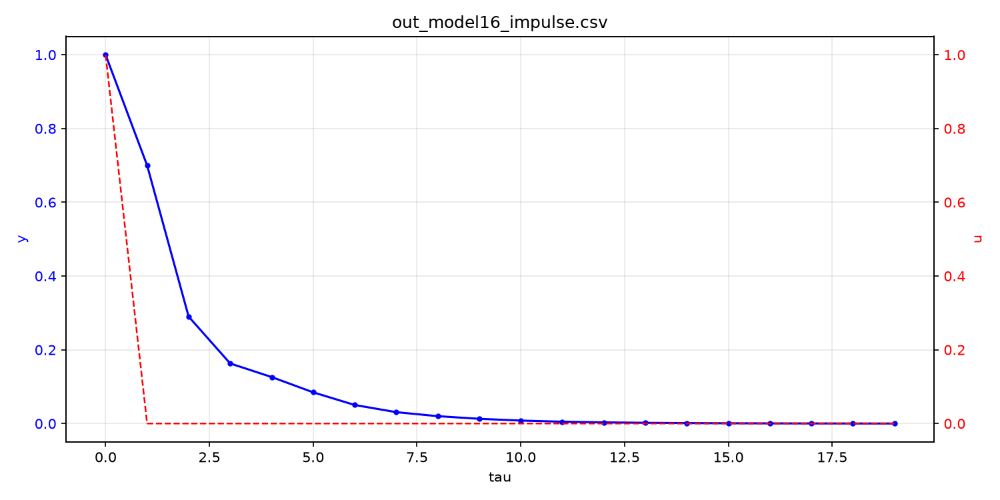
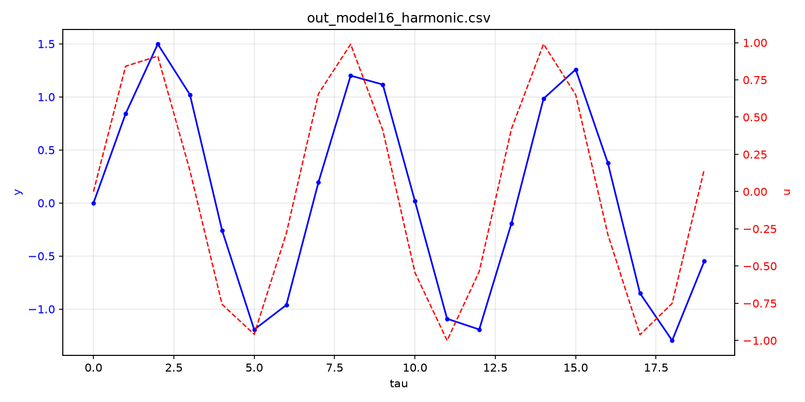
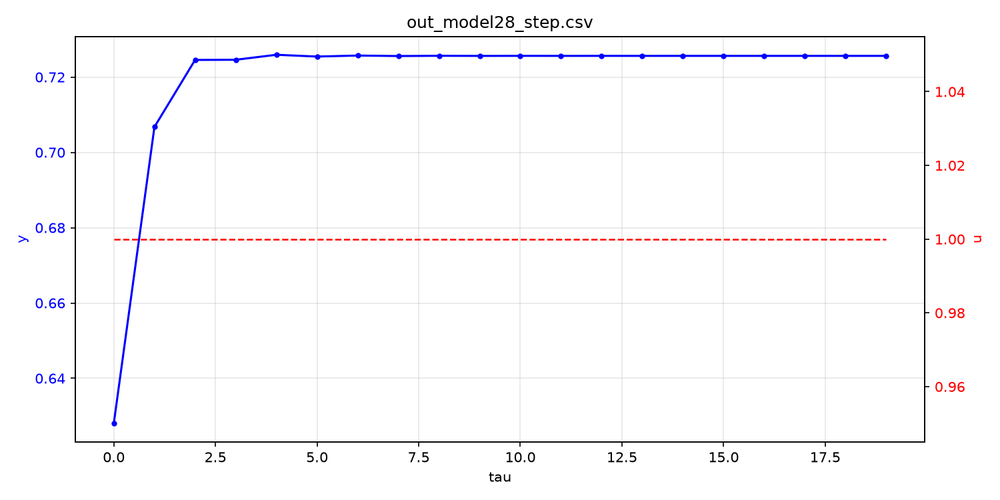
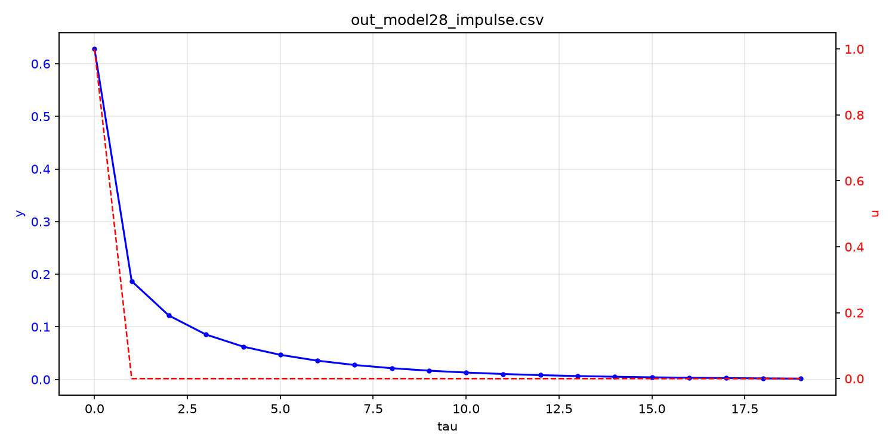
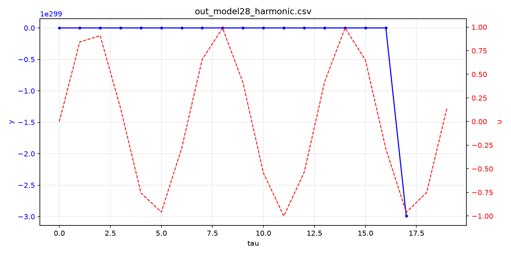
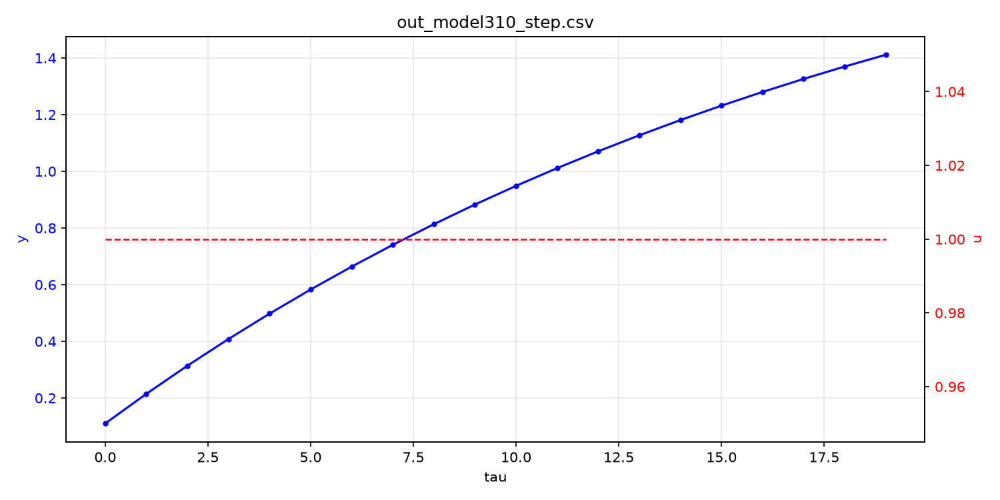
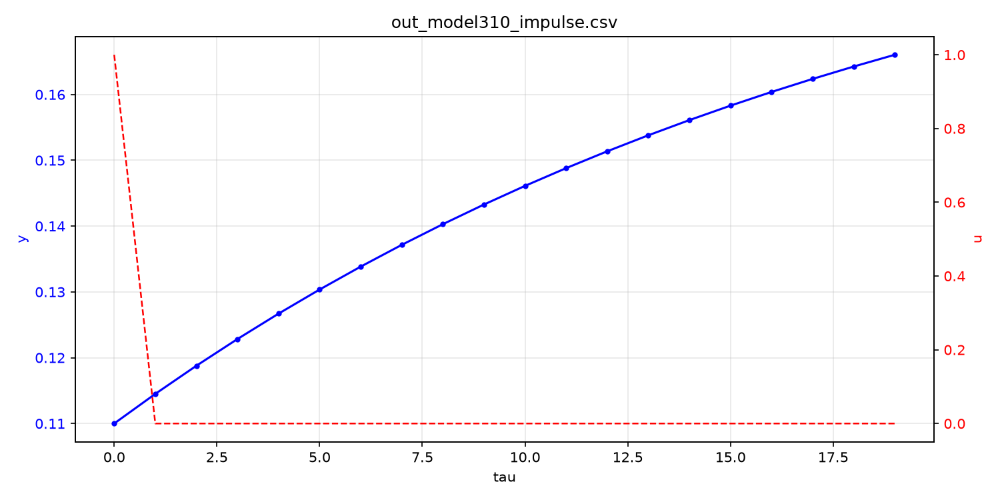
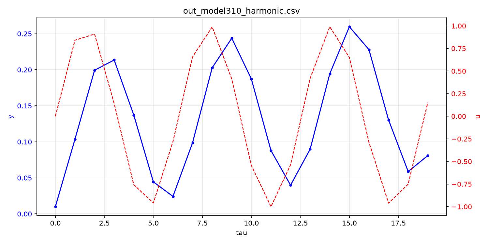

Министерство образования Республики Беларусь

Учреждение образования

“Брестский Государственный технический университет”

Кафедра ИИТ

       

Лабораторная работа №1

По дисциплине “Теория и методы автоматического управления”

Тема: “Моделирование объектов управления”

     

Выполнил:

Студент 3 курса

Группы АС-67

Доста Е. В.

Проверил:

Дворанинович Д. А.

     

Брест 2026

---

## Вариант 6

- Линейная модель: **Model 1.6**
- Нелинейная модель: **Model 2.8**
- Дифференциальное уравнение: **Model 3.10**

## Реализованные модели

### Model 1.6 (Third-Order Dynamic System)

$$y_{\tau+1} = a_1 \cdot y_{\tau} + a_2 \cdot y_{\tau-1} + a_3 \cdot y_{\tau-2} + b \cdot u_{\tau}$$

Параметры: $a_1 = 0.7$, $a_2 = -0.2$, $a_3 = 0.1$, $b = 1.0$.

### Model 2.8 (Chaotic Logistic Map Disturbance)

$$y_{\tau+1} = a \cdot y_{\tau} \cdot (1 - y_{\tau}) + b \cdot u_{\tau} + c \cdot \sin(y_{\tau-1} \cdot u_{\tau})$$

Параметры: $a = 0.8$, $b = 0.5$, $c = 0.1$, $y_0 = 0.2$.

### Model 3.10 (Basic External Constant Offset)

$$\frac{dy}{dt} = -a \cdot y + b + u \quad\Rightarrow\quad y_{\tau+1} = y_{\tau} + \Delta t \cdot (-a \cdot y_{\tau} + b + u_{\tau})$$

Параметры: $a = 0.5$, $b = 0.1$, $\Delta t = 0.1$, $y_0 = 0$.

## Входные воздействия

1. **Ступенчатое** (Step): $u_{\tau} = \text{const} = 1$
2. **Импульсное** (Impulse): $u_0 = 1,\ u_{\tau > 0} = 0$
3. **Гармоническое** (Harmonic): $u_{\tau} = \sin(\tau)$

## ООП Архитектура

Создан абстрактный базовый интерфейс `IModel` с чисто виртуальными методами
`reset()`, `advance()` и `title()`, а также виртуальным `setInitialState()`.

От `IModel` наследуются:
- `ThirdOrderLinear` — линейная модель третьего порядка (Model 1.6)
- `LogisticMap` — нелинейная модель с логистическим отображением (Model 2.8)
- `OffsetODE` — дифференциальное уравнение (Model 3.10)

Сигналы реализованы как иерархия `ISignal` с наследниками `StepSignal`,
`ImpulseSignal`, `HarmonicSignal` и фабрикой `makeSignal()`.

Симуляция инкапсулирована в классе `Runner`, возвращающем структуру `Trace`
с рядами `u` и `y`. Результаты выводятся в консоль (`Runner::show`),
экспортируются в CSV (`Runner::dumpCsv`) и визуализируются через внешний
Python-скрипт `render_plot.py` (matplotlib).

## UML Диаграмма классов

## Результаты моделирования

Все расчёты выполнены при $n = 20$ шагах и амплитуде входа $A = 1$.
Параметры моделей — значения по умолчанию.

### 1. Model 1.6 — линейная модель третьего порядка

**Ступенчатое воздействие** ($u_\tau = 1$):

**Импульсное воздействие** ($u_0 = 1$, $u_{\tau>0} = 0$):

**Гармоническое воздействие** ($u_\tau = \sin\tau$):

### 2. Model 2.8 — нелинейная модель с логистическим отображением

**Ступенчатое воздействие:**

**Импульсное воздействие:**

**Гармоническое воздействие:**

### 3. Model 3.10 — дифференциальное уравнение (метод Эйлера)

**Ступенчатое воздействие:**

**Импульсное воздействие:**

**Гармоническое воздействие:**

