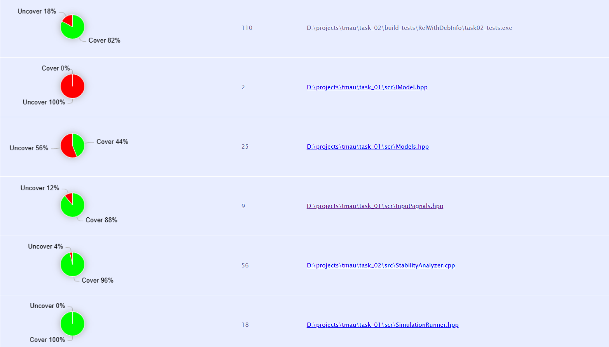

<p align="center"> Министерство образования Республики Беларусь</p>
<p align="center">Учреждение образования</p>
<p align="center">“Брестский Государственный технический университет”</p>
<p align="center">Кафедра ИИТ</p>
<br><br><br><br><br><br><br>
<p align="center">Практическая работа №2</p>
<p align="center">По дисциплине “Теория и методы автоматического управления”</p>
<p align="center">Тема: “Модульное тестирование и анализ устойчивости”</p>
<br><br><br><br><br>
<p align="right">Выполнил:</p>
<p align="right">Студент 3 курса</p>
<p align="right">Группы АС-67</p>
<p align="right">Доста Е. В.</p>
<p align="right">Проверил:</p>
<p align="right">Дворанинович Д. А.</p>
<br><br><br><br><br>
<p align="center">Брест 2026</p>


# TMAU — практическая работа №2

**Вариант:** 6  
**Предыдущая работа:** практическая работа №1  
**Язык:** C++17  
**Тестовый фреймворк:** Google Test

## 1. Цель работы

Расширить программу из практической работы №1 модулем анализа устойчивости линейной дискретной модели и обеспечить автоматическую проверку математических функций с помощью модульных тестов. Сборка, запуск тестов и подготовка отчётов выполняются локально с помощью CMake и `run_tests.bat`.

## 2. Математические модели варианта

В проекте сохранены три модели из практической работы №1:

| Модель | Тип | Уравнение |
|---|---|---|
| Model 1.6 | Линейная дискретная модель третьего порядка | $y_{\tau+1} = a_1 y_\tau + a_2 y_{\tau-1} + a_3 y_{\tau-2} + b u_\tau$ |
| Model 2.8 | Нелинейная дискретная модель (логистическое отображение) | $y_{\tau+1} = a y_\tau (1 - y_\tau) + b u_\tau + c \sin(y_{\tau-1} u_\tau)$ |
| Model 3.10 | Дифференциальная модель, рассчитываемая методом Эйлера | $y_{\tau+1} = y_\tau + \Delta t (-a y_\tau + b + u_\tau)$ |

Функция зоны нечувствительности:

Поддерживаются три входных сигнала:

Поддерживаются три входных сигнала:
- **Step** — постоянный ступенчатый сигнал;
- **Impulse** — импульс в начальный момент, после которого вход равен нулю;
- **Harmonic** — гармонический сигнал $u(\tau) = A \sin(\tau)$.

Программа рассчитывает значения модели по шагам, выводит результаты в табличном виде и сохраняет данные в CSV для построения графика.

## 3. Анализ устойчивости Model 1.6

Для анализа устойчивости рассматривается свободный процесс, то есть $u_\tau = 0$:
$y_{\tau+1} = a_1 y_\tau + a_2 y_{\tau-1} + a_3 y_{\tau-2}$.

Применяя Z-преобразование, получаем характеристическое уравнение:
$z^3 - a_1 z^2 - a_2 z - a_3 = 0$.

Дискретная линейная модель асимптотически устойчива, если все корни характеристического уравнения строго лежат внутри единичной окружности на Z-плоскости: $|z_i| < 1$. 

В модуле `StabilityAnalyzer` реализован численный метод Дюрана-Кернера для поиска комплексных корней многочлена. Программа вычисляет спектральный радиус $\max |z_i|$ и выводит предупреждение перед началом симуляции, если система неустойчива (или находится на границе устойчивости $|z_i| = 1$).

## 4. Структура проекта

```text
task_02/
├── CMakeLists.txt
├── run_tests.bat
├── readme.md
├── src/
│   ├── main.cpp
│   ├── StabilityAnalyzer.hpp
│   └── StabilityAnalyzer.cpp
├── test/
│   ├── test_models.cpp
│   ├── test_stability.cpp
│   ├── test_signals.cpp
│   ├── test_runner.cpp
│   └── test_parametric.cpp
```

### Назначение основных файлов

- `StabilityAnalyzer.*` — расчёт корней характеристического уравнения и проверка устойчивости Model 1.6.
- `main.cpp` — ввод параметров, выбор модели, выполнение симуляции, вывод предупреждения и сохранение результатов.
- `test_models.cpp` — тесты расчёта шагов моделей и краевых значений нелинейности.
- `test_stability.cpp` — тесты анализатора устойчивости (внутри, на границе и вне единичной окружности).
- `test_runner.cpp` — тесты с использованием mock-объектов (Google Mock) для проверки опроса сигналов.
- `test_parametric.cpp` — параметризованные тесты TEST_P для проверки сходимости и интегрирования.
- `run_tests.bat` — автоматическая сборка, запуск тестов и генерация HTML-отчёта покрытия (OpenCppCoverage).
## 5. Сборка и запуск

### Требования

- CMake 3.15 или новее;
- компилятор C++ с поддержкой C++17;
- Git и доступ к GitHub при первой сборке, поскольку Google Test загружаются через CMake FetchContent;
- `gcovr` для формирования HTML/XML-отчёта покрытия (необязательно, но требуется для измерения покрытия указанным способом).

### Запуск в Windows

Из корневого каталога проекта выполните:

```bat
run_tests.bat
```

Скрипт настраивает CMake, компилирует проект, запускает CTest и сохраняет JUnit-отчёт. Если `gcovr` установлен и доступен через `PATH`, дополнительно создаются отчёты покрытия.

## 6. Модульные тесты

Тесты находятся в `test/test_models.cpp`, `test/test_stability.cpp` и `test/test_signals.cpp`.

| Группа                       | Проверки | Количество               |
|------------------------------|--|--------------------------|
| Линейная модель 1.6          | Первый шаг, накопление ступеньки, нулевой вход, сброс `reset()`, реакция на импульс. | <p align="center">5</p>  |
| Нелинейная модель 2.8        | Нулевое состояние, известная эволюция логистической карты, влияние параметра `c`, сброс. | <p align="center">4</p>  |
| Дифференциальная модель 3.10 | Шаг Эйлера (сравнение с 1 шагом), влияние смещения `b`, нулевой вход, сброс. | <p align="center">4</p>  |
| Сигналы                      | Step, Impulse, Harmonic, фабрика `makeSignal()`. | <p align="center">10</p> |
| Анализ устойчивости          | Поиск корней (действительные, комплексные), вычисление спектрального радиуса, устойчивые/неустойчивые коэффициенты. | <p align="center">12</p> |
| Runner (Google Mock)         | Вызов сигнала `n` раз, порядок вызовов (`InSequence`), детектор дивергенции, запись в CSV. | <p align="center">5</p>  |
| Параметризованные (TEST_P)   | 	Сходимость к стационарному состоянию, комбинации коэффициентов, сравнение метода Эйлера с аналитикой, 3 типа сигналов. | <p align="center">16</p> |
Параметризованные тесты реализованы с использованием `TEST_P` и проверяют стабильность алгоритмов при различных входных наборах данных без дублирования кода.
## 7. Тестовое покрытие и результаты

- **Способ запуска:** локальный скрипт `run_tests.bat`.
- **Всего предусмотрено тестовых запусков:** 56.
- **Успешно пройдено:** 56 из 56.



Отчет о покрытии был сформирован с помощью утилиты `gcovr`.

## 8. Результаты и ограничения

Реализованы три математические модели (1.6, 2.8, 3.10), три типа входных сигналов, анализ устойчивости Model 1.6, модульные тесты Google Test, параметризованные тесты `TEST_P` и mock-объекты Google Mock.
## Выводы

В ходе работы расширена программа из практической работы №1 и написаны модульные тесты. Код моделей и входных сигналов не копировался: `task_02` собирается из исходников `task_01/scr`, поэтому тесты проверяют именно ту реализацию, которая использовалась в первой работе.

Реализован модуль анализа устойчивости линейной модели 1.6.

Написано 56 модульных тестов. Для проверки симуляции при разных режимах входа использованы параметризованные тесты (`TEST_P`), для проверки архитектуры — mock-объекты MockSignal. С помощью OpenCppCoverage подтверждено покрытие основной бизнес-логики.