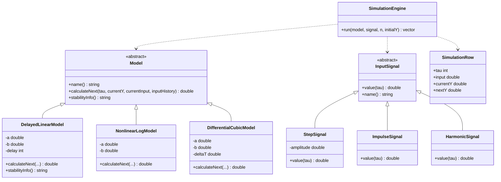

Министерство образования Республики Беларусь

Учреждение образования

«Брестский государственный технический университет»

Кафедра ИИТ

      

Лабораторная работа №1

По дисциплине «Теория и методы автоматического управления»

     

Выполнил:

Студент 1 курса

Группы АС-67

Ерш Д.А.

Проверил:

Дворанович Д.А.

     

Брест 2026

---

## Вариант 2

- Линейная модель: **Model 1.2 (System with Pure Control Delay)**
- Нелинейная модель: **Model 2.4 (Logarithmic Multi-Variable Interaction)**
- Дифференциальное уравнение: **Model 3.6 (Cubic Growth and Control)**

## Реализованные модели

### Model 1.2 (System with Pure Control Delay)

$$
y_{\tau+1}=a y_\tau+b u_{\tau-k},\qquad k\geq 1
$$

Здесь $a$ и $b$ — коэффициенты модели, $k$ — задержка входного воздействия. В начальные моменты, когда индекс  $u_{\tau-k}$ меньше нуля, задержанный вход считается равным нулю.

Для анализа устойчивости свободной составляющей используется характеристическое уравнение:

$$
z-a=0,\qquad z=a
$$

Условие асимптотической устойчивости модели: $$|a|<1$$. Задержка относится к входному воздействию и не изменяет корень характеристического уравнения свободной составляющей.

### Model 2.4 (Logarithmic Multi-Variable Interaction)

$$
y_{\tau+1}=a y_\tau\cos(y_\tau)+b\ln(1+|u_\tau|)
$$

Модель описывает нелинейную зависимость выходного значения от текущего состояния объекта и входного воздействия. Косинус учитывает нелинейность состояния, а логарифм — влияние модуля входного сигнала.

### Model 3.6 (Cubic Growth and Control)

$$
\frac{dy}{dt}=a y^3+b u
$$

Для численного моделирования используется метод Эйлера с шагом интегрирования $\Delta t$:

$$
y_{\tau+1}=y_\tau+\Delta t\left(a y_\tau^3+b u_\tau\right)
$$

## Входные воздействия

1. **Ступенчатое воздействие:**

   $$
   u_\tau=A
   $$

   где постоянное значение $A$ задаётся пользователем.

2. **Импульсное воздействие:**

   $$
   u_0=1,\qquad u_\tau=0 \text{ при } \tau>0
   $$

3. **Гармоническое воздействие:**

   $$
   u_\tau=\sin(\tau)
   $$

## ООП

Создан абстрактный базовый класс `Model` с виртуальным методом `calculateNext(...)`, который рассчитывает следующее значение выходной переменной модели. Метод `stabilityInfo()` предоставляет информацию об устойчивости модели, если такая проверка реализована.

От класса `Model` наследуются:

- `DelayedLinearModel` — линейная модель 1.2;
- `NonlinearLogModel` — нелинейная модель 2.4;
- `DifferentialCubicModel` — дифференциальная модель 3.6.

Для входных воздействий создан абстрактный класс `InputSignal` и классы-наследники `StepSignal`, `ImpulseSignal` и `HarmonicSignal`. Класс `SimulationEngine` выполняет последовательный расчёт модели по шагам времени, а структура `SimulationRow` хранит входное воздействие, текущее и следующее значения выходной переменной.

### UML

## Функционал программы

Программа:

- позволяет выбрать одну из трёх моделей варианта 2;
- принимает коэффициенты модели и начальное значение \(y_0\);
- позволяет выбрать входное воздействие;
- позволяет задать количество шагов моделирования \(n\);
- выводит результаты в табличном виде в консоль;
- сохраняет результаты моделирования в `results.csv`;
- запускает Python/Matplotlib для построения графиков входного воздействия и выходной реакции;
- сохраняет график в `results.png`.

### Демонстрация ступенчатого воздействия

### Демонстрация импульсного воздействия

### Демонстрация гармонического воздействия

