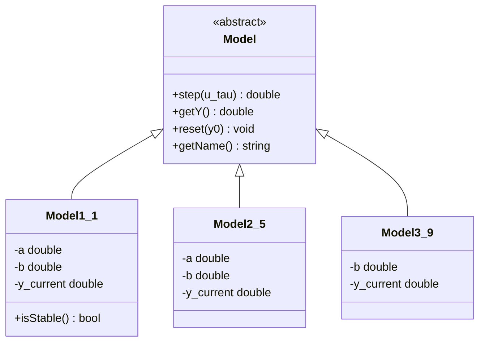
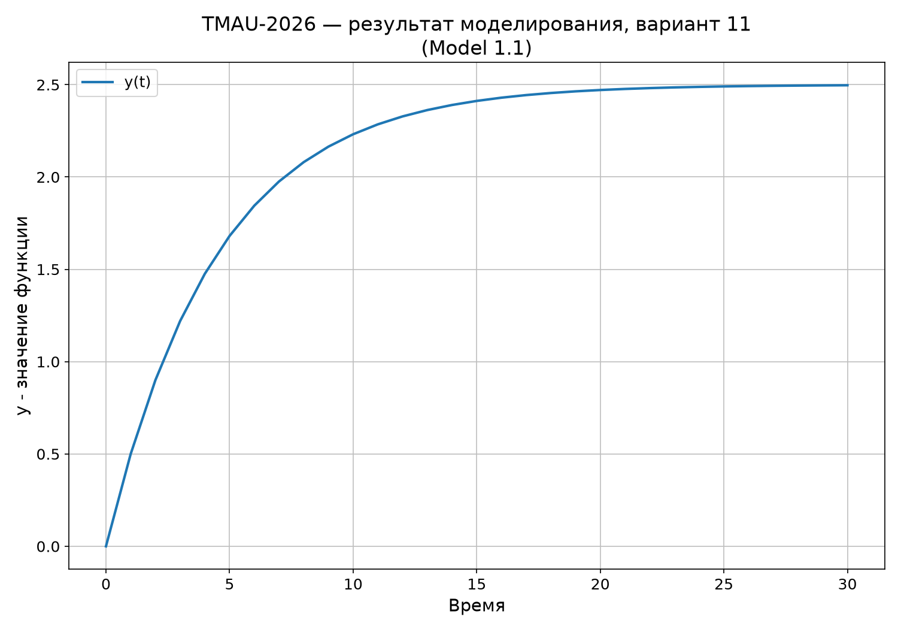
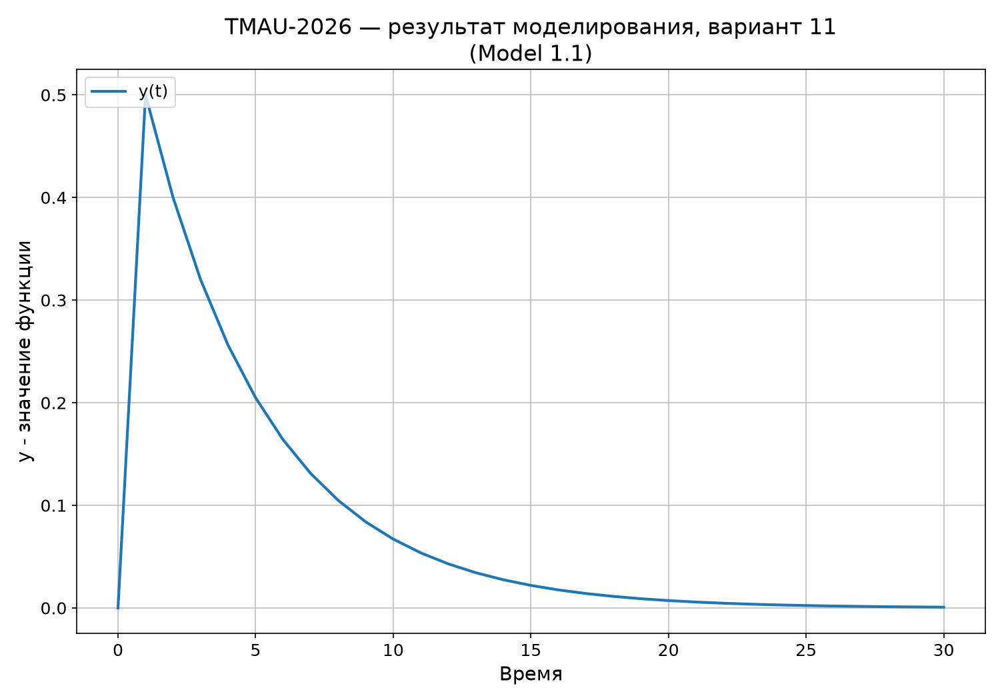
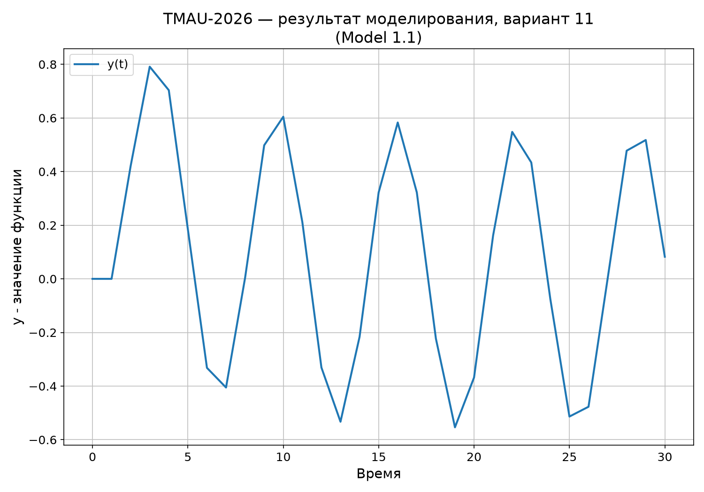

<p align="center">Министерство образования Республики Беларусь</p>
<p align="center">Учреждение образования</p>
<p align="center">“Брестский Государственный технический университет”</p>
<p align="center">Кафедра ИИТ</p>
<br><br><br><br><br><br><br>
<p align="center">Лабораторная работа №1</p>
<p align="center">По дисциплине “Теория и методы автоматического управления”</p>
<br><br><br><br><br>
<p align="right">Выполнил:</p>
<p align="right">Студент 3 курса</p>
<p align="right">Группы АС-67</p>
<p align="right">Иванович Д. И.</p>
<p align="right">Проверил:</p>
<p align="right">Дворанинович Д. А.</p>
<br><br><br><br><br>
<p align="center">Брест 2026</p>


## Вариант 11

- Линейная модель: **Model 1.1 (Standard First-Order Inertial System)**
- Нелинейная модель: **Model 2.5 (Signum Friction and Exponential Growth)**
- Дифференциальное уравнение: **Model 3.9 (Bounded Saturation Rate)**

## Реализованные модели

### Model 1.1 (Standard First-Order Inertial System)

```math
y_{\tau+1} = a\,y_\tau + b\,u_\tau
```

### Model 2.5 (Signum Friction and Exponential Growth)

```math
y_{\tau+1} = a\,y_\tau + b \cdot \text{sign}(u_\tau) \cdot (1 - e^{-|u_\tau|})
```

### Model 3.9 (Bounded Saturation Rate)

```math
\frac{dy}{dt} = b \cdot \tanh(u)
```

Для данной модели используется Метод Эйлера:

```math
y_{\tau+1} = y_\tau + dt \cdot b\,\tanh(u_\tau)
```

## Входные воздействия

1. Ступенчатое: `u(t) = A`
2. Импульсное: `u(0) = A`, `u(t > 0) = 0`
3. Гармоническое: `u(t) = A*sin(t)`

## ООП

Создан абстрактный базовый класс `Model` с чисто виртуальным методом `step(u_tau)`, который по текущему значению `y(t)` и входу `u(t)` вычисляет `y(t+1)`. Также реализованы методы `reset(y0)` для сброса состояния и `getY()` для получения текущего значения.

От него наследуются:

- `Model1_1`
- `Model2_5`
- `Model3_9`

### UML:


## Функционал программы

Программа:

- позволяет выбрать модель;
- принимает коэффициенты;
- позволяет выбрать входное воздействие;
- позволяет задать количество шагов `n`;
- выводит результаты в табличном виде;
- сохраняет результаты в `results.csv`;
- позволяет построить график через Python/Matplotlib.

## Пример работы программы:

### Демонстрация ступенчатого воздействия

### Демонстрация импульсного воздействия

### Демонстрация гармонического воздействия
