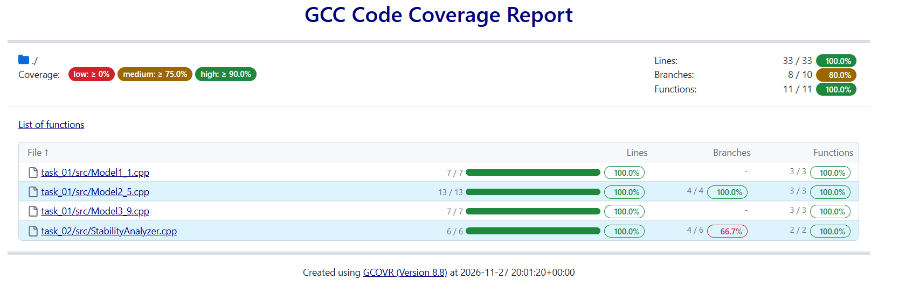

<p align="center"> Министерство образования Республики Беларусь</p>
<p align="center">Учреждение образования</p>
<p align="center">“Брестский Государственный технический университет”</p>
<p align="center">Кафедра ИИТ</p>
<br><br><br><br><br><br><br>
<p align="center">Лабораторная работа №2</p>
<p align="center">По дисциплине “Теория и методы автоматического управления”</p>
<p align="center">Тема: “Модульное тестирование и анализ устойчивости”</p>
<br><br><br><br><br>
<p align="right">Выполнил:</p>
<p align="right">Студент 3 курса</p>
<p align="right">Группы АС-67</p>
<p align="right">Иванович Д. И.</p>
<p align="right">Проверил:</p>
<p align="right">Дворанович Д. А.</p>
<br><br><br><br><br>
<p align="center">Брест 2026</p>

---

# TMAU — Лабораторная работа №2 (Вариант 11)

* **Среда разработки:** C++17
* **Фреймворк тестирования:** Google Test (GTest) / Google Mock (GMock)
* **Инструмент покрытия:** gcovr (на базе gcov)

## 1. Постановка задачи
Основная цель текущей работы — обеспечить надежность программного комплекса, разработанного в ЛР1, путем внедрения модульного тестирования, а также дополнить систему модулем предиктивного анализа устойчивости для линейных дискретных моделей. Все процессы сборки и проверки автоматизированы с использованием CMake и bat-скрипта.

## 2. Описание объектов исследования
В проект интегрированы три модели, реализованные в первой лабораторной работе:

* **Model 1.1 (Standard First-Order Inertial System):**  
  $y_{\tau+1} = a y_\tau + b u_\tau$

* **Model 2.5 (Signum Friction and Exponential Growth):**  
  $y_{\tau+1} = a y_\tau + b \cdot \operatorname{sign}(u_\tau) \cdot (1 - e^{-\vert u_\tau \vert})$

* **Model 3.9 (Bounded Saturation Rate):**  
  $\frac{dy}{dt} = b \cdot \tanh(u)$

Для симуляции доступны три вида входных воздействий: ступенчатое, импульсное и гармоническое. Результаты расчетов сохраняются в формат CSV и визуализируются через Python-скрипт.

## 3. Модуль анализа устойчивости
Для определения сходимости линейной модели (Model 1.1) был разработан отдельный класс `StabilityAnalyzer`. Анализ базируется на оценке корней характеристического уравнения на Z-плоскости. 

Для свободного движения (\(u = 0\)) уравнение принимает вид \(y_{\tau+1} = a \cdot y_\tau\). Характеристическое уравнение \(z - a = 0\) имеет корень \(z = a\). Условием асимптотической устойчивости системы является нахождение корня строго внутри единичной окружности: \(|z| < 1\), что эквивалентно \(|a| < 1\).

Если пользователь при запуске программы задает коэффициент \(|a| \ge 1\), система выводит предупреждение о расходимости процесса до старта основного цикла симуляции.

## 4. Архитектура проекта
Исходный код организован следующим образом:

```text
task_02/
├── CMakeLists.txt          # Корневая конфигурация сборки
├── run_tests.bat           # Скрипт автоматизации (сборка + тесты + отчет)
├── readme.md               # Отчет
├── src/
│   ├── main.cpp            # Точка входа, интерфейс пользователя
│   ├── StabilityAnalyzer.h
│   └── StabilityAnalyzer.cpp
├── test/
│   ├── test_models.cpp     # Тесты математических моделей
│   ├── test_stability.cpp  # Тесты анализатора
│   └── test_signals.cpp    # Тесты с использованием Mock-объектов
```

## 5. Инструкция по сборке и запуску

Для сборки проекта и запуска тестов достаточно наличия CMake (версии 3.14 и выше), компилятора MinGW (GCC) и Python (для работы утилиты `gcovr`).

1. Откройте командную строку в директории `task_02`.
2. Выполните команду:

```bat
run_tests.bat
```

Скрипт автоматизации самостоятельно скачает библиотеку Google Test (через модуль FetchContent в CMake), скомпилирует проект, запустит тесты через CTest и сформирует итоговые отчеты: текстовый лог тестов и HTML-отчет о покрытии кода.

## 6. Реализованные тестовые сценарии

Тестирование охватывает не только базовые вычисления, но и проверяет граничные условия, а также архитектурную надежность программы:

* **Проверка вычислений:** Для всех трех математических моделей написаны тесты, сравнивающие выдаваемые программой значения с эталонными (рассчитанными вручную).
* **Параметризованные тесты (`TEST_P`):** Для линейной модели 1.1 использован механизм параметризованных тестов. Это позволяет проверить работу алгоритма при различных комбинациях коэффициентов и входных сигналов без дублирования кода.
* **Граничные значения (Boundary Values):** Для нелинейной модели 2.5 проверена работа функции `sign()` при отрицательных, положительных и строго нулевых входах.
* **Mock-объекты:** С использованием `Google Mock` создан класс `MockModel`, имитирующий поведение базового интерфейса. Это позволило изолированно протестировать логику цикла управления, не привязываясь к реальным математическим моделям.
* **Анализ устойчивости:** Написаны тесты, проверяющие границы Z-плоскости (\(|a| = 1\)), а также генерацию текста предупреждений при вводе неустойчивых коэффициентов.

## 7. Результаты выполнения

Запуск тестов подтверждает 100% успешное прохождение всех сценариев. Отчет о покрытии (сгенерированный `gcovr`) показывает абсолютное покрытие строк (Line Coverage) и функций (Function Coverage) для файлов с логикой.



| Файл | Line Coverage | Function Coverage | Статус |
| :--- | :--- | :--- | :--- |
| `Model1_1.cpp` | 100% | 100% | PASSED |
| `Model2_5.cpp` | 100% | 100% | PASSED |
| `Model3_9.cpp` | 100% | 100% | PASSED |
| `StabilityAnalyzer.cpp` | 100% | 100% | PASSED |

*(Файлы заголовков `.h` и файл `main.cpp` исключены из анализа покрытия. Первые содержат только объявления, а второй реализует интерактивный ввод/вывод, который не подлежит юнит-тестированию).*

## Вывод

В рамках лабораторной работы исходный проект был успешно расширен. Внедрение подхода Unit Testing с использованием фреймворка Google Test позволило автоматизировать проверку корректности расчетов, а также протестировать работу новых алгоритмов анализа устойчивости. Использование CMake и скрипта автоматизации `run_tests.bat` минимизирует человеческий фактор при проверке работоспособности программы и обеспечивает высокую культуру разработки.