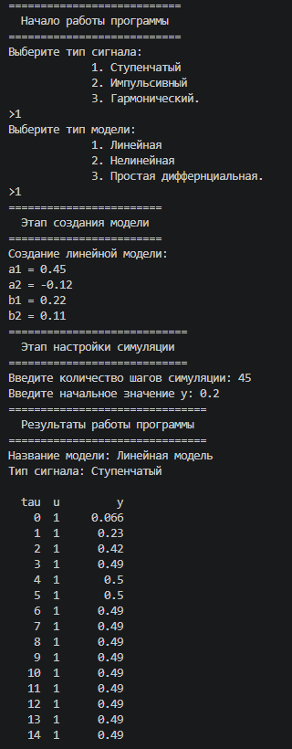
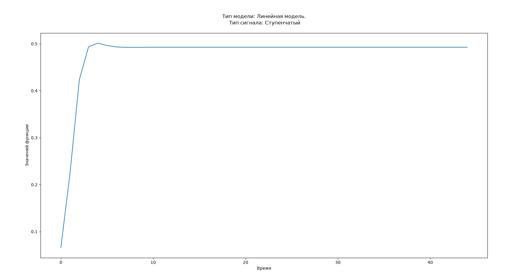
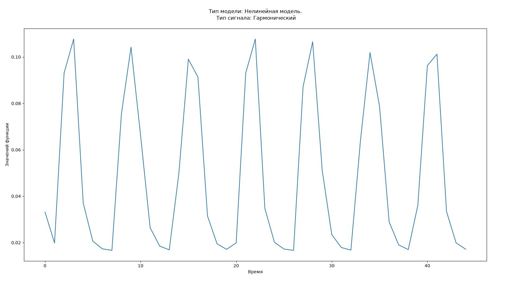
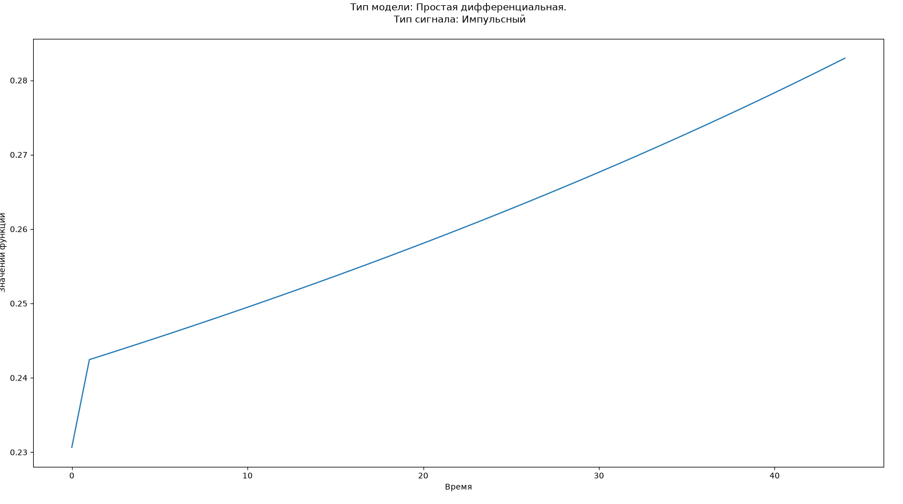

Министерство образования Республики Беларусь

Учреждение образования

“Брестский Государственный технический университет”

Кафедра ИИТ

       

Лабораторная работа №1

По дисциплине: "Теория и методы автоматического управления"

 

     

Выполнил:

Студент 2-го курса

Группы АС-67

Кирик А.Д.

Проверил

Дворанович Д.А.

     

Брест 2026

   

## Вариант задания 18
- Линейная модель: "Model 1.8 (Generalized Autoregressive Linear Model)"
    - $y_{\tau+1} = a_1y_{\tau}+a_2y_{\tau-1}+b_1u_{\tau}+b_2u_{\tau-1}$
- Нелинейная модель: "Model 2.2 (Actuator Saturation Non-linearity)"
    - $y_{\tau+1} = ay_{\tau}+b*sat(u_{\tau})$
    - $$ \text{where } \text{sat}(u) = \begin{cases} U_{\max}, & u > U_{\max} \\ u, & U_{\min} \le u \le U_{\max} \\ U_{\min}, & u < U_{\min} \end{cases} $$
- Дифференциальное уравнение: Model 3.6 "(Cubic Growth and Control)"
    - $\frac{dy}{dt}=ay^3+bu$
    - для этой модели используется метод эйлера: $y_{\tau+1}=y_{\tau}+dt*(ay^3+bu)$

Была создана програма, реализующая интерфейс класс "*IModel*" с помощью классов-наследнников:
- *LinearModel*
- *NoneLinearModel*
- *SimpleDifferentialModel*

## Функционал программы:
- Выбор типа генерируемого сигнала
- Выбор типа модели
- Ввод коэффициентов для каждой модели
- Выбор количества шагов симуляции
- Вывод результатов в табличном виде
- Сохранение данных в файл с расширением .csv
- Вывод графика функции

## Пример работы программы
Вывод работы программы в консоли:

График линейной модели со ступенчатым сигналом:

График нелинейной модели с гармоническим сигналом:

График дифференциальной модели с импульсным сигналом:

## UML
