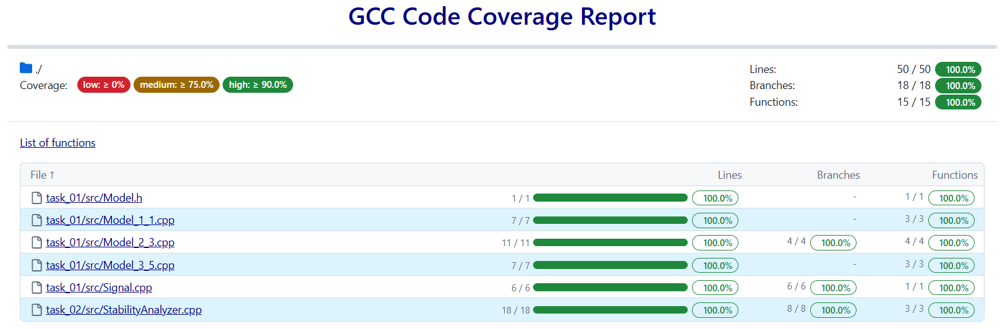

<p align="center"> Министерство образования Республики Беларусь</p>
<p align="center">Учреждение образования</p>
<p align="center">“Брестский Государственный технический университет”</p>
<p align="center">Кафедра ИИТ</p>
<br><br><br><br><br><br><br>
<p align="center">Лабораторная работа №2</p>
<p align="center">По дисциплине “Теория и методы автоматического управления”</p>
<p align="center">Тема: “Модульное тестирование и анализ устойчивости”</p>
<br><br><br><br><br>
<p align="right">Выполнил:</p>
<p align="right">Студент 3 курса</p>
<p align="right">Группы АС-67</p>
<p align="right">Ковалевич М. М.</p>
<p align="right">Проверил:</p>
<p align="right">Дворанович Д. А.</p>
<br><br><br><br><br>
<p align="center">Брест 2026</p>


# TMAU — лабораторная работа №2

**Вариант:** 1  
**Предыдущая работа:** лабораторная работа №1  
**Язык:** C++17  
**Тестовый фреймворк:** Google Test

## 1. Цель работы

Расширить программу из лабораторной работы №1 модулем анализа устойчивости линейной дискретной модели и обеспечить автоматическую проверку математических функций с помощью модульных тестов. Сборка, запуск тестов и подготовка отчётов выполняются локально с помощью CMake и `run_tests.bat`.

## 2. Математические модели варианта

В проекте сохранены три модели из лабораторной работы №1:

| Модель | Тип | Уравнение |
|---|---|---|
| Model 1.1 | Линейная дискретная модель первого порядка | $y_{\tau+1} = a\,y_\tau + b\,u_\tau$ |
| Model 2.3 | Нелинейная дискретная модель (зона нечувствительности) | $y_{\tau+1} = a\,y_\tau + b \cdot \mathrm{deadzone}(u_\tau)$ |
| Model 3.5 | Дифференциальная модель, рассчитываемая методом Эйлера | $y_{\tau+1} = y_\tau + dt \cdot b\,\sin(u_\tau)$ |

Функция зоны нечувствительности:

```math
\mathrm{deadzone}(u) =
\begin{cases}
u - \delta, & u > \delta \\
0, & -\delta \le u \le \delta \\
u + \delta, & u < -\delta
\end{cases}
```

Поддерживаются три входных сигнала:

- **Step** — постоянный ступенчатый сигнал;
- **Impulse** — импульс в начальный момент, после которого вход равен нулю;
- **Harmonic** — гармонический сигнал $u(t) = A \sin(t)$.

Программа рассчитывает значения модели по шагам, выводит результаты в табличном виде и сохраняет данные в CSV для построения графика.

## 3. Анализ устойчивости Model 1.1

Для анализа устойчивости рассматривается свободный процесс, то есть $u_\tau = 0$:
$y_{\tau+1} = a\,y_\tau$.

Применяя Z-преобразование, получаем передаточную функцию $H(z) = \frac{b}{z - a}$. Характеристическое уравнение $z - a = 0$ имеет единственный корень $z = a$.

Дискретная линейная модель асимптотически устойчива, если корень строго лежит внутри единичной окружности:
$|z| < 1$, то есть $|a| < 1$.

Граничный случай $|a| = 1$ не считается асимптотической устойчивостью. Анализатор отклоняет не конечные коэффициенты (`NaN`, бесконечность). Перед запуском симуляции Model 1.1 программа выводит найденный корень и предупреждение, если модель неустойчива.

Анализатор предназначен только для Model 1.1. Для Model 2.3 (нелинейной) и Model 3.5 (дифференциальной) нужны отдельные критерии устойчивости.

## 4. Структура проекта

```text
task_02/
├── CMakeLists.txt
├── run_tests.bat
├── readme.md
├── src/
│   ├── main.cpp               # пользовательский интерфейс и запуск
│   ├── StabilityAnalyzer.h
│   ├── StabilityAnalyzer.cpp
├── test/
│   ├── test_models.cpp
│   ├── test_stability.cpp
│   ├── test_signals.cpp
```

### Назначение основных файлов

- `StabilityAnalyzer.*` — расчёт корня характеристического уравнения и проверка устойчивости Model 1.1.
- `main.cpp` — ввод параметров, выбор модели, выполнение симуляции, вывод предупреждения и сохранение результатов.
- `test/test_models.cpp` — тесты моделей и граничных значений нелинейности.
- `test/test_stability.cpp` — тесты анализатора устойчивости.
- `test/test_signals.cpp` — тесты входных сигналов.
- `run_tests.bat` — автоматическая сборка, запуск тестов и генерация отчётов в Windows.

## 5. Сборка и запуск

### Требования

- CMake 3.15 или новее;
- компилятор C++ с поддержкой C++17;
- Git и доступ к GitHub при первой сборке, поскольку Google Test загружаются через CMake FetchContent;
- `gcovr` для формирования HTML/XML-отчёта покрытия (необязательно, но требуется для измерения покрытия указанным способом).

### Запуск в Windows

Из корневого каталога проекта выполните:

```bat
run_tests.bat
```

Скрипт настраивает CMake, компилирует проект, запускает CTest и сохраняет JUnit-отчёт. Если `gcovr` установлен и доступен через `PATH`, дополнительно создаются отчёты покрытия.

Установка `gcovr`:

```bat
py -m pip install gcovr
```

### Ручной запуск

```bat
cmake -S . -B build
cmake --build build
ctest --test-dir build --output-on-failure
```

## 6. Модульные тесты

Тесты находятся в `test/test_models.cpp`, `test/test_stability.cpp` и `test/test_signals.cpp`.

| Группа | Проверки |
|---|---|
| Линейная модель 1.1 | Расчёт $y_3$ для трех режимов входа (Step, Impulse, Harmonic) с помощью параметризованного `TEST_P`. Проверка сходимости к установившемуся значению $y_{уст} = \frac{bA}{1-a}$. |
| Нелинейная модель 2.3 | Расчет $y_3$ для трех режимов входа. Проверка граничных значений зоны нечувствительности ($u = \pm\delta$). |
| Дифференциальная модель 3.5 | Расчет $y_3$ для трех режимов входа. Проверка сходимости метода Эйлера к аналитическому решению при уменьшении шага $dt$. |
| Инварианты | Проверка состояния покоя при $u = 0$ и $y_0 = 0$. Проверка названий моделей. |
| Входные сигналы | Проверка корректности генерации ступенчатого, импульсного и гармонического сигналов. |
| Анализ устойчивости | Устойчивые действительные корни, неустойчивый корень, граница $|z| = 1$ (для $a = \pm 1$), согласованность анализа с поведением модели во времени. |

**Количество тестовых запусков, предусмотренных текущими файлами: 40.** Параметризованные тесты запускаются для нескольких наборов данных (по 3-5 кейсов на каждый тест), вместе с остальными тестами в трех файлах предусмотрено 40 запусков. Фактическое число успешно пройденных тестов подтверждается запуском `run_tests.bat`.

## 7. Тестовое покрытие и результаты

- **Способ запуска:** локальный скрипт `run_tests.bat`.
- **Всего предусмотрено тестовых запусков:** 40.
- **Успешно пройдено:** 40 из 40.



Отчет о покрытии был сформирован с помощью утилиты `gcovr`. Основная логика моделей и анализатора покрыта на 100%. Файл `main.cpp` исключен из замера, так как содержит интерактивный ввод с клавиатуры.

## 8. Результаты и ограничения

Реализованы три математические модели, три типа входных сигналов, анализ устойчивости Model 1.1, модульные тесты Google Test и параметризованные тесты `TEST_P`. 

Для полного подтверждения результата необходимо выполнить `run_tests.bat` в среде с установленным CMake и компилятором C++17, доступом к GitHub при первой загрузке Google Test и, для отчёта покрытия, установленным `gcovr`. 

## Выводы

В ходе работы расширена программа из лабораторной работы №1 и написаны модульные тесты на Google Test. Код моделей и входных сигналов не копировался: `task_02` собирается из исходников `task_01`, поэтому тесты проверяют именно ту реализацию, которая использовалась в первой работе.

Реализован модуль анализа устойчивости линейной модели 1.1: по корню характеристического уравнения $z = a$ определяется, лежит ли он строго внутри единичного круга. Граничный случай $|a| = 1$ считается неустойчивым. Если коэффициенты, введённые пользователем, дают неустойчивую систему, программа выводит предупреждение до начала симуляции.

Написано 40 модульных тестов. Значения моделей проверены по ручному расчёту; для проверки симуляции при разных режимах входа использованы параметризованные тесты (`TEST_P`). Отдельно проверены граничные значения нелинейности (в точках $\pm\delta$ и вне их) и поведение метода Эйлера при разных шагах интегрирования. Для проверки устойчивости протестированы точки внутри, на границе и вне единичной окружности.
