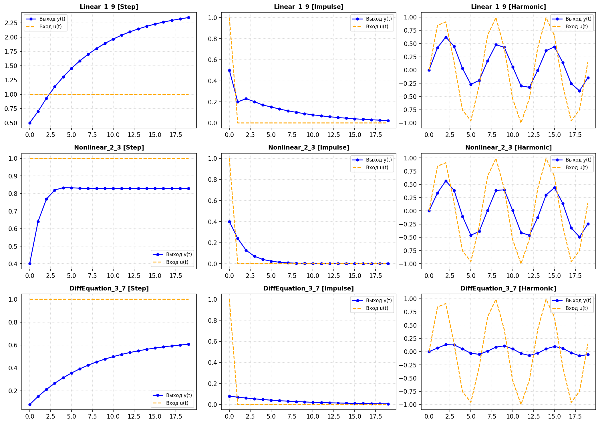
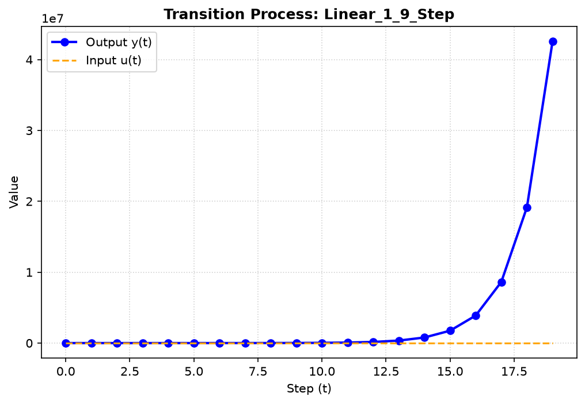
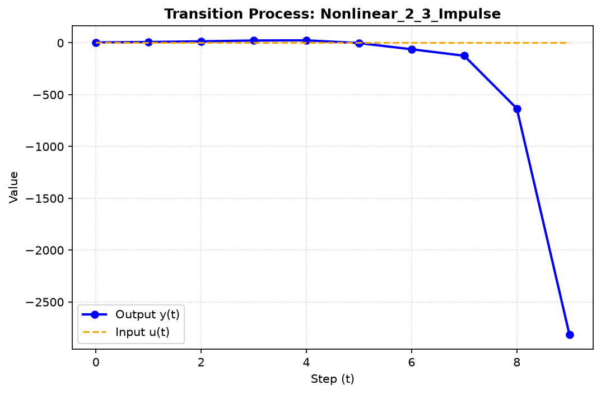
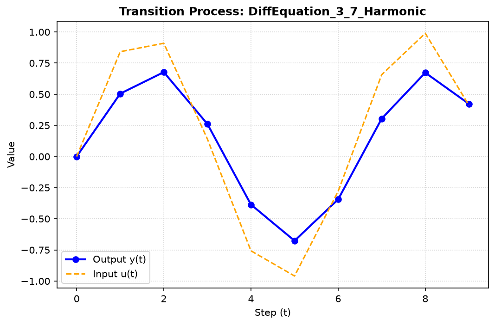

<p align="center">Министерство образования Республики Беларусь</p>
<p align="center">Учреждение образования</p>
<p align="center">Брестский государственный технический университет</p>
<p align="center">Кафедра ИИТ</p>
<br><br><br><br><br><br><br>
<p align="center">Отчет по лабораторной работе №1</p>
<p align="center">Дисциплина: Теория и методы автоматического управления</p>
<p align="center">Тематика: Моделирование управляемых объектов</p>
<br><br><br><br><br>
<p align="right">Выполнил студент:</p>
<p align="right">Группа: АС-67 (3 курс)</p>
<p align="right">Кошелев Б.В.</p>
<p align="right">Преподаватель:</p>
<p align="right">Дворанинович Д. А.</p>
<br><br><br><br><br>
<p align="center">Брест, 2026 год</p>

---

## Выполнение задания (Вариант 19)

### Математическое описание разработанных моделей
В рамках варианта реализованы три типа моделей:

1. **Линейная дискретная модель (1.9):**
   Уравнение имеет следующий вид: 
   $$Y_{\tau+1} = a_1 Y_{\tau} + a_2 Y_{\tau-1} + a_3 Y_{\tau-2} + b_1 u_{\tau}$$

2. **Нелинейная модель (2.3):**
   Описывается уравнением со второй степенью:
   $$Y_{\tau+1} = a_1 Y_{\tau} - b_1 Y_{\tau-1}^2 + c_1 u_{\tau}$$

3. **Дифференциальное уравнение (3.7):**
   Исходное уравнение: \(\frac{dy}{dt} = -e^a y + b u\)
   Для программной реализации применен численный метод Эйлера: \(y_{t+1} = y_t + \Delta t \cdot (-e^a y_t + b u_t)\)

---

## Результаты моделирования

Ниже представлены сводные графики переходных процессов для всех трех моделей (ступенчатое, импульсное и гармоническое воздействия):

Сводный график всех моделей


*(Примечание: Если вы хотите вставить отдельные графики, они приведены ниже).*

**Модель 1.9 (Ступенчатое воздействие):**


**Модель 2.3 (Импульсное воздействие):**


**Модель 3.7 (Гармоническое воздействие):**


---

### Структура классов (UML)
Для реализации объектно-ориентированного подхода была спроектирована следующая архитектура классов:

```mermaid
classDiagram
    class Model {
        <<abstract>>
        #y_curr : double
        +calculateNext(u : double) double*
        +reset() void*
    }

    class Model1_9 {
        -a1 : double
        -a2 : double
        -a3 : double
        -b1 : double
        -y_prev1 : double
        -y_prev2 : double
        +calculateNext(u : double) double
        +reset() void
    }

    class Model2_3 {
        -a1 : double
        -b1 : double
        -c1 : double
        -y_prev1 : double
        +calculateNext(u : double) double
        +reset() void
    }

    class Model3_7 {
        -a : double
        -b : double
        -dt : double
        +calculateNext(u : double) double
        +reset() void
    }

    Model <|-- Model1_9
    Model <|-- Model2_3
    Model <|-- Model3_7