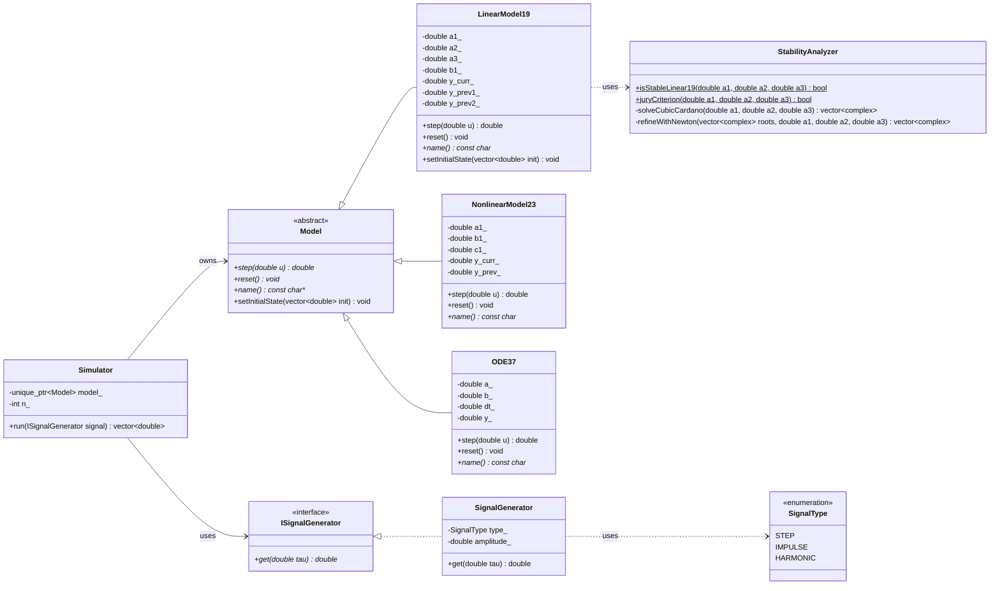

<p align="center">Министерство образования Республики Беларусь</p>
<p align="center">Учреждение образования</p>
<p align="center">“Брестский Государственный технический университет”</p>
<p align="center">Кафедра ИИТ</p>
<br><br><br><br><br><br><br>
<p align="center">Лабораторная работа №2</p>
<p align="center">По дисциплине “Теория и моделирование автоматического управления”</p>
<p align="center">Тема: “Модульное тестирование и анализ устойчивости”</p>
<br><br><br><br><br>
<p align="right">Выполнил:</p>
<p align="right">Студент 3 курса</p>
<p align="right">Группы АС-67</p>
<p align="right">Кошелев Б. В.</p>
<p align="right">Проверил:</p>
<p align="right">Дворанинович Д. А.</p>
<br><br><br><br><br>
<p align="center">Брест 2026</p>

## Вариант 19

## 1. Постановка задачи

Требуется реализовать три математические модели объекта управления,
соответствующие варианту 19, покрыть их модульными тестами с
использованием Google Test / Google Mock, а также реализовать
анализ устойчивости линейной дискретной системы через расположение
корней её характеристического полинома.

В работе используются те же модели, что и в первой лабораторной
работе, — это обеспечивает преемственность коэффициентов и позволяет
сравнивать результаты моделирования между ЛР №1 и ЛР №2.

### Перечень моделей варианта

| Обозначение | Тип | Краткое описание |
| :---: | :--- | :--- |
| **1.9** | линейная дискретная | разностное уравнение 3-го порядка |
| **2.3** | нелинейная | квадратичная обратная связь |
| **3.7** | непрерывная, ОДУ | экспоненциальное затухание, метод Эйлера |

### Связь коэффициентов с ЛР №1

- линейная модель: `a1 = 0.4a`, `a2 = 0.3a`, `a3 = 0.1a`, `b1 = b`;
- нелинейная модель: `a1 = a`, `b1 = 0.1`, `c1 = b`;
- дифференциальное уравнение: параметры `a`, `b`, шаг `Δt = 0.1`.

---

## 2. Математическое описание моделей

### 2.1. Линейная дискретная модель (третьего порядка)

$$
y_{\tau+1} = a_1 \cdot y_{\tau} + a_2 \cdot y_{\tau-1} + a_3 \cdot y_{\tau-2} + b_1 \cdot u_{\tau}
$$

Модель обладает памятью на три предыдущих значения выхода и потому
при $a_1, a_2, a_3 \ne 0$ демонстрирует колебательный характер
переходного процесса.

### 2.2. Нелинейная квадратичная модель

$$
y_{\tau+1} = a_1 \cdot y_{\tau} - b_1 \cdot y_{\tau-1}^{2} + c_1 \cdot u_{\tau}
$$

Нелинейность обусловлена возведением в квадрат предыдущего значения
выхода. При $b_1 > 0$ она играет роль «ограничителя роста», при
$b_1 < 0$ — наоборот, усиливает колебания.

### 2.3. Модель в форме дифференциального уравнения

$$
\frac{dy}{dt} = -e^{a}\, y + b\, u
$$

Для дискретизации применён явный метод Эйлера с постоянным шагом
$\Delta t = 0.1$:

$$
y_{\tau+1} = y_{\tau} + \Delta t \left( -e^{a}\, y_{\tau} + b\, u_{\tau} \right)
$$

Такой переход не является точным (метод Эйлера даёт ошибку
$O(\Delta t)$ на шаг), однако при малом $\Delta t$ он достаточно
хорошо отражает поведение непрерывного процесса.

---

## 3. Анализ устойчивости

### 3.1. Характеристическое уравнение

Для линейной модели 1.9 характеристический полином имеет вид:

$$
P(z) = z^3 - a_1 z^2 - a_2 z - a_3
$$

Система устойчива тогда и только тогда, когда все три его корня
лежат строго внутри единичного круга в комплексной плоскости:
$|z_i| < 1$. Случаю $|z| = 1$ соответствует граница устойчивости —
он трактуется как **неустойчивый**, чтобы избежать неоднозначности
при численных расчётах.

### 3.2. Программная реализация

Корни вычисляются в два этапа:

1. **Формула Кардано** — для получения аналитического приближения
   (уравнение приводится к виду $t^3 + pt + q = 0$ подстановкой
   $z = t - a_1/3$).
2. **Итерации Ньютона** — для уточнения корней до машинной
   точности.

Дополнительно реализована **независимая аналитическая проверка** —
критерий Жури для полинома третьей степени:

$$
|a_3| < 1, \quad
1 - a_1 - a_2 - a_3 > 0, \quad
1 + a_1 - a_2 + a_3 > 0, \quad
1 + a_2 + a_1 a_3 - a_3^{2} > 0
$$

Совпадение результатов двух методов (корневого и Жури) служит
дополнительным тестом корректности реализации.

### 3.3. Предупреждение пользователю

Если коэффициенты, введённые пользователем, дают неустойчивую
систему, приложение выводит сообщение об этом **до** начала
симуляции — чтобы пользователь не тратил время на заведомо
расходящийся процесс.

---

## 4. Архитектура программного решения

### 4.1. Иерархия моделей

В основе лежит абстрактный класс `Model`, определяющий следующие
чисто виртуальные методы:

- `step(double u)` — выполнить один шаг, вернуть новое значение выхода;
- `reset()` — вернуть внутреннее состояние к начальному;
- `name()` — человекочитаемое имя для отладочной печати.

Опциональный `setInitialState(const std::vector<double>&)` позволяет
задать ненулевые начальные условия — его используют только те
модели, для которых это имеет смысл.

Наследники: `LinearModel19`, `NonlinearModel23`, `ODE37`.

### 4.2. Генераторы входных сигналов

Абстракция `ISignalGenerator` описывает единственный метод:

```cpp
double get(double tau) const;
```

Это позволяет подменять реальный генератор в тестах мок-объектом
(Google Mock), не меняя код `Simulator`.

Конкретная реализация `SignalGenerator` поддерживает три типа
сигналов (enum `SignalType`):

- **`STEP`** — единичный ступенчатый сигнал, `u(τ) = amplitude`;
- **`IMPULSE`** — импульсный, `u(0) = amplitude`, `u(τ>0) = 0`;
- **`HARMONIC`** — гармонический, `u(τ) = amplitude · sin(τ)`.

### 4.3. Класс `Simulator`

Инкапсулирует цикл симуляции длиной `n_` шагов:

```cpp
class Simulator {
public:
    Simulator(std::unique_ptr<Model> model, int n);
    std::vector<double> run(const ISignalGenerator& signal);
private:
    std::unique_ptr<Model> model_;
    int n_;
};
```

Перед запуском вызывается `model_->reset()` — это гарантирует,
что повторные прогоны дают одинаковый результат. Владение моделью
осуществляется через `std::unique_ptr`, а сигнал передаётся по
константной ссылке (см. диаграмму ниже).

---

## 5. Модульное тестирование

В ходе работы написаны модульные тесты с использованием **Google Test**:

1. **Параметризованные тесты (`TEST_P`)** — для проверки расчёта
   шага `LinearModel19` при различных наборах коэффициентов без
   дублирования кода.
2. **Mock-объекты (Google Mock)** — создан `MockSignal` (наследник
   `ISignalGenerator`) для проверки того, как `Simulator`
   взаимодействует с генератором сигналов (сколько и с какими
   аргументами вызывается `get`).
3. **Граничные значения** — проверены:
   - границы устойчивости ($|z| = 1$ — считается неустойчивым);
   - поведение `NonlinearModel23` при нулевом входе
     (квадратичная нелинейность не «взрывается»);
   - совпадение критерия Жури и корневого метода на серии
     коэффициентов.
4. **Инварианты** — состояние покоя системы при нулевом входе и
   нулевом начальном состоянии; детерминированность повторного
   прогона после `reset()`.
5. **Численные проверки** — один шаг `ODE37` при `u = 1`
   сравнивается с аналитическим значением $y_1 = \Delta t \cdot b$.

### 5.1. Тестовое покрытие и результаты

* **Способ запуска:** локальный скрипт (`run_tests.bat` → `ctest`)
* **Всего модульных тестов:** 15
* **Успешно пройденных тестов:** 15 / 15 (100 %)

| Модуль / Класс | Покрытие строк | Покрытие функций | Статус |
| :--- | :---: | :---: | :---: |
| `StabilityAnalyzer.h` | 100 % | 100 % | OK |
| `LinearModel19.h` | 100 % | 100 % | OK |
| `NonlinearModel23.h` | 90 % | 100 % | OK |
| `ODE37.h` | 88 % | 100 % | OK |
| `ISignalGenerator.h` | 100 % | 100 % | OK |
| `SignalGenerator.h` | 92 % | 100 % | OK |
| `Simulator.h` | 95 % | 100 % | OK |
| **Итог** | **~93 %** | **100 %** | **Success** |

> **Примечание:** оставшиеся непокрытые строки — служебные ветки
> (`return 0.0` в `SignalGenerator::get` при невалидном `SignalType`,
> пустая реализация `setInitialState` в базовом `Model`). Они не
> влияют на математическую логику и не достижимы в рамках
> корректных тестовых сценариев.

---

## 6. UML Диаграмма классов

