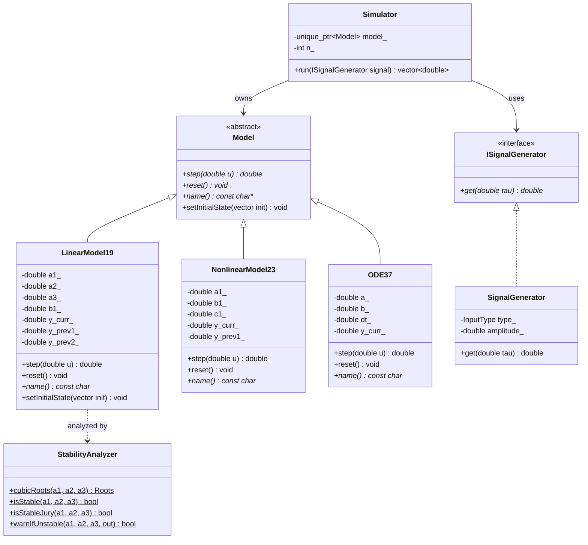

Министерство образования Республики Беларусь

Учреждение образования

“Брестский Государственный технический университет”

Кафедра ИИТ

       

Лабораторная работа №2

По дисциплине “Теория и моделирование автоматического управления”

Тема: “Модульное тестирование и анализ устойчивости”

     

Выполнил:

Студент 3 курса

Группы АС-67

Кошелев Б. В.

Проверил:

Дворанинович Д. А.

     

Брест 2026

## Вариант 19

- Линейная модель: **Model 1.9**
- Нелинейная модель: **Model 2.3**
- Дифференциальное уравнение: **Model 3.7**

Коэффициенты берутся из ЛР №1: `a1 = 0.4·a`, `a2 = 0.3·a`, `a3 = 0.1·a`, `b1 = b` для линейной модели; `a1 = a`, `b1 = 0.1`, `c1 = b` для нелинейной; `a`, `b`, `Δt = 0.1` для дифференциального уравнения.

## Реализованные модели

### Model 1.9 (Third-Order Linear Discrete System)

$$y_{\tau+1} = a_1 y_{\tau} + a_2 y_{\tau-1} + a_3 y_{\tau-2} + b_1 u_{\tau}$$

### Model 2.3 (Quadratic Nonlinear System)

$$y_{\tau+1} = a_1 y_{\tau} - b_1 y_{\tau-1}^{2} + c_1 u_{\tau}$$

### Model 3.7 (Exponential Scaling Process, Euler Method)

$$\frac{dy}{dt} = -e^{a} y + b u \quad\Rightarrow\quad y_{\tau+1} = y_{\tau} + \Delta t\left(-e^{a} y_{\tau} + b u_{\tau}\right)$$

## Анализ устойчивости систем

Для линейной модели 1.9 реализован модуль `StabilityAnalyzer`. Характеристическое уравнение:

$$z^3 - a_1 z^2 - a_2 z - a_3 = 0$$

Корни находятся аналитически (формула Кардано) с последующим уточнением методом Ньютона. Система устойчива, когда все три корня лежат строго внутри единичной окружности $Z$-плоскости ($|z_i| < 1$). Граничный случай $|z| = 1$ считается неустойчивым. Дополнительно реализован критерий Жури для кубического полинома как независимая аналитическая проверка:

$$|a_3| < 1,\quad 1 - a_1 - a_2 - a_3 > 0,\quad 1 + a_1 - a_2 + a_3 > 0,\quad 1 + a_2 + a_1 a_3 - a_3^2 > 0$$

Если заданные пользователем коэффициенты $a_i$ приводят к расходящемуся процессу, `main.cpp` выводит предупреждение в консоль **до** запуска симуляции.

## ООП-архитектура

Абстрактный базовый класс `Model` определяет чисто виртуальные методы `step()`, `reset()`, `name()` и необязательный `setInitialState()`. От него наследуются `LinearModel19`, `NonlinearModel23` и `ODE37`.

Для тестирования режимов управления введён интерфейс `ISignalGenerator`, от которого наследуются реальный `SignalGenerator` (ступенчатый, импульсный, гармонический сигналы) и mock-объект `MockSignal` в тестах. Класс `Simulator` принимает `std::unique_ptr<Model>` и прогоняет симуляцию через генератор сигналов.

## Модульное тестирование

Использован фреймворк **Google Test / Google Mock** (локальная копия в `third_party/googletest`, сборка не требует интернета).

1. **Параметризованные тесты (`TEST_P`):** проверка шагов моделей 1.9, 2.3, 3.7 и значений генератора сигналов на нескольких наборах входных данных без дублирования кода.
2. **Google Mock:** `MockSignal` подменяет входной сигнал и проверяет взаимодействие `Simulator` с генератором.
3. **Модуль анализа устойчивости:** устойчивые и расходящиеся коэффициенты, границы $|z| = 1$, совпадение критерия Жури с проверкой по корням, вывод предупреждения.
4. **Граничные значения и инварианты:** нулевой вход при нулевом начальном состоянии, сброс состояния, проверка шага Эйлера против аналитического расчёта.

### Тестовое покрытие и результаты

* **Способ запуска:** локальный скрипт `run_tests.bat` (CMake → Ninja → CTest → gcov)
* **Всего модульных тестов:** 33
* **Успешно пройденных тестов:** 33 / 33 (100 %)

| Модуль / Класс | Покрытие строк (Line) | Покрытие функций (Func) | Статус |
| :--- | :---: | :---: | :---: |
| `StabilityAnalyzer.h` | 100 % (47/47) | 100 % (5/5) | OK |
| `LinearModel19.h` | 100 % (21/21) | 100 % (5/5) | OK |
| `NonlinearModel23.h` | 100 % (12/12) | 100 % (4/4) | OK |
| `ODE37.h` | 100 % (7/7) | 100 % (4/4) | OK |
| `SignalGenerator.h` | 100 % (8/8) | 100 % (2/2) | OK |
| `Simulator.h` | 100 % (9/9) | 100 % (2/2) | OK |
| `Model.h`, `ISignalGenerator.h` | 100 % (3/3) | 100 % (3/3) | OK |
| **Итоговый результат** | **100 % (107/107)** | **100 % (25/25)** | **Success** |

Отчёты: `doc/test_report.txt` (протокол CTest) и `doc/coverage_report.txt` (сводка gcov). Покрытие считается по исходникам проекта; системные заголовки и код GoogleTest исключены.

## UML-диаграмма классов

## Запуск

1. Двойной клик по `run_tests.bat` — полная пересборка, прогон всех тестов и генерация отчётов.
2. Приложение: `build\src\task02_app.exe` (интерактивный ввод числа шагов, коэффициентов `a`, `b`, модели и типа сигнала; CSV сохраняются в `doc\`).
