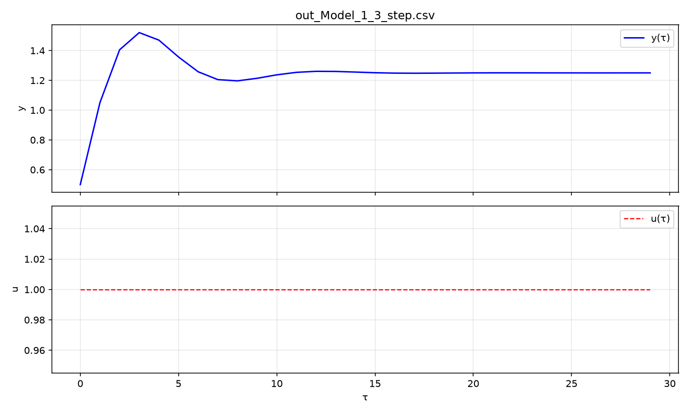
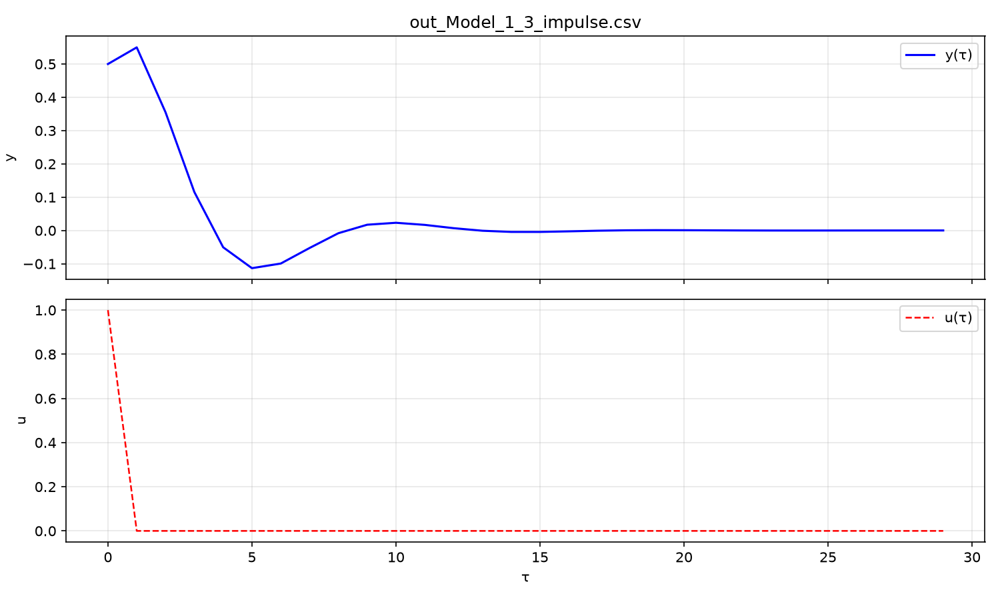
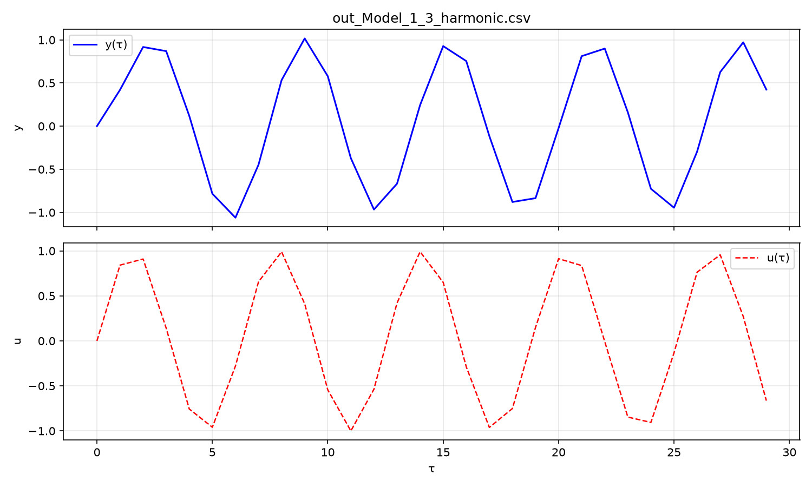
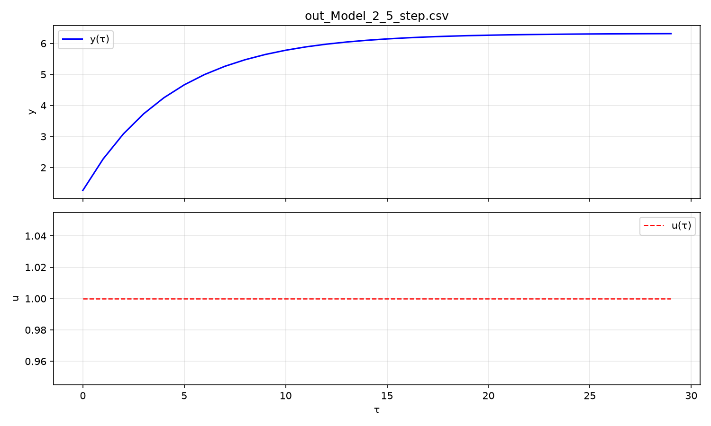
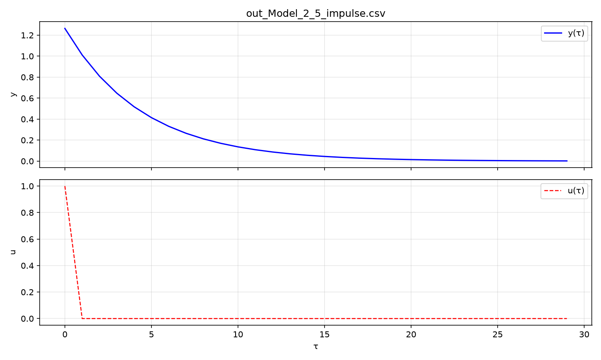
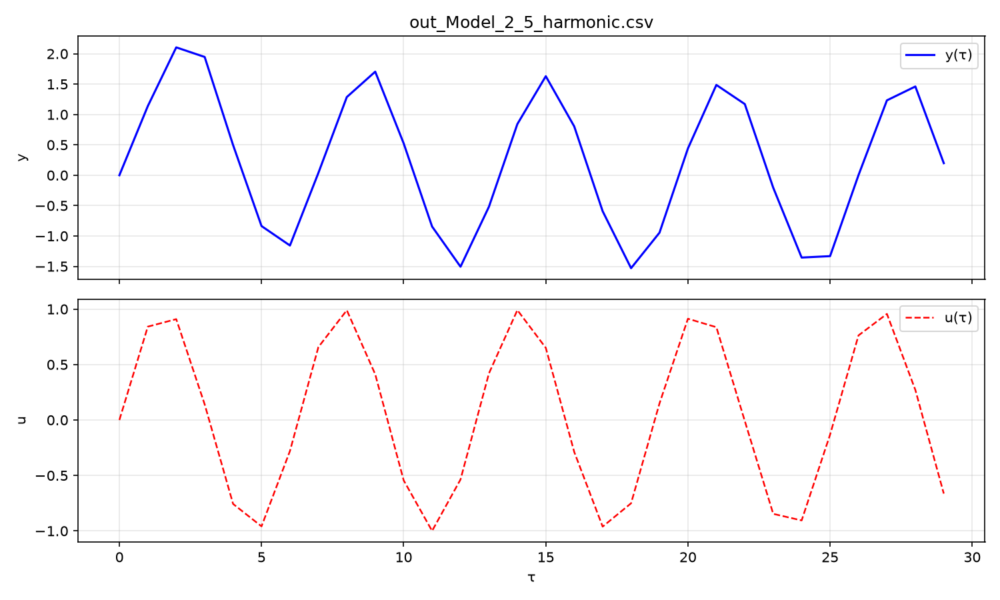
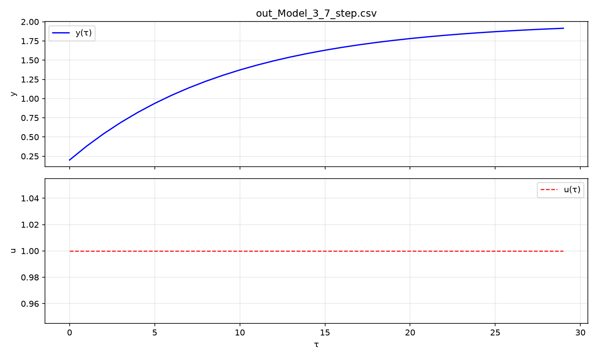
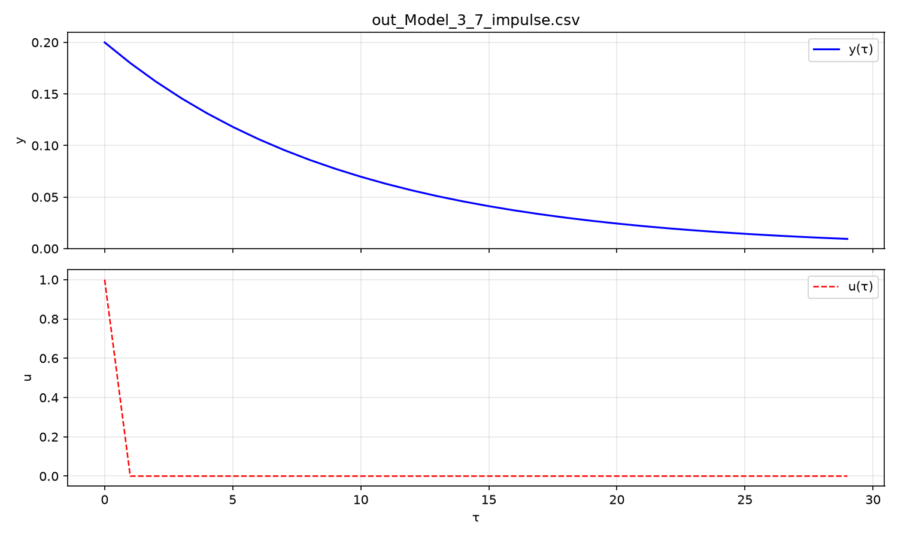
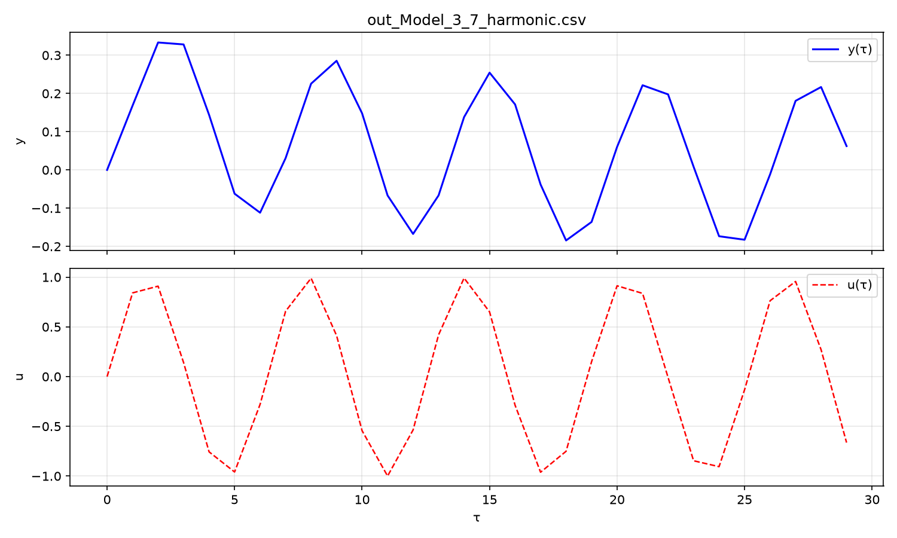

<p align="center">Министерство образования Республики Беларусь</p>
<p align="center">Учреждение образования</p>
<p align="center">“Брестский Государственный технический университет”</p>
<p align="center">Кафедра ИИТ</p>
<br><br><br><br><br><br><br>
<p align="center">Лабораторная работа №1</p>
<p align="center">По дисциплине “Теория и моделирование автоматического управления”</p>
<p align="center">Тема: “Моделирование объектов управления”</p>
<br><br><br><br><br>
<p align="right">Выполнил:</p>
<p align="right">Студент 3 курса</p>
<p align="right">Группы АС-67</p>
<p align="right">Лискович И.</p>
<p align="right">Проверил:</p>
<p align="right">Дворанинович Д. А.</p>
<br><br><br><br><br>
<p align="center">Брест 2026</p>

---

## Вариант 3

- Линейная модель: **Model 1.3**
- Нелинейная модель: **Model 2.5**
- Дифференциальное уравнение: **Model 3.7**

## Реализованные модели

### Model 1.3 (Second-Order Oscillatory/Inertial System)

$$y_{\tau+1} = a_1 \cdot y_{\tau} + a_2 \cdot y_{\tau-1} + b \cdot u_{\tau}$$

Параметры: $a_1 = 1.1$, $a_2 = -0.5$, $b = 0.5$

### Model 2.5 (Signum Friction and Exponential Growth)

$$y_{\tau+1} = a \cdot y_{\tau} + b \cdot \text{sign}(u_{\tau}) \cdot \left(1 - e^{-|u_{\tau}|}\right)$$

Параметры: $a = 0.8$, $b = 2.0$

### Model 3.7 (Exponential Scaling Process)

$$\frac{dy}{dt} = -e^a \cdot y + b \cdot u \quad\Rightarrow\quad y_{\tau+1} = y_{\tau} + \Delta t \cdot \left(-e^a \cdot y_{\tau} + b \cdot u_{\tau}\right)$$

Параметры: $a = 0.0$, $b = 2.0$, $\Delta t = 0.1$

## Входные воздействия

1. **Ступенчатое** (Step): $u_{\tau} = \text{const} = 1$
2. **Импульсное** (Impulse): $u_0 = 1,\ u_{\tau > 0} = 0$
3. **Гармоническое** (Harmonic): $u_{\tau} = \sin(\tau)$

## ООП Архитектура

Создан абстрактный базовый класс `Model` с чистыми виртуальными методами
`step()` и `reset()`, а также методом `name()`.

От базового класса наследуются:
- `LinearModel13` — линейная система второго порядка
- `NonlinearModel25` — нелинейная модель с sign и exp
- `ODE37` — дифференциальное уравнение

## Результаты моделирования

### 1. Переходные процессы линейной модели (Model 1.3)







### 2. Переходные процессы нелинейной модели (Model 2.5)







### 3. Переходные процессы дифференциальной модели (Model 3.7)







## UML Диаграмма классов

```mermaid
classDiagram
    class Model {
        <<abstract>>
        +step(double u)* double
        +reset()* void
        +name()* const char*
        +setInitialState(vector~double~ init) void
    }

    class LinearModel13 {
        -double a1_
        -double a2_
        -double b_
        -double y_curr_
        -double y_prev_
        +step(double u) double
        +reset() void
        +name() const char*
    }

    class NonlinearModel25 {
        -double a_
        -double b_
        -double y_
        +step(double u) double
        +reset() void
        +name() const char*
    }

    class ODE37 {
        -double a_
        -double b_
        -double dt_
        -double y_
        +step(double u) double
        +reset() void
        +name() const char*
    }

    class SignalGenerator {
        -SignalType type_
        -double amplitude_
        +get(double tau) double
    }

    class Simulator {
        -unique_ptr~Model~ model_
        -int n_
        +run(SignalGenerator signal) vector~double~
        +printTable(vector~double~ y, SignalGenerator signal) void
        +exportCSV(vector~double~ y, SignalGenerator signal, string fname) void
        +modelName() const char*
    }

    Model <|-- LinearModel13
    Model <|-- NonlinearModel25
    Model <|-- ODE37

    Simulator --> Model : owns
    Simulator ..> SignalGenerator : uses
