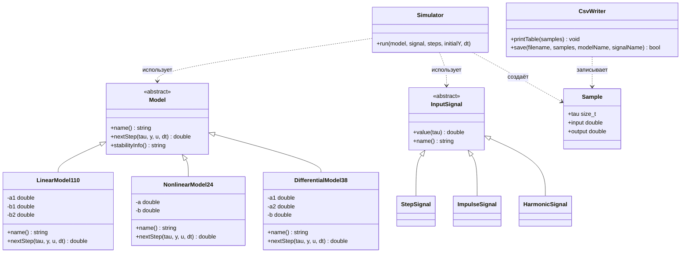
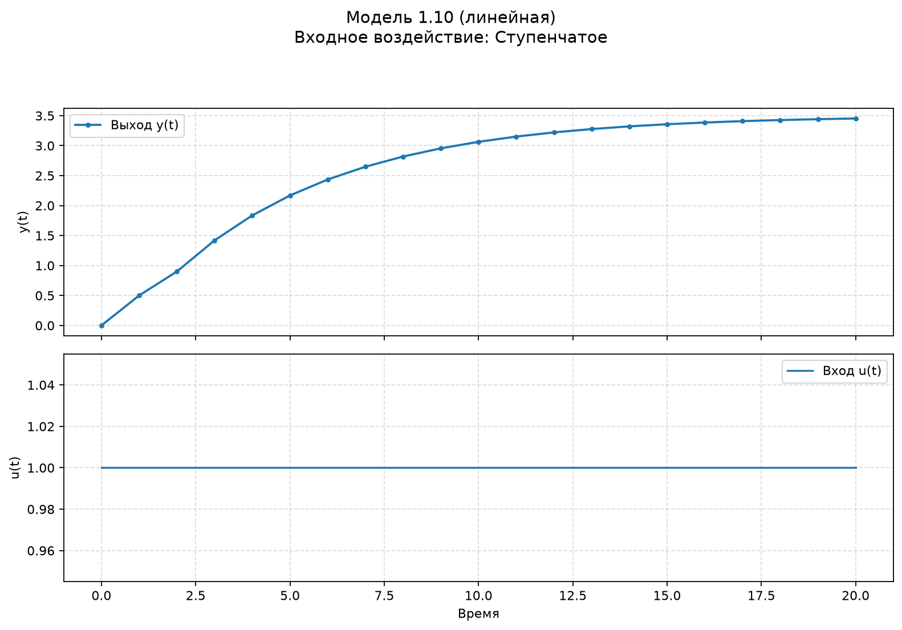
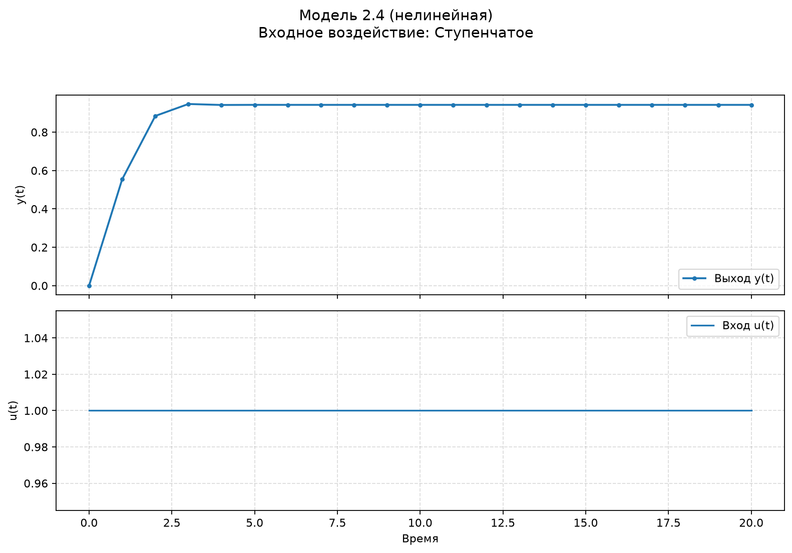
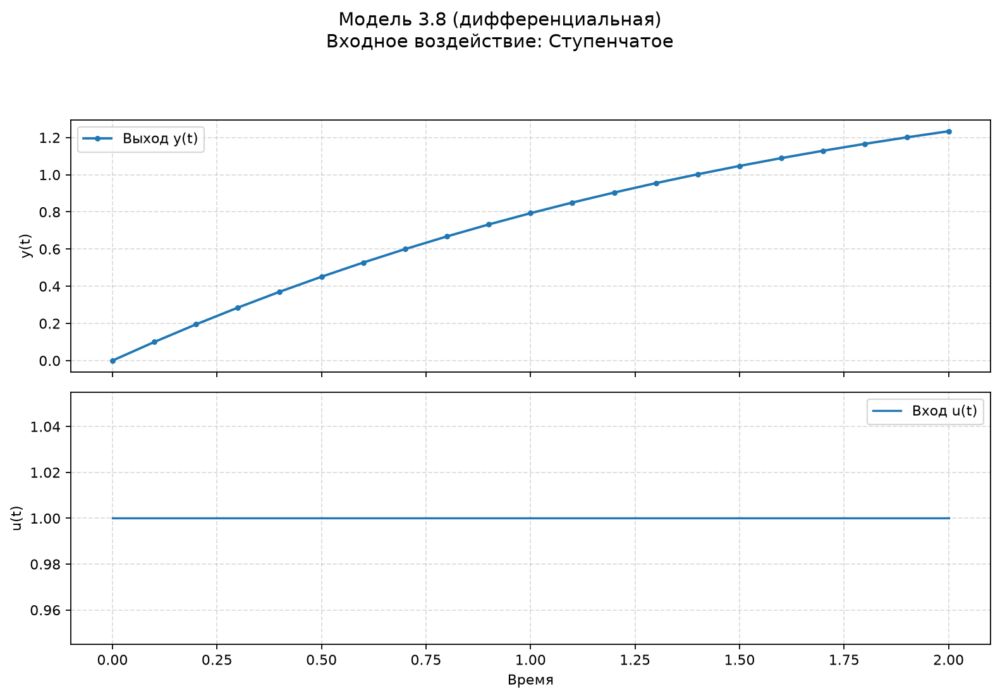

 
Министерство образования Республики Беларусь

Учреждение образования

«Брестский государственный технический университет»

Кафедра ИИТ

      

<b>Лабораторная работа № 1</b>

По дисциплине «Теория и моделирование автоматического управления»

Тема: «Моделирование объектов управления»

     

Выполнил:

Студент 3 курса

Группы АС-67

Масюк А. М.

Проверил:

Дворанович Д.А.

     

<b>Брест 2026</b>

---

# Вариант 20

Согласно таблице вариантов для выполнения лабораторной работы выбраны следующие модели:

- Линейная модель: **Model 1.10**.
- Нелинейная модель: **Model 2.4**.
- Дифференциальное уравнение: **Model 3.8**.

Программа реализована на C++ с применением объектно-ориентированного подхода. Пользователь выбирает модель, входное воздействие и количество шагов моделирования. Результаты выводятся в консольную таблицу и визуализируются при помощи Python и Matplotlib.

## 1. Реализованные математические модели

### 1.1. Model 1.10 — линейная модель с запаздыванием управления

Математическое описание:

$$
y_{\tau+1}=a_1y_\tau+b_1u_\tau+b_2u_{\tau-2}
$$

где $a_1$, $b_1$ и $b_2$ — коэффициенты модели, $y_\tau$ — текущее выходное значение, $u_\tau$ — текущее входное воздействие, $u_{\tau-2}$ — входное воздействие с задержкой на два шага.

Модель учитывает текущее состояние системы, текущее входное воздействие и входной сигнал, поступивший двумя шагами ранее. Если индекс задержанного сигнала выходит за начало последовательности, значение входа считается равным нулю.

В программе модель реализована отдельным классом, наследующим абстрактный класс `Model`.

Пример параметров для тестирования: $a_1=0.8$, $b_1=0.5$, $b_2=0.2$.

### 1.2. Model 2.4 — нелинейная модель

Математическое описание:

$$
y_{\tau+1}=ay_\tau\cos(y_\tau)+b\ln(1+|u_\tau|)
$$

где $a$ и $b$ — коэффициенты модели, $y_\tau$ — текущее выходное значение, $u_\tau$ — входное воздействие.

Уравнение содержит косинус текущего выходного значения и логарифмическую зависимость от модуля входного воздействия. Поэтому модель является нелинейной.

В программе модель реализована отдельным классом, наследующим абстрактный класс `Model`.

Пример параметров для тестирования: $a=0.5$, $b=0.3$.

### 1.3. Model 3.8 — дифференциальное уравнение

Математическое описание:

$$
\frac{dy}{dt}=-a_1y-a_2y^2+bu
$$

Для численного решения используется метод Эйлера:

$$
y_{\tau+1}=y_\tau+\Delta t
\left(-a_1y_\tau-a_2y_\tau^2+bu_\tau\right)
$$

где $a_1$, $a_2$ и $b$ — коэффициенты уравнения, а $\Delta t$ — шаг интегрирования.

Метод Эйлера позволяет приближённо вычислять решение дифференциального уравнения последовательно, на каждом шаге определяя новое значение выходного сигнала.

В программе модель реализована отдельным классом, наследующим абстрактный класс `Model`.

Пример параметров для тестирования: $a_1=0.5$, $a_2=0.1$, $b=0.2$, $\Delta t=0.1$.

Значения, приведённые выше, являются примерами для тестового запуска. В программе коэффициенты вводятся пользователем.

## 2. Входные воздействия

Для проверки моделей реализованы три вида входного сигнала.

1. **Ступенчатое воздействие:**

$$
u_\tau=
\begin{cases}
0, & \tau<10,\\
1, & \tau\geq 10.
\end{cases}
$$

Ступенчатый сигнал до десятого шага равен нулю, а начиная с десятого шага принимает постоянное значение, равное единице.

2. **Импульсное воздействие:**

$$
u_\tau=
\begin{cases}
1, & \tau=0,\\
0, & \tau>0.
\end{cases}
$$

Импульсный сигнал равен единице на начальном шаге, а на всех последующих шагах равен нулю.

3. **Гармоническое воздействие:**

$$
u_\tau=\sin(\tau)
$$

Гармонический сигнал периодически изменяется по закону синуса.

Сигналы реализованы классами `StepSignal`, `ImpulseSignal` и `HarmonicSignal`, наследующими абстрактный класс `InputSignal`.

## 3. Объектно-ориентированная архитектура

В основе программы лежит абстрактный класс `Model`. Он задаёт общий интерфейс для всех математических моделей:

- `name()` — возвращает название модели;
- `nextStep(...)` — вычисляет следующее значение выхода;
- `stabilityInfo()` — возвращает информацию об устойчивости, если она предусмотрена моделью.

Класс `Model` имеет чистые виртуальные методы `name()` и `nextStep()`, поэтому непосредственно создать объект базового класса нельзя. Конкретные уравнения реализованы в классах-наследниках.

Для входных сигналов используется абстрактный класс `InputSignal` с виртуальными методами `value(tau)` и `name()`. Это позволяет симулятору работать с разными сигналами через общий интерфейс.

Дополнительные классы программы:

- `Simulator` — выполняет расчёт последовательности значений модели;
- `Sample` — хранит номер шага, значение входного сигнала и значение выхода;
- `CsvWriter` — выводит таблицу в консоль и сохраняет результаты в CSV-файл, если это предусмотрено реализацией программы.

### UML-диаграмма классов

Диаграмма классов представлена ниже в формате Mermaid. На GitHub она отображается как UML-диаграмма.

## 4. Результаты моделирования

В начале работы пользователь выбирает одну из трёх моделей и одно из трёх входных воздействий. Далее вводятся количество шагов \(n\), начальное значение \(y(0)\) и коэффициенты выбранного уравнения. Для дифференциальной модели дополнительно задаётся шаг интегрирования \(\Delta t\).

Результаты содержат следующие поля:

| Поле | Описание |
|---|---|
| `tau` | Номер дискретного шага |
| `u_tau` | Значение входного воздействия |
| `y_tau` | Значение выходного сигнала модели |
| `model` | Название выбранной модели |
| `signal` | Название выбранного входного воздействия |

### Model 1.10 — линейная модель с задержкой управления

### Model 2.4 — нелинейная модель

### Model 3.8 — дифференциальное уравнение

