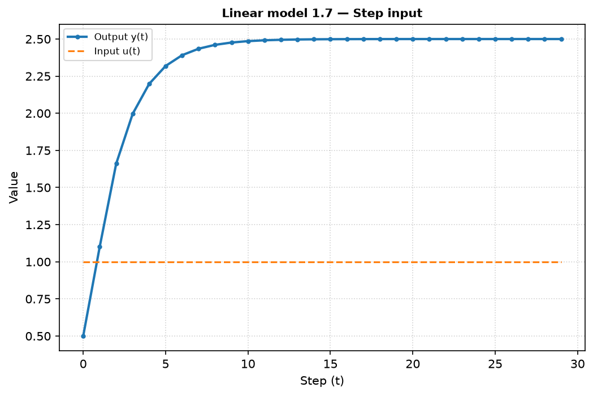
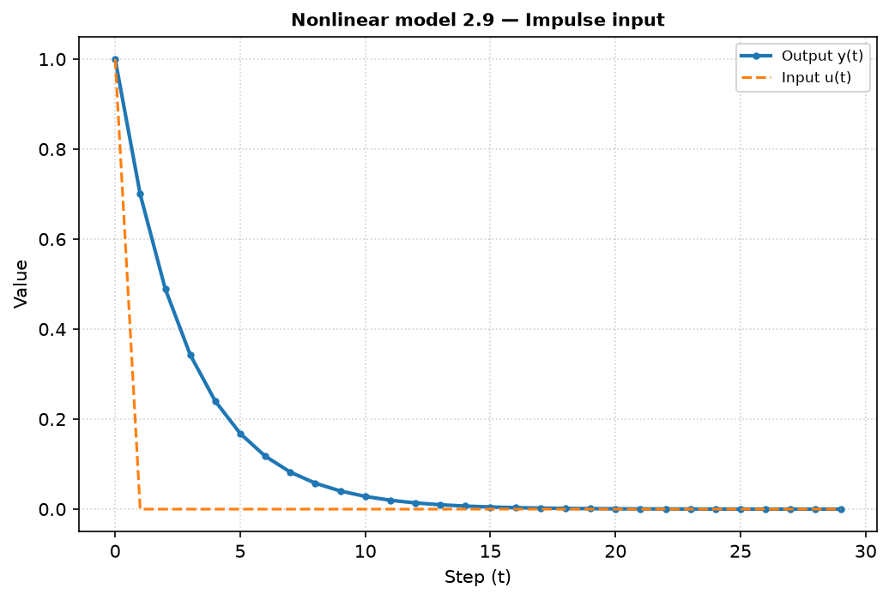
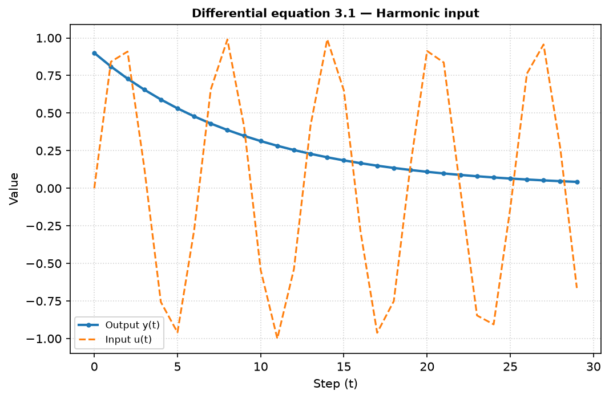
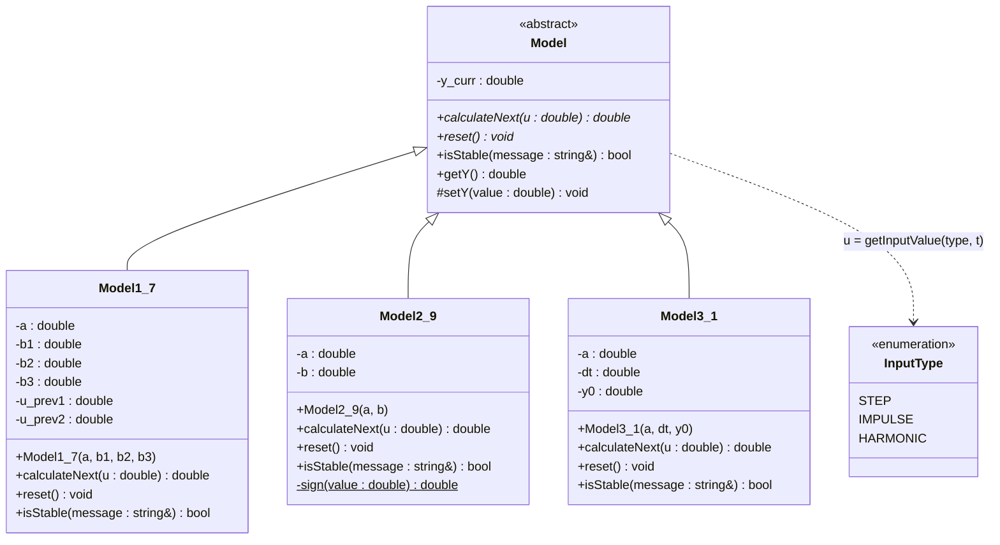

<p align="center">Министерство образования Республики Беларусь</p>
<p align="center">Учреждение образования</p>
<p align="center">Брестский государственный технический университет</p>
<p align="center">Кафедра ИИТ</p>
<br><br><br><br><br><br><br>
<p align="center">Отчет по лабораторной работе №1</p>
<p align="center">Дисциплина: Теория и методы автоматического управления</p>
<p align="center">Тематика: Моделирование управляемых объектов</p>
<br><br><br><br><br>
<p align="right">Выполнил студент:</p>
<p align="right">Группа: АС-67</p>
<p align="right">Никитин В. Н.</p>
<p align="right">Преподаватель:</p>
<p align="right">Дворанинович Д. А.</p>
<br><br><br><br><br>
<p align="center">Брест, 2026 год</p>

---

## Выполнение задания (Вариант 7)

**Цель работы:** смоделировать поведение управляемого объекта с помощью линейной,
нелинейной и дифференциальной моделей, исследовать переходные процессы при
ступенчатом, импульсном и гармоническом входных воздействиях.

| Блок | Модель | Название |
| :--: | :----: | :------- |
| 1 | Model 1.7 | System with Multi-Step Control History (система с многошаговой историей управления) |
| 2 | Model 2.9 | Square Root Modulated Action (модуляция воздействия квадратным корнем) |
| 3 | Model 3.1 | Pure Linear Decay (чистое линейное затухание) |

### Математическое описание разработанных моделей

1. **Линейная дискретная модель (1.7):**

   $$y_{\tau+1} = a y_{\tau} + b_1 u_{\tau} + b_2 u_{\tau-1} + b_3 u_{\tau-2}$$

   В объекте хранятся два предыдущих значения входа $u_{\tau-1}$, $u_{\tau-2}$.

2. **Нелинейная модель (2.9):**

   $$y_{\tau+1} = a y_{\tau} + b \sqrt{|u_{\tau}|} \cdot \text{sign}(u_{\tau})$$

3. **Дифференциальное уравнение (3.1):**

   Исходное уравнение: $\dfrac{dy}{dt} = -a y$

   Для программной реализации применён численный метод Эйлера с шагом $\Delta t$:

   $$y_{\tau+1} = y_{\tau} - \Delta t \cdot a y_{\tau}$$

   Входное воздействие $u$ в уравнение не входит, поэтому процесс задаётся
   начальным условием $y_0$ (при $y_0 = 0$ выход тождественно равен нулю).
   Модель описывает свободное движение (затухание) объекта.

### Входные воздействия

| Тип | Формула |
| :-- | :------ |
| Ступенчатое | $u_{\tau} = 1$ |
| Импульсное | $u_0 = 1,\; u_{\tau>0} = 0$ |
| Гармоническое | $u_{\tau} = \sin(\tau)$ |

### Параметры моделирования (значения по умолчанию)

| Модель | Параметры |
| :----: | :-------- |
| 1.7 | $a = 0.6,\; b_1 = 0.5,\; b_2 = 0.3,\; b_3 = 0.2$ |
| 2.9 | $a = 0.7,\; b = 1$ |
| 3.1 | $a = 1,\; \Delta t = 0.1,\; y_0 = 1$ |

Количество шагов симуляции $n$ задаётся пользователем (по умолчанию $n = 30$),
все параметры моделей вводятся с клавиатуры (Enter — значение по умолчанию).

---

## Анализ устойчивости (дополнительное задание)

**Модель 1.7.** Применяя Z-преобразование, получаем передаточную функцию

$$W(z) = \frac{Y(z)}{U(z)} = \frac{b_1 z^2 + b_2 z + b_3}{z^2 (z - a)}$$

Полюса: $z_{1,2} = 0$ (от задержек входа) и $z_3 = a$. Характеристическое
уравнение по выходу: $z - a = 0$. Система устойчива, если $|a| < 1$;
коэффициенты $b_i$ на устойчивость не влияют.

Для $a = 0.6$: $|z| = 0.6 < 1$ — система **устойчива**. Установившееся
значение при $u = 1$:

$$y_{\infty} = \frac{b_1 + b_2 + b_3}{1 - a} = \frac{1.0}{0.4} = 2.5$$

**Модель 2.9.** Однородная часть линейна: $y_{\tau+1} = a y_{\tau}$, корень
$z = a$, устойчивость при $|a| < 1$. При $u = 1$:
$y_{\infty} = \dfrac{b}{1 - a} = 3.33$.

**Модель 3.1.** Разностная схема Эйлера: $y_{\tau+1} = (1 - a\Delta t) y_{\tau}$,
корень $z = 1 - a\Delta t$, условие устойчивости $|1 - a\Delta t| < 1$, т.е.
$0 < a\Delta t < 2$. Решение: $y_{\tau} = y_0 (1 - a\Delta t)^{\tau}$, при
устойчивой схеме $y_{\infty} = 0$.

Пример вывода программы для неустойчивого коэффициента ($a = 1.3$):

```
[Stability] Linear_1_7: Characteristic equation: z - (1.3000) = 0; |z| = 1.3000 (must be < 1)
[WARNING] Coefficients lead to a DIVERGENT (unstable) process!
```

---

## Результаты моделирования

Результаты каждого прогона выводятся в консоль в виде таблицы и сохраняются в
файлы `doc/<Модель>_<Сигнал>.csv` (столбцы `Step,u,y`).

Фрагмент вывода для модели 1.7 (ступенчатое воздействие):

```
>>> Linear_1_7 (Step signal)
+------+------------+--------------+
|     t|        u(t)|        y(t+1)|
+------+------------+--------------+
|     0|      1.0000|        0.5000|
|     1|      1.0000|        1.1000|
|     2|      1.0000|        1.6600|
|     3|      1.0000|        1.9960|
|     4|      1.0000|        2.1976|
|     5|      1.0000|        2.3186|
|     6|      1.0000|        2.3911|
|     7|      1.0000|        2.4347|
|     8|      1.0000|        2.4608|
|     9|      1.0000|        2.4765|
|    10|      1.0000|        2.4859|
```

Фрагмент вывода для модели 2.9 (гармоническое воздействие):

```
>>> Nonlinear_2_9 (Harmonic signal)
+------+------------+--------------+
|     t|        u(t)|        y(t+1)|
+------+------------+--------------+
|     0|      0.0000|        0.0000|
|     1|      0.8415|        0.9173|
|     2|      0.9093|        1.5957|
|     3|      0.1411|        1.4926|
|     4|     -0.7568|        0.1749|
|     5|     -0.9589|       -0.8568|
```

Фрагмент вывода для модели 3.1 (импульсное воздействие):

```
>>> DiffEquation_3_1 (Impulse signal)
+------+------------+--------------+
|     t|        u(t)|        y(t+1)|
+------+------------+--------------+
|     0|      1.0000|        0.9000|
|     1|      0.0000|        0.8100|
|     2|      0.0000|        0.7290|
|     3|      0.0000|        0.6561|
|     4|      0.0000|        0.5905|
|     5|      0.0000|        0.5314|
```

### Графики переходных процессов

Визуализация выполнена с помощью Python/Matplotlib (`src/plot.py`).


**Модель 1.7 (ступенчатое воздействие):**



**Модель 2.9 (импульсное воздействие):**



**Модель 3.1 (гармоническое воздействие):**


---

### Структура классов (UML)

Программа построена на принципах ООП: абстрактный базовый класс `Model`
задаёт чисто виртуальные методы `calculateNext()` и `reset()`, а конкретные
уравнения реализованы в классах-наследниках.



---

### Сборка и запуск

Сборка выполняется системой CMake. Для запуска достаточно выполнить
`run_build.bat` в папке `task_01`. Скрипт:

1. находит CMake и компилятор C++;
2. конфигурирует проект (`cmake -S . -B build`);
3. собирает его с подробным выводом (`cmake --build build --verbose`);
4. запускает программу моделирования и строит графики (`src/plot.py`).

Структура проекта:

```
task_01/
├── CMakeLists.txt
├── run_build.bat
├── doc/          — отчёт, CSV-результаты и графики
└── src/
    ├── CMakeLists.txt
    ├── Model.h               — абстрактный базовый класс
    ├── Model1_7.h / .cpp     — линейная модель 1.7
    ├── Model2_9.h / .cpp     — нелинейная модель 2.9
    ├── Model3_1.h / .cpp     — дифференциальное уравнение 3.1
    ├── InputSignal.h / .cpp  — входные воздействия
    ├── main.cpp              — диалог с пользователем, вывод таблиц и CSV
    └── plot.py               — визуализация (Matplotlib)
```

---

## Выводы

1. **Модель 1.7** при $a = 0.6$ устойчива. Учёт предыдущих значений
   управления ($b_2 u_{\tau-1}$, $b_3 u_{\tau-2}$) «растягивает» реакцию: импульсная
   характеристика достигает максимума не сразу, а на втором шаге, после чего
   экспоненциально затухает; при ступенчатом входе выход выходит на
   $y_\infty = 2.5$.
2. **Модель 2.9** ведёт себя как инерционное звено первого порядка со
   «сжатым» входом: при $|u| = 1$ нелинейность не проявляется ($\sqrt{1} = 1$),
   а при гармоническом сигнале малые значения $|u|$ усиливаются
   ($\sqrt{|u|} > |u|$), из-за чего амплитуда выхода выше, чем у линейного звена.
3. **Модель 3.1** (метод Эйлера, $\Delta t = 0.1$) описывает свободное
   затухание: выход экспоненциально убывает от $y_0 = 1$ к нулю, а графики
   при всех трёх воздействиях совпадают, поскольку вход не входит в уравнение.
4. Реализована проверка устойчивости: при коэффициентах, ведущих к
   расходящемуся процессу, программа выводит предупреждение до начала симуляции.
