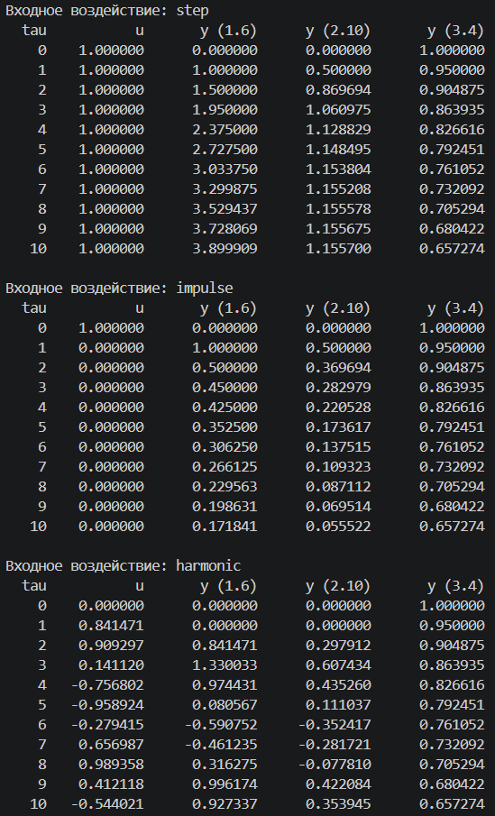
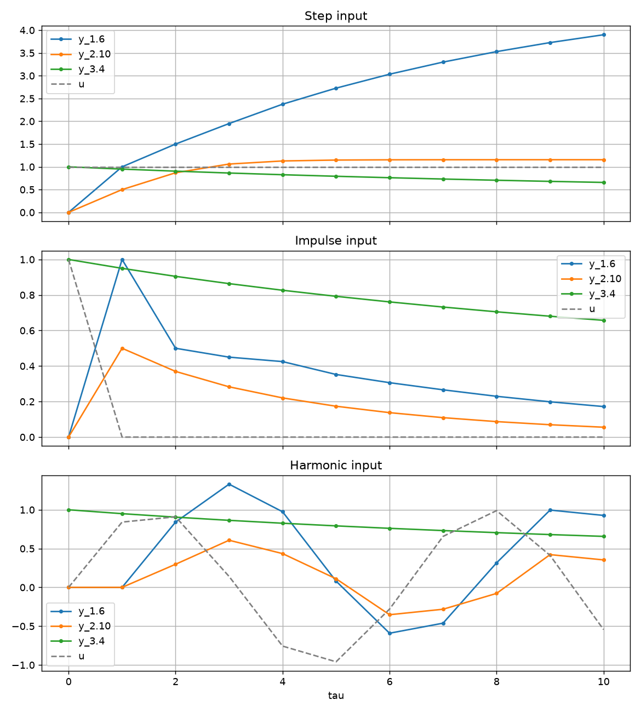
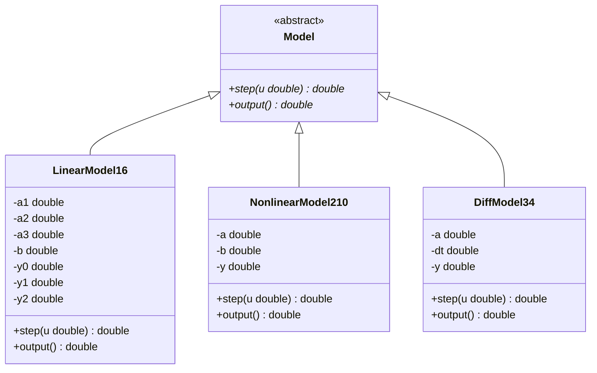

<p align="center"> Министерство образования Республики Беларусь</p>
<p align="center">Учреждение образования</p>
<p align="center">“Брестский Государственный технический университет”</p>
<p align="center">Кафедра ИИТ</p>
<br><br><br><br><br><br><br>
<p align="center">Лабораторная работа №1</p>
<p align="center">По дисциплине “Теория и моделирование автоматического управления”</p>
<p align="center">Тема: “Моделирование объектов управления”</p>
<br><br><br><br><br>
<p align="right">Выполнила:</p>
<p align="right">Студентка 3 курса</p>
<p align="right">Группы АС-67</p>
<p align="right">Петрова А. И.</p>
<p align="right">Проверил:</p>
<p align="right">Дворанинович Д. А.</p>
<br><br><br><br><br>
<p align="center">Брест 2026</p>


## Вариант

- Линейная модель: **Model 1.6**
- Нелинейная модель: **Model 2.10**
- Дифференциальное уравнение: **Model 3.4**

## Реализованные модели

### Model 1.6 (Third-Order Dynamic System)
$$\Large y_{\tau+1} = a_1y_{\tau} + a_2y_{\tau-1} + a_3y_{\tau-2} + bu_{\tau}$$
Параметры: $a_1 = 0.5$, $a_2 = 0.2$, $a_3 = 0.1$, $b = 1$.  
Начальные условия: $y_0 = y_{-1} = y_{-2} = 0$.

### Model 2.10 (Hyperbolic Tangent Smoothing)
$$\Large y_{\tau+1} = a \cdot
  \tanh(y_{\tau}) + b \cdot u_{\tau}^3$$
Параметры: $a = 0.8$, $b = 0.5$.  
Начальное условие: $y_0 = 0$.

### Model 3.4 (Quadratic Self-Decay)
$$\Large \frac{dy}{dt} = -a \cdot y^2$$
  $$ \implies y_{\tau+1} = y_{\tau} - \Delta t \cdot a y_{\tau}^2$$
Параметры: $a = 0.5$, $\Delta t = 0.1$.  
Начальное условие: $y_0 = 1$.


## Входные воздействия

1. Ступенчатое: $u_\tau = 1$
2. Импульсное: $u_0 = 1$, $u_{\tau > 0} = 0$
3. Гармоническое: $u_\tau = \sin(\tau)$

## ООП

Создан абстрактный базовый класс `Model` с виртуальным методом `step(u)`, который рассчитывает следующий шаг симуляции, и методом `output()`, возвращающим текущее значение выхода.

От него наследуются:

- `LinearModel16` — Model 1.6
- `NonlinearModel210` — Model 2.10
- `DiffModel34` — Model 3.4


## Результат

Программа:
 
- позволяет задать количество шагов симуляции `n` (по умолчанию 20)
- для каждого из трёх входных воздействий моделирует все три модели
- выводит результаты в консоль в табличном виде
- сохраняет результаты в `doc/results_step.csv`, `doc/results_impulse.csv`, `doc/results_harmonic.csv`
- строит графики через Python/Matplotlib (`src/plot.py` читает CSV из `doc` и сохраняет `doc/results.png`)


## Пример работы программы:

### Сборка

На Windows build.bat:

```bat
@echo off
chcp 65001 >nul
setlocal
cd /d "%~dp0"

echo ===== [1/3] Configuring project (CMake) =====
cmake -S . -B build
if errorlevel 1 goto :error

echo.
echo ===== [2/3] Building project (Release) =====
cmake --build build --config Release
if errorlevel 1 goto :error

echo.
echo ===== [3/3] Running program =====
build\Release\task_01_as06716.exe
if errorlevel 1 goto :error

echo.
echo ===== Plotting results (Python / Matplotlib) =====
python src\plot.py
if errorlevel 1 echo Plotting failed. Try: pip install matplotlib

pause
endlocal
exit /b 0

:error
echo.
echo ERROR: a step failed, exit code %errorlevel%.
pause
endlocal
exit /b 1
```

Файл `build.bat` последовательно выполняет конфигурацию, сборку, запуск программы и построение графиков.

### Демонстрация исполняемого файла task_01_as06716.exe




При запуске исполняемого файла результаты сохраняются в файлы `.csv` в каталоге `doc`, после чего запускается `plot.py` для визуализации.


### Графики для трёх входных воздействий
 



## UML


