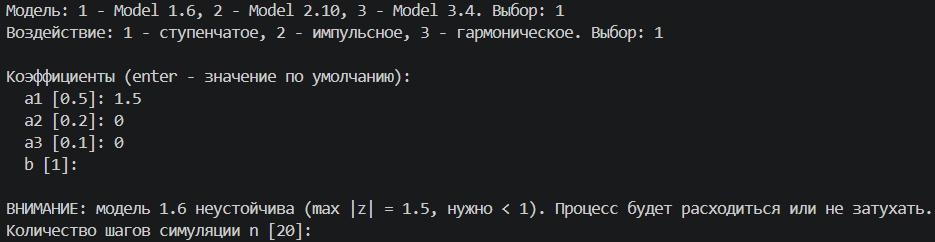
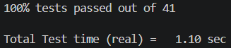
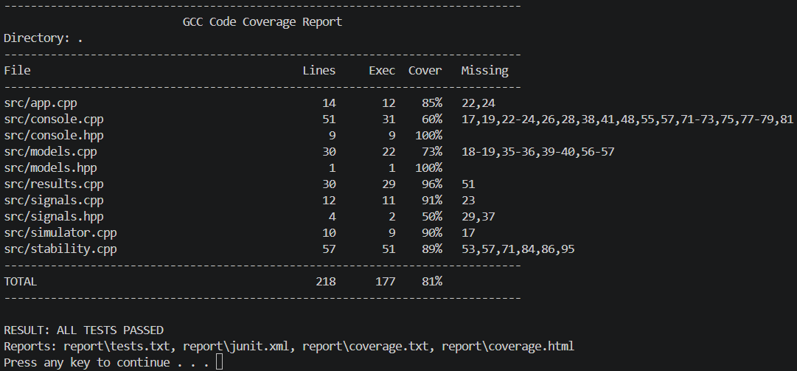

<p align="center"> Министерство образования Республики Беларусь</p>
<p align="center">Учреждение образования</p>
<p align="center">“Брестский Государственный технический университет”</p>
<p align="center">Кафедра ИИТ</p>
<br><br><br><br><br><br><br>
<p align="center">Лабораторная работа №2</p>
<p align="center">По дисциплине “Теория и методы автоматического управления”</p>
<p align="center">Тема: “Модульное тестирование и анализ покрытия кода”</p>
<br><br><br><br><br>
<p align="right">Выполнила:</p>
<p align="right">Студентка 3 курса</p>
<p align="right">Группы АС-67</p>
<p align="right">Петрова А. И.</p>
<p align="right">Проверил:</p>
<p align="right">Дворанинович Д. А.</p>
<br><br><br><br><br>
<p align="center">Брест 2026</p>


## Вариант 16

- Линейная модель: **Model 1.6**
- Нелинейная модель: **Model 2.10**
- Дифференциальное уравнение: **Model 3.4**

## Анализ устойчивости Model 1.6

Модель:  
$$y_{\tau+1} = a_1y_{\tau} + a_2y_{\tau-1} + a_3y_{\tau-2} + bu_{\tau}$$

Для свободного движения ($u=0$) подстановка $y_\tau = z^\tau$ даёт характеристическое уравнение на Z-плоскости:

$$z^3 - a_1z^2 - a_2z - a_3 = 0$$

Модель асимптотически устойчива, если все корни лежат строго внутри единичной окружности $|z_i| < 1$. Корень на окружности ($|z| = 1$) - граница, такая модель устойчивой не считается. Коэффициент $b$ на устойчивость не влияет.

В программе (`src/stability.cpp`):

- `characteristicRoots` находит корни уравнения методом Дурана-Кернера, `analyze` возвращает `max|z|`
- `isStable` принимает решение по критерию Джури для кубического многочлена (строгие неравенства, поэтому граница $|z|=1$ определяется точно)
- `warnIfUnstable` печатает предупреждение, если модель неустойчива

Предупреждение выводится сразу после ввода коэффициентов, **до** начала симуляции:



## Модульные тесты

Фреймворк Google Test / Google Mock. Тесты находятся в `test/`:

| Файл | Что проверяется |
| :--- | :--- |
| `test_models.cpp` | значения моделей, посчитанные вручную; покой при $u=0,\ y=0$; ограниченность обратной связи нелинейности (tanh); метод Эйлера против точного решения $y=y_0/(1+ay_0t)$ (`TEST_P` по шагу $dt$) |
| `test_stability.cpp` | `TEST_P`: устойчивые, неустойчивые и граничные ($\lvert z\rvert=1$) коэффициенты, предупреждение только для неустойчивых; корни характеристического уравнения |
| `test_simulation.cpp` | `TEST_P`: сходимость к установившемуся значению и затухание импульсной реакции; Google Mock: `MockModel` получает ступенчатое, импульсное и гармоническое воздействие, `MockSignal` подменяет входной сигнал |
| `test_app.cpp` | вся программа на строковых потоках: предупреждение выводится раньше таблицы симуляции |

## Запуск

Из каталога `task_02`:

```bat
run_tests.bat
```

Скрипт собирает проект, запускает тесты (`ctest`), сохраняет отчёт в `report/` и строит отчёт покрытия.

## Тестовое покрытие и результаты

* **Способ запуска:** локальный скрипт (`run_tests.bat`)
* **Всего модульных тестов:** 41 (параметризованные `TEST_P` считаются по числу наборов данных)
* **Успешно пройденных тестов:** 41 / 41

| Модуль / Класс | Покрытие строк (Line Coverage) | Покрытие функций (Func Coverage) | Статус |
| :--- | :---: | :---: | :---: |
| `app.cpp` | 85.7 % | 100 % | OK |
| `console.cpp` / `console.hpp` | 66.7 % | 87.5 % | OK |
| `results.cpp` | 96.7 % | 100 % | OK |
| `signals.cpp` / `signals.hpp` | 81.3 % | 75.0 % | OK |
| `models.hpp` | 83.3 % | 71.4 % | OK |
| `simulator.cpp` | 90.0 % | 100 % | OK |
| `stability.cpp` | 89.5 % | 100 % | OK |
| **Итоговый результат** | **82.5 %** (174 из 211) | **82.9 %** (34 из 41) | **Success** |

`main.cpp` в покрытие не входит. Не покрыты в основном ветки обработки неверного ввода в `console.cpp` и вспомогательные методы (`output()`, `name()`).

Результаты `run_tests.bat`:






## Вывод

Программа из первой лабораторной дополнена модулем анализа устойчивости модели 1.6 по корням характеристического уравнения на Z-плоскости. При неустойчивых коэффициентах предупреждение выводится до начала симуляции. Написано 41 модульный тест на Google Test (в том числе параметризованные `TEST_P` и mock-объекты Google Mock), покрытие кода - 82.5 % по строкам (gcovr).
