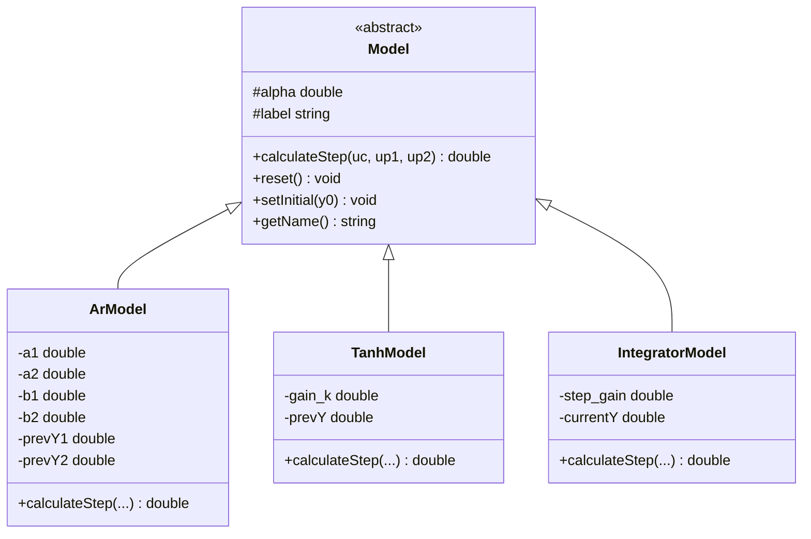
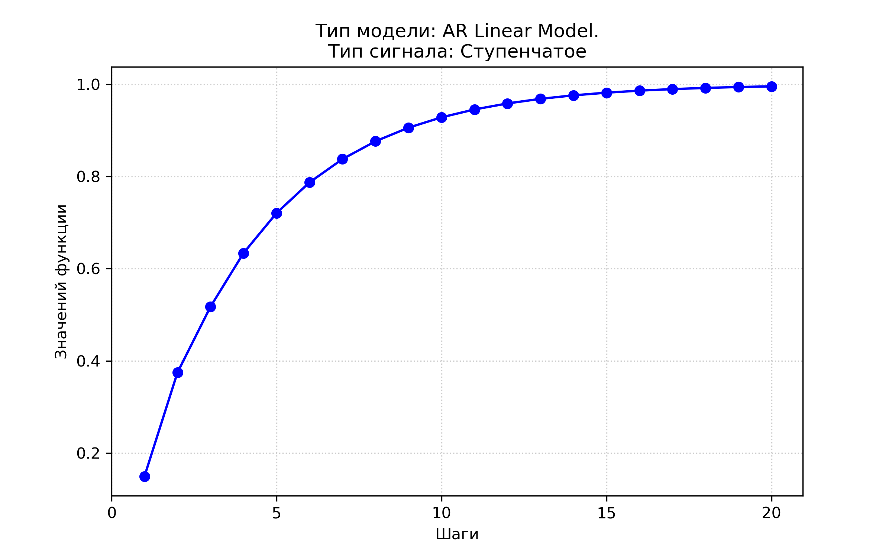
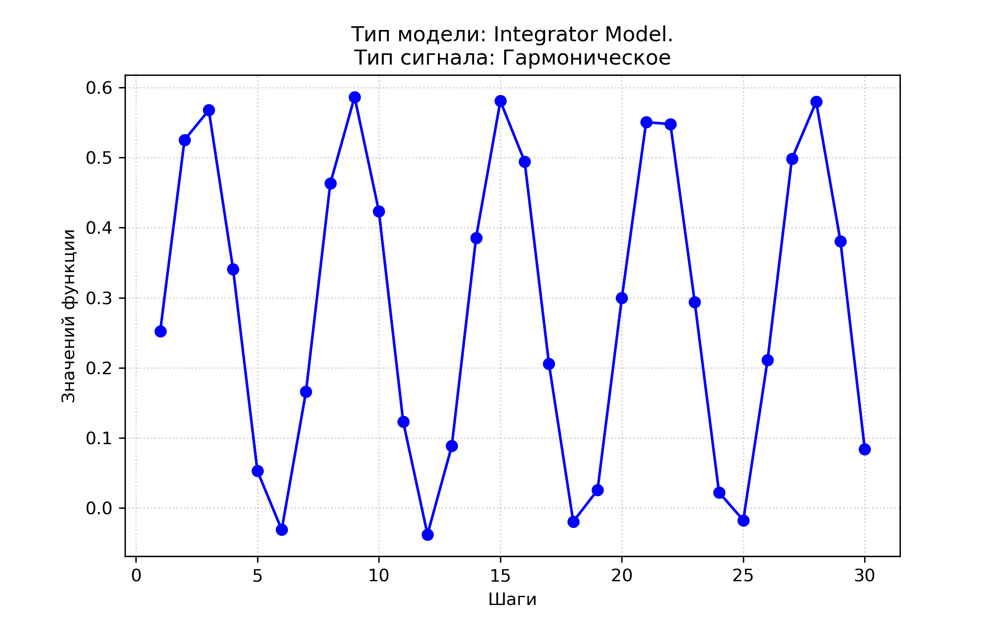

Министерство образования Республики Беларусь

Учреждение образования

«Брестский государственный технический университет»

Кафедра ИИТ

      

<b>Лабораторная работа № 1</b>

По дисциплине «Теория и моделирование автоматического управления»

Тема: «Моделирование объектов управления»

     

Выполнил:

Студент 3 курса

Группы АС-67

Сеглюк К.О.

Проверил:

Дворанинович Д. А.

     

<b>Брест 2026</b>

---

## Вариант 8

Согласно таблице вариантов для выполнения лабораторной работы выбраны следующие модели:

- Обобщённая авторегрессионная линейная модель: **model1-8**.
- Модель с гиперболическим сглаживанием: **model2-10**.
- Дифференциальная модель постоянного воздействия: **model3-2**.

## 1. Математическое описание моделей

### 1.1. model1-8 (AR Linear Model)

Математическое описание:

$$
y_{\tau+1} = a_1 \cdot y_{\tau} + a_2 \cdot y_{\tau-1} + b_1 \cdot u_{\tau} + b_2 \cdot u_{\tau-1}
$$

### 1.2. model2-10 (Tanh Smoothing Model)

Математическое описание:

$$
y_{\tau+1} = a \cdot \tanh(y_{\tau}) + b \cdot u_{\tau}^3
$$

### 1.3. model3-2 (Integrator Model)

Математическое описание:

$$
y_{\tau+1} = y_{\tau} + dt \cdot (b \cdot u_{\tau})
$$

## 2. Исследуемые входные воздействия $u(\tau)$

Для проверки моделей используются три типа входных воздействий:

1. **Ступенчатое:**

$$
u(\tau) = A
$$

2. **Импульсное:**

$$
u(1) = A, \qquad u(\tau > 1) = 0
$$

3. **Гармоническое:**

$$
u(\tau) = A \cdot \sin(\tau)
$$

## 3. Архитектура программы (ООП)

В основе программы лежит абстрактный класс `Model`, определяющий единый интерфейс расчёта следующего шага симуляции (`calculateStep`).

От абстрактного класса наследуются конкретные классы моделей:

- `ArModel` — реализация обобщённой авторегрессионной линейной модели;
- `TanhModel` — реализация модели с гиперболическим сглаживанием;
- `IntegratorModel` — реализация интегрирующей модели.

### UML-диаграмма классов

Диаграмма классов представлена ниже в формате Mermaid и отражает структуру объектно-ориентированной реализации программы.

## 4. Результаты моделирования

В начале работы пользователь выбирает одну из трёх моделей и одно из трёх входных воздействий. Далее вводятся количество шагов симуляции $$n$$, амплитуда входного сигнала $$A$$ и начальное значение $$y(0)$$. Для выбранной модели дополнительно вводятся её коэффициенты: для `AR Linear Model` — $$a_1, a_2, b_1, b_2$$; для `Tanh Smoothing Model` — $$\alpha, \beta$$; для `Integrator Model` — $$\beta$$. После ввода всех параметров программа выполняет расчёт переходного процесса, выводит таблицу результатов в консоль и сохраняет данные в CSV-файл для автоматического построения графиков.

Результаты моделирования представлены в графическом виде. Графики позволяют оценить характер изменения выходного сигнала во времени и сравнить реакцию моделей на различные входные воздействия.

### 4.1. Model 1.8 — Generalized Autoregressive Linear Model

*Рисунок 1 — Результаты моделирования Model 1.8.*

### 4.2. Model 2.10 — Hyperbolic Tangent Smoothing

*Рисунок 2 — Результаты моделирования Model 2.10.*

### 4.3. Model 3.2 — Pure Constant Input Drive

*Рисунок 3 — Результаты моделирования Model 3.2.*

