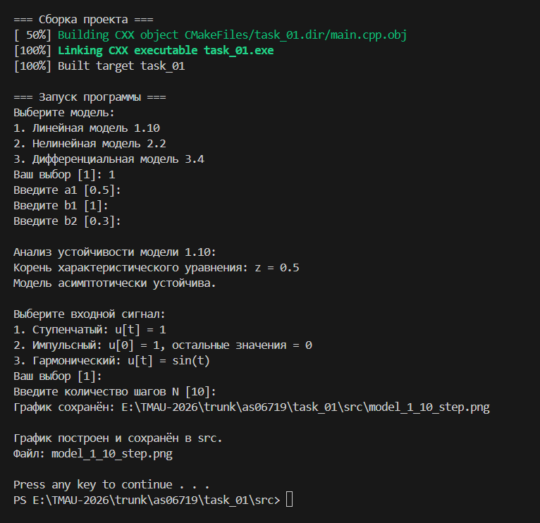
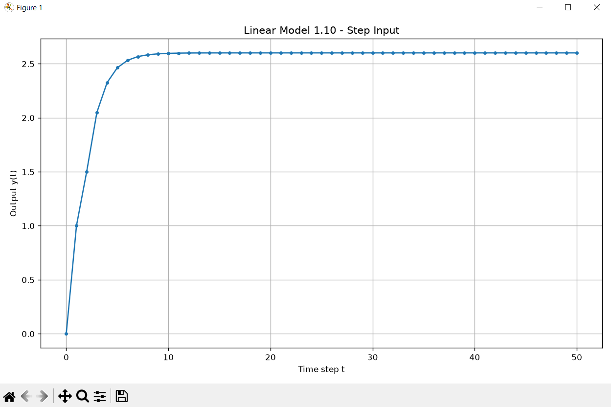
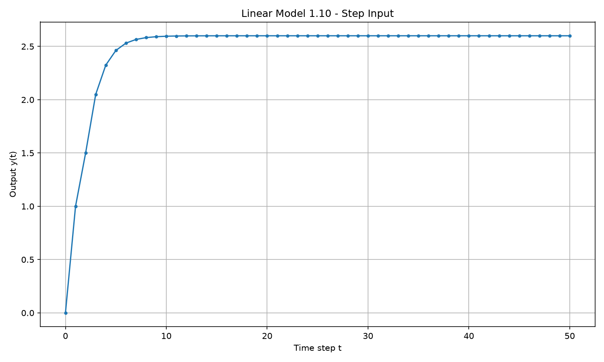
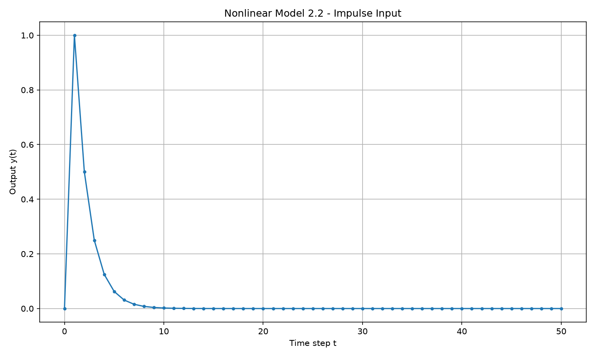
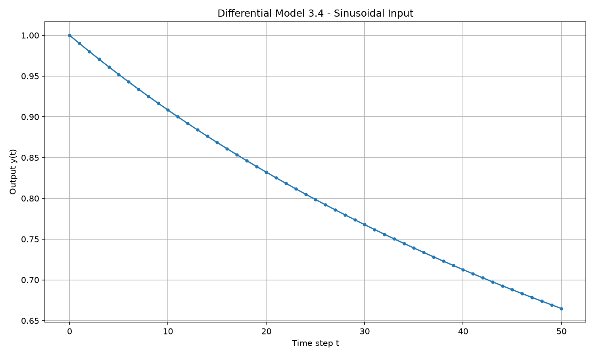
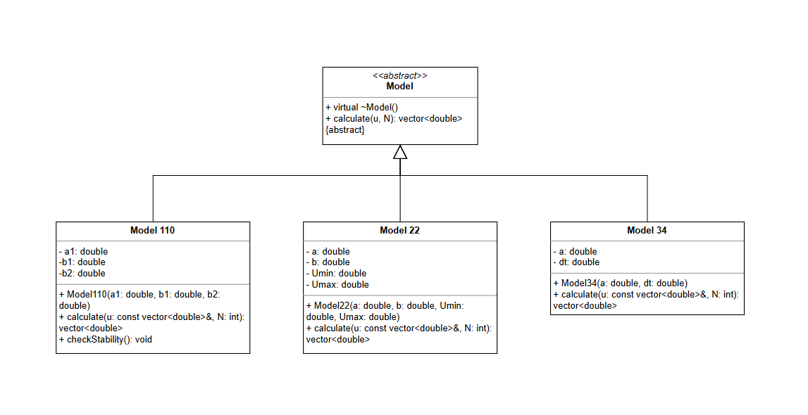

 
Министерство образования Республики Беларусь

Учреждение образования

«Брестский государственный технический университет»

Кафедра ИИТ

     

Лабораторная работа № 1

По дисциплине: «Теория и методы автоматического управления»

    

Выполнил:

Студент 3-го курса

Группы АС-67

Тюрина Т. А.

Проверил:

Дворанович Д. А.

    

Брест 2026

   

## Вариант задания 10

- **Линейная модель: Model 1.10**

  Уравнение модели:

  $$
  y_{t+1}=a_1y_t+b_1u_t+b_2u_{t-2}
  $$

  Характеристическое уравнение:

  $$
  z-a_1=0
  $$

  Модель асимптотически устойчива при условии:

  $$
  |a_1|<1
  $$

- **Нелинейная модель: Model 2.2 (Actuator Saturation Non-linearity)**

  Уравнение модели:

  $$
  y_{t+1}=ay_t+b\cdot sat(u_t)
  $$

  Функция насыщения:

  $$
  sat(u)=
  \begin{cases}
  U_{\max}, & u>U_{\max},\\
  u, & U_{\min}\leq u\leq U_{\max},\\
  U_{\min}, & u<U_{\min}.
  \end{cases}
  $$

  Используются границы насыщения:

  $$
  U_{\min}=-1,\qquad U_{\max}=1
  $$

- **Дифференциальная модель: Model 3.4**

  Дифференциальное уравнение:

  $$
  \frac{dy}{dt}=-ay^2
  $$

  Для численного решения используется метод Эйлера:

  $$
  y_{t+1}=y_t-dt\cdot ay_t^2
  $$

## Структура программы

Программа реализует базовый класс `Model` и классы-наследники:

- `Model110` — линейная модель 1.10;
- `Model22` — нелинейная модель 2.2;
- `Model34` — дифференциальная модель 3.4.

Для построения графиков используется Python и библиотека Matplotlib.

## Функционал программы

- Выбор математической модели.
- Выбор входного сигнала.
- Ввод параметров модели.
- Выбор количества шагов моделирования.
- Расчёт выходных значений.
- Проверка устойчивости линейной модели.
- Построение и сохранение графика выходного сигнала.

В программе реализованы следующие входные сигналы:

- Ступенчатый: \(u_t=1\).
- Импульсный: \(u_0=1\), при \(t>0\) — \(u_t=0\).
- Синусоидальный: \(u_t=\sin(t)\).

## Пример работы программы

Вывод работы программы в консоли:

Вывод графика в окне:

График линейной модели:

График нелинейной модели:

График дифференциальной модели:

## UML

## Вывод

В ходе выполнения лабораторной работы была разработана программа для моделирования линейной, нелинейной и дифференциальной систем. Реализованы выбор входного сигнала, расчёт выходных значений, анализ устойчивости линейной модели и построение графиков результатов моделирования.