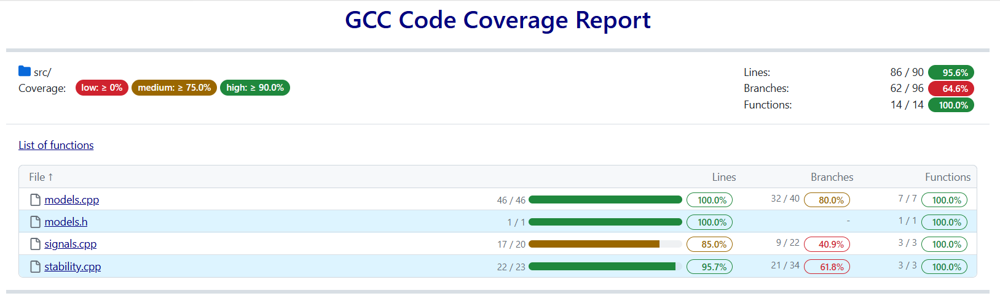

<p align="center">Министерство образования Республики Беларусь</p>
<p align="center">Учреждение образования</p>
<p align="center">«Брестский государственный технический университет»</p>
<p align="center">Кафедра ИИТ</p>

<br><br><br><br><br><br>

<p align="center"><strong>Лабораторная работа № 2</strong></p>
<p align="center">По дисциплине «Теория и методы автоматического управления»</p>
<p align="center">Тема: «Модульное тестирование и анализ устойчивости»</p>

<br><br><br><br><br>

<p align="right">Выполнил:</p>
<p align="right">Студент 3-го курса</p>
<p align="right">Группы АС-67</p>
<p align="right">Тюрина Т. А.</p>
<p align="right">Проверил:</p>
<p align="right">Дворанович Д. А.</p>

<br><br><br><br><br>

<p align="center">Брест 2026</p>

<br><br><br>

---

## Вариант 10

- Линейная модель: **Model 1.10**
- Нелинейная модель: **Model 2.2**
- Дифференциальное уравнение: **Model 3.4**

## Реализованные модели

### Model 1.10 — дискретная линейная система

Уравнение модели:

$$
y_{t+1}=a_1y_t+b_1u_t+b_2u_{t-2}
$$

Модель учитывает текущее входное воздействие и воздействие с задержкой на два такта.

### Model 2.2 — система с ограничением входного сигнала

Уравнение модели:

$$
y_{t+1}=ay_t+b\cdot sat(u_t)
$$

В модели реализовано ограничение входного сигнала функцией насыщения. Значение входного сигнала ограничивается заданным диапазоном от `Umin` до `Umax`.

Значения по умолчанию:

- `Umin = -1`;
- `Umax = 1`.

### Model 3.4 — нелинейная непрерывная система

Дифференциальное уравнение:

$$
\frac{dy}{dt}=-ay^2
$$

Для численного моделирования используется метод Эйлера:

$$
y_{t+1}=y_t-\Delta t\cdot a\cdot y_t^2
$$

Начальное значение:

$$
y_0=1.0
$$

## Структура проекта

```text
task_02/
│
├── src/
│   ├── CMakeLists.txt
│   ├── main.cpp
│   ├── models.h
│   ├── models.cpp
│   ├── stability.h
│   ├── stability.cpp
│   ├── signals.h
│   └── signals.cpp
│
├── test/
│   ├── test_models.cpp
│   ├── test_stability.cpp
│   ├── test_parameterized.cpp
│   └── test_signals.cpp
│
├── doc/
│   └── README.md
│
├── CMakeLists.txt
└── run_tests.bat
```

- `src/` — исходный код программы.
- `test/` — модульные и параметризованные тесты.
- `doc/` — документация проекта.
- `CMakeLists.txt` — конфигурация сборки проекта.
- `run_tests.bat` — автоматизация сборки, тестирования и формирования отчётов.

## Анализ устойчивости системы

Для линейной модели 1.10 выполнен аналитический анализ устойчивости.

Характеристическое уравнение системы:

$$
z-a_1=0
$$

Корень характеристического уравнения:

$$
z=a_1
$$

Критерий устойчивости дискретной системы определяется расположением корня на Z-плоскости относительно единичной окружности:

- При $|z|<1$ система асимптотически устойчива.
- При $|z|=1$ система находится на границе устойчивости.
- При $|z|>1$ система неустойчива.

Для проверки реализована функция `checkStability()`, которая определяет состояние системы по значению коэффициента `a1`.

Функция `checkModelBeforeSimulation()` выполняет проверку устойчивости перед началом моделирования и выводит соответствующее сообщение. Если система неустойчива, программа выводит предупреждение до начала симуляции.

Также предусмотрена обработка некорректных значений коэффициента, включая `NaN` и бесконечность.

## ООП-архитектура

В проекте реализован абстрактный базовый класс `Model`, от которого наследуются три класса:

- `Model110` — дискретная линейная модель с задержанным входным воздействием;
- `Model22` — модель с ограничением входного сигнала;
- `Model34` — нелинейная модель, использующая метод Эйлера.

Для анализа устойчивости модели 1.10 реализован отдельный модуль, состоящий из файлов `stability.h` и `stability.cpp`.

Генерация входных воздействий вынесена в отдельный модуль `signals.h` и `signals.cpp`.

Такое разделение позволяет независимо использовать математические модели, проверку устойчивости и генераторы сигналов.

## Генерация входных сигналов

Реализованы три типа входных сигналов:

1. **Ступенчатый сигнал** — сигнал, изменяющий своё значение в заданный момент времени.
2. **Импульсный сигнал** — сигнал с кратковременным ненулевым значением.
3. **Гармонический сигнал** — периодический сигнал, описываемый гармонической функцией.

Генераторы сигналов используются для формирования входных воздействий при моделировании и тестировании.

## Модульное тестирование

Для тестирования программы используется библиотека **Google Test**.

В проекте реализованы обычные и параметризованные тесты (`TEST_P`).

Проверяются следующие аспекты:

1. **Расчёты моделей:** правильность вычислений для всех трёх математических моделей.
2. **Обработка входных данных:** работа с пустыми и короткими входными последовательностями, а также с задержанным сигналом.
3. **Граничные значения:** проверка пределов насыщения, нулевых параметров и граничных условий.
4. **Некорректные параметры:** проверка обработки отрицательного количества шагов, недопустимых границ насыщения и некорректного шага интегрирования.
5. **Параметризованные тесты (`TEST_P`):** проверка расчётов модели 1.10 при различных наборах коэффициентов.
6. **Проверка устойчивости:** определение устойчивого, граничного и неустойчивого состояний системы.
7. **Интеграционная проверка:** проверка выполнения анализа устойчивости перед моделированием и вывода предупреждения для неустойчивой системы.
8. **Генерация сигналов:** проверка ступенчатого, импульсного и гармонического сигналов.

Для проверки моделей используются различные входные сигналы в качестве тестовых воздействий.

### Тестовое покрытие и результаты

- **Фреймворк:** Google Test.
- **Способ запуска:** `run_tests.bat`.
- **Всего тестов:** 33.
- **Успешно пройдено:** 33 / 33 (100%).
- **Не пройдено:** 0.

### Результаты покрытия кода

Для анализа покрытия использовались инструменты GCC, gcov и gcovr.

| Показатель | Покрытие |
|:---|---:|
| Покрытие строк (Line Coverage) | 95.6% |
| Покрытие функций (Function Coverage) | 100.0% |
| Покрытие ветвей (Branch Coverage) | 64.6% |

Файл `src/main.cpp` исключён из расчёта покрытия, поскольку содержит демонстрационную программу, а не основную тестируемую логику.

<p align="center">
  
</p>

<p align="center">
  Рисунок 1 — Результаты анализа покрытия исходного кода с использованием gcovr.
</p>

## Автоматизация сборки и тестирования

Для автоматизации проверки проекта создан скрипт `run_tests.bat`.

Скрипт выполняет следующие действия:

1. Проверяет наличие необходимых инструментов `g++`, `gcov` и `gcovr`.
2. Настраивает сборку проекта с поддержкой покрытия кода.
3. Удаляет предыдущие данные покрытия.
4. Выполняет сборку проекта.
5. Запускает автоматизированные тесты.
6. Формирует отчёты о результатах тестирования и покрытии кода.

Для запуска необходимо выполнить файл:

```bat
run_tests.bat
```

После успешного выполнения в каталоге `build_gcc/` формируются следующие отчёты:

- `test_report.xml` — результаты автоматизированного тестирования;
- `coverage.html` — подробный HTML-отчёт о покрытии кода;
- `coverage.xml` — отчёт о покрытии в формате XML.

## Используемые технологии

- C++17;
- CMake;
- Google Test;
- GCC / MinGW;
- gcov;
- gcovr.

## Вывод

В ходе выполнения лабораторной работы были реализованы три математические модели согласно варианту 10: дискретная линейная система, система с ограничением входного сигнала и нелинейная непрерывная система с численным решением методом Эйлера.

Для модели 1.10 выполнен аналитический анализ устойчивости на основе характеристического уравнения. Реализована проверка устойчивости перед началом моделирования с выводом предупреждения для неустойчивой системы.

Также разработаны генераторы ступенчатого, импульсного и гармонического сигналов, созданы модульные и параметризованные тесты с использованием Google Test.

Все 33 теста успешно пройдены. Покрытие строк кода составило 95.6%, функций — 100.0%, ветвей — 64.6%.

Для автоматизации сборки, тестирования и формирования отчётов реализован скрипт `run_tests.bat`.

Поставленная цель лабораторной работы достигнута.