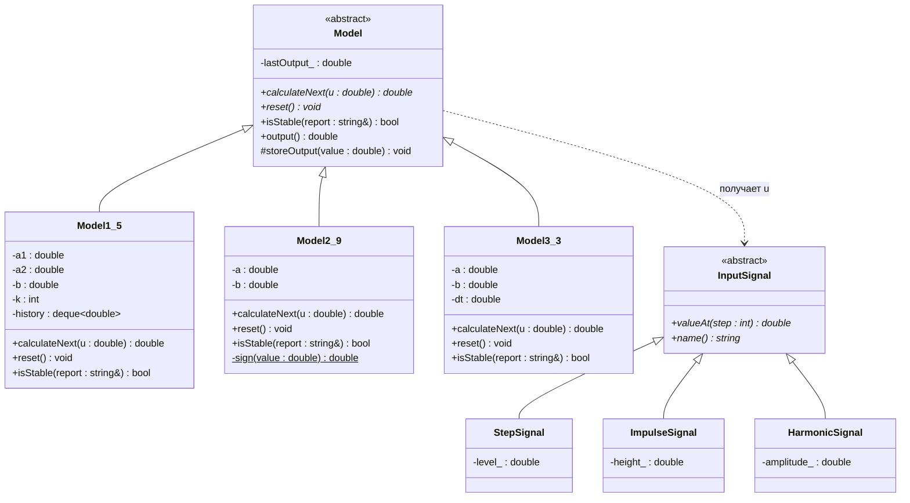
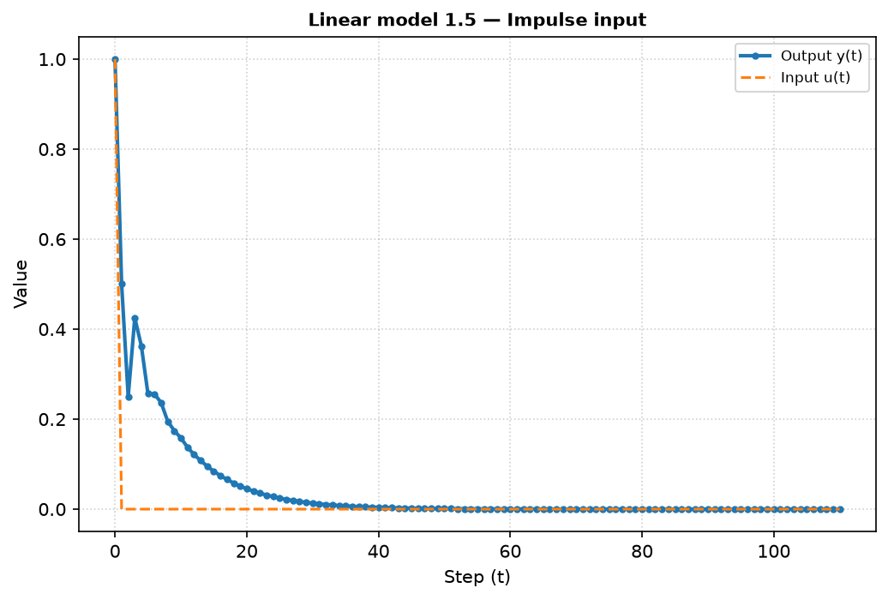
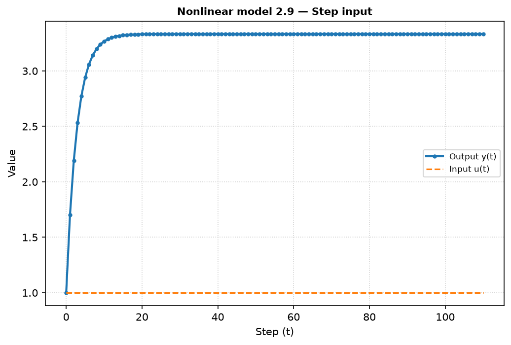
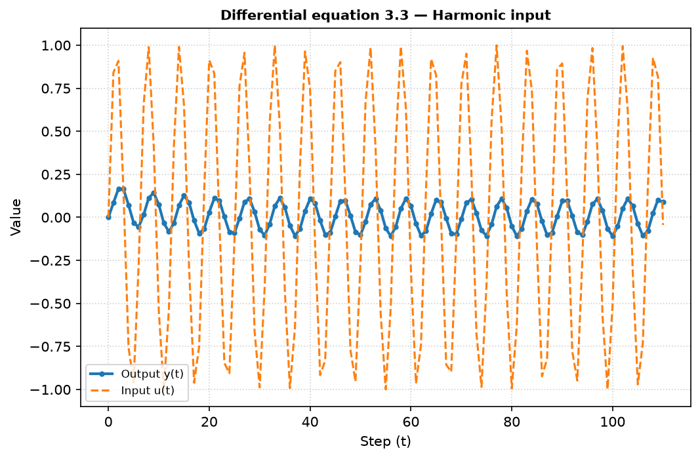

<p align="center">Министерство образования Республики Беларусь</p>
<p align="center">Учреждение образования</p>
<p align="center">Брестский государственный технический университет</p>
<p align="center">Кафедра ИИТ</p>
<br><br><br><br><br><br><br>
<p align="center">Отчет по лабораторной работе №1</p>
<p align="center">Дисциплина: Теория и методы автоматического управления</p>
<p align="center">Тематика: Моделирование управляемых объектов</p>
<br><br><br><br><br>
<p align="right">Выполнил студент:</p>
<p align="right">Группа: АС-67 (3 курс)</p>
<p align="right">Швед М. С.</p>
<p align="right">Преподаватель:</p>
<p align="right">Дворанинович Д. А.</p>
<br><br><br><br><br>
<p align="center">Брест, 2026 год</p>

---

# Вариант 15

В работе исследуется реакция трёх моделей объекта управления на типовые
входные сигналы. По таблице вариантов для варианта 15 назначены:
линейная модель **1.5**, нелинейная модель **2.9** и дифференциальное
уравнение **3.3**. Программа написана на C++17, собирается CMake,
графики строит скрипт на Python (Matplotlib).

## 1. Постановка задачи

### 1.1. Модель 1.5 — запаздывание по состоянию

Выход на следующем шаге зависит от текущего выхода и от выхода,
запомненного $k$ шагов назад:

$$y_{\tau+1} = a_1 y_{\tau} + a_2 y_{\tau-k} + b u_{\tau}, \quad k \ge 1$$

Чтобы получить $y_{\tau-k}$, класс `Model1_5` держит очередь `std::deque`
из $k+1$ последних значений выхода.

### 1.2. Модель 2.9 — корневая модуляция управления

Вход проходит через нелинейность «корень из модуля со знаком»:

$$y_{\tau+1} = a y_{\tau} + b \sqrt{|u_{\tau}|} \cdot \text{sign}(u_{\tau})$$

Малые по модулю сигналы при этом усиливаются, а большие — ослабляются.

### 1.3. Модель 3.3 — апериодическое звено первого порядка

Непрерывное уравнение

$$\frac{dy}{dt} = -a y + b u$$

переводится в разностную форму явным методом Эйлера с шагом $\Delta t$:

$$y_{\tau+1} = y_{\tau} + \Delta t \, (-a y_{\tau} + b u_{\tau})$$

### 1.4. Тестовые воздействия

- ступенька: $u_{\tau} = 1$ для всех $\tau$;
- импульс: $u_0 = 1$, далее $u_{\tau} = 0$;
- гармоника: $u_{\tau} = \sin(\tau)$.

## 2. Устройство программы

### 2.1. Классы

Все модели наследуются от абстрактного класса `Model` и переопределяют
чисто виртуальные методы `calculateNext(u)` (один шаг симуляции) и
`reset()` (сброс в нулевое состояние). Метод `isStable()` выполняет
проверку устойчивости. Входные сигналы устроены так же: абстрактный
`InputSignal` с методами `valueAt(step)` и `name()` и три наследника.



### 2.2. Файлы

| Файл | Назначение |
| :--- | :--------- |
| `src/Model.h` | базовый класс моделей |
| `src/Model1_5.*`, `src/Model2_9.*`, `src/Model3_3.*` | модели варианта |
| `src/InputSignal.*` | классы входных сигналов |
| `src/main.cpp` | ввод параметров, запуск, таблицы, CSV |
| `src/plot.py` | построение графиков по CSV |
| `run_build.bat` | сборка и запуск одной командой |

### 2.3. Работа с программой

После запуска программа спрашивает число шагов $n$ (от 1 до 1000),
модель (одну или все три), входной сигнал (один или все три) и
коэффициенты выбранных моделей. Нажатие Enter оставляет значение,
указанное в квадратных скобках. Перед расчётом выводится результат
проверки устойчивости. Каждая пара «модель — сигнал» печатается
в консоль таблицей и сохраняется в `doc/<модель>_<сигнал>.csv`.

Значения по умолчанию:

- модель 1.5: $a_1 = 0.5$, $a_2 = 0.3$, $b = 1$, $k = 2$;
- модель 2.9: $a = 0.7$, $b = 1$;
- модель 3.3: $a = 1$, $b = 1$, $\Delta t = 0.1$;
- число шагов $n = 30$.

### 2.4. Сборка

Файл `run_build.bat` находит CMake и компилятор, конфигурирует проект
в папку `build`, собирает его с подробным выводом, запускает программу
и вызывает `src/plot.py`.

## 3. Проверка устойчивости (Advanced Level)

**Модель 1.5.** Однородное уравнение
$y_{\tau+1} = a_1 y_{\tau} + a_2 y_{\tau-k}$ после Z-преобразования
и умножения на $z^{k}$ даёт характеристический многочлен степени $k+1$:

$$z^{k+1} - a_1 z^{k} - a_2 = 0$$

Процесс сходится, только если модули всех корней меньше единицы.
Корни ищутся численно методом Дюрана–Кернера; если наибольший модуль
$\ge 1$, программа печатает предупреждение. Для быстрой оценки удобно
помнить, что условие $|a_1| + |a_2| < 1$ гарантирует устойчивость,
а $a_1 + a_2 < 1$ необходимо для неё.

При значениях по умолчанию уравнение $z^3 - 0.5z^2 - 0.3 = 0$ имеет
$\max|z| \approx 0.884$, т.е. модель устойчива, а установившийся выход
на ступеньку равен $b / (1 - a_1 - a_2) = 5$.

**Модель 2.9.** Нелинейность действует только на вход, поэтому
устойчивость определяется корнем $z = a$: нужно $|a| < 1$.
На ступеньку выход стремится к $b / (1 - a) \approx 3.33$.

**Модель 3.3.** У схемы Эйлера один корень $z = 1 - a\Delta t$,
условие $|1 - a\Delta t| < 1$ равносильно $0 < a\Delta t < 2$.
На ступеньку выход стремится к $b / a = 1$.

Так выглядит предупреждение при $a_1 = 1.2$, $a_2 = 0.5$, $k = 3$:

```
* Stability of Linear_1_5
  Characteristic equation: z^4 - (1.2000)*z^3 - (0.5000) = 0; max |z| = 1.3873
  [WARNING] unstable coefficients, the process DIVERGES!
```

## 4. Результаты

### 4.1. Табличный вывод (начало таблиц)

Модель 1.5, ступенька:

```
== Linear_1_5 / Step ==
--------------------------------------
    step |    input u |     output y
--------------------------------------
       0 |     1.0000 |       1.0000
       1 |     1.0000 |       1.5000
       2 |     1.0000 |       1.7500
       3 |     1.0000 |       2.1750
       4 |     1.0000 |       2.5375
       5 |     1.0000 |       2.7937
```

Модель 2.9, гармоника:

```
== Nonlinear_2_9 / Harmonic ==
--------------------------------------
    step |    input u |     output y
--------------------------------------
       0 |     0.0000 |       0.0000
       1 |     0.8415 |       0.9173
       2 |     0.9093 |       1.5957
       3 |     0.1411 |       1.4926
       4 |    -0.7568 |       0.1749
```

Модель 3.3, импульс:

```
== DiffEquation_3_3 / Impulse ==
--------------------------------------
    step |    input u |     output y
--------------------------------------
       0 |     1.0000 |       0.1000
       1 |     0.0000 |       0.0900
       2 |     0.0000 |       0.0810
       3 |     0.0000 |       0.0729
       4 |     0.0000 |       0.0656
```

### 4.2. Графики

Импульсная характеристика модели 1.5:



Реакция модели 2.9 на ступеньку:



Реакция модели 3.3 на гармонический сигнал:



## 5. Выводы

- Запаздывание в модели 1.5 делает переходный процесс немонотонным:
  после импульса через $k$ шагов на графике появляется повторный подъём,
  а на ступеньку выход медленно подходит к значению 5.
- В модели 2.9 при $|u| = 1$ нелинейность незаметна, но на синусоиде
  малые значения входа усиливаются, поэтому амплитуда выхода больше,
  чем у аналогичного линейного звена.
- Модель 3.3 сглаживает вход: на ступеньку выход экспоненциально
  растёт до 1, а синусоида проходит с заметным ослаблением и сдвигом
  по фазе, как через фильтр низких частот.
- Проверка устойчивости позволяет заранее увидеть, что выбранные
  коэффициенты приведут к расходящемуся процессу.
