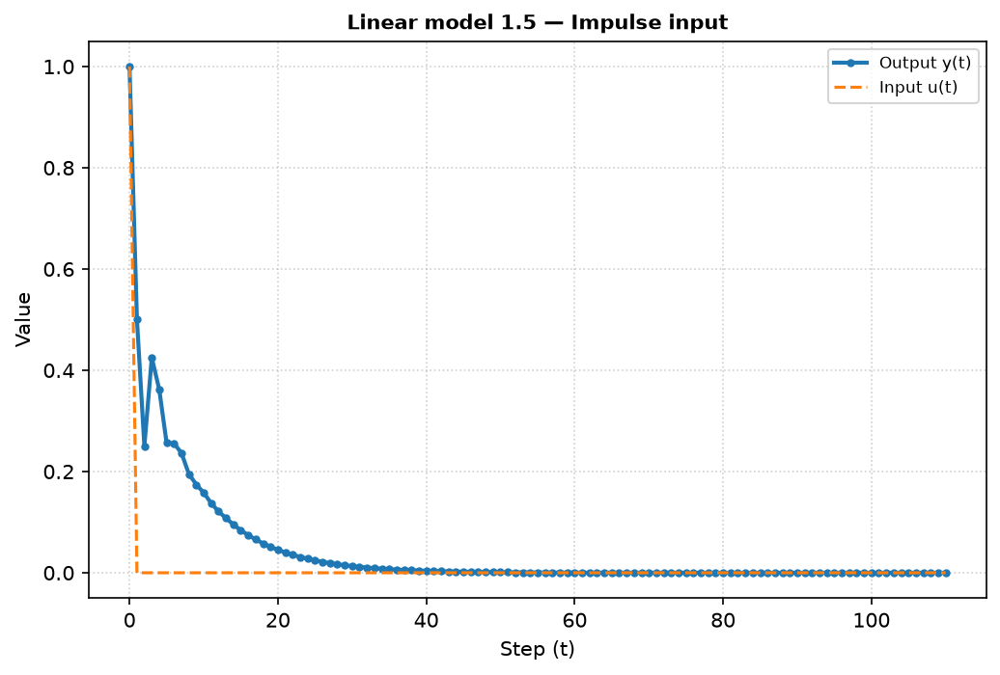
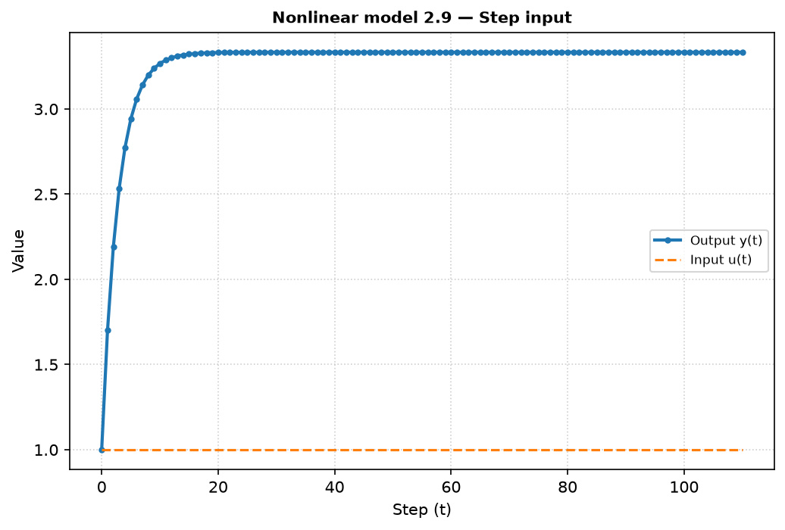
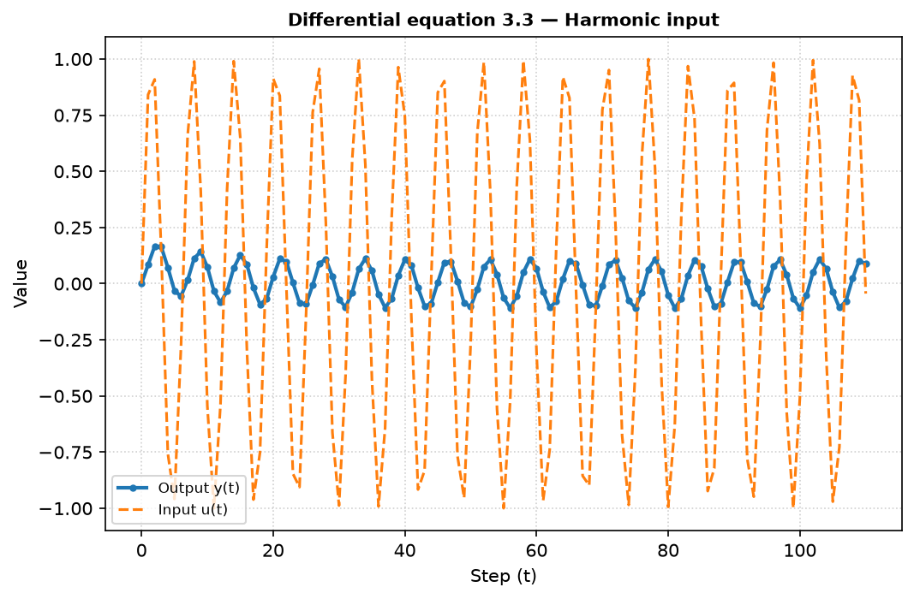
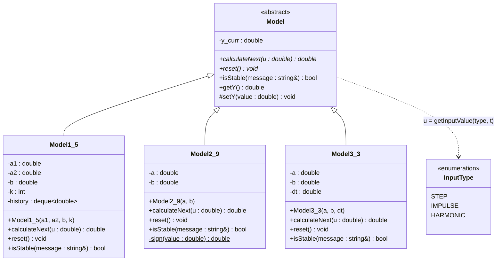

<p align="center">Министерство образования Республики Беларусь</p>
<p align="center">Учреждение образования</p>
<p align="center">Брестский государственный технический университет</p>
<p align="center">Кафедра ИИТ</p>
<br><br><br><br><br><br><br>
<p align="center">Отчет по лабораторной работе №1</p>
<p align="center">Дисциплина: Теория и методы автоматического управления</p>
<p align="center">Тематика: Моделирование управляемых объектов</p>
<br><br><br><br><br>
<p align="right">Выполнил студент:</p>
<p align="right">Группа: АС-67 (3 курс)</p>
<p align="right">Швед М. С.</p>
<p align="right">Преподаватель:</p>
<p align="right">Дворанинович Д. А.</p>
<br><br><br><br><br>
<p align="center">Брест, 2026 год</p>

---

## Выполнение задания (Вариант 15)

**Цель работы:** смоделировать поведение управляемого объекта с помощью линейной,
нелинейной и дифференциальной моделей, исследовать переходные процессы при
ступенчатом, импульсном и гармоническом входных воздействиях.

| Блок | Модель | Название |
| :--: | :----: | :------- |
| 1 | Model 1.5 | System with State Delay (линейная система с запаздыванием по состоянию) |
| 2 | Model 2.9 | Square Root Modulated Action (модуляция воздействия квадратным корнем) |
| 3 | Model 3.3 | Standard First-Order Process (стандартный процесс первого порядка) |

### Математическое описание разработанных моделей

1. **Линейная дискретная модель (1.5):**

   $$y_{\tau+1} = a_1 y_{\tau} + a_2 y_{\tau-k} + b u_{\tau}, \quad k \ge 1$$

   Для хранения значений $y_{\tau}, y_{\tau-1}, \dots, y_{\tau-k}$ используется
   буфер (`std::deque`) длины $k+1$.

2. **Нелинейная модель (2.9):**

   $$y_{\tau+1} = a y_{\tau} + b \sqrt{|u_{\tau}|} \cdot \text{sign}(u_{\tau})$$

3. **Дифференциальное уравнение (3.3):**

   Исходное уравнение: $\dfrac{dy}{dt} = -a y + b u$

   Для программной реализации применён численный метод Эйлера с шагом $\Delta t$:

   $$y_{\tau+1} = y_{\tau} + \Delta t \cdot (-a y_{\tau} + b u_{\tau})$$

### Входные воздействия

| Тип | Формула |
| :-- | :------ |
| Ступенчатое | $u_{\tau} = 1$ |
| Импульсное | $u_0 = 1,\; u_{\tau>0} = 0$ |
| Гармоническое | $u_{\tau} = \sin(\tau)$ |

### Параметры моделирования (значения по умолчанию)

| Модель | Параметры |
| :----: | :-------- |
| 1.5 | $a_1 = 0.5,\; a_2 = 0.3,\; b = 1,\; k = 2$ |
| 2.9 | $a = 0.7,\; b = 1$ |
| 3.3 | $a = 1,\; b = 1,\; \Delta t = 0.1$ |

Количество шагов симуляции $n$ задаётся пользователем (по умолчанию $n = 30$),
все параметры моделей вводятся с клавиатуры (Enter — значение по умолчанию).

---

## Анализ устойчивости (дополнительное задание)

**Модель 1.5.** Применяя Z-преобразование к однородному уравнению
$y_{\tau+1} - a_1 y_{\tau} - a_2 y_{\tau-k} = 0$ и умножая на $z^{k}$,
получаем характеристическое уравнение:

$$z^{k+1} - a_1 z^{k} - a_2 = 0$$

Система устойчива, если **все** корни лежат внутри единичной окружности:
$|z_i| < 1$. Программа находит корни численно (метод Дюрана–Кернера) и
выводит предупреждение, если $\max |z_i| \ge 1$.

Необходимое условие устойчивости (подстановка $z = 1$): $a_1 + a_2 < 1$;
достаточное условие: $|a_1| + |a_2| < 1$.

Для параметров по умолчанию ($a_1 = 0.5$, $a_2 = 0.3$, $k = 2$):
$z^3 - 0.5z^2 - 0.3 = 0$, $\max|z| = 0.8839 < 1$ — система **устойчива**.
Установившееся значение при $u = 1$: $y_{\infty} = \dfrac{b}{1 - a_1 - a_2} = 5$.

**Модель 2.9.** Однородная часть линейна: $y_{\tau+1} = a y_{\tau}$, корень
$z = a$, устойчивость при $|a| < 1$. При $u = 1$:
$y_{\infty} = \dfrac{b}{1 - a} = 3.33$.

**Модель 3.3.** Разностная схема Эйлера: $y_{\tau+1} = (1 - a\Delta t) y_{\tau} + \Delta t\, b u_{\tau}$,
корень $z = 1 - a\Delta t$, условие устойчивости $|1 - a\Delta t| < 1$, т.е.
$0 < a\Delta t < 2$. При $u = 1$: $y_{\infty} = b / a = 1$.

Пример вывода программы для неустойчивых коэффициентов ($a_1 = 1.2$, $a_2 = 0.5$, $k = 3$):

```
[Stability] Linear_1_5: Characteristic equation: z^4 - (1.2000)*z^3 - (0.5000) = 0; max |z| = 1.3873
[WARNING] Coefficients lead to a DIVERGENT (unstable) process!
```

---

## Результаты моделирования

Результаты каждого прогона выводятся в консоль в виде таблицы и сохраняются в
файлы `doc/<Модель>_<Сигнал>.csv` (столбцы `Step,u,y`).

Фрагмент вывода для модели 1.5 (ступенчатое воздействие):

```
>>> Linear_1_5 (Step signal)
+------+------------+--------------+
|     t|        u(t)|        y(t+1)|
+------+------------+--------------+
|     0|      1.0000|        1.0000|
|     1|      1.0000|        1.5000|
|     2|      1.0000|        1.7500|
|     3|      1.0000|        2.1750|
|     4|      1.0000|        2.5375|
|     5|      1.0000|        2.7937|
|     6|      1.0000|        3.0494|
|     7|      1.0000|        3.2859|
|     8|      1.0000|        3.4811|
|     9|      1.0000|        3.6554|
|    10|      1.0000|        3.8135|
```

Фрагмент вывода для модели 2.9 (гармоническое воздействие):

```
>>> Nonlinear_2_9 (Harmonic signal)
+------+------------+--------------+
|     t|        u(t)|        y(t+1)|
+------+------------+--------------+
|     0|      0.0000|        0.0000|
|     1|      0.8415|        0.9173|
|     2|      0.9093|        1.5957|
|     3|      0.1411|        1.4926|
|     4|     -0.7568|        0.1749|
|     5|     -0.9589|       -0.8568|
```

Фрагмент вывода для модели 3.3 (импульсное воздействие):

```
>>> DiffEquation_3_3 (Impulse signal)
+------+------------+--------------+
|     t|        u(t)|        y(t+1)|
+------+------------+--------------+
|     0|      1.0000|        0.1000|
|     1|      0.0000|        0.0900|
|     2|      0.0000|        0.0810|
|     3|      0.0000|        0.0729|
|     4|      0.0000|        0.0656|
|     5|      0.0000|        0.0590|
```

### Графики переходных процессов

Визуализация выполнена с помощью Python/Matplotlib (`src/plot.py`).

**Модель 1.5 (импульсное воздействие):**


**Модель 2.9 (ступенчатое воздействие):**


**Модель 3.3 (гармоническое воздействие):**


---

### Структура классов (UML)

Программа построена на принципах ООП: абстрактный базовый класс `Model`
задаёт чисто виртуальные методы `calculateNext()` и `reset()`, а конкретные
уравнения реализованы в классах-наследниках.



---

### Сборка и запуск

Сборка выполняется системой CMake. Для запуска достаточно выполнить
`run_build.bat` в папке `task_01`. Скрипт:

1. конфигурирует проект (`cmake -S . -B build`);
2. собирает его с подробным выводом (`cmake --build build --verbose`);
3. запускает программу моделирования;
4. строит графики (`src/plot.py`) и сохраняет их в `doc/`.

Структура проекта:

```
task_01/
├── CMakeLists.txt
├── run_build.bat
├── doc/          — отчёт, CSV-результаты и графики
└── src/
    ├── CMakeLists.txt
    ├── Model.h               — абстрактный базовый класс
    ├── Model1_5.h / .cpp     — линейная модель 1.5
    ├── Model2_9.h / .cpp     — нелинейная модель 2.9
    ├── Model3_3.h / .cpp     — дифференциальное уравнение 3.3
    ├── InputSignal.h / .cpp  — входные воздействия
    ├── main.cpp              — диалог с пользователем, вывод таблиц и CSV
    └── plot.py               — визуализация (Matplotlib)
```

---

## Выводы

1. **Модель 1.5** при выбранных коэффициентах устойчива ($\max|z| = 0.884$).
   Запаздывание по состоянию приводит к немонотонному переходному процессу:
   на импульсной характеристике видны «всплески» через $k$ шагов, а при
   ступенчатом воздействии выход медленно приближается к значению $y_\infty = 5$.
2. **Модель 2.9** ведёт себя как инерционное звено первого порядка со
   «сжатым» входом: при $|u| = 1$ нелинейность не проявляется ($\sqrt{1} = 1$),
   а при гармоническом сигнале малые значения $|u|$ усиливаются
   ($\sqrt{|u|} > |u|$), из-за чего амплитуда выхода выше, чем у линейного звена.
3. **Модель 3.3** (метод Эйлера, $\Delta t = 0.1$) даёт экспоненциальный
   переходный процесс к $y_\infty = b/a = 1$; при гармоническом входе выход
   отстаёт по фазе и заметно ослаблен — объект работает как фильтр низких частот.
4. Реализована проверка устойчивости: при коэффициентах, ведущих к
   расходящемуся процессу, программа выводит предупреждение до начала симуляции.
