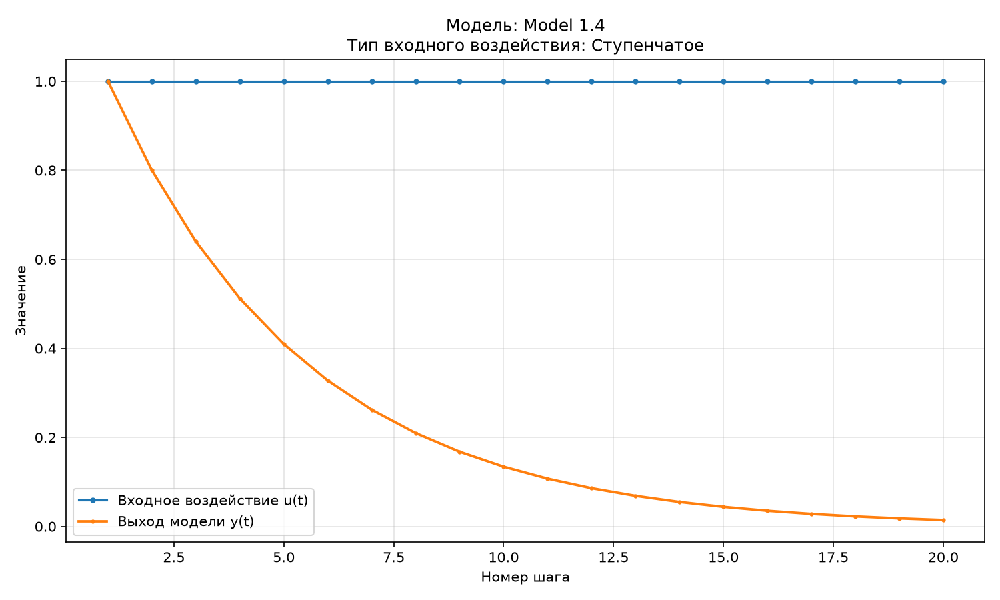
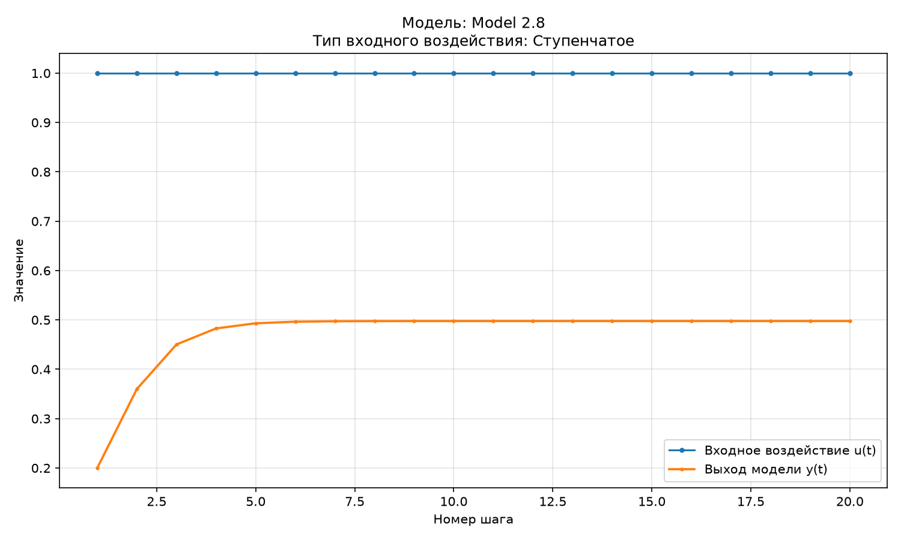
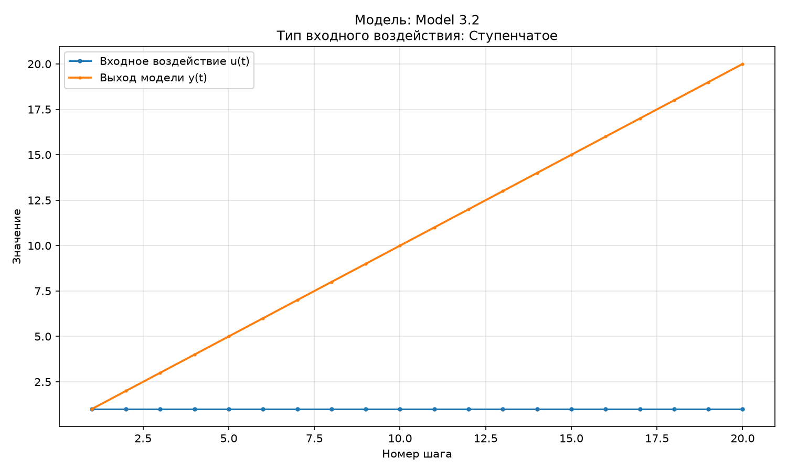
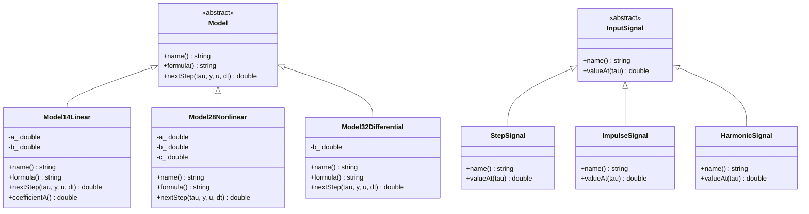

Министерство образования Республики Беларусь

Учреждение образования

«Брестский государственный технический университет»

Кафедра ИИТ

      

Лабораторная работа №1

По дисциплине «Теория и моделирование автоматического управления»

Тема: «Моделирование объектов управления»

     

Выполнил:

Студент 3 курса

Группы АС-67

Якимович И. А.

Проверил:

Дворанинович Д. А.

     

Брест 2026

---

## Вариант 14

- Линейная модель: **Model 1.4**
- Нелинейная модель: **Model 2.8**
- Дифференциальное уравнение: **Model 3.2**

## Реализованные модели

### Model 1.4 (Discrete Integrator with Loss)

Уравнение линейной дискретной модели:

$$
y_{\tau+1}=a y_\tau+b(u_\tau-u_{\tau-1})
$$

Параметры по умолчанию: \(a=0{,}8\), \(b=1{,}0\).

Начальное состояние: \(y_0=0\). Для первого шага принято \(u_{-1}=0\).

Для однородной части модели характеристический корень равен:

$$
z=a
$$

Условие асимптотической устойчивости:

$$
|a|<1
$$

При значении по умолчанию \(a=0{,}8\) это условие выполняется. В программе реализовано предупреждение, если заданный коэффициент \(a\) приводит к нарушению условия устойчивости.

### Model 2.8 (Chaotic Logistic Map Disturbance)

Нелинейная логистическая модель с дополнительным возмущением:

$$
y_{\tau+1}
=
a y_\tau(1-y_\tau)
+b u_\tau
+c\sin(y_{\tau-1}u_\tau)
$$

Параметры по умолчанию: \(a=1{,}0\), \(b=0{,}2\), \(c=0{,}1\).

Начальное состояние: \(y_0=0\).

Модель является нелинейной из-за логистического выражения \(y_\tau(1-y_\tau)\) и дополнительного синусоидального слагаемого.

### Model 3.2 (Pure Constant Input Drive)

Дифференциальное уравнение с постоянным входным воздействием:

$$
\frac{dy}{dt}=bu
$$

Для численного решения используется метод Эйлера:

$$
y_{\tau+1}=y_\tau+\Delta t\cdot b u_\tau
$$

Параметры по умолчанию: \(b=1{,}0\), \(\Delta t=1{,}0\).

Начальное состояние: \(y_0=0\).

## Входные воздействия

1. **Ступенчатое (Step):**

$$
u_\tau=1
$$

2. **Импульсное (Impulse):**

$$
u_0=1,\qquad u_{\tau>0}=0
$$

3. **Гармоническое (Harmonic):**

$$
u_\tau=\sin(\tau)
$$

   В гармоническом воздействии аргумент синуса задаётся в радианах.

Программа позволяет выбрать модель, тип входного воздействия и количество шагов моделирования \(n\). По умолчанию используется \(n=20\). Пользователь может принять предложенные значения параметров нажатием Enter или ввести собственные.

## ООП-архитектура

В программе реализован абстрактный базовый класс `Model`, содержащий виртуальные методы `name()`, `formula()` и `nextStep()`.

От базового класса наследуются:

- `Model14Linear` — линейная модель 1.4;
- `Model28Nonlinear` — нелинейная модель 2.8;
- `Model32Differential` — дифференциальная модель 3.2.

Для входных воздействий реализован абстрактный класс `InputSignal` с методами `name()` и `valueAt()`.

От класса `InputSignal` наследуются:

- `StepSignal` — ступенчатое воздействие;
- `ImpulseSignal` — импульсное воздействие;
- `HarmonicSignal` — гармоническое воздействие.

Основная функция программы выполняет выбор модели и входного воздействия, ввод параметров, расчёт переходного процесса, вывод результатов в табличном виде и экспорт данных в `results.csv`.

После завершения симуляции программа автоматически запускает скрипт `plot.py`, который строит график выбранной модели и входного воздействия.

Сборка проекта осуществляется с помощью CMake и запускается через файл `build.bat`.

## Результаты моделирования

Для исследования переходных процессов рассматриваются все три модели при трёх типах входных воздействий. Графики построены при параметрах по умолчанию и количестве шагов \(n=20\).

### 1. Переходные процессы линейной модели (Model 1.4)

### 2. Переходные процессы нелинейной модели (Model 2.8)

### 3. Переходные процессы дифференциальной модели (Model 3.2)

## UML-диаграмма классов

UML-диаграмма отражает структуру объектно-ориентированной программы, абстрактные классы, классы-наследники и основные методы.

