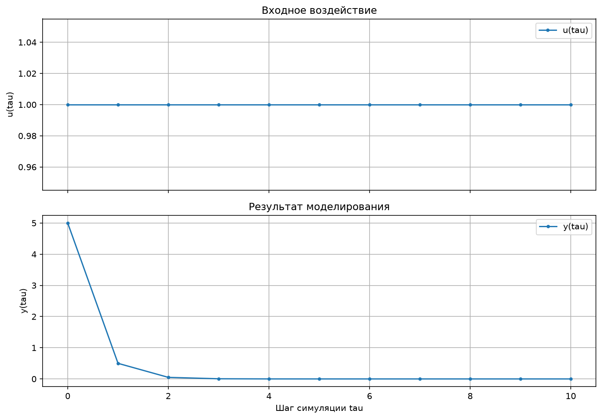
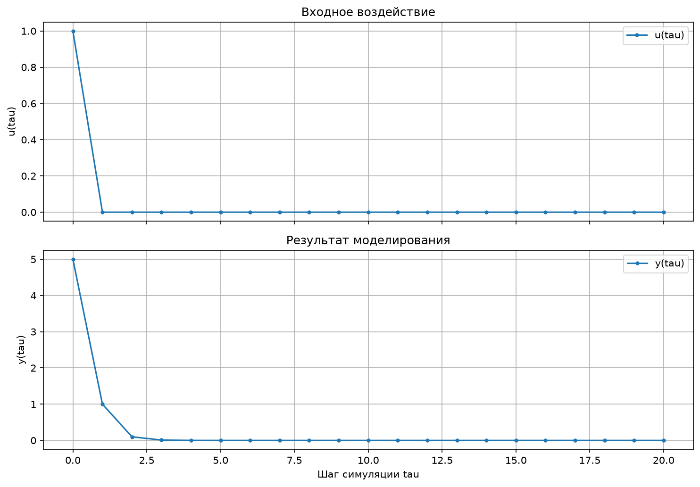
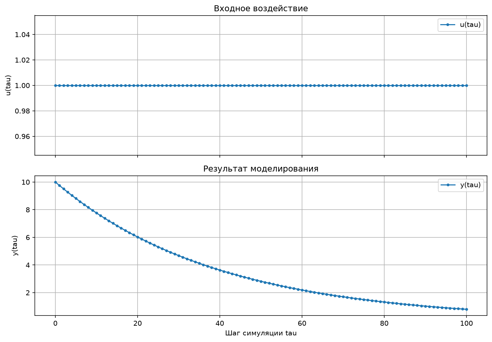

**Министерство образования Республики Беларусь**  
**Учреждение образования**  
**«Брестский государственный технический университет»**  
**Кафедра ИИТ**

   

# [task_01] Юреня ЛР1

**Лабораторная работа № 1**

**По дисциплине:** «Теория и моделирование автоматического управления»  
**Тема:** «Моделирование объектов управления»

  

Выполнил:  
Студент 3 курса  
Группа: АС-67  
Юреня Кирилл Витальевич  
Вариант 22  

Проверил:  
Дворанович Д.А.

  

**Брест 2026**

---

# Вариант 22

Согласно заданию, в программе реализованы следующие модели:

- Линейная модель: **Model 1.4**.
- Модель Square Root Modulated Action: **Model 2.9**.
- Дифференциальная модель Pure Linear Decay: **Model 3.1**.

Программа реализована на C++ с применением объектно-ориентированного подхода. Пользователь выбирает модель, тип входного воздействия и количество шагов моделирования. Результаты выводятся в консоль, сохраняются в CSV-файл и могут визуализироваться с помощью Python и Matplotlib.

## 1. Реализованные математические модели

### 1.1. Model 1.4 — линейная модель

Математическое описание:

$$
y_{\tau+1}=a y_\tau+b(u_\tau-u_{\tau-1})
$$

где $a$ и $b$ — коэффициенты модели, $y_\tau$ — текущее выходное значение, $u_\tau$ и $u_{\tau-1}$ — текущее и предыдущее значения входного воздействия.

Модель вычисляет следующее выходное значение на основе текущего состояния и изменения входного сигнала.

Пример параметров для тестирования: $a=0.9$, $b=2$.

### 1.2. Model 2.9 — Square Root Modulated Action

Математическое описание:

$$
y_{\tau+1}=a y_\tau+b|u_\tau|\cdot\operatorname{sign}(u_\tau)
$$

Так как $|u|\operatorname{sign}(u)=u$, выражение можно записать в эквивалентной форме:

$$
y_{\tau+1}=a y_\tau+b u_\tau
$$

где $a$ и $b$ — коэффициенты модели, $y_\tau$ — текущее выходное значение, $u_\tau$ — входное воздействие.

При вычислении следующего значения учитываются текущее состояние системы и входной сигнал.

Пример параметров для тестирования: $a=0.8$, $b=2$.

### 1.3. Model 3.1 — Pure Linear Decay

Математическое описание:

$$
\frac{dy}{dt}=-a y
$$

Для численного решения дифференциального уравнения используется явный метод Эйлера:

$$
y_{k+1}=y_k+\Delta t(-a y_k)
$$

После преобразования получаем:

$$
y_{k+1}=y_k(1-a\Delta t)
$$

где $a$ — коэффициент затухания, $y_k$ — текущее значение выходной переменной, $\Delta t$ — шаг интегрирования.

При положительном коэффициенте $a$ и достаточно малом шаге интегрирования значение модели постепенно уменьшается.

Пример параметров для тестирования: $a=0.5$, $\Delta t=0.05$, $y_0=10$.

Приведённые параметры используются как примеры для тестового запуска. Фактические значения вводятся пользователем во время работы программы.

## 2. Входные воздействия

Для проверки моделей предусмотрены три вида входного сигнала:

1. **Ступенчатое воздействие:**

$$
u_\tau=1
$$

2. **Импульсное воздействие:**

$$
u_0=1,\qquad u_\tau=0\quad\text{при }\tau>0
$$

3. **Гармоническое воздействие:**

$$
u_\tau=\sin(\tau)
$$

Входные сигналы позволяют исследовать реакцию дискретных моделей на различные воздействия. Для дифференциальной модели Model 3.1 входной сигнал не используется, поскольку уравнение $\frac{dy}{dt}=-ay$ не содержит входной переменной.

## 3. Объектно-ориентированная архитектура

В основе программы находится абстрактный класс `Model`, задающий общий интерфейс для математических моделей. Конкретные модели реализуются в производных классах.

Основные компоненты программы:

- `Model` — абстрактный базовый класс для моделей;
- `InputSignal` — интерфейс для задания входных сигналов;
- классы входных сигналов — формируют ступенчатое, импульсное и гармоническое воздействие;
- классы моделей — реализуют уравнения Model 1.4, Model 2.9 и Model 3.1;
- структура `Sample` — хранит значения, полученные на шаге моделирования;
- механизм симуляции — последовательно вычисляет значения модели;
- CSV-вывод — отображает результаты и сохраняет данные для последующей визуализации.

Использование абстрактного базового класса и наследования позволяет обращаться к разным моделям через общий интерфейс и упрощает расширение программы новыми моделями.

### UML-диаграмма классов

UML-диаграмма классов проекта хранится в каталоге `doc` в файле `uml.puml`. Она показывает базовый класс модели, его производные классы, классы входных сигналов и связи между компонентами программы.

## 4. Результаты моделирования

В начале работы пользователь выбирает модель и тип входного сигнала. Затем вводятся количество шагов моделирования, начальное значение выходной переменной и необходимые коэффициенты. Для дифференциальной модели также задаётся шаг интегрирования $\Delta t$.

Результаты моделирования выводятся в консоль и сохраняются в файл `results.csv`. Файл используется для построения графика с помощью скрипта `src/plot.py`.

Основные поля результатов:

| Поле | Описание |
|---|---|
| `tau` | Номер шага моделирования |
| `u` | Значение входного воздействия |
| `y` | Значение выходного сигнала модели |

### Model 1.4 — линейная модель

После запуска Model 1.4 можно построить график изменения выходного сигнала при выбранном входном воздействии.

### Model 2.9 — Square Root Modulated Action

Для наглядной демонстрации можно использовать гармоническое входное воздействие и проследить, как меняется выходной сигнал модели.

### Model 3.1 — Pure Linear Decay

График демонстрирует затухание выходного значения при выбранном начальном условии и коэффициенте $a$.

*Примечание: изображения графиков необходимо добавить в каталог `doc` после выполнения программы и построения соответствующих графиков.*

## 5. Вывод

В ходе лабораторной работы разработана программа на C++ для моделирования трёх математических моделей: Model 1.4, Model 2.9 и Model 3.1. В программе применён объектно-ориентированный подход с использованием общего интерфейса моделей и отдельных реализаций математических уравнений. Предусмотрены выбор входных воздействий, ввод параметров моделирования, вывод результатов в консоль, сохранение данных в CSV-файл и построение графиков средствами Python и Matplotlib. Полученные результаты позволяют наблюдать поведение моделей при различных параметрах и входных сигналах.
