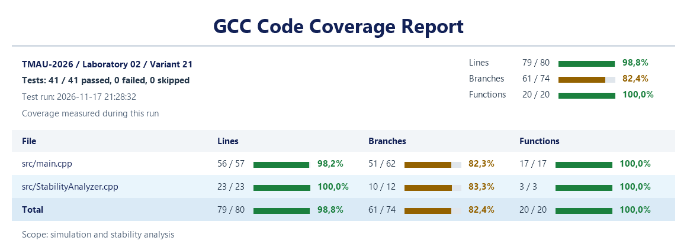

<div align="center">

**Министерство образования Республики Беларусь**  
**Учреждение образования**  
**«Брестский государственный технический университет»**  
**Кафедра ИИТ**

<br><br><br>

**Лабораторная работа № 2**

**По дисциплине:** «Теория и моделирование автоматического управления»  
**Тема:** «Расширенное модульное тестирование и анализ покрытия кода»

<br><br>

</div>

<div align="right">

Выполнил:  
Студент 3 курса  
Группа: АС-67  
Юреня Кирилл Витальевич  
Вариант 21 

Проверил:  
Дворанович Д.А.

</div>

<br><br>

<div align="center">

**Брест 2026**

</div>

---

Моделирование и модульное тестирование моделей 1.2, 2.7 и 3.5. Программа сохраняет результаты в `results.csv` со столбцами `tau,u,y` и строит график через Matplotlib. Формулы взяты из [задания ЛР №1](https://github.com/krixiszzzz/TMAU-2026/blob/main/task_01/readme.md#1-linear-models-линейные-модели).

## Математические модели

| Модель | Уравнение шага |
| --- | --- |
| 1.2. Чистое запаздывание управления | $y_{\tau+1} = ay_\tau + b u_{\tau-k}$ |
| 2.7. Реле с гистерезисом | $y_{\tau+1} = ay_\tau + b\,\mathrm{relay}(u_\tau,y_\tau)$ |
| 3.5. Гармоническая сила | $y_{\tau+1} = y_\tau + \Delta t\, b\sin(u_\tau)$ |

Для модели 1.2 принято $u_\tau=0$ при $\tau<0$. При $k=0$ используется текущий вход. Если импульс подан на шаге 0, его вклад впервые появится в $y_{k+1}$. В столбце `u` записывается фактический вход на текущем шаге.

Для модели 2.7 при $u>\varepsilon$ реле выдаёт $+1$, а при $u<-\varepsilon$ выдаёт $-1$. Внутри диапазона $[-\varepsilon,\varepsilon]$, включая обе границы, реле выдаёт $+1$ при $y>0$ и $-1$ при $y\le 0$. Поэтому при $u_0=y_0=0$ следующий выход равен $-b$.

Для модели 3.5 используется явный метод Эйлера. При постоянном входе $u(t)=u_0$ аналитическое решение равно $y(t)=y_0+t b\sin(u_0)$. Для проверки сходимости выбран вход $u(t)=\arcsin(t)$ на $[0,1]$ при $b=2$ и $y_0=0$. Тогда $y(t)=t^2$, а глобальная ошибка метода Эйлера в точке $t=1$ равна $\Delta t$.

## Проверка устойчивости модели 1.2

При отключённом входе уравнение свободного движения имеет вид $y_{\tau+1}=a y_\tau$. Подстановка $y_\tau=z^\tau$ даёт характеристическое уравнение $z-a=0$ с корнем $z=a$. Запаздывание $k$ относится к входу. Если представить его отдельным регистром сдвига, он добавит $k$ собственных значений в нуле.

| Условие | Свободный отклик |
| --- | --- |
| $\lvert a\rvert<1$ | Затухает. Система асимптотически устойчива. |
| $a=1$ | Остаётся постоянным. |
| $a=-1$ | Чередует знак при постоянном модуле. |
| $\lvert a\rvert>1$ | Растёт по модулю при ненулевом начальном состоянии. |

До запуска симуляции анализатор выводит предупреждение для граничного случая $\lvert a\rvert=1$ и для $\lvert a\rvert>1$. После предупреждения расчёт продолжается.

## Запуск в Windows

Запустите скрипт из каталога `trunk/as06721/task_02`.

```bat
run_tests.bat
run_tests.bat --coverage
```

Для обычного запуска нужны CMake 3.21 или новее и компилятор C++17. Скрипт использует MinGW, если в `PATH` есть `g++` и `mingw32-make`. Для Visual Studio скрипт использует MSVC и комплектный Ninja при наличии обоих инструментов. Если `cmake` отсутствует в `PATH`, скрипт ищет CMake из Visual Studio. При первой сборке CMake использует установленный Google Test либо загружает релиз 1.16.0. Для сборки без сети можно заранее положить официальный архив `googletest-v1.16.0.tar.gz` в каталог `build/dependencies`.

Для режима покрытия добавьте `g++`, `gcov`, `mingw32-make` и `gcovr` в `PATH`. Установить анализатор можно командой `py -m pip install gcovr==8.4`. Скрипт сохраняет `test-results.txt` и `test-results.xml` в каталоге сборки. Для MSVC это `build/task_02`, для MinGW — `build/task_02_mingw`, с покрытием — `build/task_02_coverage`. Режим покрытия также формирует `coverage.txt` и `coverage-summary.json`.

Приложение `task02.exe` находится в подкаталоге `src` каталога сборки. Для генератора Visual Studio путь заканчивается на `src/Debug/task02.exe`. Для графиков требуется `py -m pip install matplotlib`. Параметр `--no-plot` оставляет консольный вывод и CSV без запуска Python.

Во время запуска в терминале видны отдельные тесты и общий итог. После прогона открывается сводка с количеством пройденных тестов и таблицей покрытия по файлам. Сводка сразу сохраняется в `test_results.png` рядом с `test-results.xml`. Закройте окно, чтобы вернуться к приглашению командной строки. При обычном запуске покрытие берётся из приложенного замера GCC и отмечается как сохранённое. С ключом `--coverage` таблица заполняется данными нового замера.

## Структура лабораторной

| Путь | Содержимое |
| --- | --- |
| `src/main.cpp` | Модели и консольное приложение |
| `src/StabilityAnalyzer.cpp` | Анализ устойчивости и формирование предупреждений |
| `src/StabilityAnalyzer.h` | Интерфейс моделей и анализатора, доступный из приложения и тестов |
| `test/test_models.cpp` | Траектории моделей, границы реле и сходимость метода Эйлера |
| `test/test_signals.cpp` | Ступенчатый, импульсный и гармонический сигналы |
| `test/test_stability.cpp` | Характеристический корень, классификация устойчивости и предупреждения |
| `doc/` | Отчёт и изображение результата gcovr |
| `run_tests.bat` | Сборка, запуск тестов и формирование отчётов, включая встроенный генератор PNG |

## Тестовое покрытие и результаты

Параметризованные тесты Google Test проверяют шаги симуляции на заранее рассчитанных значениях. Ступенька, импульс и гармоника передаются как подменные сигналы. Отдельно проверены оба порога реле, шаг Эйлера, уменьшение его ошибки, корни внутри, на границе и снаружи единичной окружности и текст предупреждения.

- Команда проверки — `run_tests.bat --coverage`.
- Среда — Windows, GCC 15.2.0, Google Test 1.16.0, gcovr 8.4.
- Выполнено **41 из 41** тестов успешно, в том числе 30 параметризованных случаев.

| Файл | Покрытие строк | Покрытие функций |
| --- | ---: | ---: |
| `main.cpp` | 98,2 % (56/57) | 100 % (17/17) |
| `StabilityAnalyzer.cpp` | 100 % (23/23) | 100 % (3/3) |
| **Итого** | **98,8 % (79/80)** | **100 % (20/20)** |

Покрытие рассчитано для библиотеки симуляции и анализа устойчивости. Консольное приложение проверено отдельно на всех трёх моделях, включая порядок вывода предупреждения в модели 1.2 и значения в CSV.

Покрытие ветвей составило 82,4 % (61/74). Код моделей из `main.cpp` компилируется как часть тестируемой библиотеки. Код консольного интерфейса из этого же файла собирается отдельно. Для деструктора по умолчанию gcovr зафиксировал вызовы функции, но не засчитал строку её определения.

Подробный HTML-отчёт gcovr формируется в каталоге сборки с именем coverage.html.




