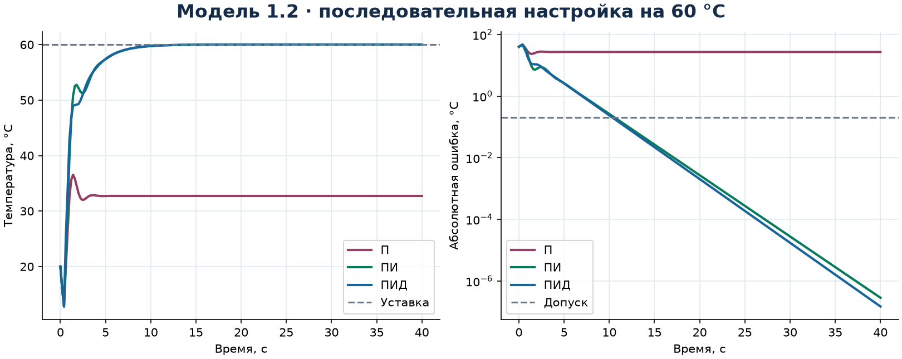
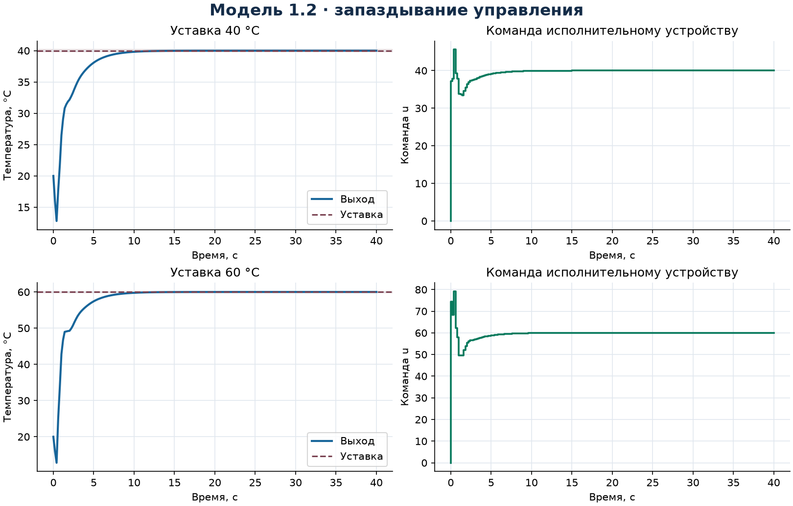
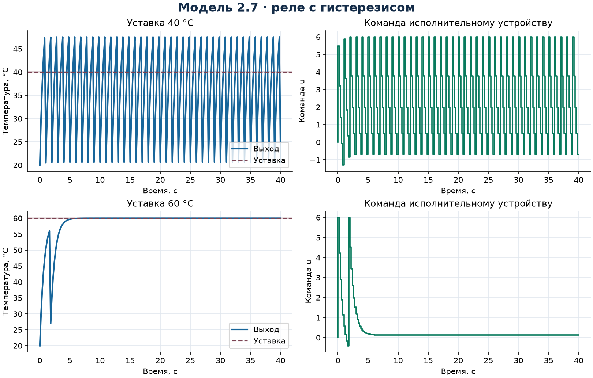
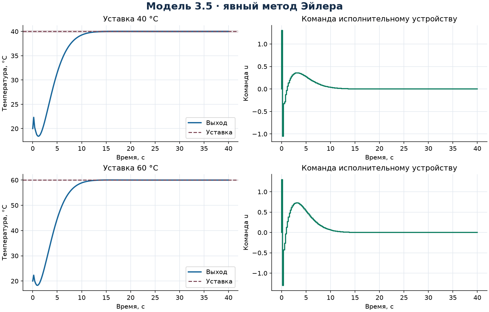
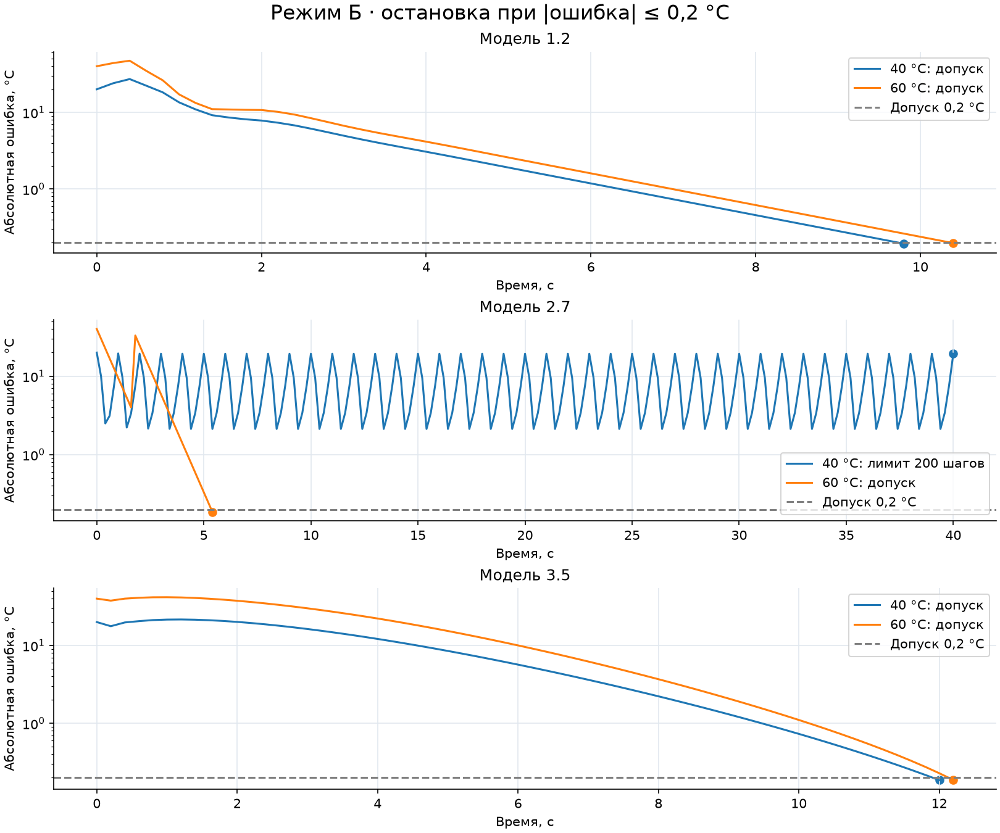

<p align="center">Министерство образования Республики Беларусь</p>
<p align="center">Учреждение образования</p>
<p align="center">«Брестский Государственный технический университет»</p>
<p align="center">Кафедра ИИТ</p>

<br><br><br><br><br>

<p align="center">Лабораторная работа №3</p>
<p align="center">По дисциплине «Теория и моделирование автоматического управления»</p>
<p align="center">Тема: «ПИД-регулирование и автоматическая документация»</p>

<br><br><br><br><br>

<p align="right">Выполнил:</p>
<p align="right">Студент 3 курса</p>
<p align="right">Группы АС-67</p>
<p align="right">Юреня К. В.</p>
<p align="right">Проверил:</p>
<p align="right">Дворанинович Д. А.</p>

<br><br><br><br><br>

<p align="center">Брест 2026</p>

---

## Вариант 21

## Математическая модель

| Объект | Разностное уравнение |
| --- | --- |
| 1.2 · чистое запаздывание | $y_{k+1}=ay_k+bu_{k-d}$ |
| 2.7 · реле с гистерезисом | $y_{k+1}=ay_k+bR(u_k,y_k)$ |
| 3.5 · гармоническая сила, явный Эйлер | $y_{k+1}=y_k+\Delta t\,b\sin u_k$ |

Задержка $d$ целочисленная. Команды до первого шага принимаются нулевыми. Реле выдаёт $+1$ при $u>\delta$ и $-1$ при $u<-\delta$. На порогах и между ними реле выдаёт $+1$ при $y>0$ и $-1$ при $y\le0$.

Для ПИД-регулятора используется инкрементная форма. Начальные значения $u_{-1}$, $e_{-1}$ и $e_{-2}$ равны нулю.

$$
e_k=g-y_k
$$

$$
\Delta u_k=K_p(e_k-e_{k-1})+K_i\Delta t\,e_k+
\frac{K_d}{\Delta t}(e_k-2e_{k-1}+e_{k-2})
$$

$$
u_k=\operatorname{clip}(u_{k-1}+\Delta u_k, u_{\min}, u_{\max})
$$

В следующем шаге используется уже ограниченное значение $u_k$. Избыток команды за пределами актуатора в состоянии регулятора не накапливается. После смены знака ошибки команда может сразу выйти из насыщения.

## Режимы симуляции

- **А. Фиксированное число шагов.** Программа выполняет ровно $n$ обновлений объекта и записывает $n+1$ строк данных с учётом начального состояния.
- **Б. Допуск по ошибке.** Программа проверяет $\lvert e_k\rvert\le\epsilon$ на каждом отсчёте, начиная с начального. Остановка происходит при первом выполнении условия. Пользователь также задаёт максимальное число шагов на случай, если допуск недостижим.

Файл `results.csv` содержит поля `step,time,target,output,error,command`. Значение `command` относится к интервалу, который привёл к текущему состоянию. В первой строке оно равно нулю.

## Последовательная настройка ПИД

Для модели 1.2 выбраны $a=0{,}8$, $b=0{,}2$, задержка $d=2$, шаг $\Delta t=0{,}2$ с, начальная температура 20 °C и уставка 60 °C. Команда ограничена интервалом $[-120,120]$. Каждый пробный расчёт длится 200 шагов. Для сравнения использован допуск 0,2 °C.

1. **Настройка пропорциональной части.** При $K_p=1{,}2$, $K_i=K_d=0$ выход стабилизируется около 32,73 °C. Остаточная ошибка на 200-м шаге — 27,27 °C.
2. **Добавление интегральной части.** При $K_i=0{,}8$ и прежнем $K_p$ выход достигает допуска на 54-м шаге, через 10,8 с, и остаётся в нём до конца эксперимента.
3. **Добавление дифференциальной части.** При $K_d=0{,}1$ первый отсчёт в допуске появляется на 52-м шаге, через 10,4 с. На этих данных превышения уставки не наблюдается. Эта тройка коэффициентов используется как предустановка для модели 1.2.



## Переходные процессы для 40 и 60 °C

В каждом опыте начальная температура равна 20 °C, период дискретизации составляет 0,2 с. Выполнено 200 шагов. На графиках слева показаны температура и уставка, справа — команда регулятора. Таблица показывает первый отсчёт в допуске 0,2 °C.

| Модель | $K_p$, $K_i$, $K_d$ | Параметры объекта | Пределы команды | При 40 °C | При 60 °C |
| --- | --- | --- | --- | ---: | ---: |
| 1.2 | 1,2 / 0,8 / 0,1 | $a=0{,}8$, $b=0{,}2$, $d=2$ | $[-120,120]$ | 49 шагов · 9,8 с | 52 шага · 10,4 с |
| 2.7 | 0,25 / 0,12 / 0 | $a=0{,}75$, $b=15$, $\delta=0{,}2$ | $[-6,6]$ | Допуск не достигнут | 27 шагов · 5,4 с |
| 3.5 | 0,09 / 0,025 / 0,02 | $b=12$ | $[-1{,}3,1{,}3]$ | 60 шагов · 12 с | 61 шаг · 12,2 с |





Для модели 2.7 предустановка использует ПИ-режим. При удержании реле в одном состоянии выход стремится к $\pm15/(1-0{,}75)=\pm60$ °C. Постоянное значение 40 °C потребовало бы $R=2/3$, а реле выдаёт только $+1$ или $-1$. При выбранных коэффициентах процесс для 40 °C колеблется и ни один из 201 отсчёта не попадает в допуск 0,2 °C.



Для модели 3.5 команда ограничена диапазоном между $-\pi/2$ и $\pi/2$, где $\sin(u)$ монотонен. Для обеих уставок ошибка входит в заданный допуск.

## Режим Б: остановка по допуску

Примеры рассчитаны программой через `--examples`. Начальная температура 20 °C, шаг 0,2 с, предел 200 шагов. Параметры объектов и регуляторов совпадают с предыдущим разделом. CSV всех 18 опытов сохраняется в `build/examples/modeb_summary.csv`, траектории для допуска 0,2 °C — в `modeb_model*_*.csv`.

| Модель | Уставка, °C | Допуск, °C | Шаг остановки | Время, с | Абсолютная ошибка, °C | Причина |
| --- | ---: | ---: | ---: | ---: | ---: | --- |
| 1.2 | 40 | 0.5 | 40 | 8 | 0.45627 | Допуск достигнут |
| 1.2 | 40 | 0.2 | 49 | 9.8 | 0.19361 | Допуск достигнут |
| 1.2 | 40 | 0.05 | 64 | 12.8 | 0.04639 | Допуск достигнут |
| 1.2 | 60 | 0.5 | 43 | 8.6 | 0.46393 | Допуск достигнут |
| 1.2 | 60 | 0.2 | 52 | 10.4 | 0.19686 | Допуск достигнут |
| 1.2 | 60 | 0.05 | 67 | 13.4 | 0.04717 | Допуск достигнут |
| 2.7 | 40 | 0.5 | 200 | 40 | 19.33419 | Лимит шагов |
| 2.7 | 40 | 0.2 | 200 | 40 | 19.33419 | Лимит шагов |
| 2.7 | 40 | 0.05 | 200 | 40 | 19.33419 | Лимит шагов |
| 2.7 | 60 | 0.5 | 24 | 4.8 | 0.44104 | Допуск достигнут |
| 2.7 | 60 | 0.2 | 27 | 5.4 | 0.18606 | Допуск достигнут |
| 2.7 | 60 | 0.05 | 32 | 6.4 | 0.04415 | Допуск достигнут |
| 3.5 | 40 | 0.5 | 54 | 10.8 | 0.44082 | Допуск достигнут |
| 3.5 | 40 | 0.2 | 60 | 12 | 0.18620 | Допуск достигнут |
| 3.5 | 40 | 0.05 | 68 | 13.6 | 0.03917 | Допуск достигнут |
| 3.5 | 60 | 0.5 | 56 | 11.2 | 0.46095 | Допуск достигнут |
| 3.5 | 60 | 0.2 | 61 | 12.2 | 0.18705 | Допуск достигнут |
| 3.5 | 60 | 0.05 | 66 | 13.2 | 0.04849 | Допуск достигнут |



Точка в конце каждой кривой обозначает остановку расчёта. При 40 °C модель 2.7 не достигает допуска и возвращает `stepLimit`. Программа не сообщает о достижении цели в этом случае.

Условие режима Б — первое попадание в допуск, а не удержание в нём несколько последовательных шагов. Поэтому время остановки нельзя автоматически считать временем установления. Для оценки последующего поведения служит режим А с полными 200 шагами.

## Сборка и проверка

Откройте терминал в `trunk/as06721/task_03`. Нужны CMake 3.21 или новее, компилятор с поддержкой C++17 и Doxygen. Скрипт ищет Doxygen в `PATH`. Для портативной версии можно задать переменную `DOXYGEN_EXE` с полным путём к исполняемому файлу. [Установка Doxygen](https://www.doxygen.nl/manual/install.html#install_bin_windows)

```bat
run_all.bat
```

Для локального Python скрипт автоматически проверяет `build/dependencies/python/python.exe`. На этом компьютере туда установлены Python 3.12.10 и Matplotlib 3.10.8. Каталог `build` остаётся вне Git. На другом компьютере можно установить обычный Python и выполнить `py -m pip install matplotlib`.

Скрипт собирает код, выводит результаты CTest в терминал, сохраняет `test-results.xml` в каталоге сборки и генерирует `doc/html/index.html`. Затем он рассчитывает примеры и открывает пять графиков в одном окне. При наличии Python и Matplotlib новые PNG записываются в подкаталог `figures` каталога сборки. Если Matplotlib недоступен, открываются сохранённые иллюстрации из `doc/figures`, а окно помечается как `saved`. Закройте окно, чтобы вернуться к командной строке.

CMake использует установленный Google Test, локальный `build/dependencies/googletest-v1.16.0.tar.gz` или загружает Google Test 1.16.0 из GitHub.

**18 из 18 тестов прошли.** Тесты проверяют формулу ПИД, выход из насыщения, задержку и нулевую предысторию, переходы реле на порогах, шаг Эйлера, обработку входных данных и оба режима остановки.

Ниже команды для сборки с MSVC и Ninja. При сборке через MinGW замените `build\msvc` на `build\mingw`. При использовании генератора Visual Studio исполняемый файл находится в `build\msvc\src\Debug`.

```bat
build\msvc\src\task03.exe
py -m pip install matplotlib
py src\plot_results.py results.csv
```

Последняя команда сохраняет `results.png`. Для повторной генерации иллюстраций отчёта выполните:

```bat
build\msvc\src\task03.exe --examples
py src\plot_results.py --examples
```

## Документация и GitHub Pages

Документация Doxygen находится в `doc/html/index.html` и пересоздаётся батником. Все файлы из `doc/html`, включая CSS, JS, SVG и PNG, нужно переносить вместе. Каталог `build` в Git не добавляется.

Workflow `.github/workflows/as06721-task03-pages.yml` публикует документацию только в личном форке `krixiszzzz/TMAU-2026`. Автоматический запуск настроен для веток `main` и `lab3` при изменении HTML или workflow. Ручной запуск доступен через `workflow_dispatch` после появления workflow в основной ветке форка. В общем репозитории университета публикация пропускается.

Порядок проверки публикации:

1. В форке открыть **Settings → Pages → Build and deployment → Source → GitHub Actions**.
2. Отправить каталог работы и workflow в ветку `lab3`. Если используется другое имя ветки, добавить его в `branches` workflow.
3. В **Actions** открыть **Publish as06721 lab 03 documentation** и дождаться успешных заданий `build` и `deploy`.
4. Открыть адрес из результата задания `deploy`. Ожидаемый адрес — https://krixiszzzz.github.io/TMAU-2026/ . Наличие workflow в файлах само по себе не подтверждает успешную публикацию.

При ошибке окружения `github-pages` проверить **Settings → Environments → github-pages → Deployment branches and tags**: ветка `lab3` должна быть разрешена для публикации.

При переносе работы в общий репозиторий сохранить существующий корневой `README.md` с таблицами групп. Не заменять его отдельным шаблоном из архива лабораторной.
