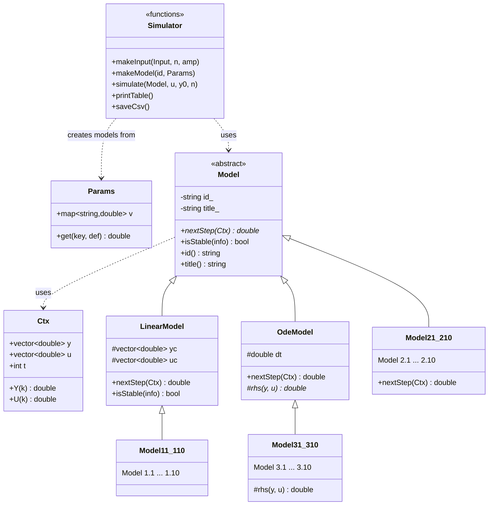
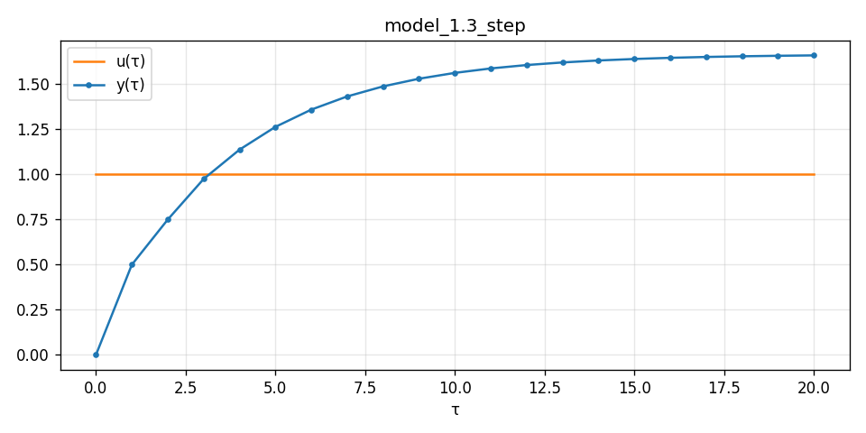
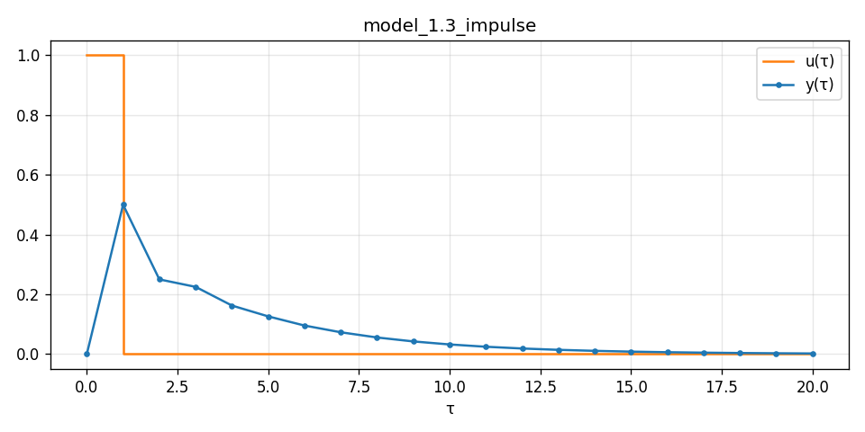
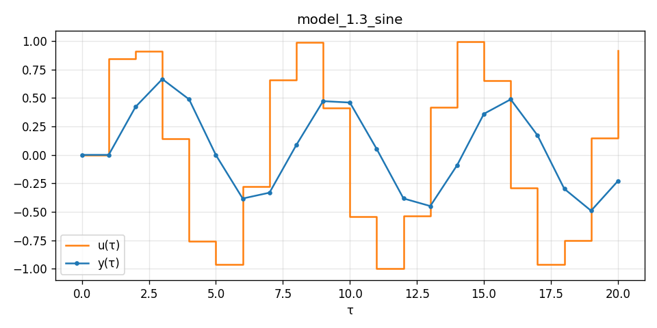
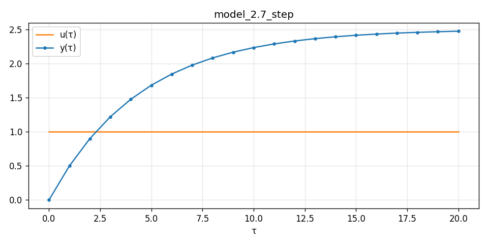
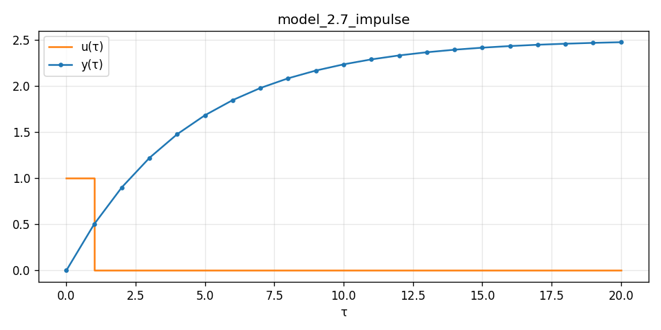
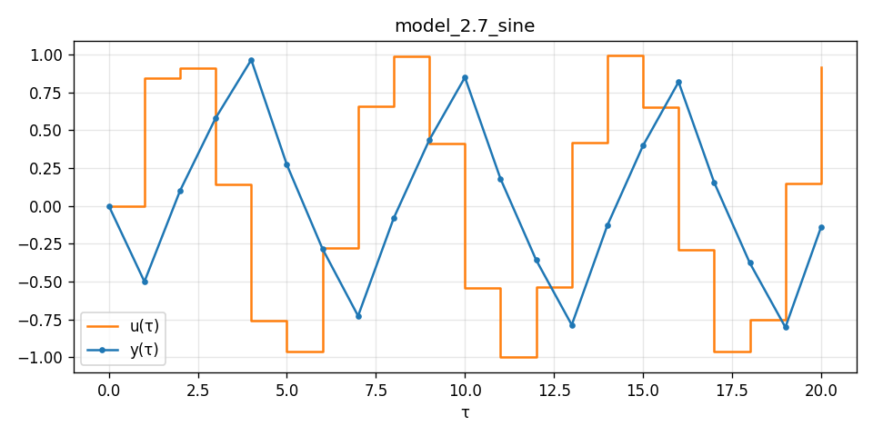
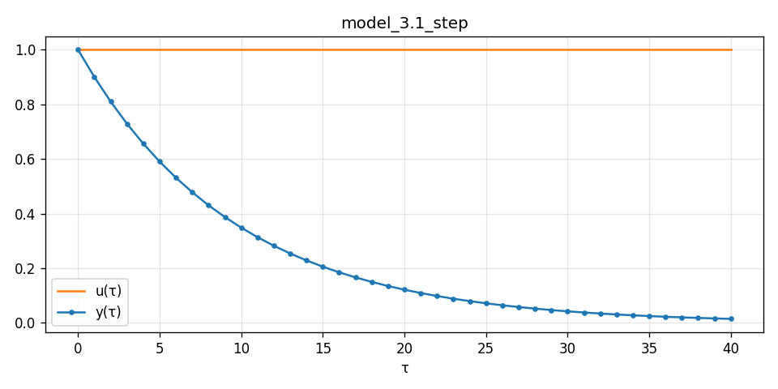
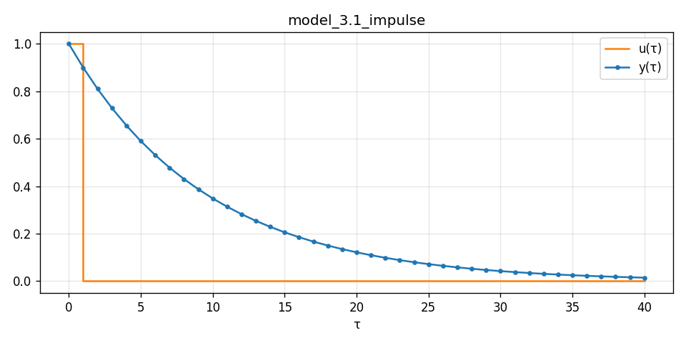
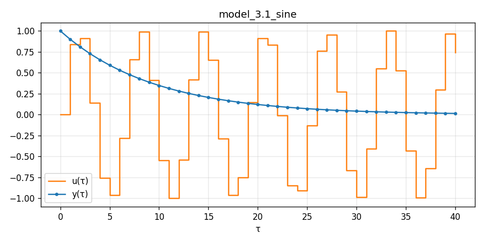

<p align="center">Министерство образования Республики Беларусь</p>
<p align="center">Учреждение образования</p>
<p align="center">“Брестский Государственный технический университет”</p>
<p align="center">Кафедра ИИТ</p>
<br><br><br><br><br><br><br>
<p align="center">Лабораторная работа №1</p>
<p align="center">По дисциплине “Теория и методы автоматического управления”</p>
<br><br><br><br><br>
<p align="right">Выполнил:</p>
<p align="right">Студент 3 курса</p>
<p align="right">Группы АС-68</p>
<p align="right">Богданов В. С.</p>
<p align="right">Проверил:</p>
<p align="right">Дворанинович Д. А.</p>
<br><br><br><br><br>
<p align="center">Брест 2026</p>

## Вариант 13

- Линейная модель: **Model 1.3 (Second-Order Oscillatory/Inertial System)**
- Нелинейная модель: **Model 2.7 (Relay with Hysteresis Element)**
- Дифференциальное уравнение: **Model 3.1 (Pure Linear Decay)**

## Цель работы

Реализовать на C++ (ООП) дискретные линейные и нелинейные модели объекта управления и ДУ (метод Эйлера),
промоделировать их при ступенчатом, импульсном и гармоническом входных воздействиях, вывести результаты
в таблицу, сохранить в `.csv` и визуализировать.

## Реализованные модели

### Model 1.3 (Second-Order Oscillatory/Inertial System)

```math
y_{\tau+1} = a_1\,y_\tau + a_2\,y_{\tau-1} + b\,u_\tau
```

### Model 2.7 (Relay with Hysteresis Element)

```math
y_{\tau+1} = a\,y_\tau + b \cdot \text{relay}(u_\tau, y_\tau)
```

```math
\text{relay}(u, y) = \begin{cases} 1, & u > \epsilon \ \text{or}\ (u \ge -\epsilon \ \text{and}\ y_\tau > 0) \\ -1, & u < -\epsilon \ \text{or}\ (u \le \epsilon \ \text{and}\ y_\tau \le 0) \end{cases}
```

### Model 3.1 (Pure Linear Decay)

```math
\frac{dy}{dt} = -a \cdot y
```

Для данной модели используется метод Эйлера:

```math
y_{\tau+1} = y_\tau - \Delta t \cdot a\,y_\tau
```

Дополнительно в программе реализованы все 30 моделей из задания (выбор через `--model`).

## ООП и архитектура программы

* `Model` — абстрактный базовый класс с чисто виртуальным методом `nextStep(const Ctx&)`,
  вычисляющим $y_{\tau+1}$ по истории $y$ и $u$ (`Ctx::Y(k)` = $y_{\tau-k}$, `Ctx::U(k)` = $u_{\tau-k}$).
* `LinearModel` — общий предок линейных моделей: $y_{\tau+1}=\sum a_j y_{\tau-j}+\sum b_j u_{\tau-j}$.
  Конкретные `Model11 … Model110` задают свои коэффициенты. Здесь же реализован анализ устойчивости.
* `Model21 … Model210` — нелинейные модели, каждая переопределяет `nextStep`.
* `OdeModel` — предок ДУ: `nextStep` = $y+\Delta t\cdot f(y,u)$, потомки `Model31 … Model310` задают правую часть `rhs`.
* `simulator.hpp` — входные воздействия, фабрика `makeModel`, цикл симуляции, вывод таблицы и csv.

### UML



## Входные воздействия

| Тип | Формула | Ключ |
|---|---|---|
| Ступенчатое | $u_\tau = \text{const}$ (`--amp`, по умолчанию 1) | `step` |
| Импульсное | $u_0=1,\ u_{\tau>0}=0$ | `impulse` |
| Гармоническое | $u_\tau=\sin(\tau)$ | `sine` |

Начальное условие $y_0$ задаётся `--y0` (по умолчанию 0), число шагов $n$ — `--n`.
Ненулевые значения $u$ и $y$ до начала симуляции (при запаздывании) считаются равными 0.

## Сборка и запуск

Требуется CMake ≥ 3.10 и компилятор C++11 (MSVC / MinGW). Запуск:

```
src\build.bat
```

Скрипт выполняет три шага: конфигурация `cmake`, сборка `cmake --build`, запуск программы,
и выводит ход каждого шага. Дальнейшие примеры:

```
build\bin\sim.exe --model 1.3 --input step --n 30 --a1 0.5 --a2 0.2 --b 0.5
build\bin\sim.exe --model 2.7 --input all --n 30 --eps 0.1
build\bin\sim.exe --model 3.1 --input all --n 60 --y0 1 --dt 0.1 --a 1
build\bin\sim.exe --model all --input all --n 50 --quiet
python plot.py output
```

Параметры по умолчанию: `a=0.8, b=0.5, a1=0.5, a2=0.2, a3=0.1, b1=0.5, b2=0.3, b3=0.2, c=0.1, d=0.2, k=2,
Umax=1, Umin=-1, delta=0.3, eps=0.1, dt=0.1` (у отдельных моделей свои значения, см. исходники).

## Функционал программы

Программа:

- позволяет выбрать модель (`--model 1.3`, `2.7`, `3.1` или `all`);
- принимает коэффициенты модели (`--a1`, `--a2`, `--b`, `--eps`, `--dt` и др.);
- позволяет выбрать входное воздействие (`--input step | impulse | sine | all`);
- позволяет задать количество шагов `n` (`--n`) и начальное значение `y0` (`--y0`);
- выводит результаты в табличном виде в консоль;
- сохраняет результаты в `.csv` (каталог `output`);
- проверяет устойчивость линейной модели и выводит предупреждение до начала симуляции;
- позволяет построить графики через Python/Matplotlib (`python plot.py output`).

## Анализ устойчивости (Advanced)

**Модель 1.3.** $Z$-преобразование даёт характеристическое уравнение

$$z^2-a_1z-a_2=0,\qquad z_{1,2}=\frac{a_1\pm\sqrt{a_1^2+4a_2}}{2}.$$

Система устойчива, если $|z_{1,2}|<1$. Эквивалентно (критерий Джури):

$$|a_2|<1,\qquad 1-a_1-a_2>0,\qquad 1+a_1-a_2>0.$$

Для $a_1=0.5,\ a_2=0.2$: $z_1=0.7623,\ z_2=-0.2623$ — устойчива. Коэффициент $b$ на устойчивость не влияет.
Корни программа ищет численно (метод Дюрана–Кернера). Если $\max|z_i|\ge1$, перед симуляцией выводится предупреждение. Пример `--model 1.3 --a1 1.2 --a2 0.1`:

```
Устойчивость: z1 = 1.2782 (|z|=1.2782); z2 = -0.0782 (|z|=0.0782)
*** ПРЕДУПРЕЖДЕНИЕ: система НЕУСТОЙЧИВА (корень вне единичного круга) — процесс будет расходиться! ***
```

Для 2.7 (нелинейная) и 3.1 (ДУ) проверка не применяется. Для информации: схема Эйлера для 3.1 даёт
$y_{\tau+1}=(1-a\Delta t)y_\tau$, т.е. устойчива при $|1-a\Delta t|<1$, то есть $0<a\Delta t<2$.
Если $y$ становится `inf/NaN`, расчёт останавливается с сообщением.

## Пример работы программы

Параметры: 1.3 — $a_1=0.5,\ a_2=0.2,\ b=0.5$; 2.7 — $a=0.8,\ b=0.5,\ \epsilon=0.1$; 3.1 — $a=1,\ \Delta t=0.1,\ y_0=1$. $n=30$ (для 3.1 $n=60$).

Модель 1.3, ступенька:

```
     tau |            u |              y
  -------+--------------+---------------
       0 |      1.00000 |              0
       1 |      1.00000 |            0.5
       2 |      1.00000 |           0.75
       3 |      1.00000 |          0.975
       4 |      1.00000 |         1.1375
       5 |      1.00000 |        1.26375
```

Установившееся значение: $y_\infty=\dfrac{b}{1-a_1-a_2}u\approx1.667$.

Модель 2.7, гармонический вход (видно переключение реле):

```
     tau |            u |              y
       1 |      0.84147 |           -0.5
       2 |      0.90930 |            0.1
       3 |      0.14112 |           0.58
       4 |     -0.75680 |          0.964
       5 |     -0.95892 |         0.2712
       6 |     -0.27942 |       -0.28304
```

Модель 3.1, $y_0=1$: $y_\tau=0.9^\tau$ (при $u$ не зависит от входа): 1, 0.9, 0.81, 0.729, 0.6561, 0.59049, …

Графики (ступенька / импульс / синус):

| | Ступенька | Импульс | Синус |
|:-:|:-:|:-:|:-:|
| **1.3** |  |  |  |
| **2.7** |  |  |  |
| **3.1** |  |  |  |

## Выводы

Реализована иерархия классов на основе абстрактного `Model`; добавление новой модели сводится к созданию
наследника и регистрации в фабрике. Линейные модели устойчивы при корнях внутри единичного круга
(программа предупреждает о неустойчивости до симуляции), нелинейные модели демонстрируют
насыщение, зону нечувствительности, гистерезис и т. д.; метод Эйлера для ДУ даёт ожидаемые
переходные процессы.

## Структура сдачи

```
trunk/as06801/task_01/
├── doc/readme.md (+ img/)
└── src/ main.cpp, model.hpp, linear_models.hpp, nonlinear_models.hpp,
        ode_models.hpp, simulator.hpp, CMakeLists.txt, build.bat, plot.py
```
