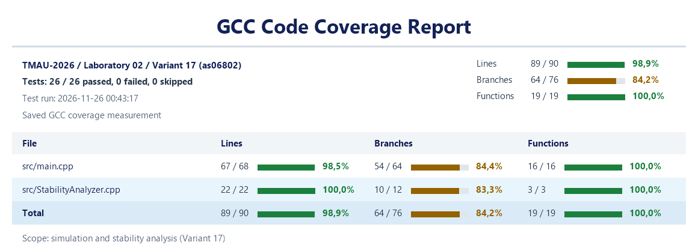

<p align="center">Министерство образования Республики Беларусь</p>
<p align="center">Учреждение образования</p>
<p align="center">«Брестский государственный технический университет»</p>
<p align="center">Кафедра ИИТ</p>

<br><br><br><br><br>

<p align="center">Лабораторная работа №2</p>
<p align="center">По дисциплине «Теория и моделирование автоматического управления»</p>
<p align="center">Тема: «Модульное тестирование и анализ устойчивости»</p>

<br><br><br><br><br>

<p align="right">Выполнил:</p>
<p align="right">Студент 3 курса</p>
<p align="right">Группы АС-68</p>
<p align="right">Борисюк Р. Б.</p>
<p align="right">Проверил:</p>
<p align="right">Дворанинович Д. А.</p>

<br><br><br><br><br>

<p align="center">Брест 2026</p>

---

## Вариант 17 (`as06802`)

Разработка, модульное тестирование и анализ устойчивости для моделей **1.7**, **2.1** и **3.5**. Результаты симуляции экспортируются в `results.csv` (`tau,u,y`), а графики строятся автоматически средствами Python и Matplotlib.

## Математические модели варианта

| Модель | Уравнение перехода |
| --- | --- |
| 1.7. Линейная система с многошаговой историей управления | $y_{\tau+1} = a y_\tau + b_1 u_\tau + b_2 u_{\tau-1} + b_3 u_{\tau-2}$ |
| 2.1. Квадратичная обратная связь и гармоническое управление | $y_{\tau+1} = a y_\tau - b y_{\tau-1}^2 + c u_\tau + d \sin(u_{\tau-1})$ |
| 3.5. Дифференциальное уравнение с гармоническим приводом | $\dfrac{dy}{dt} = b \cdot \sin(u)$ |

Для **модели 1.7** до начала симуляции ($\tau < 0$) входные воздействия принимаются нулевыми ($u_{-1} = u_{-2} = 0$). Вклад слагаемых $b_2 u_{\tau-1}$ и $b_3 u_{\tau-2}$ последовательно включается на шагах $\tau = 1$ и $\tau = 2$.

Для **модели 2.1** хранится предыстория состояния $y_{\tau-1}$ и управления $u_{\tau-1}$ (при $\tau = 0$ принято $y_{-1} = 0$, $u_{-1} = 0$). При нулевых начальных условиях и отсутствии входного сигнала ($y_0 = 0, u_\tau = 0$) система остаётся в точке покоя ($y_\tau = 0$).

Для **модели 3.5** интегрирование выполняется явным методом Эйлера с шагом $\Delta t$:
$$y_{\tau+1} = y_\tau + \Delta t \cdot b \cdot \sin(u_\tau)$$
При постоянном входном сигнале $u(t) = u_0$ скорость изменения состояния постоянна, а аналитическое решение имеет вид:
$$y(t) = y_0 + b \sin(u_0) \cdot t$$
Разностная схема Эйлера воспроизводит это решение с машинной точностью на любом равномерном разбиении сетки.

## Анализ устойчивости модели 1.7 на Z-плоскости

В автономном режиме ($u_\tau = 0$) разностное уравнение модели 1.7 сводится к однородному уравнению первого порядка $y_{\tau+1} = a y_\tau$. Характеристический полином $z - a = 0$ имеет единственный ненулевой корень $z = a$ (запаздывания по входу $u_{\tau-1}, u_{\tau-2}$ порождают только нулевые корни в начале координат).

| Значение коэффициента $a$ | Поведение свободного движения |
| --- | --- |
| $\lvert a \rvert < 1$ | Колебания или апериодический процесс затухают, система асимптотически устойчива. |
| $\lvert a \rvert = 1$ | Полюс лежит на единичной окружности (граница устойчивости). |
| $\lvert a \rvert > 1$ | Полюс вне единичного круга, отклик неограниченно расходится. |

Модуль `inspectLinearStability` проверяет модуль полюса до старта расчёта и при $\lvert a \rvert \ge 1$ выводит предупреждение в консоль.

## Сборка и запуск тестов

Из каталога `trunk/as06802/task_02` выполните:

```bat
run_tests.bat
run_tests.bat --coverage
```

Скрипт настраивает окружение сборки, компилирует статическую библиотеку моделей `as06802_var17_lib`, консольное приложение `task02.exe` и тестовый набор `var17_unit_tests`, запускает тесты через `ctest` и сохраняет графический отчёт `test_results.png`.

## Структура каталога

| Путь | Назначение |
| --- | --- |
| `src/StabilityAnalyzer.h` | Объявление базового класса `BaseSystemModel`, моделей варианта 17 и анализатора полюсов |
| `src/StabilityAnalyzer.cpp` | Реализация проверки устойчивости линейной модели 1.7 и формирования предупреждений |
| `src/main.cpp` | Реализация шагов симуляции моделей 1.7, 2.1, 3.5 и консольного интерфейса |
| `test/test_models.cpp` | Параметризованные тесты траекторий моделей, равновесия и аналитической точности Эйлера |
| `test/test_signals.cpp` | Тесты ступенчатого, импульсного и гармонического генераторов сигналов |
| `test/test_stability.cpp` | Тесты классификации полюсов на Z-плоскости и вывода предупреждений |
| `doc/` | Отчёт по работе (`readme.md`) и скриншот результатов тестирования (`test_results.png`) |
| `run_tests.bat` | Пакетный файл автоматической сборки, прогона тестов и генерации отчёта |

## Результаты модульного тестирования

* **Среда запуска:** Локальный пакетный скрипт (`run_tests.bat`)
* **Всего тестов Google Test:** 26 (включая параметризованные наборы `Variant17Models` и `Variant17Poles`)
* **Пройдено успешно:** 26 / 26


| Файл исходного кода | Покрытие строк | Покрытие функций | Статус |
| --- | :---: | :---: | :---: |
| `src/main.cpp` | 98.5 % (67/68) | 100 % (16/16) | OK |
| `src/StabilityAnalyzer.cpp` | 100 % (22/22) | 100 % (3/3) | OK |
| **Итого** | **98.9 % (89/90)** | **100 % (19/19)** | **Success** |


