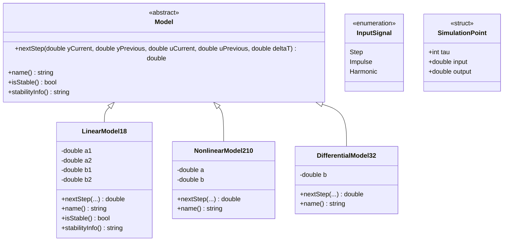
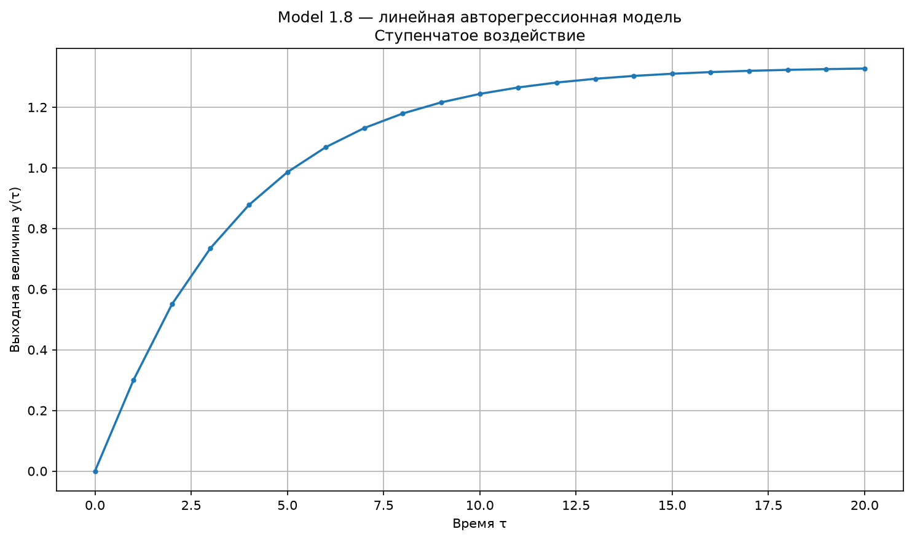
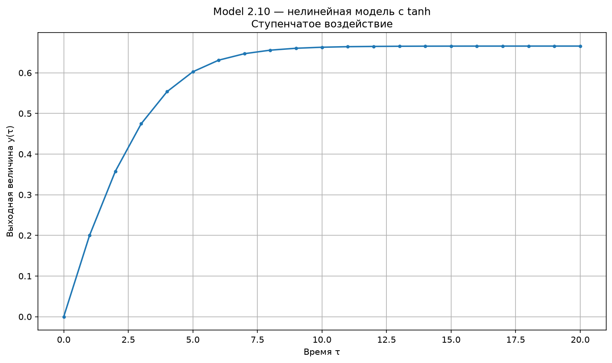
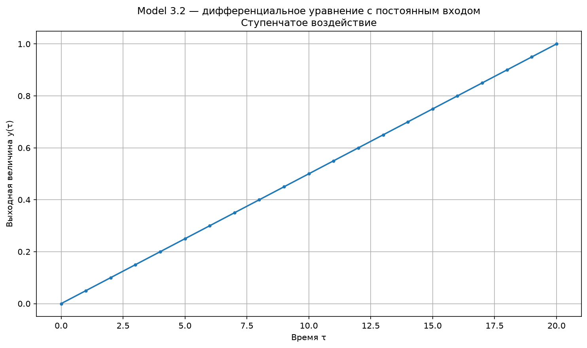

Министерство образования Республики Беларусь

Учреждение образования

«Брестский государственный технический университет»

Кафедра ИИТ

     

Лабораторная работа № 1

По дисциплине «Теория и моделирование автоматического управления»

Тема: «Моделирование объектов управления»

    

Выполнил:

Студент 3 курса

Группы АС-68

Венско А. В.

Проверил:

Дворанинович Д. А.

    

Брест 2026

---

## Вариант 8

- Линейная модель: **Model 1.8**.
- Нелинейная модель: **Model 2.10**.
- Дифференциальное уравнение: **Model 3.2**.

## Реализованные модели

### Model 1.8 (Generalized Autoregressive Linear Model)

Обобщённая авторегрессионная линейная модель:

$$
y_{\tau+1}=a_1y_\tau+a_2y_{\tau-1}+b_1u_\tau+b_2u_{\tau-1}.
$$

Параметры по умолчанию: $a_1=0.5$, $a_2=0.2$, $b_1=0.3$, $b_2=0.1$.

Для данной модели дополнительно выполняется проверка устойчивости. Характеристическое уравнение:

$$
z^2-a_1z-a_2=0.
$$

Система считается устойчивой, если модули обоих корней характеристического уравнения меньше единицы:

$$
|z_1|<1,\qquad |z_2|<1.
$$

### Model 2.10 (Hyperbolic Tangent Smoothing)

Нелинейная модель с использованием гиперболического тангенса:

$$
y_{\tau+1}=a\cdot\tanh(y_\tau)+b\cdot u_\tau^3.
$$

Параметры по умолчанию: $a=0.8$, $b=0.2$.

### Model 3.2 (Pure Constant Input Drive)

Дифференциальное уравнение с входным воздействием:

$$
\frac{dy}{dt}=b\cdot u.
$$

Для численного решения используется метод Эйлера:

$$
y_{\tau+1}=y_\tau+\Delta t\cdot b\cdot u_\tau.
$$

Параметры по умолчанию: $b=0.5$, $\Delta t=0.1$.

## Входные воздействия

Для проверки моделей используются три типа входных воздействий:

1. **Ступенчатое (Step):** $u_\tau=A$, где по умолчанию $A=1$.
2. **Импульсное (Impulse):** $u_0=1$, $u_{\tau}=0$ при $\tau>0$.
3. **Гармоническое (Harmonic):** $u_\tau=\sin(\tau)$.

Количество шагов симуляции по умолчанию $n=20$, начальное значение $y(0)=0$. При запуске пользователь может выбрать одну из трёх моделей, тип входного воздействия, количество шагов, начальное значение и параметры выбранной модели. Пустой ввод позволяет использовать значение по умолчанию.

## ООП архитектура

Программа реализована с использованием принципов объектно-ориентированного программирования. В качестве базового класса создан абстрактный класс `Model`, который содержит виртуальный деструктор, чистые виртуальные методы `nextStep()` и `name()`, а также виртуальные методы `isStable()` и `stabilityInfo()`.

От базового класса `Model` наследуются три класса:

- `LinearModel18` — реализует линейную авторегрессионную модель 1.8. Хранит коэффициенты `a1`, `a2`, `b1`, `b2` и переопределяет методы расчёта следующего шага и проверки устойчивости.
- `NonlinearModel210` — реализует нелинейную модель 2.10. Хранит коэффициенты `a` и `b`, использует функцию гиперболического тангенса.
- `DifferentialModel32` — реализует дифференциальное уравнение 3.2. Хранит коэффициент `b`, а расчёт выполняет методом Эйлера с заданным шагом интегрирования.

Для выбора входного воздействия используется перечисление `InputSignal` со значениями `Step`, `Impulse` и `Harmonic`. Функции `getInputValue()` и `getInputSignalName()` определяют значение и название выбранного сигнала. Структура `SimulationPoint` хранит номер шага `tau`, входное воздействие `input` и выходное значение `output`.

Функция `runSimulation()` выполняет расчёт последовательности значений, `printTable()` выводит результаты в консоль, а `saveCsv()` сохраняет их в CSV-файл. После расчёта запускается Python-скрипт `plot.py`, который строит и сохраняет график выбранной модели и входного воздействия.

## UML диаграмма классов

Диаграмма отражает структуру классов программы: абстрактный базовый класс `Model`, три класса-наследника, перечисление `InputSignal` и структуру `SimulationPoint`.

## Результаты моделирования

Для построения графиков использованы значения параметров по умолчанию, количество шагов $n=20$ и начальное значение $y(0)=0$. Для каждой модели рассмотрены ступенчатое, импульсное и гармоническое входные воздействия.

### 1. Результаты Model 1.8 — линейная модель

**Ступенчатое воздействие:**

### 2. Результаты Model 2.10 — нелинейная модель

**Ступенчатое воздействие:**

### 3. Результаты Model 3.2 — дифференциальное уравнение

**Ступенчатое воздействие:**

