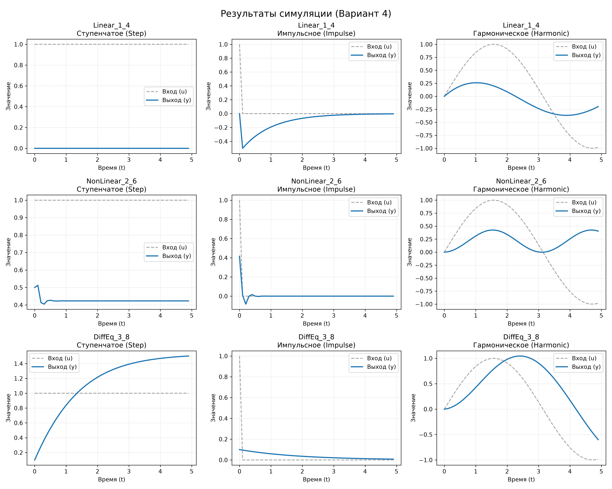
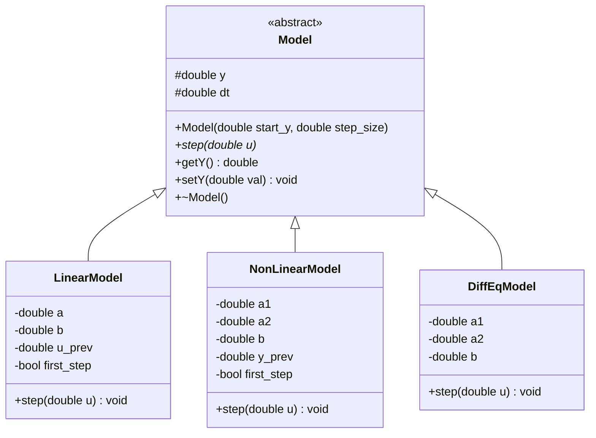

<p align="center">Министерство образования Республики Беларусь</p>
<p align="center">Учреждение образования</p>
<p align="center">“Брестский Государственный технический университет”</p>
<p align="center">Кафедра ИИТ</p>
<br><br><br><br><br><br><br>
<p align="center">Лабораторная работа №1</p>
<p align="center">По дисциплине “Теория и моделирование автоматического управления”</p>
<p align="center">Тема: “Моделирование объектов управления”</p>
<br><br><br><br><br>
<p align="right">Выполнил:</p>
<p align="right">Студент 3 курса</p>
<p align="right">Группы АС-68</p>
<p align="right">Веремейчук В. А.</p>
<p align="right">Проверил:</p>
<p align="right">Дворанинович Д. А.</p>
<br><br><br><br><br>
<p align="center">Брест 2026</p>


**Вариант 4**

### 1. Цель работы

Разработать программу на языке C++ для моделирования динамических систем с использованием принципов объектно-ориентированного программирования.

В ходе лабораторной работы необходимо:
- Реализовать базовый абстрактный класс Model.
- Создать классы-наследники для трёх математических моделей.
- Реализовать три типа входных воздействий.
- Предусмотреть настройку количества шагов моделирования.
- Организовать вывод результатов в табличном формате.
- Реализовать сохранение результатов в CSV-файлы.
- Выполнить визуализацию результатов моделирования.
- Создать UML-диаграмму классов.
- Настроить сборку проекта с помощью CMake.

### 2. Используемые технологии

| Технология | Назначение |
|---|---|
| C++ | Разработка программы |
| STL | Работа со строками и файлами |
| CMake | Система сборки |
| MinGW | Компиляция программы |
| CSV | Сохранение результатов |
| Python | Обработка данных |
| Matplotlib | Построение графиков |
| GitHub | Хранение исходного кода |

### 3. Архитектура программы

Программа реализована с использованием объектно-ориентированного подхода.

В основе архитектуры находится абстрактный класс `Model`, содержащий:
- `y` — текущее состояние системы;
- `dt` — шаг моделирования;
- `step(double u)` — чисто виртуальный метод для расчёта следующего состояния;
- `getY()` — метод получения текущего значения выходной переменной;
- виртуальный деструктор.

От базового класса `Model` наследуются три класса:

1. `LinearModel` — линейная модель 1.4.
2. `NonLinearModel` — нелинейная модель 2.6.
3. `DiffEqModel` — модель дифференциального уравнения 3.8.

Каждый класс реализует собственный метод `step()`, соответствующий математическому уравнению модели.

Для выбора модели используется указатель базового типа `Model*`. Благодаря этому обеспечивается полиморфизм.

### 4. Математические модели

#### 4.1. Модель 1.4 — линейная модель

Для первой модели используется разностное уравнение:

$$
y_{k+1}=a y_k+b(u_k-u_{k-1})
$$

где:
- $y_k$ — текущее значение выходной переменной;
- $a,b$ — коэффициенты модели;
- $u_k$ — текущее значение входного сигнала;
- $u_{k-1}$ — предыдущее значение входного сигнала.

Реализация выполнена в классе `LinearModel`.

Для хранения предыдущего значения входного сигнала используется переменная `u_prev`.

#### 4.2. Модель 2.6 — нелинейная модель

Для второй модели используется уравнение:

$$
y_{k+1}=a_1y_k^3-a_2y_{k-1}+bu_k^2
$$

где:
- $a_1,a_2,b$ — коэффициенты модели;
- $y_k$ — текущее состояние системы;
- $y_{k-1}$ — предыдущее состояние системы;
- $u_k$ — входное воздействие.

Реализация выполнена в классе `NonLinearModel`.

Для хранения предыдущего состояния системы используется переменная `y_prev`.

#### 4.3. Модель 3.8 — модель дифференциального уравнения

Для третьей модели используется дифференциальное уравнение:

$$
\frac{dy}{dt}=-a_1y-a_2y^2+bu
$$

Для численного решения применяется явный метод Эйлера:

$$
y_{k+1}=y_k+\Delta t(-a_1y_k-a_2y_k^2+bu_k)
$$

где:
- $a_1,a_2,b$ — параметры модели;
- $\Delta t$ — шаг интегрирования;
- $u_k$ — входной сигнал;
- $y_k$ — текущее состояние системы.

Реализация выполнена в классе `DiffEqModel`.

### 5. Типы входных воздействий

Для тестирования моделей предусмотрено три типа входных сигналов.

#### 5.1. Ступенчатое воздействие

Ступенчатый сигнал имеет постоянное значение:

$$
u_k=1
$$

#### 5.2. Импульсное воздействие

Импульсный сигнал задаётся следующим образом:

$$
u_k=
\begin{cases}
1, & k=0,\\
0, & k>0.
\end{cases}
$$

#### 5.3. Гармоническое воздействие

Гармонический сигнал задаётся функцией:

$$
u(t)=\sin(t)
$$

Выбор входного воздействия осуществляется пользователем при запуске программы.

### 6. Алгоритм работы программы

1. Пользователь запускает программу.
2. Выбирает одну из трёх математических моделей.
3. Вводит коэффициенты выбранной модели.
4. Выбирает тип входного воздействия.
5. Указывает количество шагов моделирования $n$.
6. Вводит начальное значение выходной переменной $y_0$.
7. Задаёт шаг моделирования $\Delta t$.
8. Программа выполняет последовательные вычисления.
9. Результаты выводятся в консоль в табличном формате.
10. Результаты сохраняются в CSV-файл.

Время каждого шага рассчитывается по формуле:

$$
t_k=k\cdot\Delta t
$$

Количество вычисляемых значений определяется параметром $n$.

### 7. Выходные данные

Результаты моделирования выводятся в консоль в табличном формате.

| Step | Time | Input U | Output Y |
|---|---|---|---|
| Номер шага | Время моделирования | Входной сигнал | Выходной сигнал |

Количество вычисляемых значений определяется параметром `n`, который задаётся пользователем перед началом моделирования.

В таблице отображаются:
- номер текущего шага;
- время моделирования;
- значение входного воздействия;
- значение выходной переменной системы.

Время каждого шага рассчитывается по формуле:

$$
t_k=k\cdot\Delta t
$$

Полученные результаты используются для последующего анализа поведения математических моделей.

### 8. Визуализация результатов

Для визуализации результатов моделирования используется Python и библиотека Matplotlib.

Результаты моделирования отображаются в виде графиков, на которых представлены:
- входной сигнал $u(t)$;
- выходной сигнал $y(t)$.

По горизонтальной оси располагается время моделирования, по вертикальной — значения входного и выходного сигналов.

На рисунке представлены результаты моделирования трёх математических моделей при использовании различных типов входных воздействий.



Визуализация позволяет сравнить поведение линейной, нелинейной и дифференциальной моделей при ступенчатом, импульсном и гармоническом воздействиях.


### 9. UML-диаграмма классов

Для отображения структуры программы используется UML-диаграмма классов.



На диаграмме показано наследование трёх конкретных моделей от абстрактного класса `Model`.

### 10. Сборка проекта

Для сборки проекта используется система CMake и компилятор MinGW.

Автоматизация сборки реализована с помощью командного файла `Build.bat`.

Последовательность сборки:

1. Создание каталога `build`.
2. Запуск конфигурации CMake.
3. Генерация файлов сборки.
4. Компиляция исходного кода.
5. Создание исполняемого файла `lab1_app.exe`.
6. Запуск программы.
7. Запуск скрипта визуализации.

Для запуска сборки необходимо выполнить:

```bat
Build.bat
```

Процесс сборки отображается в консоли.

### 11. Тестирование программы

Тестирование выполняется для трёх моделей с использованием трёх типов входных воздействий.

| № | Модель | Входное воздействие | Цель тестирования |
|---|---|---|---|
| 1 | Модель 1.4 | Ступенчатое | Проверка реакции на постоянный сигнал |
| 2 | Модель 1.4 | Импульсное | Проверка реакции на импульс |
| 3 | Модель 1.4 | Гармоническое | Проверка реакции на синусоидальный сигнал |
| 4 | Модель 2.6 | Ступенчатое | Проверка нелинейной реакции |
| 5 | Модель 2.6 | Импульсное | Проверка реакции на импульс |
| 6 | Модель 2.6 | Гармоническое | Проверка реакции на гармонический сигнал |
| 7 | Модель 3.8 | Ступенчатое | Проверка численного решения |
| 8 | Модель 3.8 | Импульсное | Проверка реакции на импульс |
| 9 | Модель 3.8 | Гармоническое | Проверка реакции на синусоидальный сигнал |


### 12. Вывод

В ходе лабораторной работы была разработана программа для моделирования динамических систем на языке C++.

В программе реализована объектно-ориентированная архитектура с использованием абстрактного базового класса `Model` и трёх классов-наследников: `LinearModel`, `NonLinearModel` и `DiffEqModel`.

Реализована возможность выбора математической модели, задания её коэффициентов, выбора типа входного воздействия и настройки количества шагов моделирования.

Результаты вычислений выводятся в консоль в табличном виде и сохраняются в CSV-файлы для последующего анализа.

Для решения дифференциального уравнения используется явный метод Эйлера.

Также предусмотрена автоматизация сборки проекта с помощью CMake и командного BAT-файла. Для визуализации результатов используется Python и Matplotlib.

В результате выполнения лабораторной работы были закреплены навыки объектно-ориентированного программирования, численного моделирования, работы с файлами и автоматизации сборки программных проектов.
