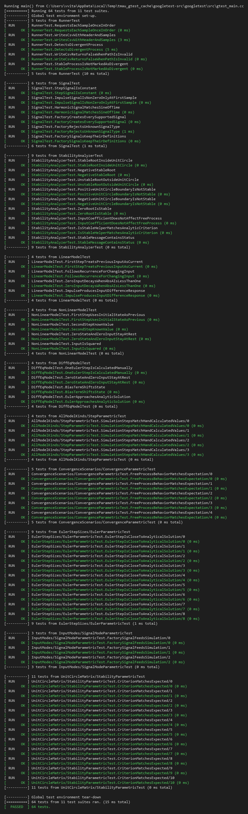

<p align="center">Министерство образования Республики Беларусь</p>
<p align="center">Учреждение образования “Брестский Государственный технический университет”</p>
<p align="center">Кафедра ИИТ</p>
<br><br><br>
<p align="center">Лабораторная работа №2</p>
<p align="center">По дисциплине “Теория и методы автоматического управления”</p>
<p align="center">Тема: “Модульное тестирование и анализ устойчивости”</p>
<br><br><br>
<p align="right">Выполнил: студент 3 курса группы АС-68</p>
<p align="right">Веремейчук В. А.</p>
<p align="right">Проверил: Дворанинович Д. А.</p>
<br><br><br>
<p align="center">Брест 2026</p>

---

# TMAU — лабораторная работа №2

**Вариант:** 4 (as06804)  
**Предыдущая работа:** лабораторная работа №1 (вариант 4: модели 1.4, 2.6, 3.8)  
**Язык:** C++17  
**Тестовый фреймворк:** Google Test 1.14.0 + Google Mock  
**Сборка и покрытие:** CMake, MinGW-W64 g++ 16.2, `gcovr` 8.8

## 1. Цель работы

Расширить программу из лабораторной работы №1 модулем анализа устойчивости линейной дискретной модели и покрыть её математические функции модульными тестами. Сборка, запуск тестов и формирование отчётов выполняются локально командным файлом `run_tests.bat`.

## 2. Математические модели варианта 4

| Модель | Тип | Уравнение |
|---|---|---|
| Model 1.4 | Линейная дискретная | $y_{k+1}=a\,y_k+b\,(u_k-u_{k-1})$ |
| Model 2.6 | Нелинейная дискретная | $y_{k+1}=a_1 y_k^3-a_2 y_{k-1}+b u_k^2$ |
| Model 3.8 | Дифференциальная (Эйлер) | $\dfrac{dy}{dt}=-a_1y-a_2y^2+bu$, $y_{k+1}=y_k+\Delta t(-a_1y_k-a_2y_k^2+bu_k)$ |

Входные воздействия (интерфейс `Signal`, фабрика `makeSignal`):

- **Step** — $u_k=1$;
- **Impulse** — $u_0=1$, $u_k=0$ при $k>0$;
- **Harmonic** — $u(t)=\sin t$.

Для первого отсчёта сохранено поведение ЛР1: предыдущий вход/состояние считается равным начальному, поэтому скачок на первом шаге не создаёт искусственного импульса.

## 3. Анализ устойчивости Model 1.4

Свободный процесс ($u_k=0$):

$$y_{k+1}=a\,y_k.$$

Z-преобразование: $zY(z)=aY(z)$, характеристическое уравнение

$$z-a=0 \quad\Rightarrow\quad z=a.$$

Корень лежит на действительной оси Z-плоскости. Модель асимптотически устойчива тогда и только тогда, когда

$$|z|=|a|<1.$$

При $|a|=1$ система находится на границе и **не является асимптотически устойчивой**, при $|a|>1$ процесс расходится. Коэффициент $b$ в свободном процессе отсутствует и на критерий не влияет.

Модуль `src/StabilityAnalyzer.*` реализует функцию `analyzeLinearModel14(a, b)`, которая возвращает корень, спектральный радиус $|z|_{\max}$, текстовый статус и флаг `stable`. В `main.cpp` результат выводится **до начала симуляции**; при `stable == false` печатается предупреждение о возможной расходимости.

## 4. Структура проекта

```
task_02/
├── run_tests.bat
├── doc/
│   ├── readme.md              # настоящий отчёт
│   └── test_results.png       # результат прогона тестов
├── src/
│   ├── CMakeLists.txt
│   ├── StabilityAnalyzer.hpp/.cpp
│   ├── main.cpp
│   ├── Model.h
│   ├── LinearModel.h/.cpp
│   ├── NonLinearModel.h/.cpp
│   ├── DiffEqModel.h/.cpp
│   ├── InputSignal.h/.cpp     # Signal + фабрика makeSignal
│   └── SimulationRunner.h/.cpp
└── test/
    ├── test_models.cpp
    ├── test_stability.cpp
    ├── test_signals.cpp
    ├── test_runner.cpp        # Google Mock
    └── test_parametric.cpp    # TEST_P
```

Исходники трёх моделей перенесены из `task_01/as06804` без изменения формул. В отличие от примера, где `task_02` собирается из `task_01/src`, в этой ветке файлы `InputSignal.*` и `SimulationRunner.*` лежат рядом с анализатором: в `task_01/as06804/src` их нет.

## 5. Сборка и запуск

### Требования

- CMake ≥ 3.16; компилятор с поддержкой C++17 (использован MinGW-W64 g++ 16.2);
- Python 3 (нужен для загрузки Google Test и для `gcovr`);
- `gcovr` — для анализа покрытия (`python -m pip install --user gcovr`).

### Локальный запуск

Из каталога `trunk\as06804\task_02`:

```bat
run_tests.bat
```

Скрипт: подготавливает Google Test 1.14.0, конфигурирует CMake из `src`, компилирует `task_02` и `task02_tests`, запускает 64 теста и выводит отчёт о покрытии через `gcovr`.

> **Особенность окружения:** MinGW `make` не корректно обрабатывает кириллические пути (`Документы\Проект по умолчанию`). Поэтому сборка выполняется в ASCII-зеркале `%TEMP%\tmau_task02_build`. При другом компиляторе зеркало можно отключить, запустив CMake напрямую из `task_02\src`.

### Запуск программы

```bat
build\task_02.exe      # в ASCII-зеркале; выбирает модель, a/b, сигнал, n, y0, dt
```

Программа печатает таблицу `Step | Time | Input U | Output Y` и сохраняет CSV (`Linear_1_4_signal1.csv` и т.п.).

## 6. Модульные тесты

| Группа | Что проверяется | Количество |
|---|---|---:|
| `LinearModelTest` | первый шаг, рекурренция, затухание при $|a|<1$, реакция на импульс | 4 |
| `NonLinearModelTest` | первое/второе состояние, покой при нулях, квадрат входа | 4 |
| `DiffEqModelTest` | один шаг Эйлера, покой, смещение $b$, сравнение с аналитикой | 4 |
| `SignalTest` | Step / Impulse / Harmonic, фабрика и ошибка на неизвестный тип | 6 |
| `StabilityAnalyzerTest` | корень $z=a$, внутри / вне / на границе единичной окружности, сообщение | 9 |
| `UnitCircleMatrix/StabilityParametricTest` (`TEST_P`) | 11 наборов $a$ включая $a=\pm1$ | 11 |
| `RunnerTest` (`Google Mock`) | порядок и число вызовов сигнала, CSV, детекция расходимости | 5 |
| `AllModelKinds/StepParametricTest` (`TEST_P`) | пошаговые значения всех трёх моделей | 4 |
| `ConvergenceScenarios/ConvergenceParametricTest` (`TEST_P`) | сходимость при $|a|<1$, граница и рост при $|a|>1$ | 5 |
| `EulerStepSizes/EulerParametricTest` (`TEST_P`) | Эйлер против аналитического решения при $\Delta t=0.1/0.05/0.01$ | 9 |
| `InputModes/SignalModeParametricTest` (`TEST_P`) | подстановка трёх режимов через фабрику сигналов | 3 |
| **Итого** | | **64** |

Требования задания выполнены: параметризованные тесты (`TEST_P`) используются для расчёта шагов и сходимости, а mock-объект `MockSignal` (Google Mock) проверяет опрос входного воздействия с помощью `InSequence` и `EXPECT_CALL`.

## 7. Тестовое покрытие и результаты

* **Способ запуска:** локальный скрипт `run_tests.bat`.
* **Всего тестов:** 64.
* **Успешно пройдено:** 64 / 64.
* **Инструмент покрытия:** `gcovr` (GCC `--coverage`).

### Покрытие тестируемой бизнес-логики (`main.cpp` исключён)

| Модуль / класс | Строк | Выполнено | Покрытие |
|---|---:|---:|---:|
| `LinearModel.cpp` | 10 | 10 | 100 % |
| `NonLinearModel.cpp` | 11 | 11 | 100 % |
| `DiffEqModel.cpp` | 7 | 7 | 100 % |
| `InputSignal.cpp` + `InputSignal.h` | 13 | 13 | 100 % |
| `Model.h` | 5 | 5 | 100 % |
| `SimulationRunner.cpp` | 29 | 28 | 96 % |
| `StabilityAnalyzer.cpp` | 18 | 18 | 100 % |
| **Итого по ядру** | **93** | **92** | **98 %** |

### Полное покрытие (включая интерактивный `main.cpp`)

| Категория | Строк | Выполнено | Покрытие |
|---|---:|---:|---:|
| Ядро (таблица выше) | 93 | 92 | 98 % |
| `main.cpp` (консольный UI, тестами не вызывается) | 79 | 0 | 0 % |
| **Итого по проекту** | **172** | **92** | **53 %** |

Непокрытая строка `SimulationRunner.cpp:46` — закрывающая скобка функции, которую `gcov` считает исполняемой; реальных ветвлений бизнес-логики без теста нет.



## 8. Результаты и ограничения

- Перенесены три модели варианта 4 без изменения математики; сигналы выделены в отдельный модуль с интерфейсом `Signal`.
- Реализован аналитический анализатор устойчивости линейной модели 1.4; предупреждение выводится до симуляции.
- Написано 64 модульных теста: обычные `TEST`, параметризованные `TEST_P` и mock-тесты на Google Mock.
- Покрытие ядра составляет 98 %, полное покрытие с учитыванием консольного `main.cpp` — 53 %.

## Выводы

В ходе лабораторной работы программа из ЛР1 была расширена модулем анализа устойчивости и автоматизированным модульным тестированием. Для модели 1.4 аналитически найден корень характеристического уравнения $z=a$ и сформулирован критерий $|a|<1$; проверка этого условия встроена в программу и покрыта тестами, включая границу $|z|=1$. Использование `TEST_P` позволило без дублирования кода проверить все три модели и разные шаги интегрирования, а Google Mock — контролировать порядок опроса входных сигналов. Локальный `run_tests.bat` обеспечивает воспроизводимую сборку, прогон 64 тестов и вывод отчёта о покрытии.
