<p align="center">Министерство образования Республики Беларусь</p>
<p align="center">Учреждение образования</p>
<p align="center">“Брестский Государственный технический университет”</p>
<p align="center">Кафедра ИИТ</p>
<br><br><br><br><br><br><br>
<p align="center">Лабораторная работа №2</p>
<p align="center">По дисциплине “Теория и моделирование автоматического управления”</p>
<p align="center">Тема: “Модульное тестирование, анализ устойчивости и покрытие кода”</p>
<br><br><br><br><br><br><br>
<p align="right">Выполнил:</p>
<p align="right">Студент 3 курса</p>
<p align="right">Группы АС-68</p>
<p align="right">Дворак В. А.</p>
<p align="right">Проверил:</p>
<p align="right">Дворанинович Д. А.</p>
<br><br><br><br><br><br><br>
<p align="center">Брест 2026</p>

---

## Цель и задачи работы

**Цель:** написать модульные тесты для программы, разработанной в лабораторной работе №1,
предварительно расширив её математический и функциональный базис модулем анализа устойчивости,
и обеспечить локальную автоматизацию сборки, тестирования и анализа покрытия кода.

**Задачи:**

1. Использовать фреймворк модульного тестирования **Google Test** (вместе с **Google Mock**).
2. Реализовать модуль анализа устойчивости линейных дискретных моделей: аналитически найти
   корни характеристического уравнения на Z-плоскости и выводить предупреждение в консоль
   перед началом симуляции, если процесс расходится.
3. Разместить исходный код программы в каталоге `trunk\as06805\task_02\src`,
   модульные тесты — в `trunk\as06805\task_02\test`.
4. Создать в корне проекта командный файл `run_tests.bat`, автоматически собирающий проект,
   запускающий тесты и генерирующий отчёт о покрытии кода.
5. Отразить выполнение работы в общем файле `readme.md`.

---

## Выбранный вариант и спецификация моделей (Вариант 3)

В рамках данной работы исследуется динамика процессов для трёх типов систем
(состав моделей расширен по сравнению с ЛР №1 — добавлены модели 1.1, 2.2 и 2.3
для проверки граничных значений нелинейностей):

1. **Дискретная линейная динамика (Model 1.3):**
   Представляет собой инерционное звено второго порядка с разностным уравнением:
   $$y_{\tau+1} = a_1 \cdot y_{\tau} + a_2 \cdot y_{\tau-1} + b \cdot u_{\tau}$$
   * Базовые параметры эксперимента: $a_1 = 0.5$, $a_2 = 0.1$, $b = 1.0$.
   * Дополнительно: **Model 1.1** — $y_{\tau+1} = a\,y_{\tau} + b\,u_{\tau}$ ($a = 0.8$, $b = 0.5$).

2. **Нелинейный объект с трением (Model 2.5):**
   Моделирует динамический процесс с экспоненциальным насыщением и учетом знака воздействия:
   $$y_{\tau+1} = a \cdot y_{\tau} + b \cdot \text{sign}(u_{\tau}) \cdot \left(1 - e^{-|u_{\tau}|}\right)$$
   * Базовые параметры эксперимента: $a = 0.8$, $b = 0.5$.
   * Дополнительно: **Model 2.2** (насыщение $\text{sat}(u)$, $U_{max} = 1.0$, $U_{min} = -1.0$)
     и **Model 2.3** (зона нечувствительности, $\delta = 0.1$).

3. **Непрерывное дифференциальное уравнение (Model 3.7):**
   Решается численным методом Эйлера первого порядка:
   $$\frac{dy}{dt} = -e^a \cdot y + b \cdot u \quad\Rightarrow\quad y_{\tau+1} = y_{\tau} + \Delta t \cdot \left(-e^a \cdot y_{\tau} + b \cdot u_{\tau}\right)$$
   * Базовые параметры эксперимента: $a = 0.1$, $b = 1.0$, $\Delta t = 0.1$.

---

## Виды тестовых воздействий

Для анализа реакции систем подавались следующие сигналы $u_{\tau}$:

* **Ступенчатый отклик (Step):** $u_{\tau} = 1.0$ (для всех $\tau$).
* **Импульсный отклик (Impulse):** $u_0 = 1.0$, $u_{\tau > 0} = 0.0$.
* **Гармонический отклик (Harmonic):** $u_{\tau} = \sin(\tau)$.

---

## Модуль анализа устойчивости

Для линейной дискретной модели $y_{\tau+1} = a_1 y_{\tau} + a_2 y_{\tau-1} + b u_{\tau}$
характеристическое уравнение имеет вид

$$z^2 - a_1 z - a_2 = 0 \quad\Rightarrow\quad z_{1,2} = \frac{a_1 \pm \sqrt{a_1^2 + 4 a_2}}{2}.$$

**Критерий устойчивости:** процесс асимптотически устойчив тогда и только тогда, когда все корни
характеристического уравнения (полюса) лежат **внутри единичной окружности** Z-плоскости: $|z| < 1$.

| Случай | Статус процесса | Поведение программы |
| :--- | :--- | :--- |
| $\max\lvert z_i\rvert < 1$ | устойчив | симуляция выполняется без предупреждения |
| $\max\lvert z_i\rvert = 1$ | на границе устойчивости | выводится предупреждение |
| $\max\lvert z_i\rvert > 1$ | неустойчив (расходится) | выводится предупреждение о расходящемся процессе |

Дополнительно в модуле `StabilityAnalyzer` реализован **аналитический критерий Джури**
для уравнения $z^2 + p_1 z + p_0 = 0$:

$$|p_0| < 1, \qquad 1 + p_1 + p_0 > 0, \qquad 1 - p_1 + p_0 > 0,$$

который в модульных тестах сверяется с корневым анализом на сетке коэффициентов $9 \times 9$.

Полюса остальных моделей:

* Model 1.1, 2.2, 2.3, 2.5 — однородная часть $y_{\tau+1} = a y_{\tau}$, полюс $z = a$;
* Model 3.7 — дискретизация Эйлера: $z = 1 - \Delta t\,e^{a}$.

### Карта полюсов на Z-плоскости

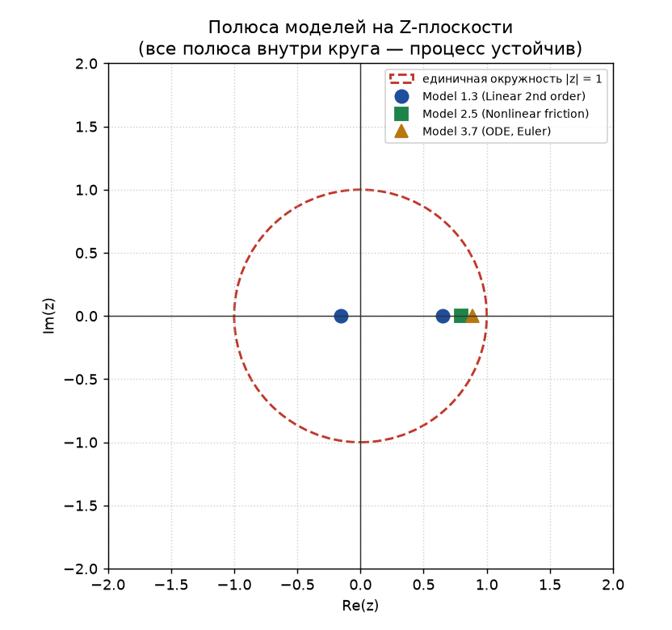

### Область устойчивости Model 1.3

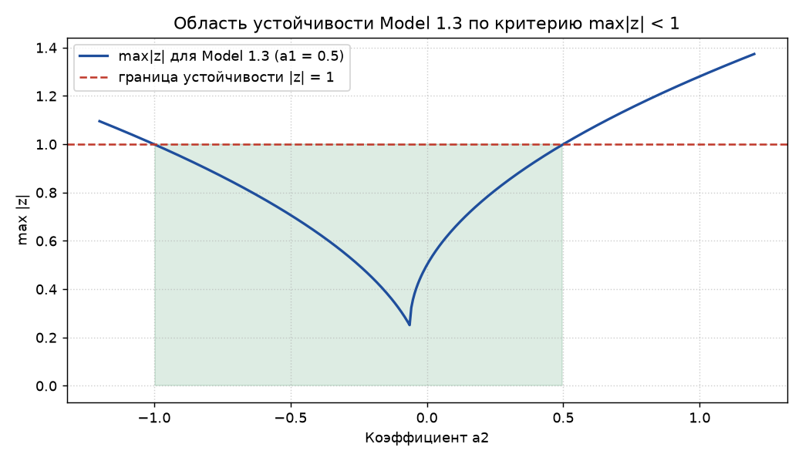

---

## Результаты работы программы в консоли

### Пример ввода параметров и выбора сценария

```text
=== МОДЕЛИРОВАНИЕ ДИНАМИЧЕСКИХ СИСТЕМ (задание 2) ===

Выберите модель для исследования:
1. LinearModel11  (Linear 1st order)
2. LinearModel13  (Linear 2nd order)
3. NonlinearModel22 (Actuator saturation)
4. NonlinearModel23 (Dead-zone non-linearity)
5. NonlinearModel25 (Nonlinear friction)
6. ODEModel37 (ODE Euler)
Ваш выбор модели (1-6) [например, 2]: 2

Выберите тип входного сигнала:
1. Ступенчатый (STEP)
2. Импульсный (IMPULSE)
3. Гармонический (HARMONIC)
Ваш выбор сигнала (1-3) [например, 1]: 1
Введите амплитуду сигнала [например, 1.0]: 1.0

Введите количество шагов N (1..10000) [например, 50]: 50
--- Параметры LinearModel13 ---
Введите a1 [например, 0.5]: 0.5
Введите a2 [например, 0.1]: 0.1
Введите b [например, 1.0]: 1.0
```

### Вывод отчёта об устойчивости и предупреждения

Для устойчивой модели программа выводит отчёт и сразу переходит к симуляции:

```text
--- Анализ устойчивости ---
Модель: Model 1.3 (Linear 2nd order)
Уравнение: y(tau+1) = 0.5000*y(tau) + 0.1000*y(tau-1) + 1.0000*u(tau)
Процесс: устойчива
  z1 = 0.6531, |z| = 0.653113
  z2 = -0.1531, |z| = 0.153113
Вывод: все полюса внутри единичной окружности, процесс сходится
```

Для неустойчивой модели (Model 1.1 с $a = 1.5$) выводится предупреждение **перед** симуляцией:

```text
--- Анализ устойчивости ---
Модель: Model 1.1 (Linear 1st order)
Уравнение: y(tau+1) = 1.5000*y(tau) + 1.0000*u(tau)
Процесс: неустойчива
  z1 = 1.5000, |z| = 1.500000
Вывод: не все полюса внутри единичной окружности, процесс может расходиться
ВНИМАНИЕ: обнаружен неустойчивый (расходящийся) процесс!
  Процесс неустойчива; полюса: z1 = 1.5000 (|z| = 1.5000)
  Процесс признан неустойчива. Симуляция может давать расходящиеся значения.
Продолжить симуляцию неустойчивого процесса? (1 — да, 0 — нет):
```

### Табличный вывод результатов вычислений

```text
=========================================
 Модель: Model 1.3 (Linear 2nd order)
=========================================
Шаг (tau)   Вход u(t)     Выход y(t)
-----------------------------------------
           0        1.0000          1.0000
           1        1.0000          1.5000
           2        1.0000          1.8500
           3        1.0000          2.0750
           4        1.0000          2.2225
-----------------------------------------
```

---

## Графики переходных процессов

Графики построены по реальному выводу программы (файл `results.csv`)
скриптом `tools/plot_results.py`.

### Model 1.3 (Linear 2nd order)

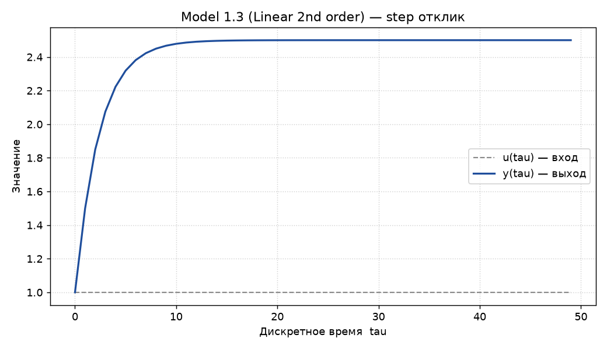

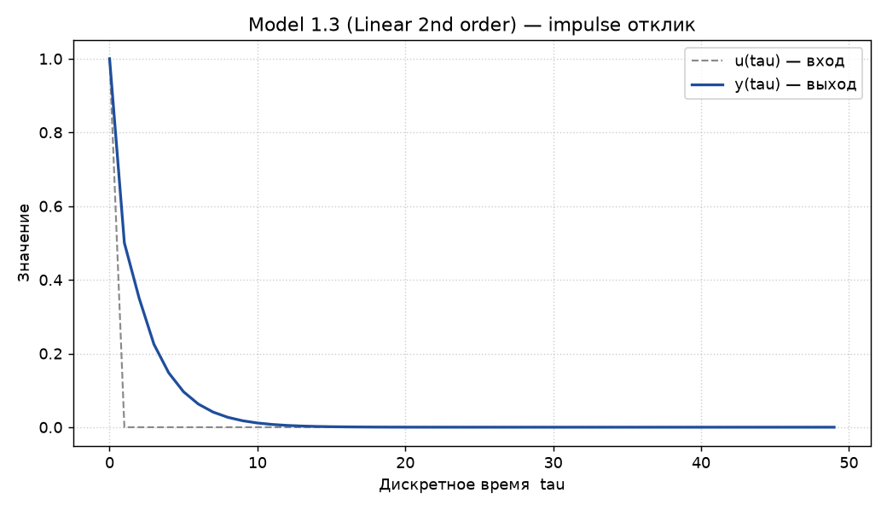

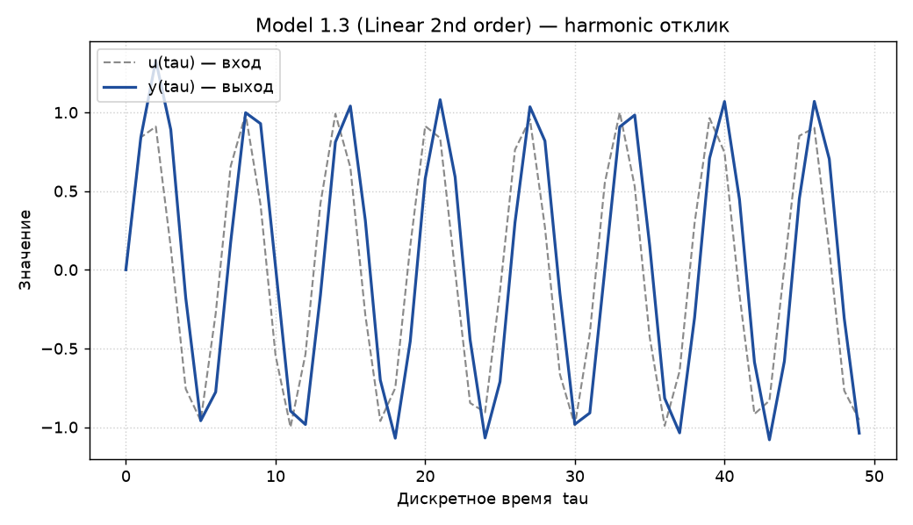

### Model 2.5 (Nonlinear friction)

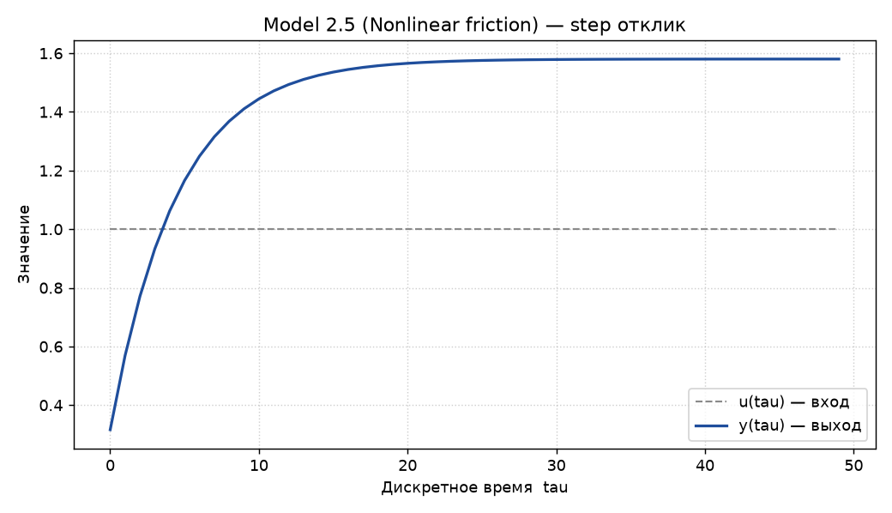

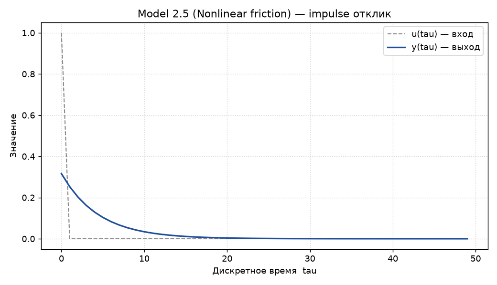

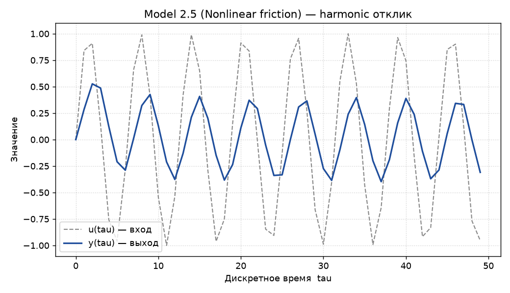

### Model 3.7 (ODE, Euler)

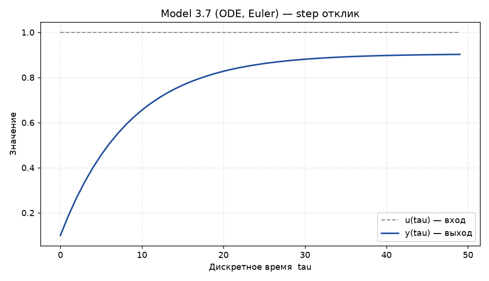

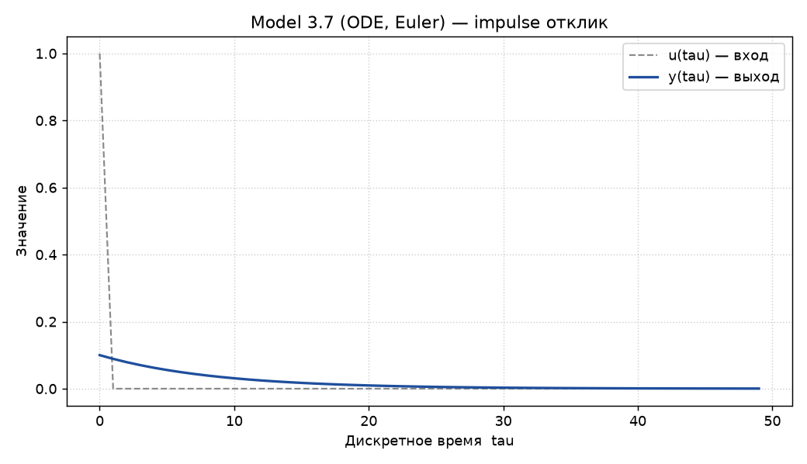

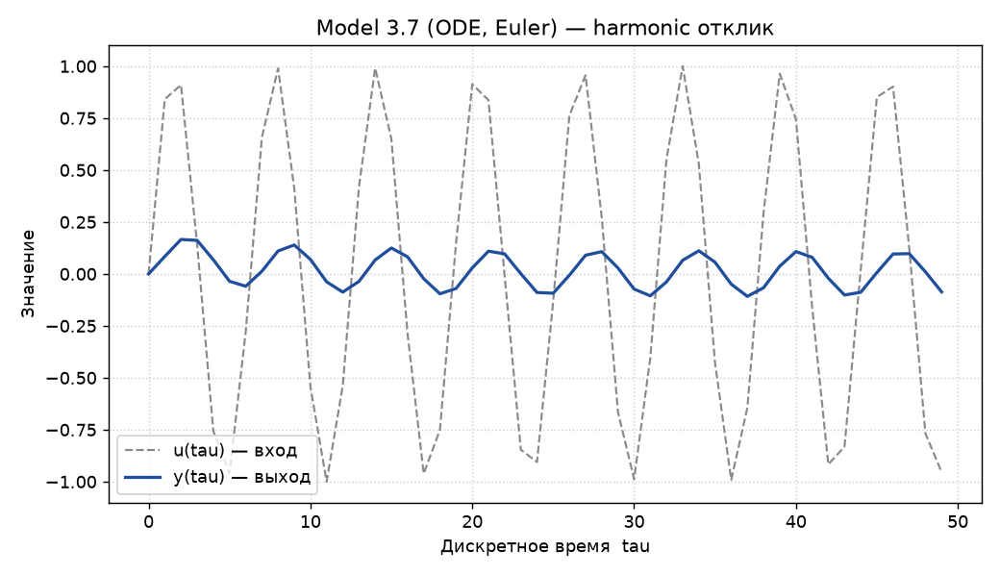

---

## Архитектура программного обеспечения (ООП)

Программа спроектирована с соблюдением принципов ООП на языке C++. Базовый класс `Model`
определяет единый интерфейс расчёта шагов симуляции (`step()`), сброса внутреннего состояния
(`reset()`), а также получения полюсов на Z-плоскости (`poles()`), текстового описания
уравнения (`equation()`) и начального состояния (`setInitialState()`). Вычисление симуляции
вынесено в отдельный управляющий класс `Simulator`, генерация входных сигналов — в
`SignalGenerator`, интерактивный сценарий — в `ConsoleApp`, а анализ устойчивости —
в `StabilityAnalyzer`.

Интерфейс `ISignalSource` позволяет подменять реальные входные сигналы mock-объектами
в модульных тестах.

### Диаграмма классов (UML)

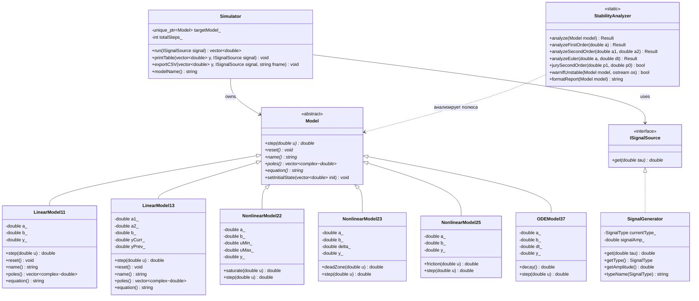

---

## Модульные тесты

Фреймворк — **Google Test v1.17.0** (+ **Google Mock**), сборка — CMake,
регистрация тестов в CTest (`gtest_add_tests`).

**Всего тестов: 164** (19 наборов тестов, 11 файлов), **успешно пройдено: 164 / 164**.

| Файл тестов | Тестов | Что проверяется |
| :--- | ---: | :--- |
| `LinearModel11Test.cpp` | 18 | значения шагов (в т.ч. вручную посчитанные), аналитическое решение переходного процесса, импульсная реакция, полюс, сброс, начальное состояние, покой при нулевом входе |
| `LinearModel13Test.cpp` | 20 | пошаговый расчёт вручную ($1.0; 1.5; 1.85; 2.075; 2.2225$), корни характеристического уравнения, комплексно-сопряжённые полюса, запаздывающая компонента, сброс, начальное состояние |
| `NonlinearModel22Test.cpp` | 16 | **граничные значения насыщения** ($u = U_{max}$, $u = U_{min}$, выход за границы), переходный процесс, полюс, сброс |
| `NonlinearModel23Test.cpp` | 15 | **граничные значения зоны нечувствительности** ($u = \delta$, $u = -\delta$), переходный процесс, полюс, сброс |
| `NonlinearModel25Test.cpp` | 14 | знаковая экспоненциальная нелинейность, нечётная симметрия, насыщение при $\lvert u\rvert \to \infty$, переходный процесс, полюс, сброс |
| `ODEModel37Test.cpp` | 16 | шаг метода Эйлера, **сравнение с аналитическим решением**, первый порядок сходимости (уменьшение ошибки вдвое при уменьшении шага вдвое), дискретный полюс, сброс |
| `SignalGeneratorTest.cpp` | 15 | ступенчатый, импульсный (с границей отсечки $10^{-9}$) и гармонический сигналы, геттеры, имена типов |
| `SimulatorTest.cpp` | 12 | длина и корректность истории, повторяемость прогонов (сброс модели), экспорт CSV, обработка ошибки экспорта, печать таблицы, работа без модели |
| `StabilityAnalyzerTest.cpp` | 22 | устойчивость/неустойчивость/граничные случаи ($\lvert z\rvert = 1$) для всех моделей, корни уравнения, **согласованность критерия Джури и корневого анализа**, генерация предупреждений, отчёт об устойчивости |
| `ConsoleAppTest.cpp` | 10 | интерактивный сценарий: выбор модели и сигнала, предупреждение об устойчивости, отказ пользователя от неустойчивой симуляции, обработка ошибочного ввода |
| `MockModelTest.cpp` | 6 | **Google Mock**: вызовы `step()`/`reset()`, порядок вызовов, **подмена входного сигнала** mock-объектом |

### Параметризованные тесты (`TEST_P`)

Для проверки расчёта шагов симуляции при различных наборах данных используются
параметризованные тесты — без дублирования кода:

* `WithDifferentCoefficients/LinearModel11ParamTest` — 5 наборов коэффициентов × 2 теста;
* `WithDifferentCoefficients/LinearModel13ParamTest` — 4 набора × 3 теста;
* `WithDifferentParameters/EulerParamTest` — 4 набора × 2 теста;
* `BoundaryValues/SaturationBoundaryTest` — 7 граничных значений;
* `BoundaryValues/DeadZoneBoundaryTest` — 8 граничных значений;
* `WithDifferentInputs/FrictionParamTest` — 5 входных сигналов;
* `ForAllSignalTypes/SignalGeneratorParamTest` — 8 комбинаций «тип сигнала + амплитуда + момент времени»;
* `ForDifferentSignals/SimulatorParamTest` — 5 сценариев «тип сигнала + амплитуда + число шагов».

### Mock-объекты (Google Mock)

* `MockModel` — mock-реализация абстрактного класса `Model`: проверяется, что симулятор
  вызывает `step()` ровно по одному разу на шаг, вызывает `reset()` перед началом прогона
  и соблюдает порядок вызовов (`InSequence`);
* `MockSignalSource` — mock-реализация интерфейса `ISignalSource`: подменяет входной сигнал
  (ступенчатый, импульсный, гармонический и произвольный) и проверяет, что значения сигнала
  корректно передаются в модель.

---

## Локальная автоматизация (`run_tests.bat`)

Скрипт выполняет полный цикл:

1. **Конфигурация и сборка** проекта (CMake + Visual Studio / MSVC);
2. **Запуск модульных тестов** (CTest, каждый тест — отдельная проверка, `--output-on-failure`);
3. **Анализ покрытия кода**: отдельная инструментированная сборка (MinGW GCC, флаг `--coverage`),
   прогон тестов и построение отчётов **gcovr** (текстовый и HTML);
4. Итоговый отчёт в консоли.

Особенности реализации:

* Google Test вендорён в `third_party/googletest` — сборка и запуск тестов работают **без доступа в Интернет**;
  при отсутствии вендорённой копии CMake автоматически загружает её через `FetchContent`;
* анализ покрытия выполняется во временном каталоге с ASCII-путём, поскольку утилиты MinGW
  некорректно работают с кириллицей в путях;
* если MinGW или `gcovr` не установлены, скрипт выведет предупреждение и завершится без сбоя
  (модульные тесты при этом уже выполнены).

**Требования:** CMake ≥ 3.15, Visual Studio 2022 (MSVC) — для основной сборки;
MinGW-w64 (GCC) и Python с пакетом `gcovr` (`python -m pip install gcovr`) — для анализа покрытия.

Запуск:

```bat
run_tests.bat
```

---

## Тестовое покрытие и результаты

* **Способ запуска:** локальный скрипт (`run_tests.bat`)
* **Инструмент анализа покрытия:** gcovr (сборка GCC с инструментированием `--coverage`)
* **Всего модульных тестов:** 164
* **Успешно пройденных тестов:** 164 / 164

| Модуль / Класс | Покрытие строк (Line Coverage) | Покрытие функций (Func Coverage) | Статус |
| :--- | :---: | :---: | :--- |
| `LinearModel11.cpp` | 100 % | 100 % | OK |
| `LinearModel13.cpp` | 100 % | 100 % | OK |
| `NonlinearModel22.cpp` | 100 % | 100 % | OK |
| `NonlinearModel23.cpp` | 100 % | 100 % | OK |
| `NonlinearModel25.cpp` | 100 % | 100 % | OK |
| `ODEModel37.cpp` | 100 % | 100 % | OK |
| `SignalGenerator.cpp` | 90 % | 100 % | OK |
| `Simulator.cpp` | 100 % | 100 % | OK |
| `StabilityAnalyzer.cpp` | 93 % | 100 % | OK |
| `ConsoleApp.cpp` | 97 % | 100 % | OK |
| **Итоговый результат** | **97.4 %** (478 / 491) | **100 %** (103 / 103) | **Success** |

Полные отчёты: `doc/coverage_report.txt`, `doc/coverage_report.html`.
Покрытие ветвей (branches): **54.9 %** (416 / 758).

## Выводы

1. Программа ЛР №1 расширена модулем анализа устойчивости (`StabilityAnalyzer`), который
   аналитически находит корни характеристического уравнения на Z-плоскости, определяет
   статус процесса (устойчив / на границе / неустойчив) и выводит предупреждение в консоль
   перед началом симуляции.
2. Написано 164 модульных теста (Google Test + Google Mock) с покрытием 97.4 % по строкам и
   100 % по функциям; параметризованные тесты (`TEST_P`) и mock-объекты применены согласно
   архитектурным требованиям задания.
3. Локальная автоматизация (`run_tests.bat`) обеспечивает сборку, запуск тестов и генерацию
   отчёта о покрытии одной командой.
4. Построены графики переходных процессов (по реальному выводу программы) и карта полюсов
   на Z-плоскости, подтверждающие корректность расчётов и критерия устойчивости.
