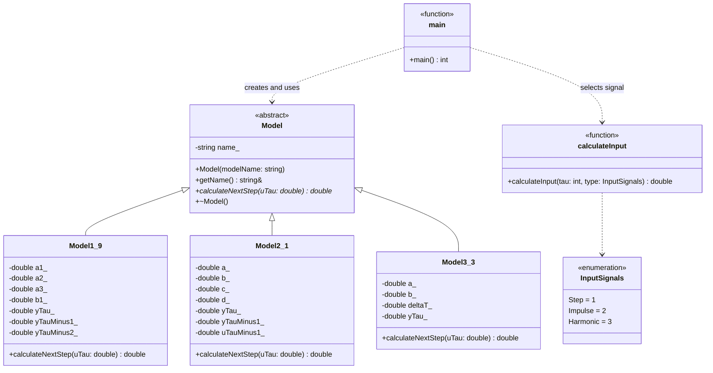
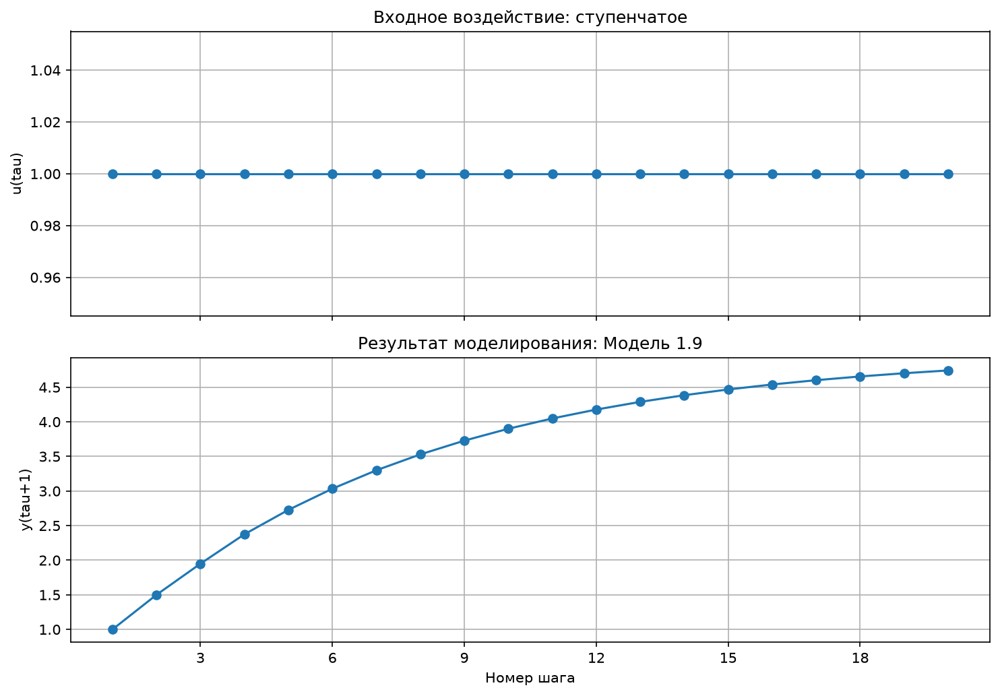
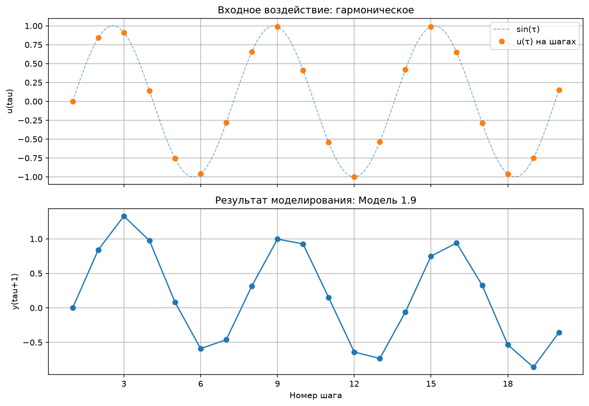
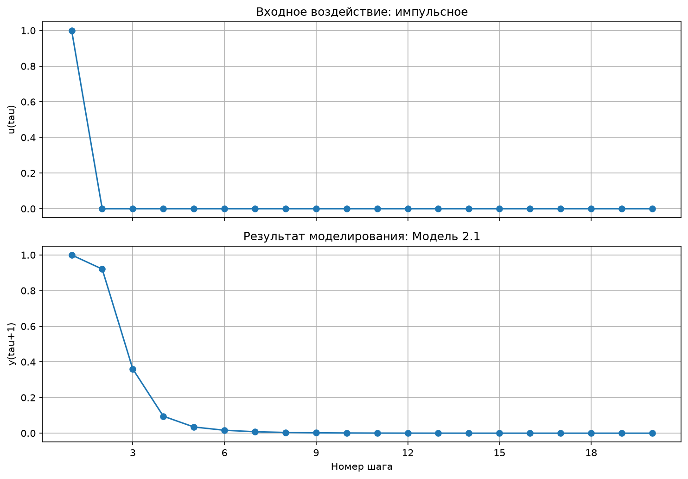
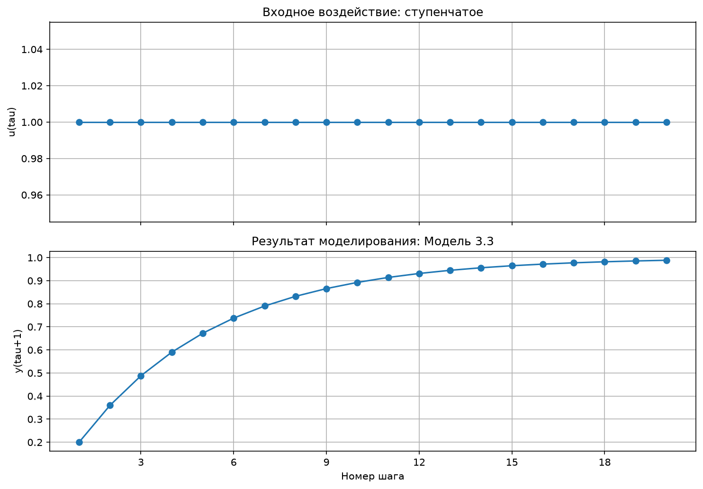
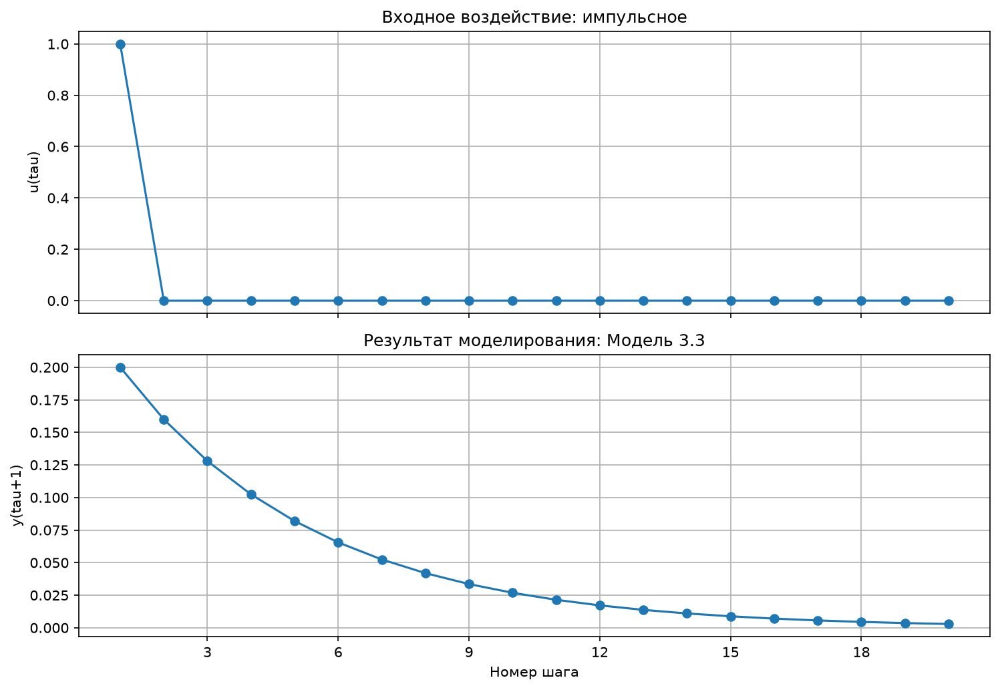
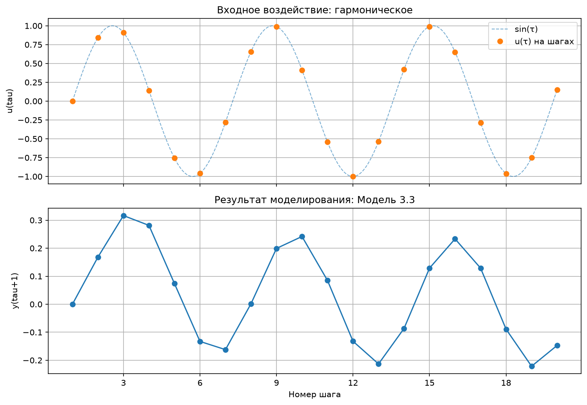

<p align="center">Министерство образования Республики Беларусь</p>

<p align="center">Учреждение образования</p>

<p align="center">«Брестский государственный технический университет»</p>

<p align="center">Кафедра ИИТ</p>

<br><br><br><br>

<p align="center"><strong>ЛАБОРАТОРНАЯ РАБОТА № 1</strong></p>

<p align="center">по дисциплине «Теория и моделирование автоматического управления»</p>

<p align="center">Тема: «Моделирование объектов управления»</p>

<br><br><br>

<p align="right">Выполнил:</p>
<p align="right">Студент 3 курса</p>
<p align="right">Группы АС-68</p>
<p align="right">Жуков А. А.</p>

<br>

<p align="right">Проверил:</p>
<p align="right">Дворанинович Д. А.</p>

<br><br><br>

<p align="center">Брест 2026</p>

---

# 1. Цель работы
Цель лабораторной работы — разработать программу на C++ для моделирования объектов управления с использованием объектно-ориентированного подхода, сравнить их отклик на разные входные воздействия, представить результаты в виде таблицы и графиков, а также организовать сборку проекта при помощи CMake.

В программе реализованы три модели: линейная модель 1.9, нелинейная модель 2.1 и дифференциальная модель 3.3. Такая комбинация соответствует **варианту 9** в таблице вариантов, приведённой в задании.

# 2. Задачи работы
В рамках работы необходимо:

1. Реализовать абстрактный базовый класс модели и отдельные классы для математических моделей.
2. Реализовать ступенчатое, импульсное и гармоническое входные воздействия.
3. Предоставить пользователю возможность задавать количество шагов моделирования и параметры выбранной модели.
4. Выводить значения входа и выхода в консольную таблицу и сохранять их в CSV-файл.
5. Построить графики входного воздействия и выходного сигнала.
6. Описать архитектуру программы UML-диаграммой классов.
7. Настроить сборку и запуск программы через CMake и пакетный файл `build.bat`.

# 3. Математические модели
Обозначения:

- $\tau$ — индекс текущего шага;
- $u_\tau$ — входное воздействие на текущем шаге;
- $y_\tau$ — выход модели на текущем шаге;
- $n$ — заданное пользователем количество шагов;
- $\Delta t$ — шаг времени для дифференциальной модели.

Начальные значения состояний в используемых классах по умолчанию равны нулю.

## 3.1. Линейная модель 1.9
Уравнение модели:

$$
y_{\tau+1}=a_1y_\tau+a_2y_{\tau-1}+a_3y_{\tau-2}+b_1u_\tau.
$$

Модель использует текущее входное воздействие и три значения выхода: текущее, предыдущее и значение двумя шагами ранее. После расчёта состояние сдвигается: старые значения выхода сохраняются для следующих итераций.

В программе параметры $a_1$, $a_2$, $a_3$ и $b_1$ вводит пользователь.

## 3.2. Нелинейная модель 2.1
Уравнение модели:

$$
y_{\tau+1}=ay_\tau-by_{\tau-1}^{2}+cu_\tau+d\sin(u_{\tau-1}).
$$

Нелинейность возникает из-за квадрата предыдущего значения выхода $y_{\tau-1}^{2}$. Дополнительно учитывается синус предыдущего значения входного воздействия. Для вычисления очередного выхода используются параметры $a$, $b$, $c$, $d$, которые вводятся при запуске программы.

## 3.3. Дифференциальная модель 3.3
Модель описывается дифференциальным уравнением первого порядка:

$$
\frac{dy}{dt}=-ay+bu.
$$

Для численного решения используется явный метод Эйлера:

$$
y_{\tau+1}=y_\tau+\Delta t(-ay_\tau+bu_\tau).
$$

Пользователь вводит параметры $a$, $b$ и шаг времени $\Delta t$. Программа проверяет, что $\Delta t>0$. При $a>0$ условие $0 < a\Delta t < 2$ обеспечивает устойчивость однородной части явной схемы Эйлера.


# 4. Входные воздействия
Для каждой модели доступны три сигнала.

| Сигнал | Формула | Поведение |
|---|---|---|
| Ступенчатый (`Step`) | $u_\tau=1$ | На каждом шаге вход равен единице. |
| Импульсный (`Impulse`) | $u_0=1$, $u_\tau=0$ при $\tau>0$ | Единица подаётся только на первом рассчитываемом шаге. |
| Гармонический (`Harmonic`) | $u_\tau=\sin(\tau)$ | Значение входа меняется по синусоидальному закону; аргумент синуса задаётся в радианах. |

В программе внутренний индекс начинается с $\tau=0$, но в консольной таблице номер шага выводится начиная с 1. Поэтому первая строка таблицы соответствует $u_0$ и содержит результат $y_1$.

# 5. Структура проекта
```text
trunk/as06806/task_01/
├── src/
│   ├── main.cpp          # Ввод параметров, выбор модели и сигнала, цикл расчёта, вывод в CSV
│   ├── model.h           # Абстрактный класс, три модели и функции входных воздействий
│   ├── visualise.py      # Чтение CSV, печать таблицы и построение графиков
│   ├── CMakeLists.txt    # Конфигурация CMake
│   └── build.bat         # Автоматическая конфигурация, сборка, запуск и визуализация
└── doc/
    ├── readme.md         # Отчёт по лабораторной работе
    └── Model_*.png       # Графики, создаваемые скриптом visualise.py
```

Во время запуска C++-программа создаёт `result.csv` в рабочем каталоге `src`. Скрипт `visualise.py` читает этот файл, отображает таблицу, строит график и сохраняет PNG вместе с копией CSV в каталог `doc`.

# 6. Объектно-ориентированная архитектура
В `model.h` объявлен абстрактный класс `Model`. Он хранит название модели и содержит чисто виртуальный метод `calculateNextStep(double uTau)`, который должен реализовать каждый наследник.

Классы `Model1_9`, `Model2_1` и `Model3_3` реализуют соответствующие уравнения и хранят необходимые коэффициенты и внутренние состояния. В `main.cpp` выбранная модель создаётся как `std::unique_ptr<Model>`, поэтому общий цикл моделирования обращается к ней через общий интерфейс.

| Принцип ООП | Реализация в проекте |
|---|---|
| Абстракция | `Model` задаёт общие свойства и интерфейс расчёта следующего шага. |
| Наследование | `Model1_9`, `Model2_1` и `Model3_3` наследуются от `Model`. |
| Инкапсуляция | Коэффициенты и состояние моделей хранятся в закрытых полях классов. |
| Полиморфизм | `calculateNextStep()` вызывается через указатель на базовый класс. |

## UML-диаграмма классов


*Рисунок 1 — UML-диаграмма классов программы.*

# 7. Алгоритм работы программы
1. Пользователь задаёт количество шагов моделирования $n$. Значение должно быть положительным целым числом.
2. Пользователь выбирает модель: 1 — модель 1.9, 2 — модель 2.1, 3 — модель 3.3.
3. Программа запрашивает коэффициенты выбранной модели. Для модели 3.3 дополнительно проверяется положительность шага времени.
4. Пользователь выбирает тип входного воздействия.
5. Для шагов от 0 до $n-1$ вычисляется вход $u_\tau$, затем модель рассчитывает $y_{\tau+1}$.
6. Каждая корректно рассчитанная строка выводится в консоль и записывается в `result.csv`.
7. После расчёта Python-скрипт читает CSV, печатает таблицу и строит графики входа и выхода.

Программа проверяет корректность основных пунктов меню, конечность вводимых коэффициентов, условие $\Delta t>0$ и значение выхода модели. Если результат не является конечным числом или его модуль превышает $10^9$, расчёт останавливается с сообщением о возможной расходимости.

# 8. Пример расчёта и контрольные результаты
Коэффициенты не зашиты в программу: пользователь вводит их при каждом запуске. Для проверки в этом разделе используются следующие демонстрационные наборы параметров при $n=5$.

| Модель | Значения, вводимые после выбора модели |
|---|---|
| 1.9 | $a_1=0.5$, $a_2=0.2$, $a_3=0.1$, $b_1=1.0$ |
| 2.1 | $a=0.5$, $b=0.1$, $c=1.0$, $d=0.5$ |
| 3.3 | $a=1.0$, $b=1.0$, $\Delta t=0.2$ |

## 8.1. Пример ручного расчёта
Для модели 1.9 со ступенчатым входом $u_\tau=1$ и нулевыми начальными состояниями:

$$
y_1=0.5\cdot0+0.2\cdot0+0.1\cdot0+1.0\cdot1=1.0.
$$

На следующем шаге:

$$
y_2=0.5\cdot1.0+0.2\cdot0+0.1\cdot0+1.0\cdot1=1.5.
$$

На третьем шаге:

$$
y_3=0.5\cdot1.5+0.2\cdot1.0+0.1\cdot0+1.0\cdot1=1.95.
$$

Результаты совпадают с рекуррентной формулой модели.

## 8.2. Первые пять значений выхода для девяти сочетаний
Значения ниже рассчитаны по формулам из `model.h` с параметрами из таблицы выше и округлены до четырёх знаков, как в консольном выводе программы.

### Модель 1.9
| Входное воздействие | $y_1, y_2, y_3, y_4, y_5$ |
|---|---|
| Ступенчатое | `1.0000; 1.5000; 1.9500; 2.3750; 2.7275` |
| Импульсное | `1.0000; 0.5000; 0.4500; 0.4250; 0.3525` |
| Гармоническое | `0.0000; 0.8415; 1.3300; 0.9744; 0.0806` |

### Модель 2.1
| Входное воздействие | $y_1, y_2, y_3, y_4, y_5$ |
|---|---|
| Ступенчатое | `1.0000; 1.9207; 2.2811; 2.1924; 1.9966` |
| Импульсное | `1.0000; 0.9207; 0.3604; 0.0954; 0.0347` |
| Гармоническое | `0.0000; 0.8415; 1.7028; 1.3163; -0.3183` |

### Модель 3.3
| Входное воздействие | $y_1, y_2, y_3, y_4, y_5$ |
|---|---|
| Ступенчатое | `0.2000; 0.3600; 0.4880; 0.5904; 0.6723` |
| Импульсное | `0.2000; 0.1600; 0.1280; 0.1024; 0.0819` |
| Гармоническое | `0.0000; 0.1683; 0.3165; 0.2814; 0.0738` |

# 9. Визуализация результатов
Скрипт `visualise.py` строит два графика: верхний показывает входное воздействие, нижний — выход выбранной модели. После выполнения скрипта изображения сохраняются в каталог `doc`.

## 9.1. Модель 1.9
| Ступенчатый сигнал | Импульсный сигнал | Гармонический сигнал |
|---|---|---|
|  |  |  |

## 9.2. Модель 2.1
| Ступенчатый сигнал | Импульсный сигнал | Гармонический сигнал |
|---|---|---|
|  |  |  |

## 9.3. Модель 3.3
| Ступенчатый сигнал | Импульсный сигнал | Гармонический сигнал |
|---|---|---|
|  |  |  |

*Рисунки 2–4 — результаты моделирования трёх моделей при разных входных воздействиях.*

# 10. Сборка и запуск
Для сборки необходимы CMake и C++-компилятор с поддержкой C++17. Для визуализации используется Python 3 и Matplotlib.

Для запуска на Windows:

1. Открыть каталог `trunk/as06806/task_01/src`.
2. Запустить `build.bat`.
3. Дождаться этапов конфигурации CMake и сборки.
4. Ввести количество шагов, выбрать модель, задать коэффициенты и выбрать сигнал.
5. После завершения расчёта дождаться запуска визуализации и при необходимости закрыть окно графика.

В пакетном файле сначала выполняется `cmake -S . -B build`, затем `cmake --build build --config Release`. После успешной сборки запускается исполняемый файл `task_01.exe`, а затем скрипт `visualise.py`.

В корневом CMake-проекте репозитория цели сборки должны иметь уникальные имена. Поэтому в локальном `CMakeLists.txt` используется цель `task_01_as06806`, при этом имя исполняемого файла сохраняется как `task_01` для совместимости с `build.bat`.

# 11. Вывод
В ходе лабораторной работы реализована программа на C++, выполняющая дискретное моделирование линейной модели 1.9, нелинейной модели 2.1 и дифференциальной модели 3.3. Общий абстрактный класс `Model` задаёт единый интерфейс расчёта следующего шага, а классы-наследники реализуют конкретные уравнения и хранят внутренние состояния. Программа позволяет выбрать один из трёх типов входного воздействия, задать число шагов и коэффициенты, получить табличные результаты и сохранить их в CSV. Скрипт Python/Matplotlib обеспечивает построение графиков входа и выхода. Сборка и запуск организованы через CMake и `build.bat`.

# 12. Рецензирование и размещение работы
По заданию требуется выполнить не менее двух рецензий на запросы других студентов и отразить выполнение работы в соответствующей строке общего `readme.md` репозитория.

| Действие | Ссылка |
|---|---|
| Рецензия 1 | [Комментарий к PR №5](https://github.com/brstu/TMAU-2026/pull/5#discussion_r4319880446) |
| Рецензия 2 | [Комментарий к PR №5](https://github.com/brstu/TMAU-2026/pull/5#discussion_r4319919653) |
| Pull Request с лабораторной работой | [PR №15](https://github.com/brstu/TMAU-2026/pull/15) |
