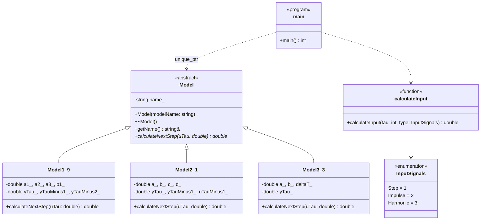

<p align="center">Министерство образования Республики Беларусь</p>

<p align="center">Учреждение образования</p>

<p align="center">«Брестский государственный технический университет»</p>

<p align="center">Кафедра ИИТ</p>

<br><br><br><br>

<p align="center"><strong>ЛАБОРАТОРНАЯ РАБОТА № 1</strong></p>

<p align="center">по дисциплине «Теория и моделирование автоматического управления»</p>

<p align="center">Тема: «Моделирование объектов управления»</p>

<br><br><br>

<p align="right">Выполнил:</p>

<p align="right">Студент 3 курса</p>

<p align="right">Группы АС-68</p>

<p align="right">Жуков А. А.</p>

<br>

<p align="right">Проверил:</p>

<p align="right">Дворанинович Д. А.</p>

<br><br><br>

<p align="center">Брест 2026</p>

---

## Вариант 6

| Тип объекта | Модель |
|---|---|
| Линейная | Модель 1.9 |
| Нелинейная | Модель 2.1 |
| Дифференциальная | Модель 3.3 |

## 1. Цель работы

Создать на C++ программу, которая моделирует поведение трёх объектов управления, и исследовать их реакцию на ступенчатое, импульсное и гармоническое воздействия. Программа строится на принципах ООП, результаты выводятся таблицей, сохраняются в CSV и отображаются на графиках, а сборка и запуск автоматизированы средствами CMake и `.bat`-файла.

## 2. Соответствие заданию

| № | Требование задания | Как выполнено |
|---|---|---|
| 1 | Отчёт в `readme.md` через pull request в `trunk/as06806/task_01/doc` | Этот файл, раздел 13 |
| 2 | Исходный код в `trunk/as06806/task_01/src` | Раздел 5 |
| 3 | Не менее двух рецензий на работы других студентов | Раздел 13 |
| 4 | Отметка о выполнении в `readme.md` репозитория | Раздел 13 |
| 5 | Вывод в виде таблицы | Консоль и CSV-файлы в `doc`, раздел 7 |
| 6 | Настраиваемое число шагов `n` | Вводится пользователем, раздел 7 |
| 7 | Визуализация результатов | Python и Matplotlib, раздел 8 |
| 8 | UML-диаграмма классов | Раздел 6 |
| 9 | Абстрактный класс `Model`, уравнения в наследниках | Раздел 6 |
| 10 | Три типа входных воздействий | Раздел 4 |
| 11 | Сборка через CMake, запуск через `.bat` с показом процесса | Раздел 9 |

## 3. Математические модели

Обозначения: $\tau$ — номер шага, $u_\tau$ — входное воздействие, $y_\tau$ — выход объекта. Начальные условия нулевые.

### 3.1. Модель 1.9 (линейная)

Следующее значение выхода зависит от трёх последних значений выхода и текущего входа:

$$
y_{\tau+1} = a_1 y_\tau + a_2 y_{\tau-1} + a_3 y_{\tau-2} + b_1 u_\tau,
\qquad y_0 = y_{-1} = y_{-2} = 0.
$$

Параметры: $a_1$, $a_2$, $a_3$, $b_1$.

### 3.2. Модель 2.1 (нелинейная)

Нелинейность создают квадрат выхода на предыдущем шаге и синус предыдущего входа:

$$
y_{\tau+1} = a y_\tau - b y_{\tau-1}^{2} + c u_\tau + d \sin(u_{\tau-1}),
\qquad y_0 = y_{-1} = u_{-1} = 0.
$$

Параметры: $a$, $b$, $c$, $d$.

### 3.3. Модель 3.3 (дифференциальная)

Объект описывается уравнением первого порядка

$$
\frac{dy}{dt} = -a y + b u,
$$

которое решается явным методом Эйлера с шагом $\Delta t$:

$$
y_{\tau+1} = y_\tau + \Delta t\,(-a y_\tau + b u_\tau),
\qquad y_0 = 0.
$$

Параметры: $a$, $b$, $\Delta t > 0$. Метод устойчив при $|1 - a\Delta t| < 1$.

## 4. Входные воздействия

| Воздействие | Формула |
|---|---|
| Ступенчатое | $u_\tau = 1$ |
| Импульсное | $u_0 = 1$, $u_\tau = 0$ при $\tau > 0$ |
| Гармоническое | $u_\tau = \sin(\tau)$, аргумент в радианах |

Номер шага в таблице на единицу больше $\tau$: первая строка соответствует $\tau = 0$.

## 5. Структура проекта

```
trunk/as06806/task_01/
├── src/
│   ├── main.cpp          - диалог с пользователем, цикл моделирования, вывод таблицы и CSV
│   ├── model.h           - класс Model, три модели, InputSignals, calculateInput()
│   ├── visualise.py      - чтение CSV, таблица и графики
│   ├── CMakeLists.txt    - описание сборки
│   └── build.bat         - сборка, запуск и визуализация
└── doc/
    ├── readme.md         - отчёт
    ├── Model_<модель>_<сигнал>.png   - 9 графиков
    └── Model_<модель>_<сигнал>.csv   - 9 таблиц результатов
```

## 6. Объектно-ориентированная архитектура

Базовый класс `Model` абстрактный: он хранит название модели и объявляет чисто виртуальный метод `calculateNextStep(uTau)`. Три наследника (`Model1_9`, `Model2_1`, `Model3_3`) хранят свои коэффициенты и предыдущие значения сигналов и реализуют этот метод по своему уравнению. В `main` выбранная модель создаётся через `std::unique_ptr<Model>`, поэтому цикл расчёта один и тот же для любой модели, а память освобождается автоматически.

| Принцип | Где проявляется |
|---|---|
| Абстракция | `Model` задаёт общий интерфейс расчёта шага |
| Наследование | Три модели наследуются от `Model` |
| Инкапсуляция | Коэффициенты и состояние находятся в закрытых полях |
| Полиморфизм | Вызов `calculateNextStep` через указатель на `Model` |

Диаграмма классов (Mermaid):



*Рисунок 1 — диаграмма классов программы.*

## 7. Ввод, вывод и проверка данных

Порядок диалога: количество шагов $n$, номер модели, коэффициенты модели, номер воздействия. Некорректный ввод прерывает программу с сообщением об ошибке:

| Поле | Допустимые значения |
|---|---|
| Количество шагов $n$ | целое число больше нуля |
| Номер модели | 1, 2 или 3 |
| Коэффициенты | любые числа |
| Шаг времени $\Delta t$ (модель 3.3) | число больше нуля |
| Номер воздействия | 1, 2 или 3 |

Если выход становится нечисловым или его модуль растёт чрезмерно (расчёт расходится), программа останавливает моделирование на этом шаге и сообщает об ошибке. В результаты попадают только корректные шаги.

Результаты выводятся в консоль таблицей с колонками «Шаг», $u(\tau)$ и $y(\tau+1)$. Пример для модели 1.9, ступенчатого воздействия и $n = 5$:

```
Модель: Модель 1.9

       Шаг         u(tau)       y(tau+1)
----------------------------------------
         1         1.0000         1.0000
         2         1.0000         1.5000
         3         1.0000         1.9500
         4         1.0000         2.3750
         5         1.0000         2.7275
```

Те же данные программа записывает в `result.csv` в полях `step`, `u_tau`, `y_next`, `model`, `signal`. Для записи используется стандартная локаль, поэтому десятичным разделителем всегда служит точка, и Python читает файл без преобразований.

## 8. Визуализация и результаты моделирования

Скрипт `visualise.py` читает `result.csv`, печатает таблицу и строит два графика: сверху входное воздействие, снизу отклик модели. Рисунок и копия таблицы сохраняются в `doc` под именами `Model_<модель>_<сигнал>.png` и `Model_<модель>_<сигнал>.csv`.

Для всех экспериментов принято $n = 20$ и следующие коэффициенты:

| Модель | Коэффициенты |
|---|---|
| 1.9 | $a_1 = 0.5$, $a_2 = 0.2$, $a_3 = 0.1$, $b_1 = 1.0$ |
| 2.1 | $a = 0.5$, $b = 0.1$, $c = 1.0$, $d = 0.5$ |
| 3.3 | $a = 1.0$, $b = 1.0$, $\Delta t = 0.2$ |

### 8.1. Модель 1.9 (линейная)

Коэффициенты: $a_1 = 0.5$, $a_2 = 0.2$, $a_3 = 0.1$, $b_1 = 1.0$.

| Ступенчатое | Импульсное | Гармоническое |
|---|---|---|
|  |  |  |

*Рисунок 2 — графики модели 1.9 при трёх входных воздействиях (слева направо: ступенчатое, импульсное, гармоническое).*

Таблицы результатов: [ступенчатое](Model_1.9_Step.csv), [импульсное](Model_1.9_Impulse.csv), [гармоническое](Model_1.9_Harmonic.csv).

<details>
<summary>Значения выхода y(τ+1) для n = 20</summary>

| Шаг | y, ступенчатое | y, импульсное | y, гармоническое |
|---:|---:|---:|---:|
| 1 | 1.0000 | 1.0000 | 0.0000 |
| 2 | 1.5000 | 0.5000 | 0.8415 |
| 3 | 1.9500 | 0.4500 | 1.3300 |
| 4 | 2.3750 | 0.4250 | 0.9744 |
| 5 | 2.7275 | 0.3525 | 0.0806 |
| 6 | 3.0337 | 0.3063 | -0.5908 |
| 7 | 3.2999 | 0.2661 | -0.4612 |
| 8 | 3.5294 | 0.2296 | 0.3163 |
| 9 | 3.7281 | 0.1986 | 0.9962 |
| 10 | 3.8999 | 0.1718 | 0.9273 |
| 11 | 4.0485 | 0.1486 | 0.1505 |
| 12 | 4.1770 | 0.1285 | -0.6397 |
| 13 | 4.2882 | 0.1112 | -0.7336 |
| 14 | 4.3844 | 0.0962 | -0.0595 |
| 15 | 4.4675 | 0.0832 | 0.7502 |
| 16 | 4.5395 | 0.0719 | 0.9401 |
| 17 | 4.6017 | 0.0622 | 0.3262 |
| 18 | 4.6555 | 0.0538 | -0.5352 |
| 19 | 4.7020 | 0.0465 | -0.8593 |
| 20 | 4.7423 | 0.0403 | -0.3542 |

</details>

### 8.2. Модель 2.1 (нелинейная)

Коэффициенты: $a = 0.5$, $b = 0.1$, $c = 1.0$, $d = 0.5$.

| Ступенчатое | Импульсное | Гармоническое |
|---|---|---|
|  |  |  |

*Рисунок 3 — графики модели 2.1 при трёх входных воздействиях (слева направо: ступенчатое, импульсное, гармоническое).*

Таблицы результатов: [ступенчатое](Model_2.1_Step.csv), [импульсное](Model_2.1_Impulse.csv), [гармоническое](Model_2.1_Harmonic.csv).

<details>
<summary>Значения выхода y(τ+1) для n = 20</summary>

| Шаг | y, ступенчатое | y, импульсное | y, гармоническое |
|---:|---:|---:|---:|
| 1 | 1.0000 | 1.0000 | 0.0000 |
| 2 | 1.9207 | 0.9207 | 0.8415 |
| 3 | 2.2811 | 0.3604 | 1.7028 |
| 4 | 2.1924 | 0.0954 | 1.3163 |
| 5 | 1.9966 | 0.0347 | -0.3183 |
| 6 | 1.9384 | 0.0164 | -1.6346 |
| 7 | 1.9913 | 0.0081 | -1.5162 |
| 8 | 2.0407 | 0.0040 | -0.5062 |
| 9 | 2.0445 | 0.0020 | 0.8118 |
| 10 | 2.0266 | 0.0010 | 1.2102 |
| 11 | 2.0160 | 0.0005 | 0.1955 |
| 12 | 2.0180 | 0.0003 | -1.3075 |
| 13 | 2.0233 | 0.0001 | -1.6149 |
| 14 | 2.0251 | 0.0001 | -0.8138 |
| 15 | 2.0239 | 0.0000 | 0.5269 |
| 16 | 2.0226 | 0.0000 | 1.2657 |
| 17 | 2.0224 | 0.0000 | 0.6199 |
| 18 | 2.0229 | 0.0000 | -0.9536 |
| 19 | 2.0232 | 0.0000 | -1.6762 |
| 20 | 2.0231 | 0.0000 | -1.1204 |

</details>

### 8.3. Модель 3.3 (дифференциальная)

Коэффициенты: $a = 1.0$, $b = 1.0$, $\Delta t = 0.2$.

| Ступенчатое | Импульсное | Гармоническое |
|---|---|---|
|  |  |  |

*Рисунок 4 — графики модели 3.3 при трёх входных воздействиях (слева направо: ступенчатое, импульсное, гармоническое).*

Таблицы результатов: [ступенчатое](Model_3.3_Step.csv), [импульсное](Model_3.3_Impulse.csv), [гармоническое](Model_3.3_Harmonic.csv).

<details>
<summary>Значения выхода y(τ+1) для n = 20</summary>

| Шаг | y, ступенчатое | y, импульсное | y, гармоническое |
|---:|---:|---:|---:|
| 1 | 0.2000 | 0.2000 | 0.0000 |
| 2 | 0.3600 | 0.1600 | 0.1683 |
| 3 | 0.4880 | 0.1280 | 0.3165 |
| 4 | 0.5904 | 0.1024 | 0.2814 |
| 5 | 0.6723 | 0.0819 | 0.0738 |
| 6 | 0.7379 | 0.0655 | -0.1328 |
| 7 | 0.7903 | 0.0524 | -0.1621 |
| 8 | 0.8322 | 0.0419 | 0.0017 |
| 9 | 0.8658 | 0.0336 | 0.1992 |
| 10 | 0.8926 | 0.0268 | 0.2418 |
| 11 | 0.9141 | 0.0215 | 0.0847 |
| 12 | 0.9313 | 0.0172 | -0.1323 |
| 13 | 0.9450 | 0.0137 | -0.2131 |
| 14 | 0.9560 | 0.0110 | -0.0865 |
| 15 | 0.9648 | 0.0088 | 0.1289 |
| 16 | 0.9719 | 0.0070 | 0.2332 |
| 17 | 0.9775 | 0.0056 | 0.1290 |
| 18 | 0.9820 | 0.0045 | -0.0891 |
| 19 | 0.9856 | 0.0036 | -0.2215 |
| 20 | 0.9885 | 0.0029 | -0.1472 |

</details>

## 9. Сборка и запуск

Требуются CMake, компилятор MSVC (Visual Studio Build Tools) и Python 3 с Matplotlib; при его отсутствии `build.bat` устанавливает библиотеку сам.

Файл `build.bat` последовательно выполняет и показывает в консоли четыре этапа:

1. `CONFIGURE PROJECT` — `cmake -S . -B build`;
2. `BUILD PROJECT` — `cmake --build build --config Release`;
3. `RUN PROGRAM` — запуск `task_01.exe` и диалог с пользователем;
4. `VISUALISATION` — проверка Matplotlib и запуск `visualise.py`.

Все девять сочетаний «модель — воздействие» запускаются через `build.bat` по очереди: при каждом запуске вводятся одни и те же $n = 20$ и коэффициенты из раздела 8, меняются только номер модели и номер воздействия. После каждого запуска в `doc` сохраняются график и таблица.

## 10. Анализ результатов

- **Модель 1.9.** При ступеньке выход монотонно растёт к установившемуся значению $b_1/(1-a_1-a_2-a_3) = 5$; к 20-му шагу он равен 4.7423. При импульсе выход затухает: корни характеристического уравнения $z^3 - 0.5z^2 - 0.2z - 0.1 = 0$ по модулю меньше единицы (наибольший около 0.865). При синусе выход колеблется в пределах примерно от $-0.86$ до $1.33$.
- **Модель 2.1.** Квадратичное слагаемое и $\sin(u_{\tau-1})$ делают отклик нелинейным. При ступеньке возникают затухающие колебания, выход устанавливается около 2.02; при импульсе отклик быстро убывает почти до нуля; при синусе размах выхода достигает примерно 1.7.
- **Модель 3.3.** При ступеньке выход экспоненциально приближается к $b/a = 1$ (на шаге $k$ он равен $1 - 0.8^k$), при импульсе убывает с множителем $1 - a\Delta t = 0.8$. При синусе амплитуда выхода около 0.2–0.3: объект сглаживает вход, и максимумы выхода отстают от максимумов входа.

## 11. Проверка корректности

- **Ручной расчёт.** Первые шаги посчитаны по формулам без программы и совпали с выводом:
  - модель 1.9, ступенька: $y_1 = 1$, $y_2 = 0.5 + 1 = 1.5$, $y_3 = 0.5 \cdot 1.5 + 0.2 \cdot 1 + 1 = 1.95$;
  - модель 2.1, ступенька: $y_1 = 1$, $y_2 = 0.5 + 1 + 0.5\sin(1) = 1.9207$;
  - модель 3.3, ступенька: $y_1 = 0.2$, $y_2 = 0.2 + 0.2\,(-0.2 + 1) = 0.36$.
- **Полный ручной расчёт для гармонического воздействия.** Для всех трёх моделей вручную вычислены все 20 шагов; значения совпали с таблицами программы до четвёртого знака.
- **Независимая проверка.** Результаты всех девяти сочетаний сравнены с отдельной реализацией тех же формул на Python, расхождений нет.
- **Некорректный ввод.** Проверены нечисловые значения, $n \le 0$, номера модели и воздействия вне диапазона, $\Delta t \le 0$: во всех случаях выводится сообщение об ошибке.
- **Расходимость.** Для модели 2.1 с $a = 2$, $b = 3$, $c = 4$, $d = 1$ при ступеньке выход уже на 12-м шаге достигает порядка $10^{50}$, а на 18-м выходит за пределы `double`. Такой расчёт останавливается с сообщением об ошибке.

## 12. Заключение

Разработана программа на C++, моделирующая три объекта управления: линейный, нелинейный и описываемый дифференциальным уравнением. Модели реализованы как наследники абстрактного класса `Model` и применяются полиморфно. Реакции каждой модели на ступенчатое, импульсное и гармоническое воздействия получены, выведены таблицами, сохранены в CSV и показаны на графиках; значения проверены вручную и независимой реализацией. Сборка и запуск автоматизированы через CMake и `.bat`-файлы.

## 13. Рецензирование и размещение работы

| № | Работа | Ссылка |
|---|---|---|
| 1 | Первая рецензия | https://github.com/brstu/TMAU-2026/pull/5#discussion_r4319880446 |
| 2 | Вторая рецензия | https://github.com/brstu/TMAU-2026/pull/5#discussion_r4319919653 |
| 3 | Pull request с лабораторной работой | https://github.com/brstu/TMAU-2026/pull/15 |