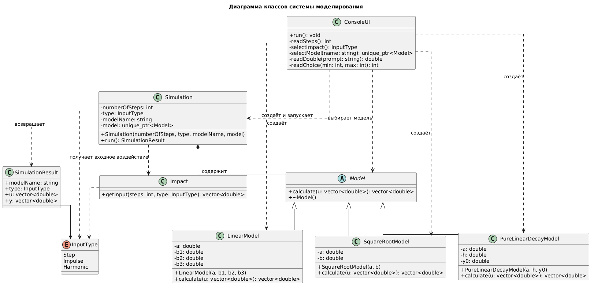

Министерство образования Республики Беларусь

Учреждение образования

«Брестский государственный технический университет»

Кафедра ИИТ

    

<strong>ЛАБОРАТОРНАЯ РАБОТА № 1</strong>

по дисциплине «Теория и моделирование автоматического управления»

Тема: «Моделирование объектов управления»

   

Выполнил:

Студент 3 курса

Группы АС-68

Мищенко А. Ф.

 

Проверил:

Дворанинович Д. А.

   

Брест 2026

---

# Вариант 7

Согласно заданию, в программе реализованы три математические модели:

- **Model 1.7** — линейная модель;
- **Model 2.9** — Square Root Modulated Action;
- **Model 3.1** — Pure Linear Decay.

Программа разработана на языке C++ с использованием объектно-ориентированного подхода. Пользователь может выбирать математическую модель, тип входного воздействия и количество шагов моделирования. Результаты вычислений выводятся в консоль, сохраняются в CSV-файл и визуализируются с помощью Python и библиотеки Matplotlib.

# Реализованные математические модели

## Model 1.7 — линейная модель

Математическое описание:

<strong>yτ+1 = a · yτ + b1 · uτ + b2 · uτ-1 + b3 · uτ-2</strong>

где:

- a, b₁, b₂, b₃ — коэффициенты модели;
- yₜ — текущее выходное значение;
- uₜ — текущее значение входного воздействия;
- uₜ₋₁ — предыдущее значение входного воздействия;
- uₜ₋₂ — значение входного воздействия на два шага ранее.

Модель вычисляет следующее выходное значение на основе текущего состояния системы и трёх последних значений входного сигнала.

**Пример параметров для тестирования:**

a = 0.9, b₁ = 2, b₂ = 1, b₃ = 0.5.

## Model 2.9 — Square Root Modulated Action

Математическое описание:

<strong>yτ+1 = a · yτ + b · |uτ| · sign(uτ)</strong>

Поскольку выполняется равенство:

<strong>|u| · sign(u) = u</strong>

выражение можно записать в эквивалентной форме:

<strong>yτ+1 = a · yτ + b · uτ</strong>

где:

- a и b — коэффициенты модели;
- yₜ — текущее выходное значение;
- uₜ — входное воздействие.

При вычислении следующего значения учитываются текущее состояние системы и входной сигнал.

**Пример параметров для тестирования:**

a = 0.8, b = 2.

## Model 3.1 — Pure Linear Decay

Математическое описание:

<strong>dy/dt = −a · y</strong>

Для численного решения дифференциального уравнения используется явный метод Эйлера:

<strong>yk+1 = yk + Δt · (−a · yk)</strong>

После преобразования получаем:

<strong>yk+1 = yk · (1 − a · Δt)</strong>

где:

- a — коэффициент затухания;
- yₖ — текущее значение выходной переменной;
- Δt — шаг интегрирования.

При положительном коэффициенте a и достаточно малом шаге интегрирования значение модели постепенно уменьшается.

**Пример параметров для тестирования:**

a = 0.5, Δt = 0.05, y₀ = 10.

*Примечание: приведённые параметры используются в качестве примеров для тестирования. Фактические значения вводятся пользователем во время работы программы.*

# Входные воздействия

Для проверки моделей предусмотрены три вида входного сигнала.

### Ступенчатое воздействие

<strong>uτ = 1</strong>

### Импульсное воздействие

<strong>u0 = 1</strong>

<strong>uτ = 0, при τ > 0</strong>

### Гармоническое воздействие

<strong>uτ = sin(τ)</strong>

Входные сигналы позволяют исследовать реакцию дискретных моделей на различные воздействия.

Для дифференциальной модели Model 3.1 входной сигнал не используется, поскольку уравнение dy/dt = −a · y не содержит входной переменной.

# Объектно-ориентированная архитектура

В основе программы находится абстрактный класс `Model`, задающий общий интерфейс для математических моделей. Конкретные модели реализуются в производных классах.

**Основные компоненты программы:**

- `Model` — абстрактный базовый класс для математических моделей;
- `InputSignal` — интерфейс для задания входных сигналов;
- классы входных сигналов — формируют ступенчатое, импульсное и гармоническое воздействия;
- классы моделей — реализуют уравнения Model 1.7, Model 2.9 и Model 3.1;
- `Sample` — структура для хранения результатов одного шага моделирования;
- механизм симуляции — последовательно вычисляет значения модели;
- CSV-вывод — отображает результаты и сохраняет данные для последующей визуализации.

Использование абстрактного базового класса и наследования позволяет обращаться к различным моделям через общий интерфейс и упрощает расширение программы новыми математическими моделями.

## UML-диаграмма классов

UML-диаграмма классов демонстрирует структуру программы, основные классы, их взаимосвязи, наследование и взаимодействие компонентов.

*Рисунок 1 — UML-диаграмма классов проекта*

#  Результаты моделирования

В начале работы пользователь выбирает математическую модель и тип входного воздействия. Затем вводятся количество шагов моделирования, начальное значение выходной переменной и необходимые коэффициенты.

Для дифференциальной модели дополнительно задаётся шаг интегрирования $\Delta t$.

Результаты моделирования:

- выводятся в консоль;
- сохраняются в файл `results.csv`;
- используются для построения графиков с помощью скрипта `src/plot.py`.

**Основные поля CSV-файла:**

| Поле | Описание |
|:---:|---|
| `tau` | Номер шага моделирования |
| `u` | Значение входного воздействия |
| `y` | Значение выходного сигнала модели |

## Model 1.7 — линейная модель

График демонстрирует изменение выходного сигнала линейной модели при выбранном входном воздействии.

*Рисунок 2 — Результат моделирования Model 1.7*

## Model 2.9 — Square Root Modulated Action

Для демонстрации работы модели можно использовать гармоническое входное воздействие и проследить изменение выходного сигнала во времени.

*Рисунок 3 — Результат моделирования Model 2.9*

##  Model 3.1 — Pure Linear Decay

График демонстрирует затухание выходного значения при заданных начальном условии и коэффициенте затухания.

*Рисунок 4 — Результат моделирования Model 3.1*

# Вывод

В ходе лабораторной работы разработана программа на языке C++ для моделирования трёх математических моделей: Model 1.7, Model 2.9 и Model 3.1.

При разработке использован объектно-ориентированный подход с применением абстрактного базового класса и отдельных реализаций математических уравнений.

В программе предусмотрены выбор входных воздействий, ввод параметров моделирования, последовательное вычисление выходных значений и сохранение результатов в CSV-файл. Для визуализации результатов используется Python и библиотека Matplotlib.

Полученные графики позволяют исследовать поведение математических моделей при различных параметрах и входных воздействиях, а реализованная архитектура обеспечивает возможность дальнейшего расширения программы.
