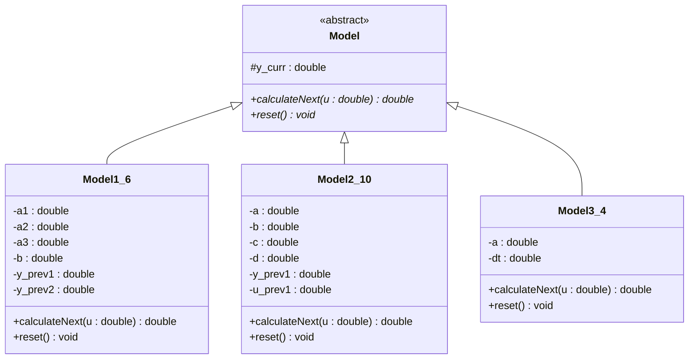
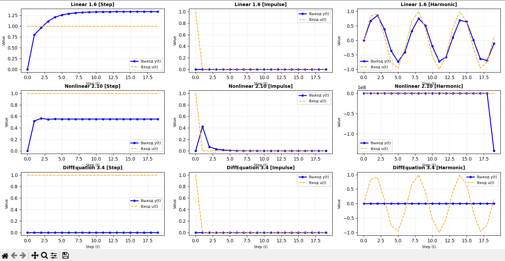

 Министерство образования Республики Беларусь

Учреждение образования

“Брестский Государственный технический университет”

Кафедра ИИТ

       

Лабораторная работа №1

По дисциплине “теория и методы автоматического управления”

Тема: “Моделирование контролируемых объектов”

     

Выполнил:

Студент 3 курса

Группы АС-68

Кульбеда А. Ю.

Проверил:

Дворанинович Д. А.

     

Брест 2026

 
 
 
 

## Вариант 16
 
## Математические уравнения моделей (Вариант 16)
1. **Линейная модель (Model 1.6):**
   $$Y_{\tau+1} = a_1 Y_{\tau} + a_2 Y_{\tau-1} + a_3 Y_{\tau-2} + b u_{\tau}$$
2. **Нелинейная модель (Model 2.10):**
   $$Y_{\tau+1} = a Y_{\tau} - b Y_{\tau-1}^2 + c u_{\tau} + d\sin(u_{\tau-1})$$
3. **Дифференциальное уравнение (Model 3.4):**
   $$\frac{dy}{dt} = -a y^2$$
   Численное решение методом Эйлера: $y_{t+1} = y_t + \Delta t \cdot (-a y_t^2)$

   ### Особенности реализованных моделей:
1. **Model 1.6** представляет собой линейную систему третьего порядка. Для её реализации в классе `Model1_6` используется буфер из двух предыдущих состояний.
2. **Model 2.10** — это нелинейная модель, содержащая квадратичный член и гармоническое воздействие (синус от предыдущего входа). Особое внимание уделено сохранению предыдущего значения входа `u_prev1`.
3. **Model 3.4** решается методом Эйлера для дифференциального уравнения затухания. Важной особенностью является то, что входной сигнал `u(t)` в данном уравнении не участвует, поэтому реакция системы зависит только от начального состояния.

 
## Архитектура классов (UML-диаграмма)
Ниже представлена интерактивная UML-диаграмма классов разработанного программного комплекса:

### Архитектурные решения:
При проектировании использовался принцип полиморфизма. Базовый абстрактный класс `Model` задает интерфейс, а конкретные реализации находятся в классах-наследниках. Для безопасного ввода данных были написаны собственные функции-обертки, защищающие программу от сбоев при вводе некорректных символов.

## Результаты моделирования и визуализация
Программа успешно выполняет симуляцию всех трех моделей для трех типов входных воздействий (ступенчатое, импульсное, гармоническое) и экспортирует результаты в `.csv` файлы.

### Графики переходных процессов (Python/Matplotlib)
На основе сгенерированных табличных данных с помощью библиотеки Matplotlib построены графики процессов симуляции контролируемых объектов:

