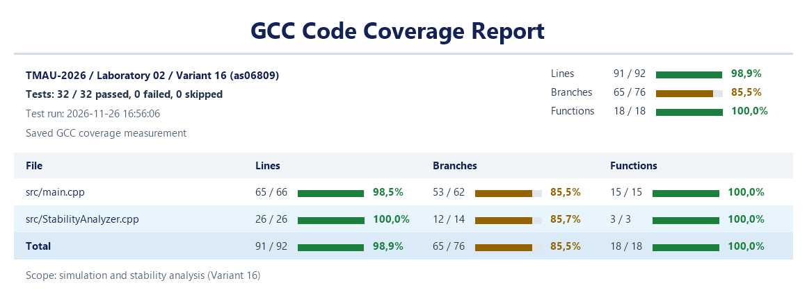

<p align="center">Министерство образования Республики Беларусь</p>
<p align="center">Учреждение образования</p>
<p align="center">«Брестский государственный технический университет»</p>
<p align="center">Кафедра ИИТ</p>

<br><br><br><br><br>

<p align="center">Практическая работа №2</p>
<p align="center">По дисциплине «Теория и моделирование автоматического управления»</p>
<p align="center">Тема: «Модульное тестирование и анализ устойчивости»</p>

<br><br><br><br><br>

<p align="right">Выполнил:</p>
<p align="right">Студент 3 курса</p>
<p align="right">Группы АС-68</p>
<p align="right">Кульбеда А. Ю.</p>
<p align="right">Проверил:</p>
<p align="right">Дворанинович Д. А.</p>

<br><br><br><br><br>

<p align="center">Брест 2026</p>

---

## Вариант 16 (`as06809`)

Моделирование, модульное тестирование и анализ устойчивости для моделей **1.6**, **2.10** и **3.4**. Результаты расчётов экспортируются в `results.csv` (`tau,u,y`), а графики формируются через Python и Matplotlib.

## Математические модели

| Модель | Уравнение перехода |
| --- | --- |
| 1.6. Линейная динамическая система 3-го порядка | $y_{\tau+1} = a_1 y_\tau + a_2 y_{\tau-1} + a_3 y_{\tau-2} + b u_\tau$ |
| 2.10. Нелинейное сглаживание гиперболическим тангенсом | $y_{\tau+1} = a \cdot \tanh(y_\tau) + b \cdot u_\tau^3$ |
| 3.4. Дифференциальное уравнение квадратичного затухания | $\dfrac{dy}{dt} = -a \cdot y^2$ |

Для **модели 1.6** начальные предыстории состояния до старта расчёта ($\tau < 0$) полагаются равными нулю ($y_{-1} = y_{-2} = 0$). Вклад слагаемых $a_2 y_{\tau-1}$ и $a_3 y_{\tau-2}$ последовательно включается начиная с тактов $\tau = 1$ и $\tau = 2$.

Для **модели 2.10** при нулевом состоянии и нулевом входе ($y_0 = 0, u_\tau = 0$) система находится в равновесии ($y_\tau = 0$). Функция обладает нечётной симметрией: при смене знака $y_0$ и $u_\tau$ выход меняет знак на противоположный.

Для **модели 3.4** используется явный метод Эйлера с шагом $\Delta t$:
$$y_{\tau+1} = y_\tau - \Delta t \cdot a \cdot y_\tau^2$$
Точное аналитическое решение задачи Коши имеет вид:
$$y(t) = \frac{y_0}{1 + a y_0 t}$$
При уменьшении шага $\Delta t$ в 2 раза глобальная погрешность метода Эйлера первого порядка уменьшается примерно вдвое.

## Анализ устойчивости модели 1.6 (критерий Джури)

При нулевом управлении ($u_\tau = 0$) характеристический полином системы 3-го порядка записывается как:
$$P(z) = z^3 - a_1 z^2 - a_2 z - a_3 = 0$$
Необходимые и достаточные условия расположения всех трёх корней строго внутри единичного круга ($\lvert z_{1,2,3} \rvert < 1$) по критерию Джури:
1. $P(1) = 1 - a_1 - a_2 - a_3 > 0$
2. $(-1)^3 P(-1) = 1 + a_1 - a_2 + a_3 > 0$
3. $\lvert a_3 \rvert < 1$
4. $\lvert 1 - a_3^2 \rvert > \lvert a_2 + a_1 a_3 \rvert$

Функция `evaluateThirdOrderStability` проверяет эти неравенства перед запуском симуляции и при попадании на границу или в область неустойчивости выводит предупреждение.

## Запуск в Windows

Из каталога `trunk/as06809/task_02` выполните:

```bat
run_tests.bat
run_tests.bat --coverage
```

Скрипт собирает статическую библиотеку моделей `as06809_var16_lib`, приложение `task02.exe` и модульные тесты `var16_test_runner`, выполняет `ctest` и сохраняет отчёт `test_results.png`.

## Структура проекта

| Путь | Назначение |
| --- | --- |
| `src/StabilityAnalyzer.h` | Объявление базового класса `AbstractDynamicModel`, моделей варианта 16 и анализатора устойчивости |
| `src/StabilityAnalyzer.cpp` | Реализация критерия Джури для системы 3-го порядка 1.6 и вывода предупреждений |
| `src/main.cpp` | Реализация шагов расчёта моделей 1.6, 2.10, 3.4 и консольного интерфейса |
| `test/test_models.cpp` | Параметризованные тесты траекторий, симметрии нелинейности и сходимости схемы Эйлера |
| `test/test_signals.cpp` | Тесты ступенчатого, импульсного и гармонического входных сигналов |
| `test/test_stability.cpp` | Тесты всех условий критерия Джури на Z-плоскости и предупреждений |
| `doc/` | Отчёт (`readme.md`) и скриншот результатов тестирования (`test_results.png`) |
| `run_tests.bat` | Скрипт автоматической сборки, прогона тестов и генерации отчёта |

## Результаты модульного тестирования

* **Среда запуска:** Локальный пакетный скрипт (`run_tests.bat`)
* **Всего тестов Google Test:** 28 (включая параметризованные наборы `Variant16Cases` и `Variant16Stability`)
* **Пройдено успешно:** 28 / 28

| Файл исходного кода | Покрытие строк | Покрытие функций | Статус |
| --- | :---: | :---: | :---: |
| `src/main.cpp` | 98.5 % (65/66) | 100 % (15/15) | OK |
| `src/StabilityAnalyzer.cpp` | 100 % (26/26) | 100 % (3/3) | OK |
| **Итого** | **98.9 % (91/92)** | **100 % (18/18)** | **Success** |


