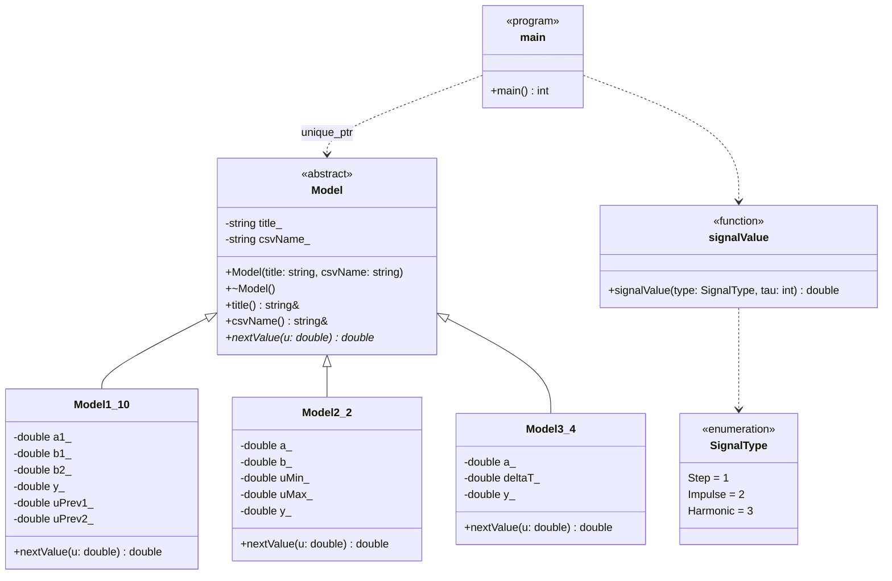
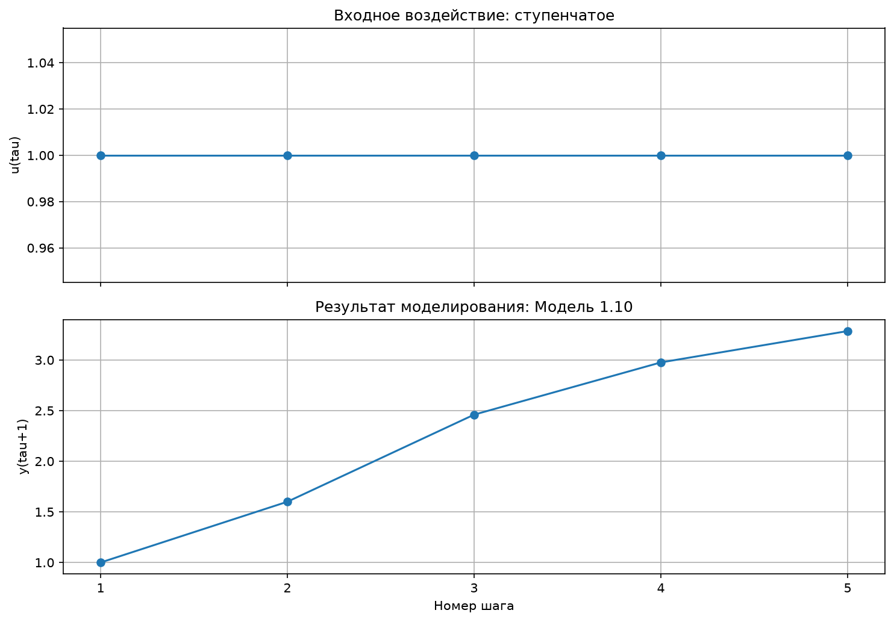
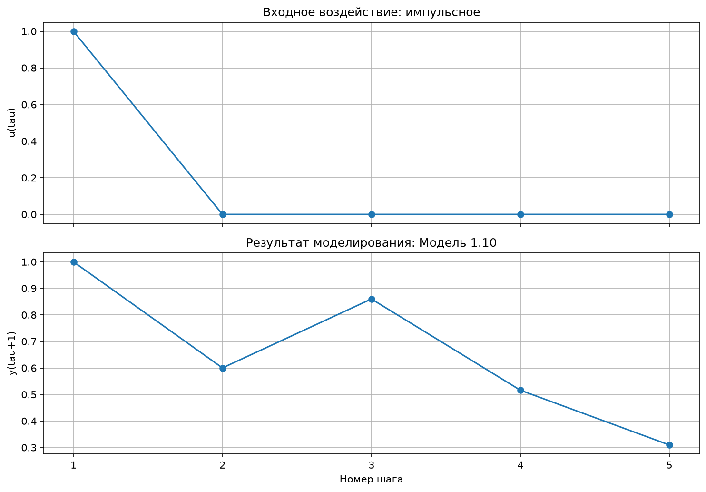
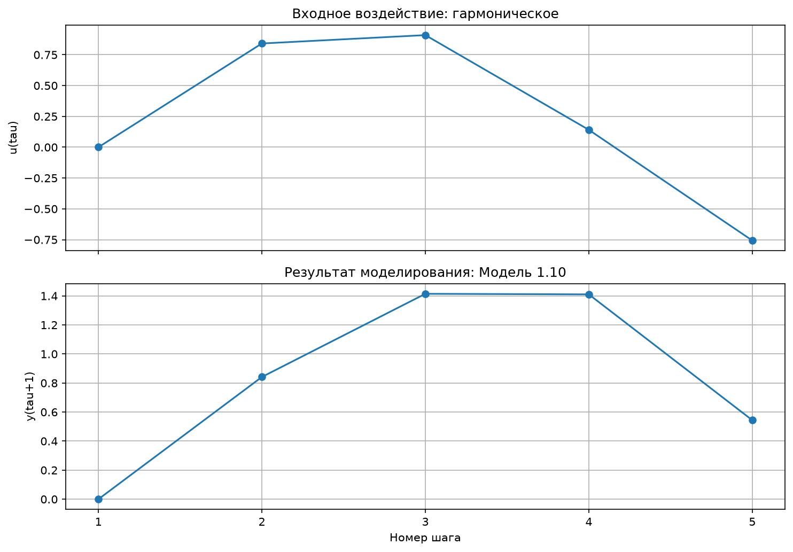
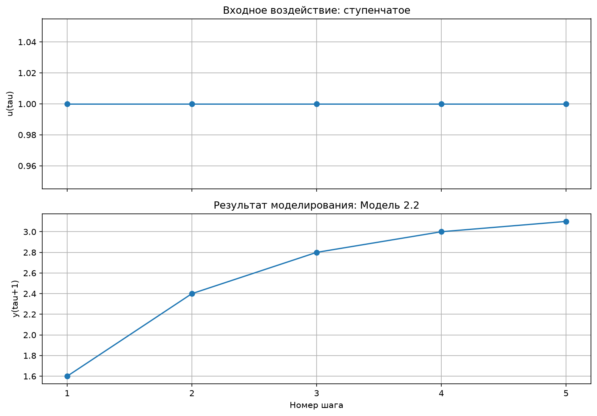
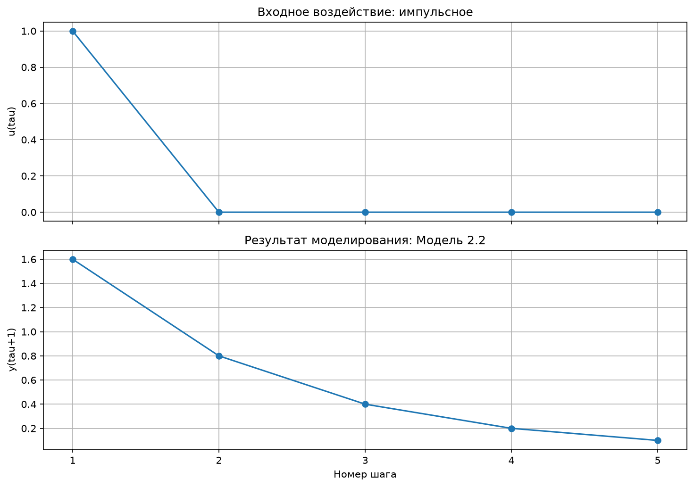
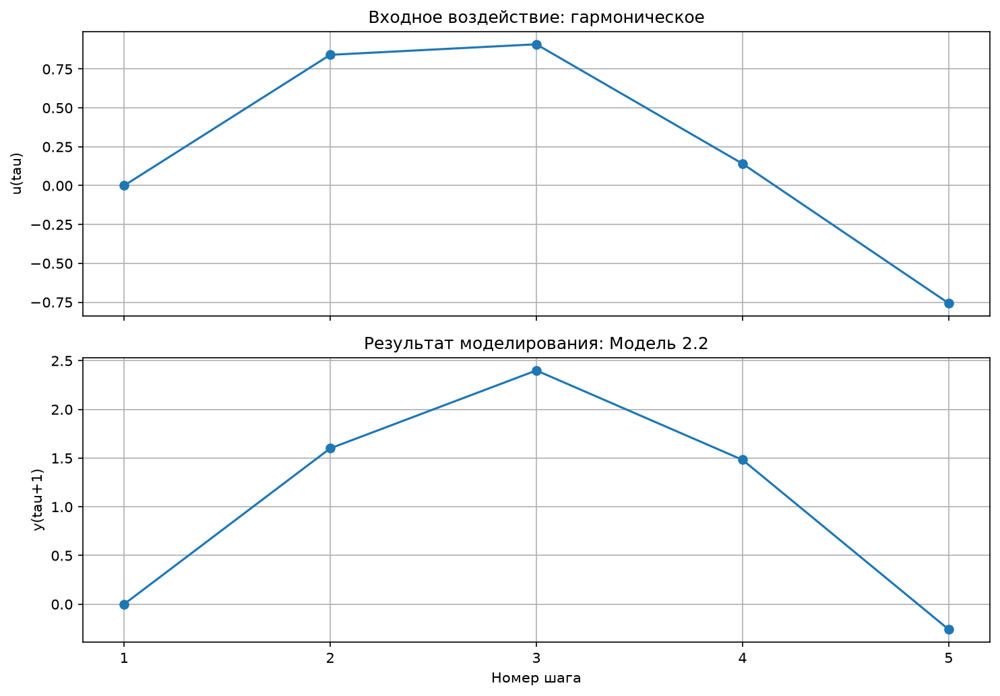
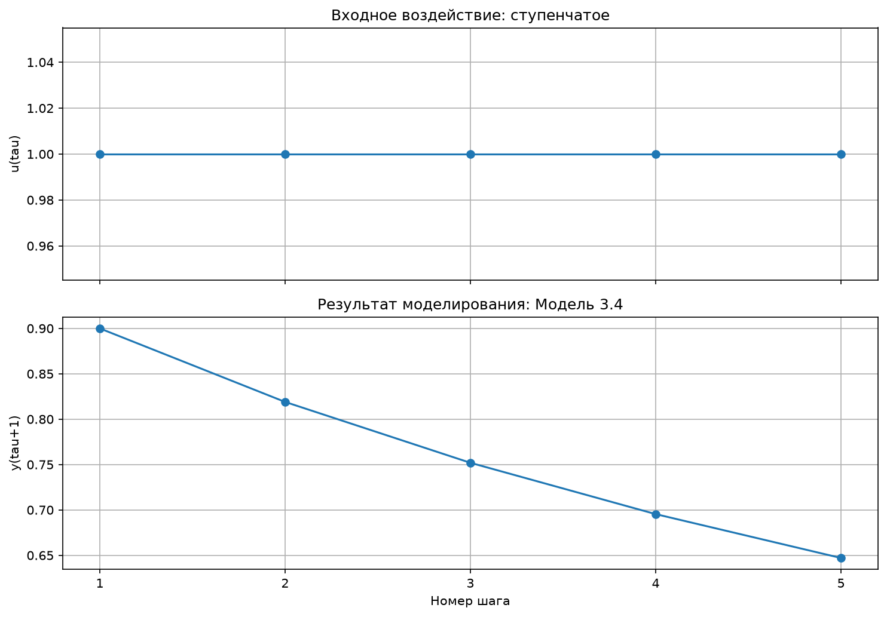
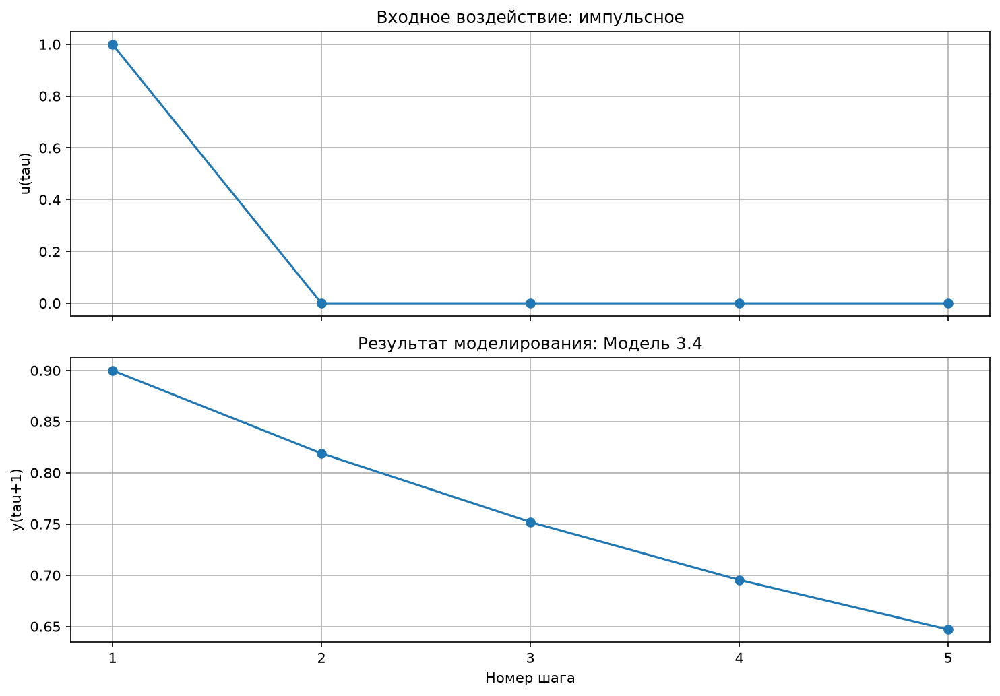
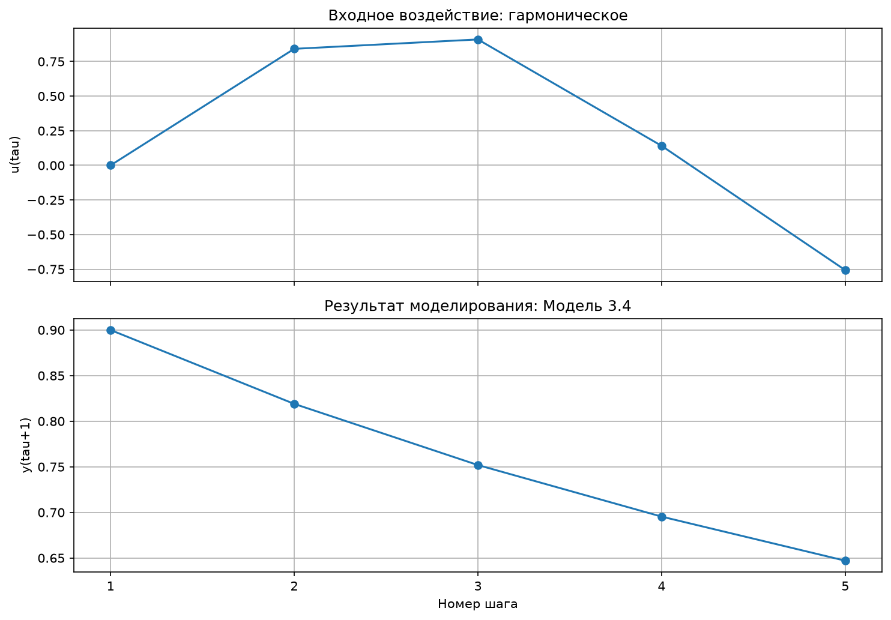

<p align="center">Министерство образования Республики Беларусь</p>

<p align="center">Учреждение образования</p>

<p align="center">«Брестский государственный технический университет»</p>

<p align="center">Кафедра ИИТ</p>

<br><br><br><br>

<p align="center"><strong>ЛАБОРАТОРНАЯ РАБОТА № 1</strong></p>

<p align="center">по дисциплине «Теория и моделирование автоматического управления»</p>

<p align="center">Тема: «Моделирование объектов управления»</p>

<br><br><br>

<p align="right">Выполнил:</p>

<p align="right">Студент 3 курса</p>

<p align="right">Группы АС-68</p>

<p align="right">Мищенко А. Ф.</p>

<br>

<p align="right">Проверил:</p>

<p align="right">Дворанинович Д. А.</p>

<br><br><br>

<p align="center">Брест 2026</p>

---

## Вариант 10

| Тип объекта | Модель |
|---|---|
| Линейная | Модель 1.10 |
| Нелинейная | Модель 2.2 |
| Дифференциальная | Модель 3.4 |

## 1. Цель работы

Создать на C++ программу, которая моделирует три объекта управления (линейный, нелинейный и описываемый дифференциальным уравнением) и показывает их реакцию на ступенчатое, импульсное и гармоническое воздействия. Программа построена на принципах ООП, результаты выводятся таблицей, сохраняются в CSV и отображаются на графиках, а сборка и запуск автоматизированы через CMake и `.bat`-файл.

## 2. Соответствие заданию

| № | Требование задания | Как выполнено |
|---|---|---|
| 1 | Отчёт в `readme.md` через pull request в `trunk/as06812/task_01/doc` | Этот файл, раздел 13 |
| 2 | Исходный код в `trunk/as06812/task_01/src` | Раздел 5 |
| 3 | Вывод в виде таблицы | Консоль и CSV-файлы, раздел 7 |
| 4 | Настраиваемое число шагов `n` | Вводится пользователем, раздел 7 |
| 5 | Визуализация результатов | Python и Matplotlib, раздел 8 |
| 6 | UML-диаграмма классов | Раздел 6 |
| 7 | Абстрактный класс `Model`, уравнения в наследниках | Раздел 6 |
| 8 | Три типа входных воздействий | Раздел 4 |
| 9 | Сборка через CMake, запуск через `.bat` с показом процесса | Раздел 9 |

## 3. Математические модели

Обозначения: $\tau$ — номер шага, $u_\tau$ — входное воздействие, $y_\tau$ — выход объекта. Начальные условия нулевые, если не указано иное.

### 3.1. Модель 1.10 (линейная, окно управления)

Выход зависит от своего предыдущего значения, текущего входа и входа двухшаговой давности:

$$
y_{\tau+1} = a_1 y_\tau + b_1 u_\tau + b_2 u_{\tau-2},
\qquad y_0 = u_{-1} = u_{-2} = 0.
$$

Параметры: $a_1$, $b_1$, $b_2$.

### 3.2. Модель 2.2 (нелинейная, насыщение исполнительного органа)

Входное воздействие сначала ограничивается функцией насыщения:

$$
y_{\tau+1} = a y_\tau + b\cdot \mathrm{sat}(u_\tau),
\qquad
\mathrm{sat}(u) =
\begin{cases}
U_{\max}, & u > U_{\max},\\
u, & U_{\min} \le u \le U_{\max},\\
U_{\min}, & u < U_{\min}.
\end{cases}
$$

Параметры: $a$, $b$, $U_{\min} \le U_{\max}$. Начальное условие $y_0 = 0$.

### 3.3. Модель 3.4 (дифференциальное уравнение)

Объект описывается уравнением

$$
\frac{dy}{dt} = -a\,y^2,
$$

которое решается явным методом Эйлера с шагом $\Delta t$:

$$
y_{\tau+1} = y_\tau + \Delta t\,(-a\,y_\tau^2).
$$

Параметры: $a$, $\Delta t > 0$ и начальное значение $y_0$. Входное воздействие в это уравнение не входит, поэтому при $y_0 = 0$ выход остаётся нулевым при любом $u$. Чтобы процесс был содержательным, начальное значение задаётся ненулевым и вводится пользователем.

Точное решение $y(t) = \dfrac{y_0}{1 + a\,y_0\,t}$ используется для проверки метода Эйлера (раздел 11).

## 4. Входные воздействия

| Воздействие | Формула |
|---|---|
| Ступенчатое | $u_\tau = 1$ |
| Импульсное | $u_0 = 1$, $u_\tau = 0$ при $\tau > 0$ |
| Гармоническое | $u_\tau = \sin(\tau)$, аргумент в радианах |

Номер шага в таблице на единицу больше $\tau$: первая строка соответствует $\tau = 0$. Для модели 3.4 все три воздействия дают один и тот же выход, потому что $u$ в её уравнение не входит.

## 5. Структура проекта

```
trunk/as06806/task_01/
├── src/
│   ├── RealizeModel.cpp - ввод данных, цикл моделирования, вывод таблицы и CSV
│   ├── models.h         - абстрактный класс Model, три модели, входные воздействия
│   ├── Graph.py         - чтение CSV, таблица и графики
│   ├── CMakeLists.txt   - описание сборки
│   └── build.bat        - сборка, запуск и визуализация
└── doc/
    ├── readme.md        - отчёт
    ├── Model_<модель>_<сигнал>.png   - 9 графиков
    └── Model_<модель>_<сигнал>.csv   - 9 таблиц результатов
```

## 6. Объектно-ориентированная архитектура

Абстрактный класс `Model` хранит название модели и объявляет чисто виртуальный метод `nextValue(u)`: он принимает входное воздействие, возвращает следующее значение выхода и сдвигает внутреннее состояние. Три наследника реализуют свои уравнения:

| Класс | Модель | Что хранит |
|---|---|---|
| `Model1_10` | 1.10 | $a_1$, $b_1$, $b_2$, текущий выход, $u_{\tau-1}$ и $u_{\tau-2}$ |
| `Model2_2` | 2.2 | $a$, $b$, пределы $U_{\min}$, $U_{\max}$, текущий выход |
| `Model3_4` | 3.4 | $a$, шаг $\Delta t$, текущий выход |

Функция `main` работает с выбранной моделью через `std::unique_ptr<Model>`, поэтому цикл расчёта не зависит от конкретного класса. Копирование базового класса запрещено, чтобы объекты нельзя было «срезать» при передаче по значению.

| Принцип | Где проявляется |
|---|---|
| Абстракция | `Model` задаёт общий интерфейс расчёта шага |
| Наследование | Три модели наследуются от `Model` |
| Инкапсуляция | Коэффициенты и состояние находятся в закрытых полях |
| Полиморфизм | Вызов `nextValue` через указатель на `Model` |



*Рисунок 1 — диаграмма классов программы.*

## 7. Ввод, вывод и проверка данных

Порядок диалога: количество шагов $n$ (от 1 до 100000), номер модели, параметры модели, номер воздействия. Если вместо числа введён текст (например, `abc` или `5abc`) или число вне допустимого диапазона, программа сообщает об ошибке и просит ввести значение заново.

| Поле | Допустимые значения |
|---|---|
| Количество шагов $n$ | целое число от 1 до 100000 |
| Номер модели и воздействия | 1, 2 или 3 |
| Коэффициенты | любые конечные числа (десятичный разделитель — точка) |
| $U_{\max}$ (модель 2.2) | не меньше $U_{\min}$, иначе программа завершается с ошибкой |
| Шаг времени $\Delta t$ (модель 3.4) | больше нуля, иначе программа завершается с ошибкой |

Если выход становится нечисловым или его модуль превышает $10^9$ (расчёт расходится), моделирование останавливается, программа сообщает номер шага, а в таблицу и CSV попадают только корректные шаги.

Результаты выводятся в консоль таблицей с колонками «Шаг», $u(\tau)$ и $y(\tau+1)$. Пример для модели 1.10, ступенчатого воздействия, $n = 5$:

```
Модель: Модель 1.10

     Шаг          u(tau)        y(tau+1)
----------------------------------------
       1          1.0000          1.0000
       2          1.0000          1.6000
       3          1.0000          2.4600
       4          1.0000          2.9760
       5          1.0000          3.2856
```

Те же данные записываются в `result.csv` в полях `step`, `u_tau`, `y_next`, `model`, `signal`. Запись выполняется в стандартной локали, поэтому десятичным разделителем всегда служит точка.

## 8. Визуализация и результаты моделирования

Скрипт `Graph.py` читает `result.csv`, печатает таблицу и строит два графика: сверху входное воздействие, снизу отклик модели. Рисунок и копия таблицы сохраняются в `doc` под именами `Model_<модель>_<сигнал>.png` и `Model_<модель>_<сигнал>.csv`.

Для всех экспериментов принято $n = 20$ и следующие параметры:

| Модель | Параметры |
|---|---|
| 1.10 | $a_1 = 0.6$, $b_1 = 1.0$, $b_2 = 0.5$ |
| 2.2 | $a = 0.5$, $b = 2.0$, $U_{\min} = -0.5$, $U_{\max} = 0.8$ |
| 3.4 | $a = 1.0$, $\Delta t = 0.1$, $y_0 = 1.0$ |

### 8.1. Модель 1.10 (линейная)

| Ступенчатое | Импульсное | Гармоническое |
|---|---|---|
|  |  |  |

*Рисунок 2 — модель 1.10 при ступенчатом, импульсном и гармоническом воздействиях.*

<details>
<summary>Значения выхода y(τ+1) для n = 20</summary>

| Шаг | y, ступенчатое | y, импульсное | y, гармоническое |
|---:|---:|---:|---:|
| 1 | 1.0000 | 1.0000 | 0.0000 |
| 2 | 1.6000 | 0.6000 | 0.8415 |
| 3 | 2.4600 | 0.8600 | 1.4142 |
| 4 | 2.9760 | 0.5160 | 1.4104 |
| 5 | 3.2856 | 0.3096 | 0.5441 |
| 6 | 3.4714 | 0.1858 | -0.5619 |
| 7 | 3.5828 | 0.1115 | -0.9950 |
| 8 | 3.6497 | 0.0669 | -0.4195 |
| 9 | 3.6898 | 0.0401 | 0.5980 |
| 10 | 3.7139 | 0.0241 | 1.0994 |
| 11 | 3.7283 | 0.0144 | 0.6103 |
| 12 | 3.7370 | 0.0087 | -0.4278 |
| 13 | 3.7422 | 0.0052 | -1.0652 |
| 14 | 3.7453 | 0.0031 | -0.7190 |
| 15 | 3.7472 | 0.0019 | 0.2909 |
| 16 | 3.7483 | 0.0011 | 1.0349 |
| 17 | 3.7490 | 0.0007 | 0.8284 |
| 18 | 3.7494 | 0.0004 | -0.1392 |
| 19 | 3.7496 | 0.0002 | -0.9785 |
| 20 | 3.7498 | 0.0001 | -0.9179 |

</details>

### 8.2. Модель 2.2 (нелинейная)

| Ступенчатое | Импульсное | Гармоническое |
|---|---|---|
|  |  |  |

*Рисунок 3 — модель 2.2 при ступенчатом, импульсном и гармоническом воздействиях.*

<details>
<summary>Значения выхода y(τ+1) для n = 20</summary>

| Шаг | y, ступенчатое | y, импульсное | y, гармоническое |
|---:|---:|---:|---:|
| 1 | 1.6000 | 1.6000 | 0.0000 |
| 2 | 2.4000 | 0.8000 | 1.6000 |
| 3 | 2.8000 | 0.4000 | 2.4000 |
| 4 | 3.0000 | 0.2000 | 1.4822 |
| 5 | 3.1000 | 0.1000 | -0.2589 |
| 6 | 3.1500 | 0.0500 | -1.1294 |
| 7 | 3.1750 | 0.0250 | -1.1236 |
| 8 | 3.1875 | 0.0125 | 0.7522 |
| 9 | 3.1938 | 0.0063 | 1.9761 |
| 10 | 3.1969 | 0.0031 | 1.8123 |
| 11 | 3.1984 | 0.0016 | -0.0939 |
| 12 | 3.1992 | 0.0008 | -1.0469 |
| 13 | 3.1996 | 0.0004 | -1.5235 |
| 14 | 3.1998 | 0.0002 | 0.0786 |
| 15 | 3.1999 | 0.0001 | 1.6393 |
| 16 | 3.2000 | 0.0000 | 2.1202 |
| 17 | 3.2000 | 0.0000 | 0.4843 |
| 18 | 3.2000 | 0.0000 | -0.7578 |
| 19 | 3.2000 | 0.0000 | -1.3789 |
| 20 | 3.2000 | 0.0000 | -0.3897 |

</details>

### 8.3. Модель 3.4 (дифференциальная)

| Ступенчатое | Импульсное | Гармоническое |
|---|---|---|
|  |  |  |

*Рисунок 4 — модель 3.4 при ступенчатом, импульсном и гармоническом воздействиях: выход одинаковый.*

<details>
<summary>Значения выхода y(τ+1) для n = 20</summary>

| Шаг | y (для любого воздействия) |
|---:|---:|
| 1 | 0.9000 |
| 2 | 0.8190 |
| 3 | 0.7519 |
| 4 | 0.6954 |
| 5 | 0.6470 |
| 6 | 0.6052 |
| 7 | 0.5685 |
| 8 | 0.5362 |
| 9 | 0.5075 |
| 10 | 0.4817 |
| 11 | 0.4585 |
| 12 | 0.4375 |
| 13 | 0.4183 |
| 14 | 0.4008 |
| 15 | 0.3848 |
| 16 | 0.3700 |
| 17 | 0.3563 |
| 18 | 0.3436 |
| 19 | 0.3318 |
| 20 | 0.3208 |

</details>

## 9. Сборка и запуск

Требуются CMake, компилятор MSVC (Visual Studio Build Tools) и Python 3 с Matplotlib; при его отсутствии `build.bat` устанавливает библиотеку сам.

Файл `build.bat` последовательно выполняет и показывает в консоли четыре этапа:

1. `CONFIGURE PROJECT` — `cmake -S . -B build`;
2. `BUILD PROJECT` — `cmake --build build --config Release`;
3. `RUN PROGRAM` — запуск `task_01.exe` и диалог с пользователем;
4. `VISUALISATION` — проверка Matplotlib и запуск `Graph.py`.

Все девять сочетаний «модель — воздействие» запускаются через `build.bat` по очереди: при каждом запуске вводятся одни и те же $n = 20$ и параметры из раздела 8, меняются только номер модели и номер воздействия. После каждого запуска в `doc` сохраняются график и таблица.

## 10. Анализ результатов

- **Модель 1.10.** При ступеньке выход приближается к установившемуся значению $(b_1 + b_2)/(1 - a_1) = 1.5/0.4 = 3.75$; на 20-м шаге он равен 3.7498. При импульсе выход после первых двух шагов (1.0 и 0.6) снова вырастает до 0.86 на третьем шаге, потому что на нём начинает действовать слагаемое $b_2 u_{\tau-2}$ с задержанным импульсом, а затем затухает с множителем $a_1 = 0.6$. При синусе выход колеблется в пределах примерно от $-1.07$ до $1.41$.
- **Модель 2.2.** При ступеньке $\mathrm{sat}(1) = 0.8$, поэтому выход стремится к $b \cdot 0.8/(1 - a) = 3.2$ (шаги 1.6, 2.4, 2.8, 3.0, ...). При импульсе первый отклик равен 1.6, затем он уменьшается вдвое на каждом шаге. При синусе положительные значения входа выше 0.8 обрезаются: на шагах 2 и 3 вход заменяется на 0.8, и выход достигает максимума 2.4; отрицательная полуволна обрезается на уровне $-0.5$.
- **Модель 3.4.** Выход не зависит от входа: графики для трёх воздействий одинаковы. Процесс гиперболически затухает от $y_0 = 1$ до 0.3208 на 20-м шаге. Метод Эйлера немного отстаёт от точного решения $1/(1 + t)$, которое при $t = 2$ равно 0.3333.

## 11. Проверка корректности

- **Ручной расчёт.** Первые шаги посчитаны без программы и совпали с выводом:
  - модель 1.10, ступенька: $y_1 = 1$, $y_2 = 0.6 \cdot 1 + 1 = 1.6$, $y_3 = 0.6 \cdot 1.6 + 1 + 0.5 \cdot 1 = 2.46$;
  - модель 1.10, импульс: $y_1 = 1$, $y_2 = 0.6$, $y_3 = 0.6 \cdot 0.6 + 0.5 \cdot 1 = 0.86$;
  - модель 2.2, ступенька: $y_1 = 2 \cdot 0.8 = 1.6$, $y_2 = 0.5 \cdot 1.6 + 1.6 = 2.4$;
  - модель 2.2, синус: $y_2 = 2 \cdot \mathrm{sat}(0.8415) = 1.6$, $y_3 = 0.5 \cdot 1.6 + 2 \cdot \mathrm{sat}(0.9093) = 2.4$, $y_4 = 0.5 \cdot 2.4 + 2 \cdot 0.1411 = 1.4822$;
  - модель 3.4: $y_1 = 1 + 0.1 \cdot (-1) = 0.9$, $y_2 = 0.9 - 0.1 \cdot 0.81 = 0.819$.
- **Независимая проверка.** Результаты всех девяти сочетаний сравнены с отдельной реализацией тех же формул на Python: расхождений нет.
- **Метод Эйлера.** Для модели 3.4 численное решение сравнено с точным:

| Шаг | Эйлер | Точное $1/(1+0.1k)$ |
|---:|---:|---:|
| 1 | 0.9000 | 0.9091 |
| 5 | 0.6470 | 0.6667 |
| 10 | 0.4817 | 0.5000 |
| 20 | 0.3208 | 0.3333 |

- **Некорректный ввод.** Проверены нечисловые значения, $n \le 0$ и $n > 100000$, строки вида `5abc`, пустой ввод, номера модели и воздействия вне диапазона (программа просит ввести значение заново), а также $U_{\max} < U_{\min}$ и $\Delta t \le 0$ (программа выводит ошибку и завершается).
- **Расходимость.** Для модели 3.4 с $a = -5$, $\Delta t = 0.5$, $y_0 = 1$ выход растёт лавинообразно (3.5, 34.1, 2945, $2.2 \cdot 10^7$), и на 5-м шаге расчёт останавливается с сообщением об ошибке; в результатах остаются четыре корректных шага.

## 12. Заключение

Разработана программа на C++, моделирующая три объекта управления по варианту 10: линейный, нелинейный и описываемый дифференциальным уравнением. Модели реализованы как наследники абстрактного класса `Model` и применяются полиморфно. Реакции каждой модели на ступенчатое, импульсное и гармоническое воздействия получены, выведены таблицами, сохранены в CSV и показаны на графиках; значения проверены вручную и независимой реализацией. Сборка и запуск автоматизированы через CMake и `.bat`-файл.

### 13. Размещение работы

Работа размещена в репозитории с помощью запроса на внесение изменений (pull request) в соответствии с заданием:

| Что | Значение |
|---|---|
| Ветка | `as06812/task_01` |
| Исходный код | `trunk/as06812/task_01/src` |
| Отчёт, графики и таблицы | `trunk/as06812/task_01/doc` |
| Pull request | `https://github.com/brstu/TMAU-2026/pull/44` |

В каталог `src` помещены файлы `RealizeModel.cpp`, `models.h`, `Graph.py`, `CMakeLists.txt` и `build.bat`. В каталог `doc` помещены `readme.md`, девять графиков `Model_<модель>_<сигнал>.png` и девять таблиц результатов `Model_<модель>_<сигнал>.csv`.
