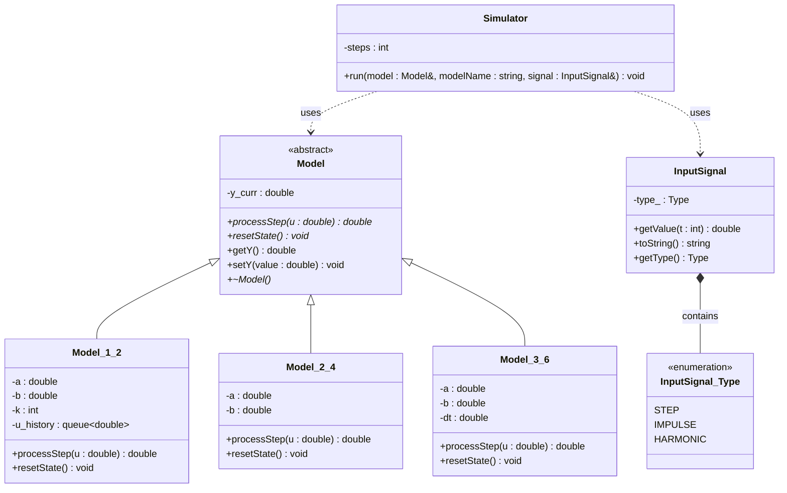
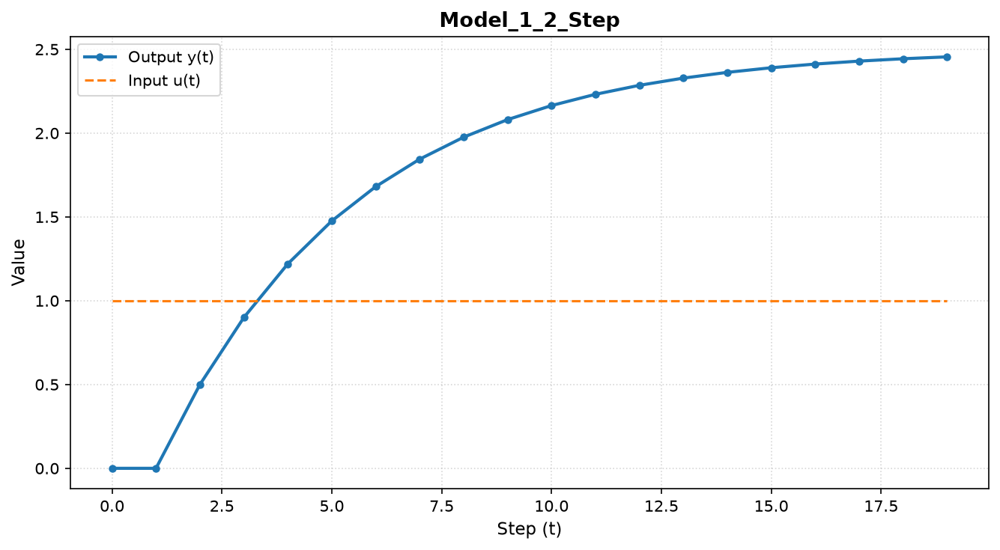
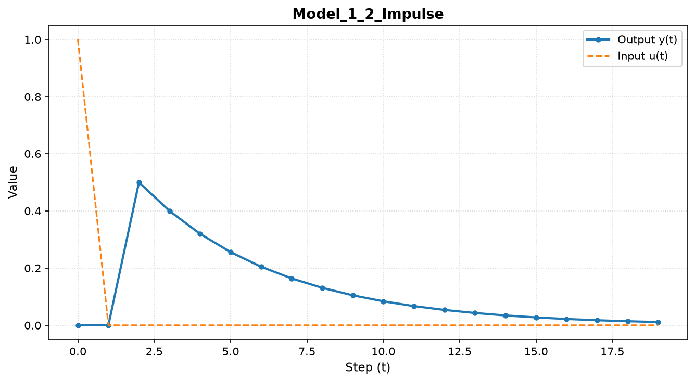
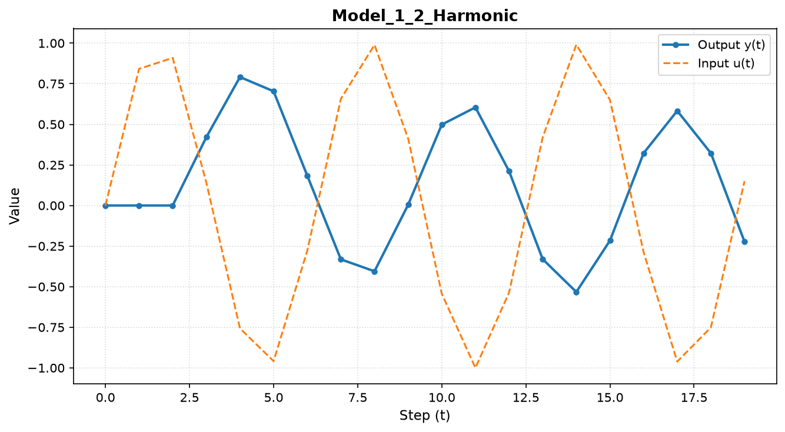
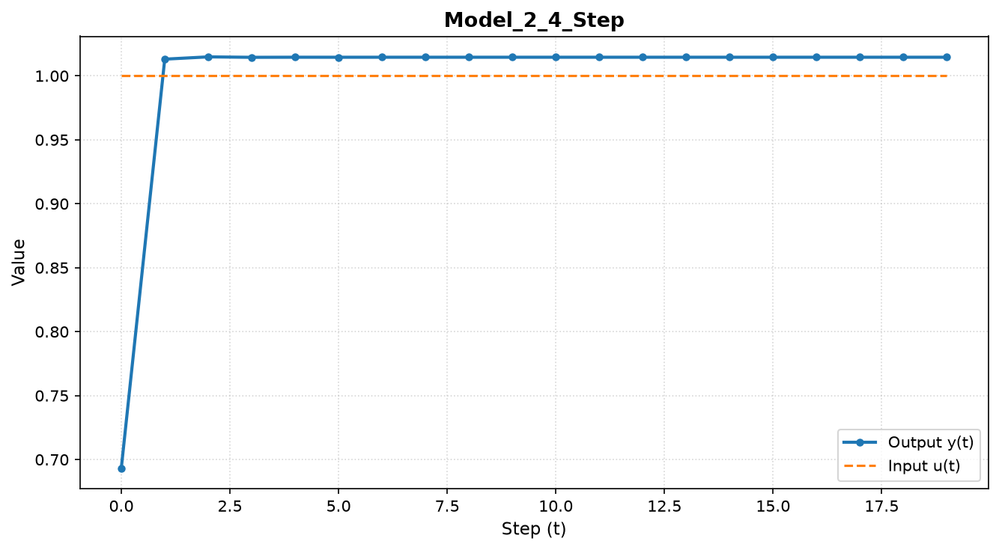
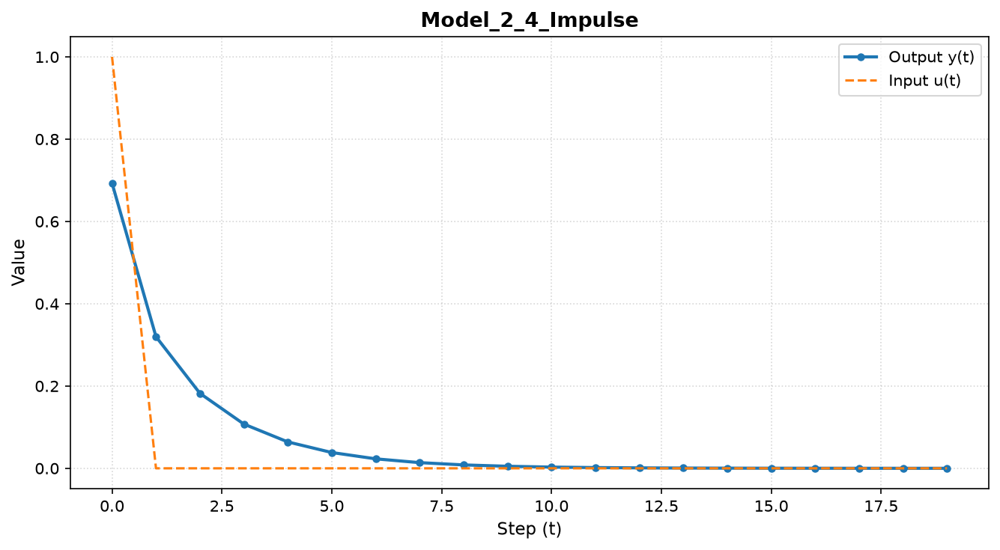
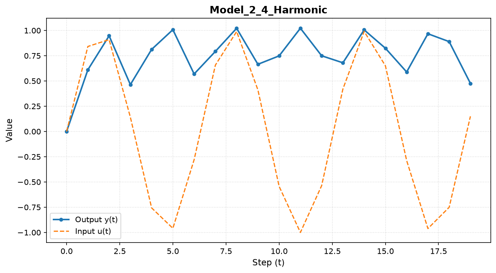
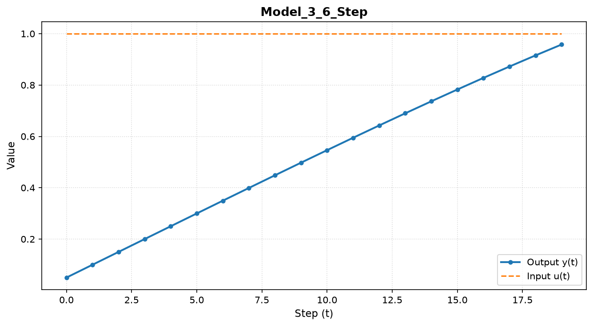
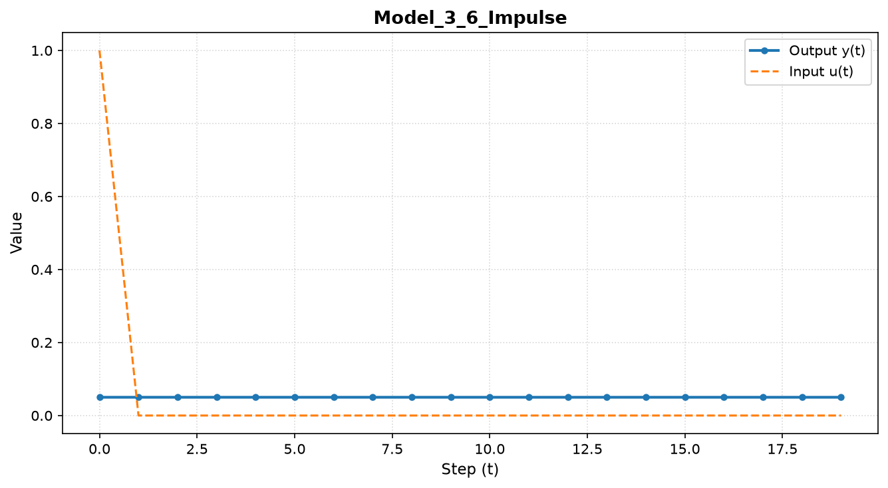
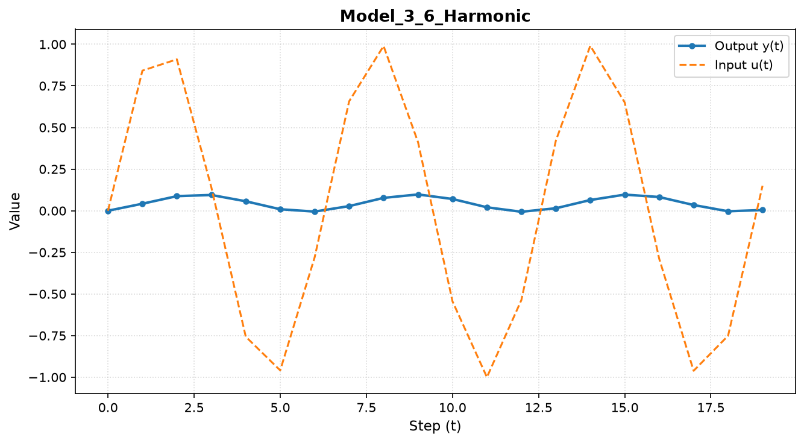

 Министерство образования Республики Беларусь

Учреждение образования

“Брестский Государственный технический университет”

Кафедра ИИТ

       

Лабораторная работа №1

По дисциплине “теория и методы автоматического управления”

Тема: “Моделирование контролируемых объектов”

     

Выполнил:

Студент 3 курса

Группы АС-68

Пошвенчук Г. В.

Проверил:

Дворанинович Д. А.

     

Брест 2026

---

## Математические уравнения моделей (Вариант 2)
1. **Линейная модель (Model 1.2 - System with Pure Control Delay k) :**
   $$Y_{\tau+1} = a Y_{\tau} + b u_{\tau-k}$$
2. **Нелинейная модель (Model 2.4 - Logarithmic Multi-Variable Interaction):**
   $$Y_{\tau+1} = a Y_{\tau} \cdot \cos(Y_{\tau}) + b \ln(1 + |u_{\tau}|)$$
3. **Дифференциальное уравнение (Model 3.6 - Cubic Growth and Control):**
   $$\frac{dy}{dt} = a y^3 + b u$$
   Численное решение методом Эйлера: $y_{\tau+1} = y_\tau + \Delta t \cdot (a y_\tau^3 + b u_\tau)$

 
## Архитектура классов (UML-диаграмма)

## Результаты моделирования и визуализация
Для каждой из трёх моделей выполняется симуляция при ступенчатом, импульсном и гармоническом воздействиях, а полученные данные автоматически экспортируются в `.csv` файлы.

### Графики переходных процессов (Python/Matplotlib)
На основании табличных данных симуляции средствами библиотеки Matplotlib построены графики переходных процессов объектов управления:

  
  
  

  
  
  

  
  
  

