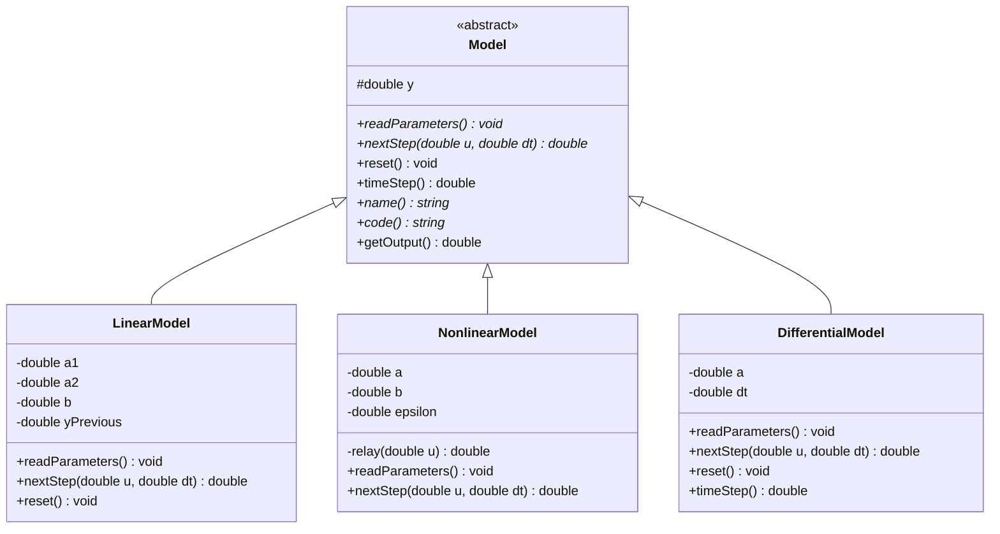
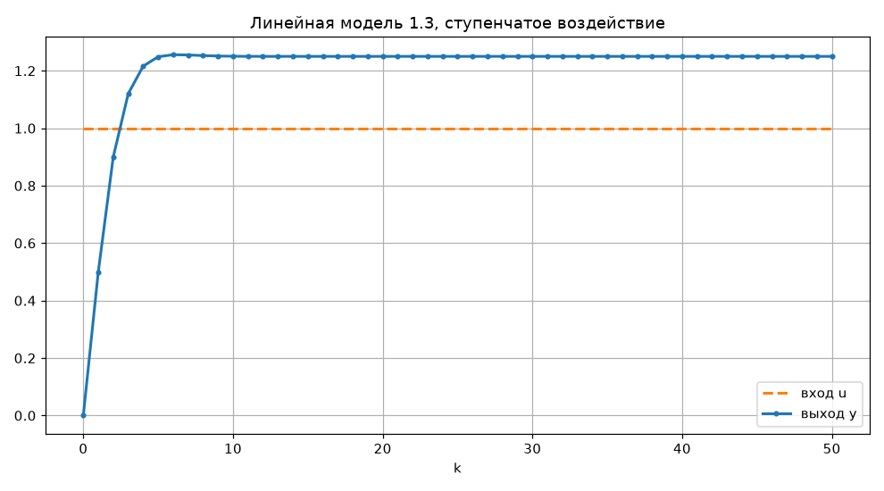
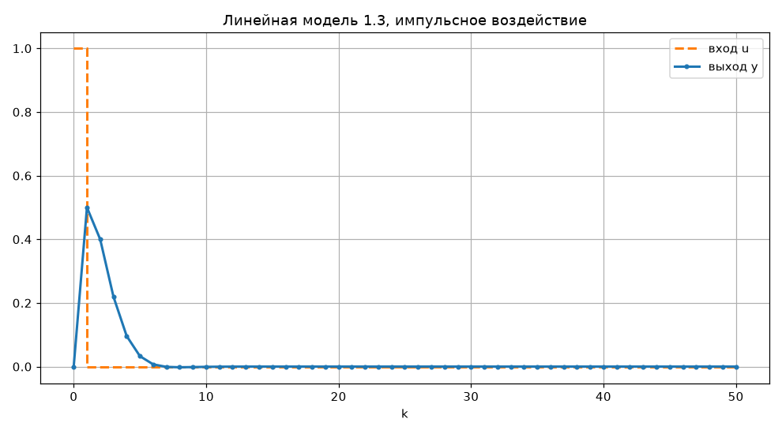
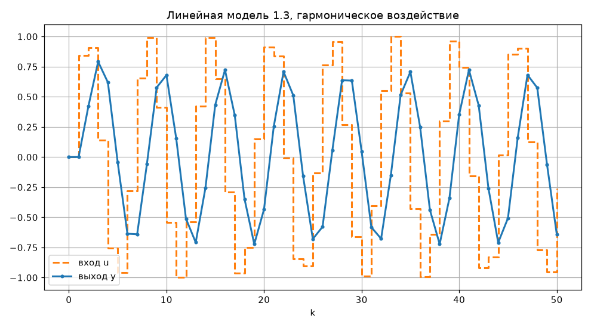
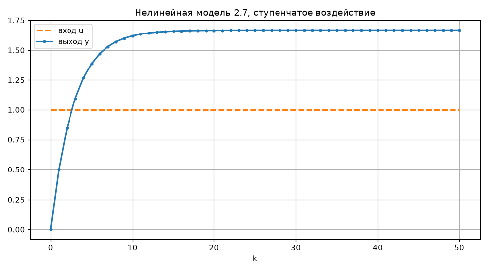
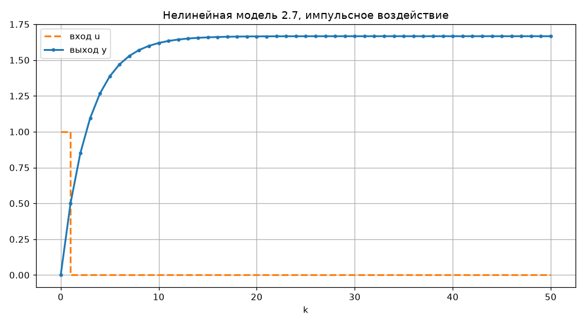
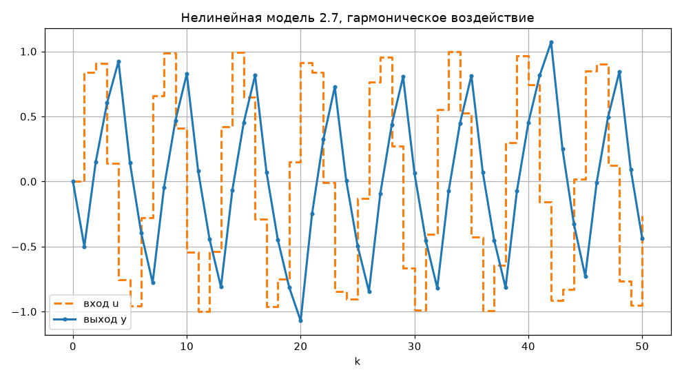
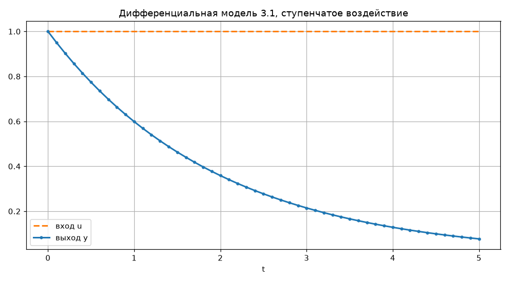
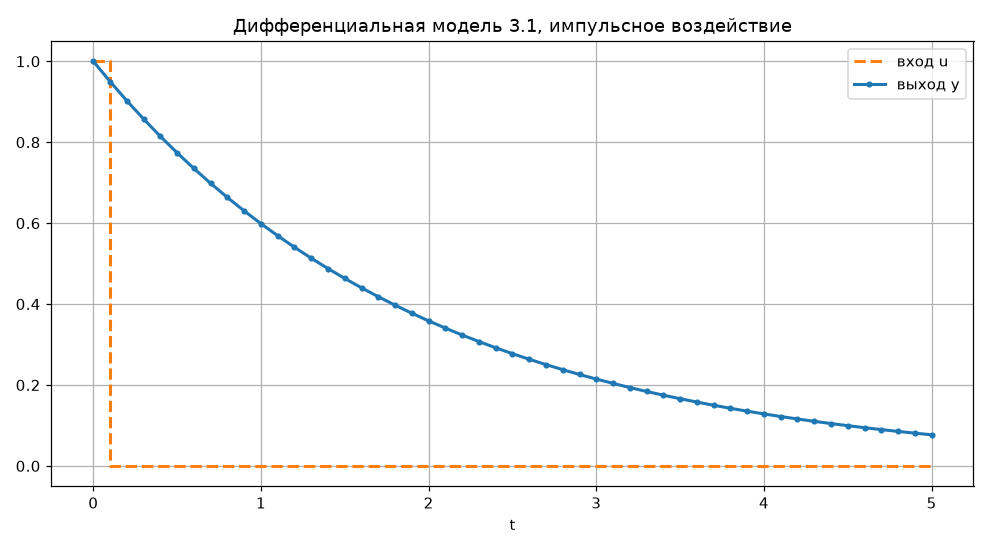
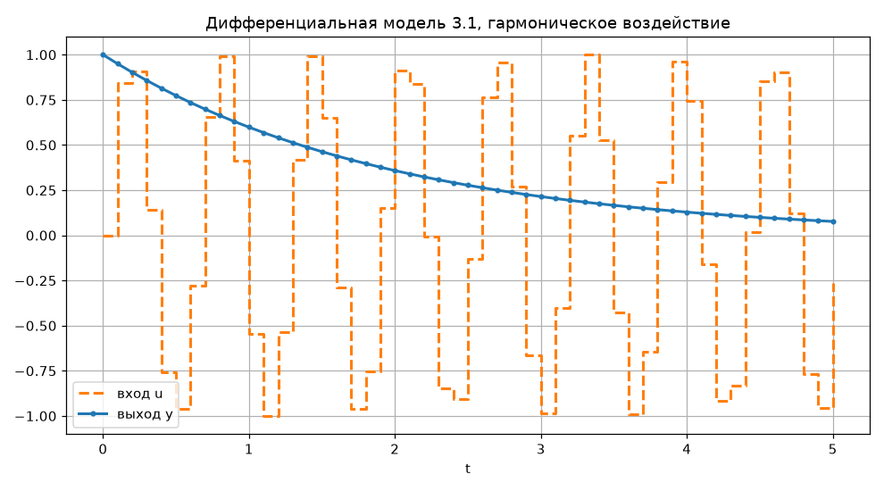

<p align="center">Министерство образования Республики Беларусь</p>
<p align="center">Учреждение образования</p>
<p align="center">«Брестский государственный технический университет»</p>
<p align="center">Кафедра ИИТ</p>
<br><br><br><br><br><br><br>
<p align="center">Лабораторная работа №1</p>
<p align="center">По дисциплине «Теория и моделирование автоматического управления»</p>
<p align="center">Тема: «Моделирование объектов управления»</p>
<br><br><br><br><br>
<p align="right">Выполнил:</p>
<p align="right">Студент 3 курса</p>
<p align="right">Группы АС-68</p>
<p align="right">Пух К. В.</p>
<p align="right">Проверил:</p>
<p align="right">Дворанинович Д. А.</p>
<br><br><br><br><br>
<p align="center">Брест 2026</p>

## Вариант 13

- Линейная модель: **Model 1.3**
- Нелинейная модель: **Model 2.7**
- Дифференциальное уравнение: **Model 3.1**

## Реализованные модели

### Model 1.3 (Second-Order Oscillatory/Inertial System)
$$y_{\tau+1} = a_1 y_{\tau} + a_2 y_{\tau-1} + b u_{\tau}$$

Параметры по умолчанию: $a_1 = 0.8$, $a_2 = -0.2$, $b = 0.5$, начальные условия $y_0 = y_{-1} = 0$

### Model 2.7 (Relay with Hysteresis Element)
$$y_{\tau+1} = a y_{\tau} + b \cdot \text{relay}(u_{\tau}, y_{\tau})$$

$$
\text{relay}(u,y)=\begin{cases}
1, & u>\varepsilon\ \text{или}\ (u\ge-\varepsilon\ \text{и}\ y>0)\\
-1, & u<-\varepsilon\ \text{или}\ (u\le\varepsilon\ \text{и}\ y\le0)
\end{cases}
$$

Параметры по умолчанию: $a = 0.7$, $b = 0.5$, $\varepsilon = 0.2$, начальное условие $y_0 = 0$

### Model 3.1 (Pure Linear Decay)
$$\frac{dy}{dt} = -a y \implies y_{\tau+1} = y_{\tau} - \Delta t \cdot a \cdot y_{\tau}$$

Параметры по умолчанию: $a = 0.5$, $\Delta t = 0.1$, начальное условие $y_0 = 1$

Коэффициенты всех моделей вводятся пользователем при запуске, в скобках показано значение по умолчанию (оно подставляется, если нажать Enter).

## Входные воздействия

1. Ступенчатое: $u_{\tau} = 1$
2. Импульсное: $u_0 = 1, u_{\tau > 0} = 0$
3. Гармоническое: $u_{\tau} = \sin(\tau)$

## ООП архитектура

Создан абстрактный базовый класс `Model`. В нём объявлены:
- `readParameters()` - чисто виртуальный метод, каждая модель сама запрашивает свои коэффициенты;
- `nextStep()` - чисто виртуальный метод расчёта следующего шага;
- `reset()` - сброс начальных условий;
- `timeStep()` - шаг по времени (для дискретных моделей 1, для дифференциальной - введённый `dt`);
- `name()` и `code()` - название модели для меню и её номер для имени файла;
- `getOutput()` - текущее значение выхода.

От базового класса наследуются:
- `LinearModel` - модель 1.3
- `NonlinearModel` - модель 2.7
- `DifferentialModel` - модель 3.1

Объекты всех моделей хранятся в `vector<unique_ptr<Model>>`, меню строится по этому вектору, а функция `simulate()` принимает ссылку на `Model`. Поэтому для всех трёх моделей используется один и тот же код, а конкретный расчёт выбирается через виртуальные методы.

Ввод чисел с проверкой вынесен в отдельный файл `Input.h`.

### UML диаграмма классов



## Работа программы

1. Пользователь вводит количество шагов $n$, выбирает модель и вводит её коэффициенты, затем выбирает входное воздействие.
2. Программа на C++ выполняет расчёт и сохраняет результат в файл `result_<модель>_<воздействие>.csv` (например, `result_1.3_step.csv`) со столбцами `k;t;u;y`.
3. После расчёта программа сама запускает скрипт `plot.py`. Он выводит таблицу в консоль и открывает окно с графиком, на котором показаны входное воздействие и выход модели. График сохраняется в папку `doc/images`.
4. Затем программа спрашивает, нужен ли ещё расчёт.

Пример таблицы (модель 1.3, ступенчатое воздействие):

```text
    k        t       u(k)         y(k)
    0     0.00     1.0000      0.00000
    1     1.00     1.0000      0.50000
    2     2.00     1.0000      0.90000
    3     3.00     1.0000      1.12000
    4     4.00     1.0000      1.21600
    5     5.00     1.0000      1.24880
    6     6.00     1.0000      1.25584
    7     7.00     1.0000      1.25491
```

## Результаты моделирования

Количество шагов $n = 50$, коэффициенты указаны в разделе с моделями.

### 1. Линейная модель (Model 1.3)

#### 1.1 Ступенчатое воздействие


Выход выходит на установившееся значение $\frac{0.5}{1 - 0.8 + 0.2} = 1.25$ с небольшим перерегулированием (1.256 на 6-м шаге).

#### 1.2 Импульсное воздействие


После импульса выход поднимается до 0.5 и затухает до нуля примерно за 8 шагов.

#### 1.3 Гармоническое воздействие


Выход колеблется с тем же периодом, что и вход, но с меньшей амплитудой (около 0.7) и с запаздыванием.

---

### 2. Нелинейная модель (Model 2.7)

#### 2.1 Ступенчатое воздействие


Реле выдаёт +1, выход стремится к $\frac{0.5}{1 - 0.7} \approx 1.667$.

#### 2.2 Импульсное воздействие


После импульса $u = 0$ попадает в зону гистерезиса, а $y > 0$, поэтому реле остаётся в состоянии +1 и график совпадает со ступенчатым.

#### 2.3 Гармоническое воздействие


На нулевом шаге $u = 0$ и $y = 0$, поэтому реле выдаёт -1 и выход сначала уходит в минус. Дальше реле переключается каждый раз, когда синус выходит за пределы $\pm\varepsilon$, и выход колеблется примерно от -1 до 1.

---

### 3. Дифференциальная модель (Model 3.1)

#### 3.1 Ступенчатое воздействие


#### 3.2 Импульсное воздействие


#### 3.3 Гармоническое воздействие


Во всех трёх случаях график одинаковый, так как $u$ не входит в уравнение. Выход затухает по экспоненте: по методу Эйлера при $t = 5$ получилось 0.0769, точное решение $e^{-0.5 \cdot 5} \approx 0.0821$.

## Сборка и запуск

Для запуска нужны CMake, компилятор C++ (Visual Studio) и Python с библиотекой matplotlib.

Сборка и запуск выполняются файлом `build.bat` из папки `src`. Он показывает в консоли все этапы: конфигурацию проекта через CMake, сборку и запуск программы `TMAU_Lab1.exe`.

```powershell
.\build.bat
```

## Вывод

Реализованы три модели по варианту 13 в виде наследников абстрактного класса `Model`. Программа позволяет выбрать модель и входное воздействие, задать коэффициенты и количество шагов. Расчёт выполняется на C++, а таблица и графики выводятся скриптом на Python. Линейная модель устойчива и выходит на значение 1.25, нелинейная модель показывает эффект гистерезиса, решение дифференциального уравнения методом Эйлера близко к точному.
