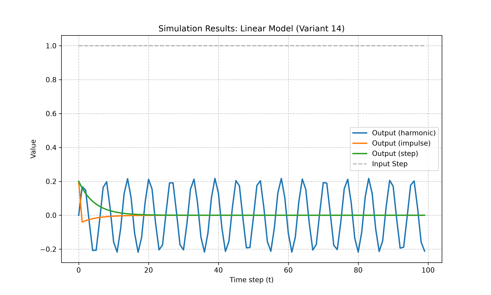
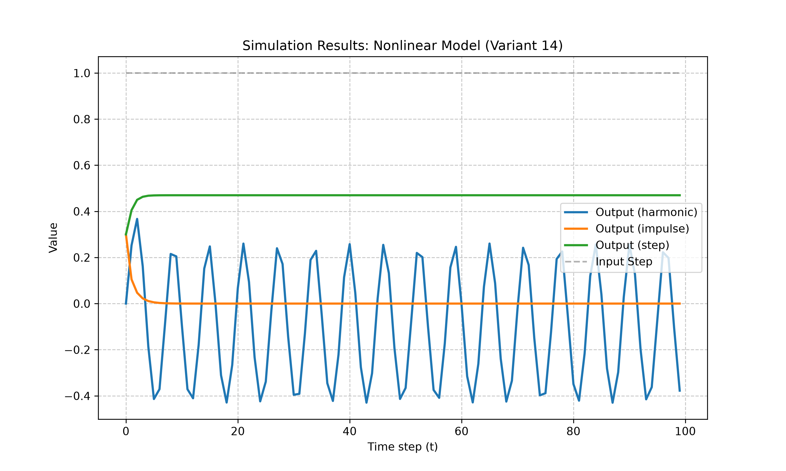
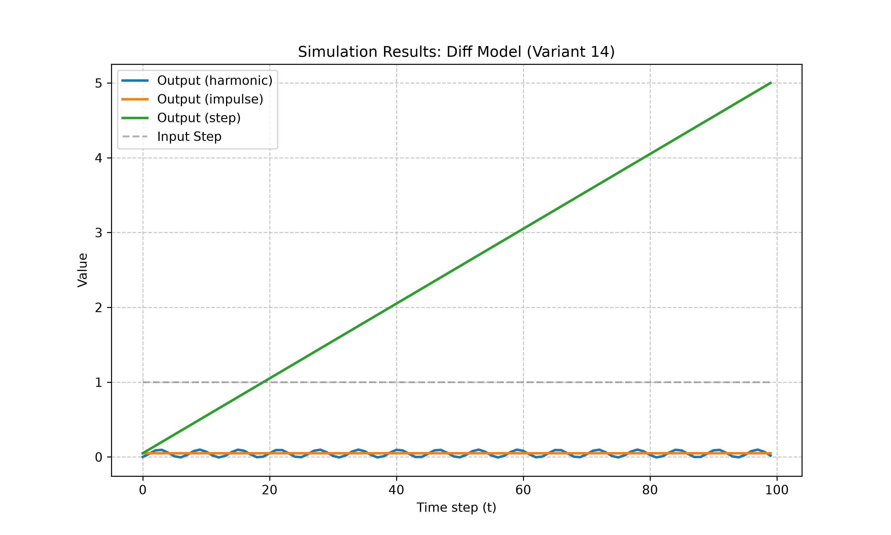

<p align="center">Министерство образования Республики Беларусь</p>
<p align="center">Учреждение образования</p>
<p align="center">“Брестский Государственный технический университет”</p>
<p align="center">Кафедра ИИТ</p>
<br><br><br><br><br><br><br>
<p align="center">Лабораторная работа №1</p>
<p align="center">По дисциплине “Теория и моделирование автоматического управления”</p>
<p align="center">Тема: “Моделирование объектов управления”</p>
<br><br><br><br><br>
<p align="right">Выполнил:</p>
<p align="right">Студент 3 курса</p>
<p align="right">Группы АС-68</p>
<p align="right">Ребенков А. Д.</p>
<p align="right">Проверил:</p>
<p align="right">Дворанинович Д. А.</p>
<br><br><br><br><br>
<p align="center">Брест 2026</p>

## Вариант 14

- Линейная модель: **Model 1.4**
- Нелинейная модель: **Model 2.8**
- Дифференциальное уравнение: **Model 3.2**

## Реализованные модели

### Model 1.4 (Discrete Integrator with Loss)
$$y_{\tau+1} = a y_{\tau} + b (u_{\tau} - u_{\tau-1})$$

Параметры: $a = 0.8$, $b = 0.2$

### Model 2.8 (Chaotic Logistic Map Disturbance)
$$y_{\tau+1} = a y_{\tau}(1 - y_{\tau}) + b u_{\tau} + c \sin(y_{\tau-1} \cdot u_{\tau})$$

Параметры: $a = 0.5$, $b = 0.3$, $c = 0.1$

### Model 3.2 (Pure Constant Input Drive)
$$\frac{dy}{dt} = b \cdot u \implies y_{\tau+1} = y_{\tau} + \Delta t \cdot b \cdot u_{\tau}$$

Параметры: $b = 0.5$, $\Delta t = 0.1$

## Входные воздействия

1. Ступенчатое (Step): $u_{\tau} = 1$
2. Импульсное (Impulse): $u_0 = 1, u_{\tau > 0} = 0$
3. Гармоническое (Harmonic): $u_{\tau} = \sin(\tau)$

## ООП Архитектура

Создан абстрактный базовый класс `Model` с чистыми виртуальными методами `calculateNext()` и `reset()`, а также виртуальным методом `simulate()`.

От базового класса наследуются:
- `LinearModel1_4`
- `NonlinearModel2_8`
- `DiffModel3_2`

## Результаты моделирования

### 1. Переходные процессы линейной модели (Model 1.4)


### 2. Переходные процессы нелинейной модели (Model 2.8)


### 3. Переходные процессы дифференциальной модели (Model 3.2)


## UML Диаграмма классов

```mermaid
classDiagram
    class Model {
        <<abstract>>
        +calculateNext(double u)* double
        +reset()* void
        +simulate(const vector~double~& inputSignal) vector~double~
    }

    class LinearModel1_4 {
        -double a
        -double b
        -double y_curr
        -double u_prev
        +calculateNext(double u) double
        +reset() void
    }

    class NonlinearModel2_8 {
        -double a
        -double b
        -double c
        -double y_curr
        -double y_prev
        +calculateNext(double u) double
        +reset() void
    }

    class DiffModel3_2 {
        -double b
        -double dt
        -double y_curr
        +calculateNext(double u) double
        +reset() void
    }

    Model <|-- LinearModel1_4
    Model <|-- NonlinearModel2_8
    Model <|-- DiffModel3_2