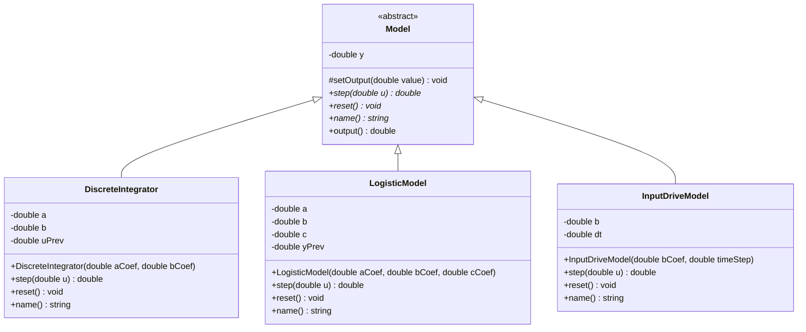
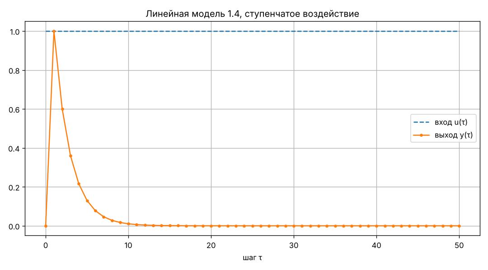
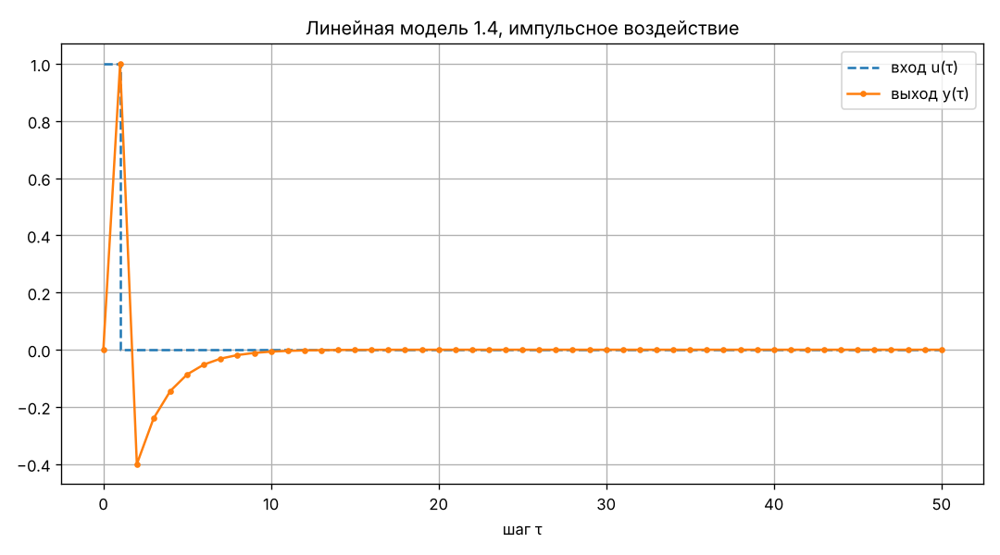
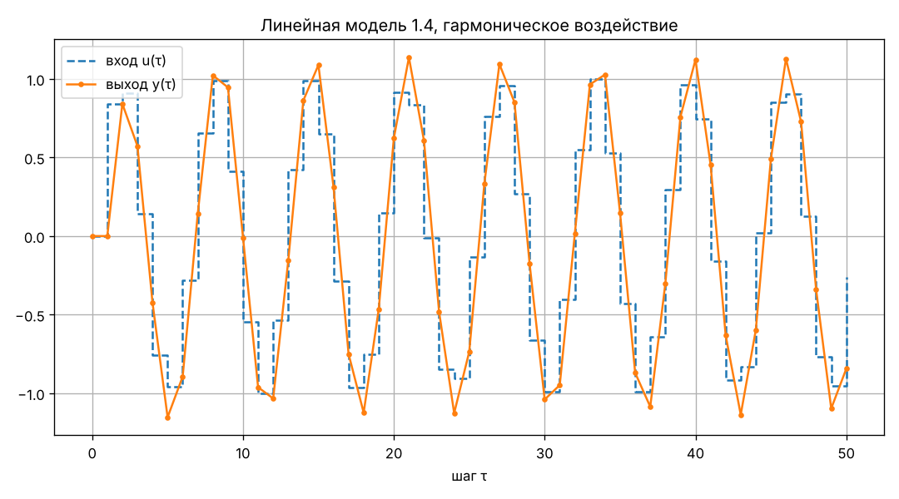
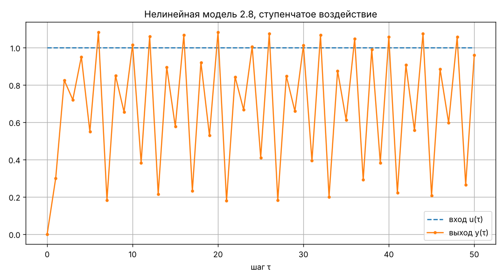
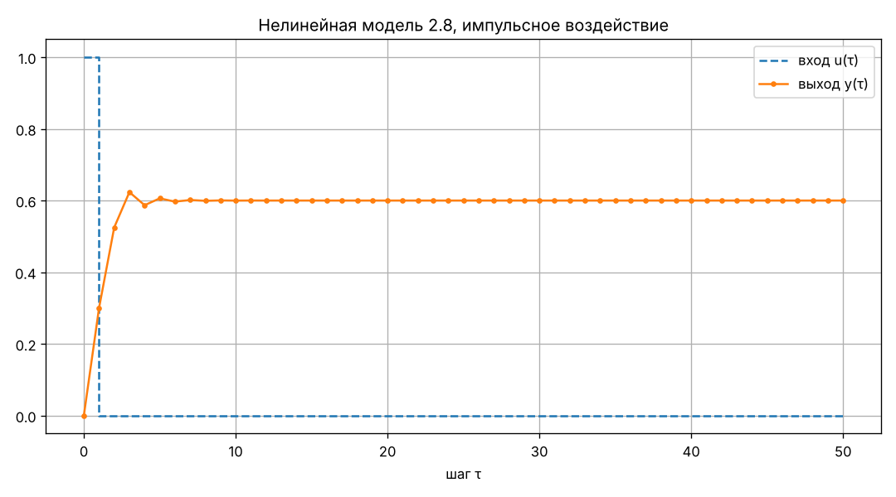
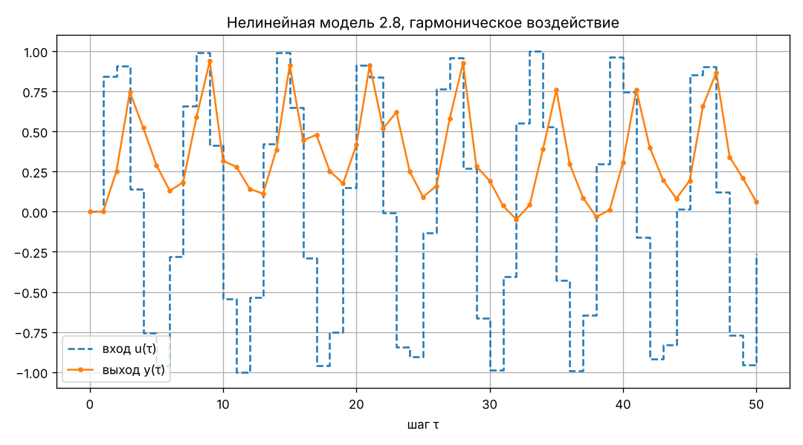
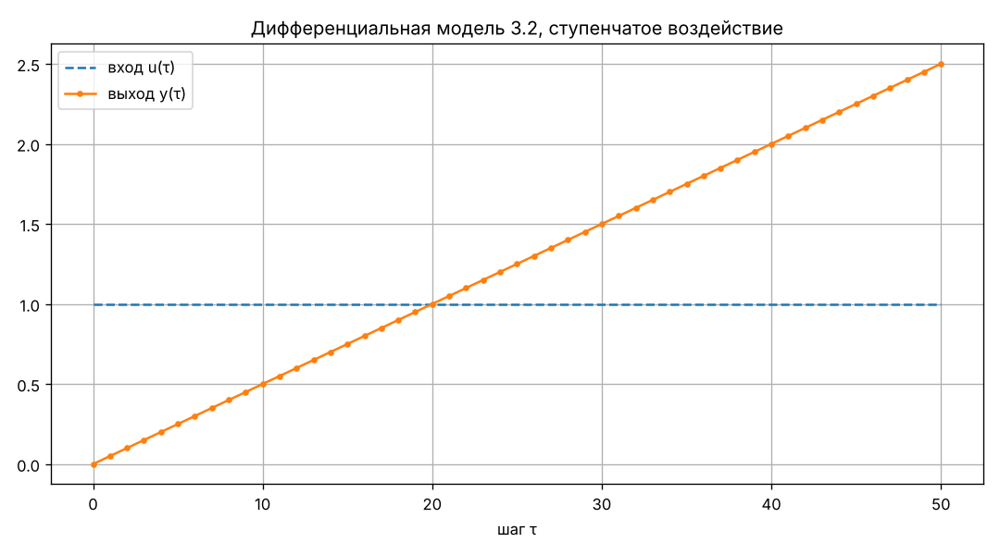
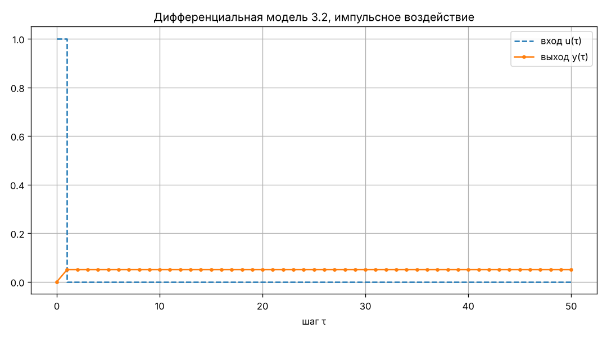
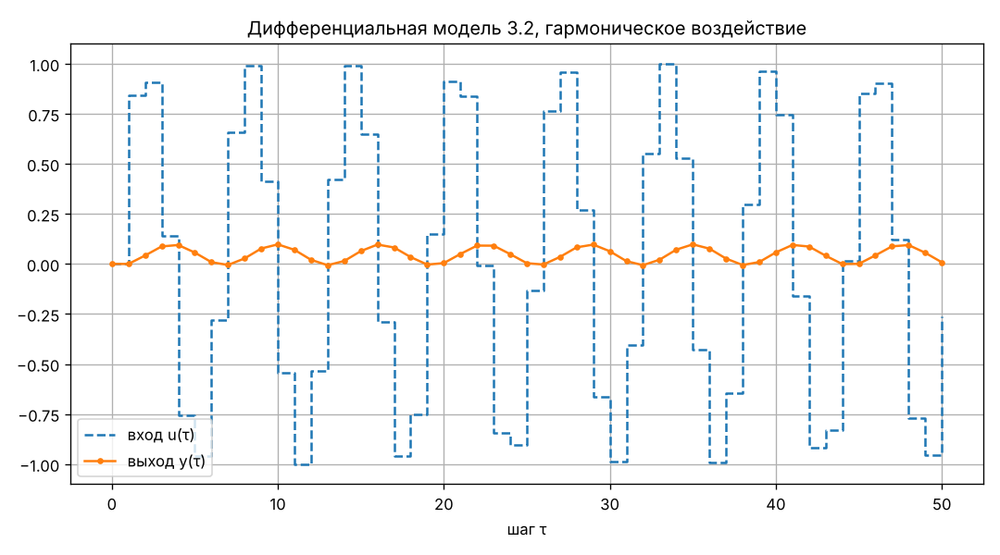

<p align="center">Министерство образования Республики Беларусь</p>
<p align="center">Учреждение образования</p>
<p align="center">«Брестский государственный технический университет»</p>
<p align="center">Кафедра ИИТ</p>
<br><br><br><br><br><br><br>
<p align="center">Лабораторная работа №1</p>
<p align="center">По дисциплине «Теория и моделирование автоматического управления»</p>
<p align="center">Тема: «Моделирование объектов управления»</p>
<br><br><br><br><br>
<p align="right">Выполнил:</p>
<p align="right">Студент 3 курса</p>
<p align="right">Группы АС-68</p>
<p align="right">Сендер К. О.</p>
<p align="right">Проверил:</p>
<p align="right">Дворанинович Д. А.</p>
<br><br><br><br><br>
<p align="center">Брест 2026</p>

---

## 1. Цель работы

Научиться строить программные модели объектов управления на C++ с использованием ООП и исследовать их реакцию на типовые входные воздействия.

## 2. Задание по варианту 14

| Блок | Модель | Уравнение |
|---|---|---|
| Линейная | 1.4 — Discrete Integrator with Loss | $y_{\tau+1} = a\,y_\tau + b\,(u_\tau - u_{\tau-1})$ |
| Нелинейная | 2.8 — Chaotic Logistic Map Disturbance | $y_{\tau+1} = a\,y_\tau(1 - y_\tau) + b\,u_\tau + c\,\sin(y_{\tau-1}\,u_\tau)$ |
| Дифференциальная | 3.2 — Pure Constant Input Drive | $\dfrac{dy}{dt} = b\,u$ |

Уравнение 3.2 решается явным методом Эйлера:

$$
y_{\tau+1} = y_\tau + \Delta t \cdot b\,u_\tau
$$

Коэффициенты вводятся при запуске программы. Если нажать Enter, подставляется значение по умолчанию; с ними получены все результаты в отчёте:

| Модель | Коэффициенты | Начальные условия |
|---|---|---|
| 1.4 | $a = 0.6$, $b = 1$ | $y_0 = 0$, $u_{-1} = 0$ |
| 2.8 | $a = 2.5$, $b = 0.3$, $c = 0.2$ | $y_0 = 0$, $y_{-1} = 0$ |
| 3.2 | $b = 0.5$, $\Delta t = 0.1$ | $y_0 = 0$ |

## 3. Входные воздействия

- ступенчатое: $u_\tau = 1$;
- импульсное: $u_0 = 1$, $u_\tau = 0$ при $\tau > 0$;
- гармоническое: $u_\tau = \sin(\tau)$.

## 4. Описание программы

### 4.1. Классы

Базовый класс `Model` абстрактный: в нём объявлены чисто виртуальные методы `step(u)` (расчёт следующего значения выхода), `reset()` (возврат к начальным условиям) и `name()`. Текущий выход хранится в закрытом поле `y`: прочитать его можно методом `output()`, а наследники меняют его только через защищённый метод `setOutput()`.

| Класс | Модель | Что хранит кроме коэффициентов |
|---|---|---|
| `DiscreteIntegrator` | 1.4 | предыдущее значение входа `uPrev` |
| `LogisticModel` | 2.8 | предыдущее значение выхода `yPrev` |
| `InputDriveModel` | 3.2 | шаг интегрирования `dt` |

Функция `createModel()` создаёт объект нужного класса и возвращает его как `std::unique_ptr<Model>`, а функция `simulate()` получает ссылку на `Model`. Поэтому цикл моделирования один для всех моделей, а какая формула считается, определяется виртуальным методом `step()`.



### 4.2. Порядок работы

1. Пользователь выбирает модель (0 — выход), вводит её коэффициенты, выбирает воздействие и количество шагов $n$.
2. Программа на C++ считает $n$ шагов и записывает результат в файл `model_<модель>_signal_<воздействие>.csv` со столбцами `tau,u,y`.
3. Затем программа запускает `plot.py`. Скрипт печатает таблицу результатов, открывает окно с графиком и сохраняет его в `doc/images`.
4. После закрытия графика снова появляется меню.

Начало работы программы:

```text
Выберите модель:
  1 - линейная модель 1.4:          y(t+1) = a*y(t) + b*(u(t) - u(t-1))
  2 - нелинейная модель 2.8:        y(t+1) = a*y(t)*(1 - y(t)) + b*u(t) + c*sin(y(t-1)*u(t))
  3 - дифференциальная модель 3.2:  dy/dt = b*u
  0 - выход
Ваш выбор: 1

Параметры модели (Enter - значение по умолчанию):
  a [0.6]:
  b [1]:
```

Таблица, которую выводит `plot.py` (модель 2.8, импульсное воздействие):

```text
   шаг |       u(τ) |         y(τ)
----------------------------------
     0 |     1.0000 |      0.00000
     1 |     0.0000 |      0.30000
     2 |     0.0000 |      0.52500
     3 |     0.0000 |      0.62344
     4 |     0.0000 |      0.58691
     5 |     0.0000 |      0.60612
     6 |     0.0000 |      0.59685
     7 |     0.0000 |      0.60155
```

### 4.3. Файлы проекта

| Файл | Назначение |
|---|---|
| `Model.h` | абстрактный класс `Model` |
| `DiscreteIntegrator.h` | модель 1.4 |
| `LogisticModel.h` | модель 2.8 |
| `InputDriveModel.h` | модель 3.2 |
| `main.cpp` | меню, ввод данных, входные сигналы, расчёт и запись CSV |
| `plot.py` | таблица и график (Python, matplotlib) |
| `CMakeLists.txt`, `build.bat` | сборка и запуск |

## 5. Результаты моделирования

Во всех расчётах $n = 50$, коэффициенты по умолчанию.

### 5.1. Модель 1.4



**Ступенчатое воздействие.** Модель реагирует не на сам вход, а на его изменение $u_\tau - u_{\tau-1}$. Ступенька меняется один раз, при $\tau = 0$, поэтому на выходе получается один всплеск до $b = 1$, который затем затухает в $a = 0.6$ раза за шаг. Через 10 шагов выход меньше 0.01, установившееся значение равно 0.



**Импульсное воздействие.** Вход меняется дважды: с 0 на 1 и обратно, поэтому выход сначала равен $+1$, а на следующем шаге $y_2 = 0.6 \cdot 1 + 1 \cdot (0 - 1) = -0.4$. Дальше отрицательный выброс затухает.



**Гармоническое воздействие.** Выход тоже синусоида, немного опережающая вход по фазе. Это характерно для дифференцирующего звена. Амплитуда выхода около 1.14, что совпадает с расчётом по передаточной функции $W(z) = \dfrac{b\,(1 - z^{-1})}{1 - a z^{-1}}$ при частоте 1 рад/шаг: $|W| = \dfrac{2\sin 0.5}{\sqrt{1 - 1.2\cos 1 + 0.36}} \approx 1.14$.

### 5.2. Модель 2.8



**Ступенчатое воздействие.** Установившегося значения нет: выход нерегулярно колеблется примерно от 0.18 до 1.08. Неподвижная точка отображения около $y^* \approx 0.82$, но производная $a(1 - 2y^*) \approx -1.6$ по модулю больше 1, поэтому точка неустойчива и процесс не сходится.



**Импульсное воздействие.** После первого шага $u = 0$, и остаётся обычное логистическое отображение $y_{\tau+1} = 2.5\,y_\tau(1 - y_\tau)$. Его неподвижная точка $1 - 1/a = 0.6$ устойчива ($|2 - a| = 0.5 < 1$), поэтому выход после нескольких колебаний выходит на 0.6.



**Гармоническое воздействие.** Выход меняется нерегулярно, почти всё время остаётся положительным (от −0.05 до 0.94). Всплески совпадают с положительными полуволнами синуса.

### 5.3. Модель 3.2



**Ступенчатое воздействие.** Модель — интегратор: при постоянном входе выход растёт линейно на $b \cdot \Delta t = 0.05$ за шаг и при $t = 5$ доходит до 2.5. Точное решение $y = b\,t$ даёт то же значение: при постоянной правой части метод Эйлера не даёт погрешности.



**Импульсное воздействие.** Интегратор «запоминает» импульс: после первого шага выход равен 0.05 и дальше не меняется, так как вход нулевой.



**Гармоническое воздействие.** Выход — накопленная сумма $0.05\sin\tau$, он колеблется в пределах от −0.006 до 0.098 и не растёт, потому что положительные и отрицательные полуволны компенсируют друг друга.

### 5.4. Проверка вручную

Первые шаги посчитаны вручную и совпали с таблицами программы:
- 1.4, ступенька: $y_1 = 1 \cdot (1 - 0) = 1$, $y_2 = 0.6 \cdot 1 + 1 \cdot (1 - 1) = 0.6$, $y_3 = 0.36$;
- 2.8, импульс: $y_1 = 0.3 \cdot 1 = 0.3$, $y_2 = 2.5 \cdot 0.3 \cdot 0.7 = 0.525$;
- 3.2, ступенька: $y_1 = 0 + 0.1 \cdot 0.5 \cdot 1 = 0.05$, $y_2 = 0.1$.

## 6. Сборка и запуск

Нужны CMake, компилятор C++ (Visual Studio) и Python с matplotlib. Запуск — файл `build.bat` в папке `src`. Он по шагам выполняет конфигурацию CMake, сборку и запускает `task_01.exe`.

```powershell
.\build.bat
```

## 7. Выводы

1. Модели варианта 14 реализованы классами-наследниками абстрактного класса `Model`, работа с ними идёт через общий интерфейс.
2. Модель 1.4 ведёт себя как дифференцирующее звено с затуханием: реагирует только на изменение входа, при постоянном входе выход уходит в 0.
3. Модель 2.8 при постоянном входе не имеет устойчивого состояния и колеблется нерегулярно, а без входа сходится к 0.6.
4. Модель 3.2 — интегратор: накапливает входной сигнал, для неё метод Эйлера даёт точное решение при постоянном входе.
