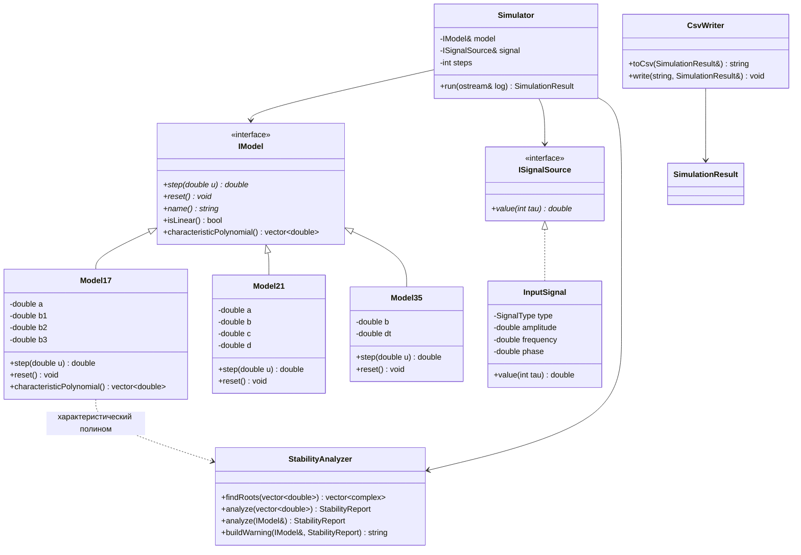

<p align="center">Министерство образования Республики Беларусь</p>
<p align="center">Учреждение образования</p>
<p align="center">“Брестский Государственный технический университет”</p>
<p align="center">Кафедра ИИТ</p>
<br><br><br><br><br><br><br>
<p align="center">Лабораторная работа №2</p>
<p align="center">По дисциплине “Теория и методы автоматического управления”</p>
<p align="center">Тема: “Модульное тестирование и анализ устойчивости”</p>
<br><br><br><br><br>
<p align="right">Выполнил:</p>
<p align="right">Студент 3 курса</p>
<p align="right">Группы АС-68</p>
<p align="right">Хомич М. А.</p>
<p align="right">Проверил:</p>
<p align="right">Дворанинович Д. А.</p>
<br><br><br><br><br>
<p align="center">Брест 2026</p>

## 1. Цель работы

Цель лабораторной работы — расширить математический и функциональный базис
программы, разработанной в лабораторной работе №1, добавить модуль анализа
устойчивости линейных дискретных систем и покрыть основные функции программы
модульными тестами с использованием фреймворка **Google Test** и mock-объектов
**Google Mock**.

## 2. Вариант задания

Вариант **17**:

| Блок | Модель | Уравнение |
| :--- | :--- | :--- |
| Линейная модель | **Model 1.7** | $y_{\tau+1} = a y_{\tau} + b_1 u_{\tau} + b_2 u_{\tau-1} + b_3 u_{\tau-2}$ |
| Нелинейная модель | **Model 2.1** | $y_{\tau+1} = a y_{\tau} - b y_{\tau-1}^2 + c u_{\tau} + d \sin(u_{\tau-1})$ |
| Дифференциальное уравнение | **Model 3.5** | $\dfrac{dy}{dt} = b \sin(u)$, метод Эйлера: $y_{\tau+1} = y_{\tau} + \Delta t \, b \sin(u_{\tau})$ |

## 3. Расширение математического и функционального базиса

По сравнению с лабораторной работой №1 программа была переработана следующим
образом:

1. **Единый интерфейс модели `IModel`.** Кроме метода одного шага `step(u)`,
   добавлены методы `reset()`, `name()`, `isLinear()` и
   `characteristicPolynomial()`. Благодаря этому симулятор и анализатор
   устойчивости работают с любой моделью через общий интерфейс.
2. **Состояние модели хранится внутри класса.** Model 1.7 самостоятельно
   хранит историю входов $u_{\tau-1}, u_{\tau-2}$, Model 2.1 — предыдущие
   значения $y_{\tau-1}$ и $u_{\tau-1}$. Это позволило корректно реализовать
   `reset()` и повторный запуск симуляции.
3. **Расширены входные воздействия.** Сигнал `InputSignal` поддерживает
   амплитуду, частоту и фазу:
   * ступенчатый: $u_{\tau} = A$;
   * импульсный: $u_0 = A$, $u_{\tau>0} = 0$;
   * гармонический: $u_{\tau} = A \sin(\omega \tau + \varphi)$.
4. **Появился результат симуляции `SimulationResult`**, содержащий шаги
   $\{\tau, u, y\}$ и отчёт об устойчивости. Это упростило тестирование:
   тесты проверяют данные, а не консольный вывод.
5. **Добавлен модуль `StabilityAnalyzer`** (см. раздел 4) и класс
   `CsvWriter` для сохранения результатов в CSV.
6. **Добавлен интерфейс `ISignalSource`.** Реальный генератор сигналов и
   mock-объект в тестах реализуют один интерфейс, что позволяет подменять
   входное воздействие без изменения симулятора.

## 4. Анализ устойчивости систем

### 4.1. Аналитический критерий для Model 1.7

Для линейной модели 1.7 однородная часть имеет вид

$$y_{\tau+1} = a y_{\tau}.$$

Характеристическое уравнение на Z-плоскости:

$$z - a = 0 \quad\Longrightarrow\quad z_1 = a.$$

Система устойчива тогда и только тогда, когда корень лежит строго внутри
единичной окружности:

$$|z_1| = |a| < 1.$$

Граничные случаи:

* $|a| < 1$ — процесс затухает, система **устойчива**;
* $|a| = 1$ — система находится **на границе устойчивости** (процесс не
  затухает, поэтому выдаётся предупреждение);
* $|a| > 1$ — процесс расходится, система **неустойчива**.

| Коэффициент $a$ | Корень $z_1$ | $\lvert z_1 \rvert$ | Вывод |
| :---: | :---: | :---: | :--- |
| 0.7 | 0.7 | 0.7 | устойчива |
| 1.0 | 1.0 | 1.0 | граница устойчивости |
| 1.5 | 1.5 | 1.5 | неустойчива |

### 4.2. Универсальный анализатор

Модуль `StabilityAnalyzer` не ограничен первой степенью. Он принимает
коэффициенты произвольного полинома

$$a_0 z^n + a_1 z^{n-1} + \dots + a_n = 0,$$

находит его корни методом **Дюрана — Кернера** и проверяет условие

$$\max_i |z_i| < 1.$$

Дополнительно обрабатываются вырожденные случаи (пустой или нулевой
полином, корни в начале координат, постоянный полином), а для границы
$|z| = 1$ выставляется признак `marginal`.

### 4.3. Предупреждение перед моделированием

`Simulator::run()` перед первым шагом вызывает анализатор. Если модель
линейная и неустойчивая, в консоль выводится предупреждение:

```text
[WARNING] Model 1.7: Система НЕУСТОЙЧИВА: |z| > 1, процесс расходится.
Корни характеристического уравнения: z1 = (1.500000, 0.000000). |z|max = 1.500000.
```

Предупреждение выводится **до** таблицы шагов симуляции. Для нелинейных
моделей 2.1 и 3.5 анализ на Z-плоскости не применяется, о чём программа
сообщает отдельно.

## 5. Архитектура программы



Исходный код расположен в каталоге [`src`](../src), тесты — в каталоге
[`test`](../test).

## 6. Модульное тестирование

### 6.1. Состав тестов

Всего написано **92 теста** (с учётом всех параметризованных наборов).
Все 92 теста проходят успешно.

| Файл тестов | Проверяемые функции и сценарии |
| :--- | :--- |
| `test_input_signal.cpp` | ступенчатый, импульсный и гармонический сигналы; амплитуда, частота, фаза; защитная ветка для неизвестного типа |
| `test_model17.cpp` | ручной расчёт последовательностей для Model 1.7; нулевой вход; `reset()`; начальное состояние; характеристический полином $z-a$ |
| `test_model21.cpp` | ручной расчёт Model 2.1; квадратичная обратная связь; нулевое состояние; `reset()`; отсутствие характеристического полинома |
| `test_model35.cpp` | шаг Эйлера; сравнение с аналитическим решением при постоянном входе; `reset()`; нулевой вход |
| `test_stability_analyzer.cpp` | критерий $\lvert z \rvert < 1$; граница $\lvert z \rvert = 1$; комплексные и кратные корни; произвольные полиномы; вырожденные случаи; текст предупреждения |
| `test_simulator.cpp` | mock-объект `MockSignalSource`; количество и нумерация шагов; предупреждение для неустойчивой модели; сброс модели; все три режима управления |
| `test_csv_writer.cpp` | формат CSV, заголовок, пустой результат, запись/чтение файла, ошибка открытия файла |

### 6.2. Параметризованные тесты (`TEST_P`)

Архитектурное требование выполнено: расчёт шагов симуляции проверяется
параметризованными тестами. Наборы параметров заданы для:

* последовательностей Model 1.7 при различных коэффициентах и входах;
* последовательностей Model 2.1;
* шага Эйлера Model 3.5 при различных $b$, $\Delta t$ и $u$;
* критерия устойчивости при значениях $a$ внутри, на границе и вне
  единичной окружности;
* корней полиномов различных степеней;
* трёх режимов управления (ступенчатый, импульсный, гармонический).

Пример параметризованного теста:

```cpp
class Model17SequenceTest
    : public ::testing::TestWithParam<Model17Case> {};

TEST_P(Model17SequenceTest, MatchesHandCalculatedSequence) {
    const Model17Case& testCase = GetParam();
    Model17 model(testCase.a, testCase.b1,
                  testCase.b2, testCase.b3);

    for (std::size_t i = 0; i < testCase.inputs.size(); ++i) {
        EXPECT_NEAR(model.step(testCase.inputs[i]),
                    testCase.expected[i], 1e-12);
    }
}
```

### 6.3. Mock-объекты Google Mock

Для проверки взаимодействия симулятора с источником сигнала создан
`MockSignalSource`:

```cpp
class MockSignalSource : public ISignalSource {
public:
    MOCK_METHOD(double, value, (int tau), (const, override));
};
```

Тест `SimulatorTest.UsesMockSignalSourceToDriveModel` задаёт ожидаемую
последовательность вызовов `value(0)`, `value(1)`, `value(2)` и проверяет,
что симулятор использует именно эти значения. Дополнительно режимы
управления проверяются реальным `InputSignal` в параметризованном тесте
`SimulatorModeTest`.

### 6.4. Граничные значения и инварианты

Проверены:

* граница устойчивости $|z| = 1$: для $a = 1$ и $a = -1$ анализатор
  возвращает `stable == false`, `marginal == true`;
* неустойчивые значения $|a| > 1$ и устойчивые $|a| < 1$;
* нулевой вход и нулевое начальное состояние: все модели остаются в покое;
* корректность шага Эйлера: результат сравнивается с аналитическим
  решением $y(t) = y_0 + \Delta t \, b \sin(u) \, t$ при постоянном $u$;
* сброс состояния `reset()` и повторный запуск симуляции.

## 7. Сборка и запуск

Сборка выполняется через CMake. Для запуска тестов и формирования отчётов
используется командный файл [`run_tests.bat`](../run_tests.bat):

```bat
run_tests.bat
```

Скрипт автоматически:

1. создаёт каталог `build`;
2. определяет доступный компилятор (MinGW или Visual Studio);
3. собирает приложение `task02_app` и тесты `task02_tests`;
4. запускает Google Test через `ctest`;
5. сохраняет текстовый отчёт `build\test_report.txt` и JUnit-отчёт
   `build\test_report.xml`;
6. при сборке через MinGW и наличии `gcovr` формирует
   `build\coverage_report.txt` и `build\coverage.html`.

Ручная сборка:

```bat
cmake -S . -B build -DENABLE_COVERAGE=ON
cmake --build build --config Debug
ctest --test-dir build -C Debug --output-on-failure
gcovr -r . --filter "src/.*" --exclude "src/main.cpp"
```

Приложение `task02_app` запрашивает количество шагов, тип сигнала и
(опционально) коэффициенты моделей, выводит таблицу значений и сохраняет
результаты в `model17.csv`, `model21.csv`, `model35.csv`.

## 8. Тестовое покрытие и результаты

* **Способ запуска:** локальный скрипт `run_tests.bat`
* **Инструмент покрытия:** `gcovr` (GCC, флаги `--coverage`)
* **Всего модульных тестов:** 92
* **Успешно пройденных тестов:** 92 / 92 (100 %)
* **Покрытие строк:** 99.2 %
* **Покрытие функций:** 100 %

| Модуль / Класс | Покрытие строк (Line Coverage) | Покрытие функций (Func Coverage) | Статус |
| :--- | :---: | :---: | :---: |
| `Model17.cpp` | 100 % | 100 % | OK |
| `Model21.cpp` | 100 % | 100 % | OK |
| `Model35.cpp` | 100 % | 100 % | OK |
| `InputSignal.cpp` | 100 % | 100 % | OK |
| `StabilityAnalyzer.cpp` | 99.1 % | 100 % | OK |
| `Simulator.cpp` | 95.2 % | 100 % | OK |
| `CsvWriter.cpp` | 100 % | 100 % | OK |
| `IModel.h`, `InputSignal.h`, `ISignalSource.h` | 100 % | 100 % | OK |
| **Итоговый результат** | **99.2 %** | **100 %** | **Success** |

> **Примечание.** `main.cpp` исключён из расчёта покрытия как точка входа
> приложения: его диалоговый ввод не относится к модульной логике. Две
> непокрытые строки (`StabilityAnalyzer.cpp`, защита от нулевого
> знаменателя в методе Дюрана — Кернера, и закрывающая фигурная скобка
> `Simulator::run`) являются защитными/служебными и не влияют на
> математическую логику.

## 9. Вывод

В ходе лабораторной работы программа была расширена: добавлены общий
интерфейс модели, настраиваемые входные сигналы, модуль анализа устойчивости
по корням характеристического уравнения на Z-плоскости и сохранение
результатов в CSV. Для основных функций программы и анализатора устойчивости
написано 92 модульных теста на Google Test, включая параметризованные тесты
`TEST_P`, mock-объект Google Mock, проверки граничных значений и инвариантов.
Все тесты проходят, покрытие строк составляет 99.2 %, покрытие функций —
100 %. Локальная автоматизация сборки, тестирования и формирования отчётов
выполняется скриптом `run_tests.bat`.
