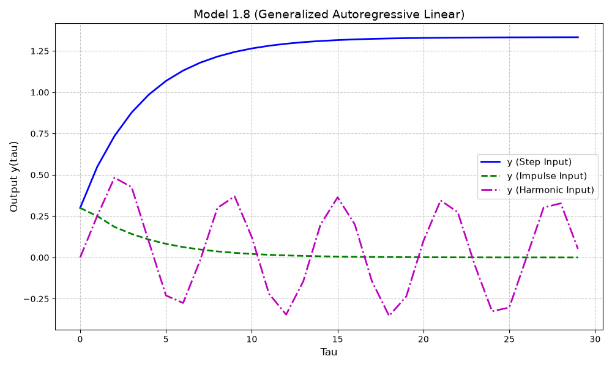
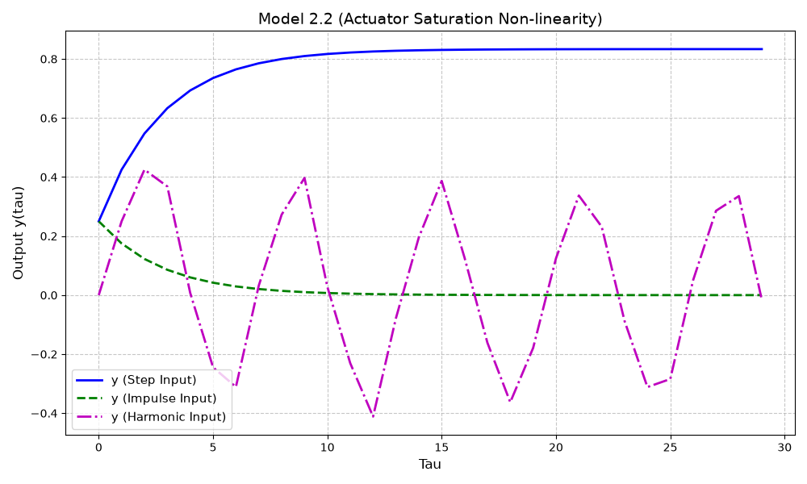
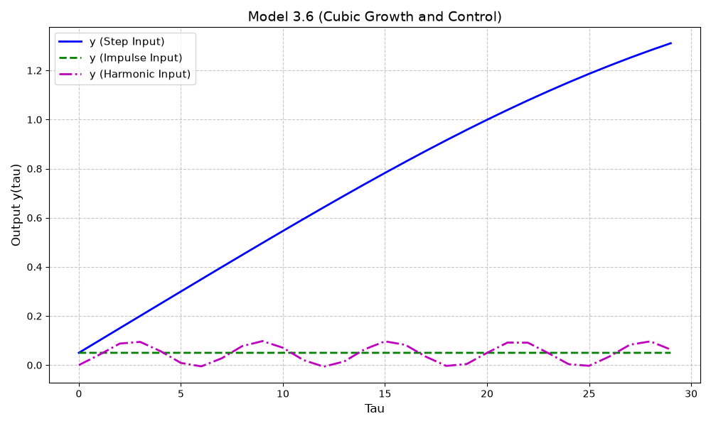

<p align="center">Министерство образования Республики Беларусь</p>
<p align="center">Учреждение образования</p>
<p align="center">“Брестский Государственный технический университет”</p>
<p align="center">Кафедра ИИТ</p>
<br><br><br><br><br><br><br>
<p align="center">Лабораторная работа №1</p>
<p align="center">По дисциплине “Теория и моделирование автоматического управления”</p>
<p align="center">Тема: “Моделирование объектов управления”</p>
<br><br><br><br><br>
<p align="right">Выполнил:</p>
<p align="right">Студент 3 курса</p>
<p align="right">Группы АС-68</p>
<p align="right">Хотько И.А.</p>
<p align="right">Проверил:</p>
<p align="right">Дворанинович Д. А.</p>
<br><br><br><br><br>
<p align="center">Брест 2026</p>

## Вариант 18

- Линейная модель: **Model 1.8**
- Нелинейная модель: **Model 2.2**
- Дифференциальное уравнение: **Model 3.6**

## Реализованные модели

### Model 1.8 (Generalized Autoregressive Linear Model)
$$y_{\tau+1} = a_1 y_{\tau} + a_2 y_{\tau-1} + b_1 u_{\tau} + b_2 u_{\tau-1}$$

Параметры: $a_1 = 0.5$, $a_2 = 0.2$, $b_1 = 0.3$, $b_2 = 0.1$

### Model 2.2 (Actuator Saturation Non-linearity)
$$y_{\tau+1} = a y_{\tau} + b \cdot \text{sat}(u_{\tau})$$

Параметры: $a = 0.7$, $b = 0.5$, $u_{min} = -0.5$, $u_{max} = 0.5$

### Model 3.6 (Cubic Growth and Control)
$$\frac{dy}{dt} = a y^3 + b u \implies y_{\tau+1} = y_{\tau} + (a y_{\tau}^3 + b u_{\tau}) \cdot \Delta t$$

Параметры: $a = -0.1$, $b = 0.5$, $\Delta t = 0.1$

## Входные воздействия

1. Ступенчатое (Step): $u_{\tau} = 1$
2. Импульсное (Impulse): $u_0 = 1, u_{\tau > 0} = 0$
3. Гармоническое (Harmonic): $u_{\tau} = \sin(\tau)$

## ООП Архитектура

Создан абстрактный базовый класс `Model` с чистыми виртуальными методами `step()` и `reset()`, а также виртуальным методом `simulate()`.

От базового класса наследуются:
- `Model1_8`
- `Model2_2`
- `Model3_6`

## Результаты моделирования

### 1. Переходные процессы линейной модели (Model 1.8)


### 2. Переходные процессы нелинейной модели (Model 2.2)


### 3. Переходные процессы дифференциальной модели (Model 3.6)


## UML Диаграмма классов

```mermaid
classDiagram
    class Model {
        <<abstract>>
        +step(double u)* double
        +reset()* void
        +simulate(int n, InputType input_type) vector~StepResult~
    }

    class Model1_8 {
        -double a1
        -double a2
        -double b1
        -double b2
        -double y_curr
        -double y_prev
        -double u_prev
        +step(double u) double
        +reset() void
    }

    class Model2_2 {
        -double a
        -double b
        -double u_min
        -double u_max
        -double y_curr
        -sat(double u) double
        +step(double u) double
        +reset() void
    }

    class Model3_6 {
        -double a
        -double b
        -double dt
        -double y_curr
        +step(double u) double
        +reset() void
    }

    Model <|-- Model1_8
    Model <|-- Model2_2
    Model <|-- Model3_6