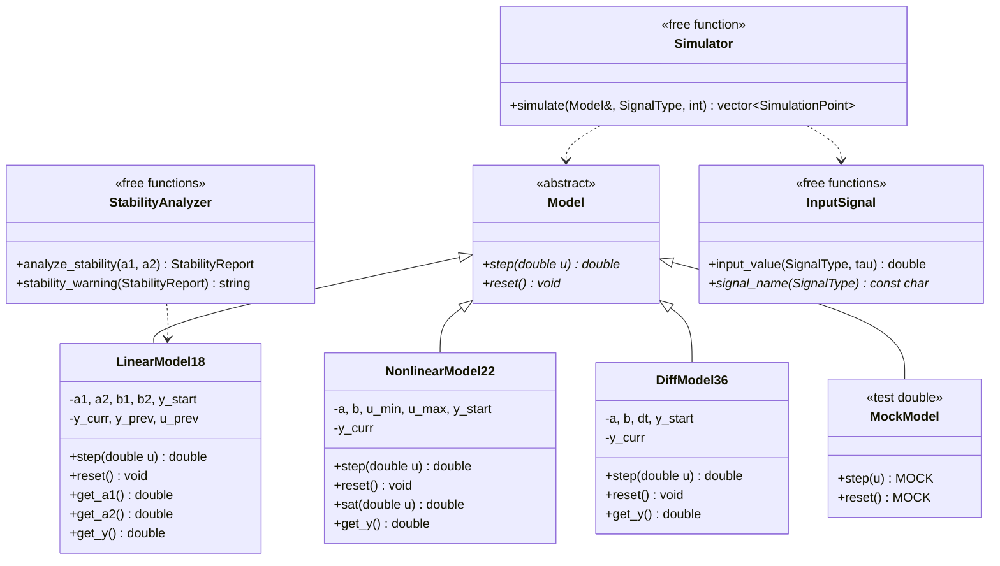

Министерство образования Республики Беларусь

Учреждение образования

“Брестский Государственный технический университет”

Кафедра ИИТ

       

Лабораторная работа №2

По дисциплине “Теория и моделирование автоматического управления”

Тема: “Модульное тестирование и анализ покрытия”

     

Выполнил:

Студент 3 курса

Группы АС-68

Хотько И.А.

Проверил:

Дворанинович Д. А.

     

Брест 2026

## Вариант 18

- Линейная модель: **Model 1.8** (обобщённая авторегрессионная)
- Нелинейная модель: **Model 2.2** (насыщение исполнительного механизма)
- Дифференциальное уравнение: **Model 3.6** (кубический рост, метод Эйлера)

## Цель работы

Расширить математический и функциональный базис программы ЛР №1, реализовать
модуль анализа устойчивости линейной модели и обеспечить надёжность
программы средствами модульного тестирования (Google Test / Google Mock)
с измерением покрытия кода (gcovr).

## Расширение базиса ЛР №1

1. **Модуль анализа устойчивости** (`stability_analyzer`): аналитическое
   определение устойчивости линейной модели 1.8 по корням характеристического
   уравнения на Z-плоскости; при неустойчивых коэффициентах программа
   выводит предупреждение в консоль **перед началом симуляции**.
2. **Начальные условия**: все модели принимают настраиваемое $y(0)$.
3. **Выделенный симулятор** (`simulate`): подача входного воздействия и сбор
   траектории вынесены из моделей — симулятор можно тестировать с
   mock-моделью.
4. **Интерактивный ввод с значениями по умолчанию**: пустой ввод выбирает
   значение по умолчанию, запятая автоматически заменяется на точку.

## Анализ устойчивости модели 1.8

Однородная часть уравнения $y_{\tau+1} = a_1 y_\tau + a_2 y_{\tau-1} + \ldots$
приводит к характеристическому уравнению:

$$z^2 - a_1 z - a_2 = 0$$

Дискриминант $D = a_1^2 + 4 a_2$ может быть отрицательным, поэтому корни
вычисляются в комплексной арифметике (`std::complex`):

$$z_{1,2} = \frac{a_1 \pm \sqrt{D}}{2}$$

**Критерий устойчивости (Z-плоскость):** процесс сходится тогда и только
тогда, когда оба корня лежат строго внутри единичной окружности:

$$|z_1| < 1 \wedge |z_2| < 1$$

Примеры (проверены тестами):

| Коэффициенты | Корни | Спектральный радиус | Вывод |
| :--- | :--- | :---: | :---: |
| $a_1=0.5,\ a_2=0.2$ | $0.762,\ -0.262$ | 0.762 | устойчив |
| $a_1=0.5,\ a_2=0.5$ | $1.0,\ -0.5$ | 1.0 | граница, не сходится |
| $a_1=1.5,\ a_2=0.5$ | $1.781,\ -0.281$ | 1.781 | расходится |
| $a_1=0,\ a_2=-0.5$ | $\pm 0.707i$ | 0.707 | устойчив (комплексные) |

## Архитектура и UML

## Стратегия тестирования

- **Параметризованные тесты (`TEST_P`)** — проверка сходимости модели 1.8 на
  четырёх наборах устойчивых коэффициентов, точные значения первых шагов для
  четырёх наборов, измельчение шага интегрирования Эйлера (0.1 → 0.05 → 0.01).
- **Mock-объекты (Google Mock)** — `MockModel` подменяет реальную модель при
  тестировании симулятора: проверяется число вызовов `step()`, вызов
  `reset()` и точная последовательность подаваемых воздействий.
- **Подмена входных сигналов** — ступенчатый, импульсный и гармонический
  входы проверяются как напрямую (`input_value`), так и через mock-модель.
- **Тесты граничных значений** нелинейности насыщения: $u = U_{\max}$,
  $u = U_{\min}$, внутри зоны и за границами.
- **Сверка с аналитическим решением**: для модели 3.6 при $u=0$ уравнение
  $\dot y = a y^3$ решается аналитически, $y(t) = y_0 / \sqrt{1 - 2 a y_0^2 t}$;
  метод Эйлера сходится к нему с ошибкой $O(\Delta t)$.
- **Инварианты**: при $u = 0$ и $y(0) = 0$ все модели остаются в состоянии
  покоя.

## Тестовое покрытие и результаты

* **Способ запуска:** локальный скрипт (`run_tests.bat`), Linux-эквивалент:
  `cmake -B build -DENABLE_COVERAGE=ON && cmake --build build && cd build && ctest && gcovr -r . -f ".*/src/.*" -e "_deps"`
* **Всего модульных тестов:** 52
* **Успешно пройденных тестов:** 52 / 52

| Набор тестов | Кол-во | Что проверяет |
| :--- | :---: | :--- |
| InputSignalTest | 4 | три типа входных воздействий, названия |
| LinearModel18Test | 5 | точные значения, reset, начальные условия |
| LinearModelStepSuite (TEST_P) | 4 | первые шаги для разных коэффициентов |
| LinearModelConvergenceSuite (TEST_P) | 4 | сходимость устойчивых процессов |
| NonlinearModel22Test | 5 | точные значения, инвариант покоя, насыщение |
| SaturationBoundarySuite (TEST_P) | 6 | граничные значения sat(u) |
| DiffModel36Test | 5 | шаг Эйлера, начальные условия, аналитика |
| EulerRefinementSuite (TEST_P) | 3 | порядок точности при измельчении dt |
| SimulatorTest (Google Mock) | 5 | вызовы step/reset, последовательности входов |
| StabilityTest | 6 | устойчивость/неустойчивость/граница/комплексные |
| StabilityWarningTest | 1 | текст предупреждения |
| CsvWriterTest | 4 | формат CSV, отказы при ошибках записи |

| Модуль / Файл | Покрытие строк | Покрытие ветвей | Статус |
| :--- | :---: | :---: | :---: |
| `linear_model.cpp` | 21/21 (100 %) | — | OK |
| `nonlinear_model.cpp` | 13/13 (100 %) | — | OK |
| `diff_model.cpp` | 11/11 (100 %) | — | OK |
| `stability_analyzer.cpp` | 22/22 (100 %) | 9/12 | OK |
| `csv_writer.cpp` | 11/11 (100 %) | 16/26 | OK |
| `simulator.cpp` | 9/10 (90 %) | 6/10 | OK |
| `input_signal.cpp` | 16/18 (88.9 %) | 8/10 | OK |
| `model.hpp` | 1/2 (50 %) | — | OK |
| **Итоговый результат** | **104/108 (96.3 %)** | | **Success** |

Пояснения:

- `input_signal.cpp` — две непокрытые строки это недостижимые
  `return`-заглушки после исчерпывающего `switch` по всем значениям
  перечисления `SignalType`.
- `main.cpp` (92 строки, интерактивный ввод-вывод) не входит в модульное
  покрытие и проверяется ручным запуском программы.

## Сборка и запуск

- Полная сборка с тестами и покрытием (Windows): `run_tests.bat`
  (конфигурирует CMake с `-DENABLE_COVERAGE=ON` при наличии MinGW,
  компилирует, запускает `ctest`, формирует отчёт `gcovr`).
- Сама программа (`task02_as06818_app`) также собирается корневым CMake
  репозитория автоматически.
- Google Test подключается через `FetchContent` (v1.14.0), интернет нужен
  только при первой конфигурации.

## Вывод

В ходе лабораторной работы программа ЛР №1 расширена модулем анализа
устойчивости: для линейной модели 1.8 выведено характеристическое уравнение
$z^2 - a_1 z - a_2 = 0$, устойчивость определяется по положению корней
относительно единичной окружности Z-плоскости, включая случай комплексных
корней; при неустойчивых коэффициентах программа выводит предупреждение
перед началом симуляции.

Реализовано 52 модульных теста (Google Test): параметризованные `TEST_P` для
проверки сходимости и порядка точности, mock-объекты Google Mock для
верификации работы симулятора с подменой входных сигналов, тесты граничных
значений нелинейности насыщения и сверки с аналитическим решением
дифференциального уравнения. Покрытие строк тестопригодной логики составило
**96.3 %** (gcovr); непокрытыми остались недостижимые защитные строки и
интерактивный `main.cpp`. Тестирование выявило и устранило ошибки в
собственных ручных расчётах ожидаемых значений — практическое подтверждение
ценности модульных тестов.
